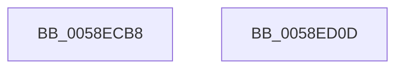

# VslProvisionDumpEncryption

- RVA: `0x0058ECB8`–`0x0058ED0E` (길이 `86` bytes)
- VA: `0x000000014058ECB8`
- 실행 섹션: `.text`
- PDB 이름 있음: `예`; PDB Function 태그: `아니요`
- unwind 정보 RVA: `0x000AA6F8`
- 디코드: `19`개 명령, `86/86` bytes 표시
- 미해석 바이트: `0` (있으면 어셈블리에 `.byte`로 보존)

> 이 문서는 커널 이미지의 기계어와 PDB 기호를 분석해 생성했습니다. 4번과 5번은 함수 원형과 자료형을 바이너리 사용 방식에서 추정한 C 해석이며 원본 소스 복구 결과는 아닙니다.

## 1. Dependencies

- 직접 호출 지점: **3**; 고유 호출 대상: **3**
- 직접 호출자로 확인된 함수: **1**
- RIP 상대 이미지 참조: **1**

### Outgoing calls
- `0x0058ECDC` → [memset](../6C/memset_function_006C6C40.md) (function, `0x006C6C40`)
- `0x0058ECF0` → [VslpEnterIumSecureMode](../23/VslpEnterIumSecureMode_function_00235E50.md) (function, `0x00235E50`)
- `0x0058ED00` → [_security_check_cookie](../6A/_security_check_cookie_function_006AC640.md) (function, `0x006AC640`)

### Direct callers
- [NtSetSystemInformation](../../page/AF/NtSetSystemInformation_function_00AF4A60.md) at `0x00AF63B9`

### Static image references
- `0x0058ECBF` → RVA `0x00E0A740` (`.data`; read)

## 2. Other-region calls and transfers

- 다른 실행 섹션으로 향하는 call: **0**
- 별도 외부 분기/꼬리 이동을 확인하지 못했습니다.

## 3. Assembly (complete function range)

```asm
0058ECB8  48 81 EC A8 00 00 00            sub rsp, 0xa8
0058ECBF  48 8B 05 7A BA 87 00            mov rax, qword ptr [rip + 0x87ba7a]
0058ECC6  48 33 C4                        xor rax, rsp
0058ECC9  48 89 84 24 90 00 00 00         mov qword ptr [rsp + 0x90], rax
0058ECD1  33 D2                           xor edx, edx
0058ECD3  48 8D 4C 24 20                  lea rcx, [rsp + 0x20]
0058ECD8  44 8D 42 68                     lea r8d, [rdx + 0x68]
0058ECDC  E8 5F 7F 13 00                  call 0x1406c6c40
0058ECE1  BA 4F 00 00 00                  mov edx, 0x4f
0058ECE6  4C 8D 4C 24 20                  lea r9, [rsp + 0x20]
0058ECEB  45 33 C0                        xor r8d, r8d
0058ECEE  B1 02                           mov cl, 2
0058ECF0  E8 5B 71 CA FF                  call 0x140235e50
0058ECF5  48 8B 8C 24 90 00 00 00         mov rcx, qword ptr [rsp + 0x90]
0058ECFD  48 33 CC                        xor rcx, rsp
0058ED00  E8 3B D9 11 00                  call 0x1406ac640
0058ED05  48 81 C4 A8 00 00 00            add rsp, 0xa8
0058ED0C  C3                              ret
0058ED0D  CC                              int3
```

## 4. C-style interpretation (structured pseudocode)

```c
__int64 __fastcall VslProvisionDumpEncryption(__int64 a1, int a2)
{
    __int64 result;
    __int64 v_rsp;
    unsigned __int64 v_stack_m18;
    unsigned __int64 v_stack_m88;

    v_rsp = (v_rsp) - (168);
    result = (*(unsigned __int64 *)(v_rip + 8895098)) ^ (v_rsp);
    v_stack_m18 = result;
    a2 = 0;
    result = memset(v_stack_m88, a2, a2 + 104, a4);
    a3 = 0;
    result = VslpEnterIumSecureMode(2, 79, a3, v_stack_m88);
    a1 = (v_stack_m18) ^ (v_rsp);
    result = _security_check_cookie(a1, 79, a3, v_stack_m88);
    v_rsp = (v_rsp) + (168);
    return result;
}
```

## 5. (Beta) C Style

```c
int64_t VslProvisionDumpEncryption(int64_t Arg1, int32_t Arg2)
{
    int64_t result;
    int64_t local_rsp;
    uint64_t v_stack_m18;
    uint64_t v_stack_m88;

    local_rsp = (local_rsp) - (168);
    result = (*(uint64_t *)(v_rip + 0x87BA7A)) ^ (local_rsp);
    v_stack_m18 = result;
    Arg2 = 0;
    result = memset(v_stack_m88, Arg2, Arg2 + 104, a4);
    a3 = 0;
    result = VslpEnterIumSecureMode(2, 79, a3, v_stack_m88);
    Arg1 = (v_stack_m18) ^ (local_rsp);
    result = _security_check_cookie(Arg1, 79, a3, v_stack_m88);
    local_rsp = (local_rsp) + (168);
    return result;
}
```

## 6. Execution-region graph

[열기: 2D/3D 그래프와 함수 탐색 컨트롤 패널](../../../control-panel.html?section=text&rva=0x0058ECB8&view=graph)

- 2D 그래프는 위에서 아래로 흐르고, 3D 그래프는 빈 공간을 드래그해 회전합니다. Shift+드래그는 이동, 휠은 확대·축소, 함수 노드 선택은 대상 보고서 이동입니다.

### Static fallback


