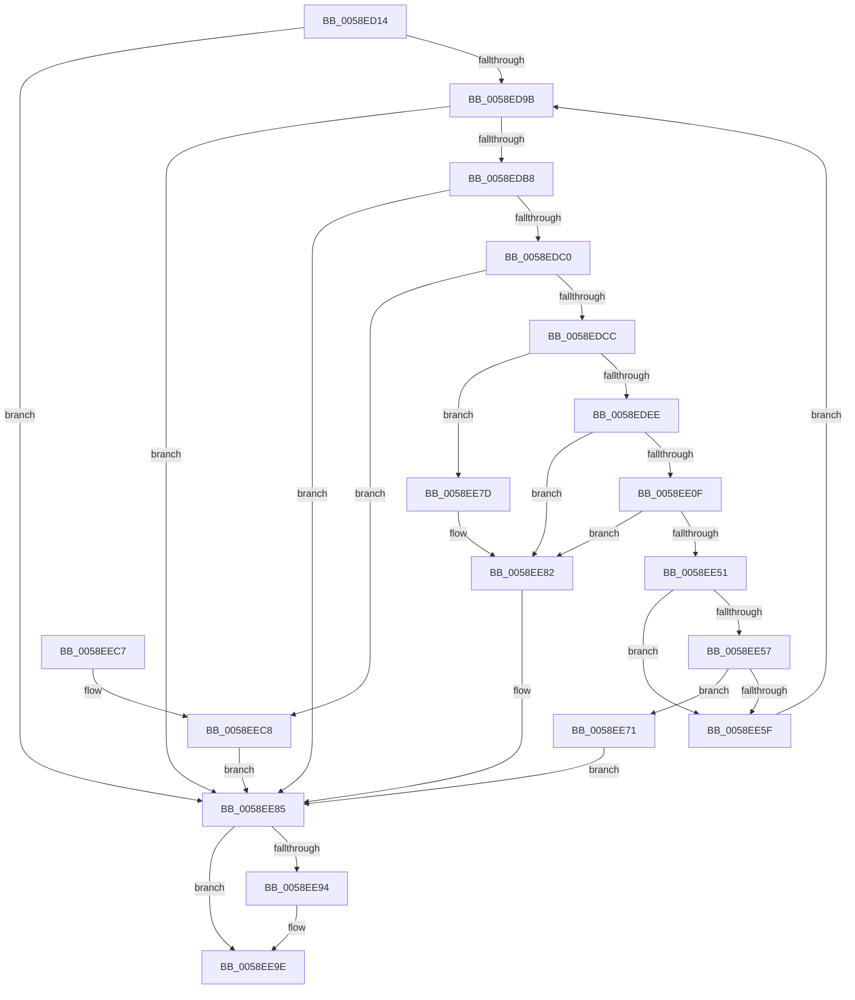

# VslQueryActiveSecurePatches

- RVA: `0x0058ED14`–`0x0058EECF` (길이 `443` bytes)
- VA: `0x000000014058ED14`
- 실행 섹션: `.text`
- PDB 이름 있음: `예`; PDB Function 태그: `아니요`
- unwind 정보 RVA: `0x000C6CE4`
- 디코드: `127`개 명령, `443/443` bytes 표시
- 미해석 바이트: `0` (있으면 어셈블리에 `.byte`로 보존)

> 이 문서는 커널 이미지의 기계어와 PDB 기호를 분석해 생성했습니다. 4번과 5번은 함수 원형과 자료형을 바이너리 사용 방식에서 추정한 C 해석이며 원본 소스 복구 결과는 아닙니다.

## 1. Dependencies

- 직접 호출 지점: **10**; 고유 호출 대상: **7**
- 직접 호출자로 확인된 함수: **2**
- RIP 상대 이미지 참조: **1**

### Outgoing calls
- `0x0058ED56` → [memset](../6C/memset_function_006C6C40.md) (function, `0x006C6C40`)
- `0x0058ED6F` → [memset](../6C/memset_function_006C6C40.md) (function, `0x006C6C40`)
- `0x0058ED8C` → [VslpEnterIumSecureMode](../23/VslpEnterIumSecureMode_function_00235E50.md) (function, `0x00235E50`)
- `0x0058EDDD` → [ExAllocatePool2](../../poolcode/B8/ExAllocatePool2_function_00B820F0.md) (function, `0x00B820F0`)
- `0x0058EE04` → [VslpLockPagesForTransfer](../29/VslpLockPagesForTransfer_function_0029E0FC.md) (function, `0x0029E0FC`)
- `0x0058EE3C` → [VslpEnterIumSecureMode](../23/VslpEnterIumSecureMode_function_00235E50.md) (function, `0x00235E50`)
- `0x0058EE48` → [VslpUnlockPagesForTransfer](../29/VslpUnlockPagesForTransfer_function_0029EE4C.md) (function, `0x0029EE4C`)
- `0x0058EE64` → [ExFreePoolWithTag](../../poolcode/B8/ExFreePoolWithTag_function_00B82870.md) (function, `0x00B82870`)
- `0x0058EE99` → [ExFreePoolWithTag](../../poolcode/B8/ExFreePoolWithTag_function_00B82870.md) (function, `0x00B82870`)
- `0x0058EEA7` → [_security_check_cookie](../6A/_security_check_cookie_function_006AC640.md) (function, `0x006AC640`)

### Direct callers
- [MiLogHotPatchRundown](../../page/80/MiLogHotPatchRundown_function_008057A4.md) at `0x00805E5F`
- [MiQueryProcessActivePatches](../../page/AC/MiQueryProcessActivePatches_function_00AC6164.md) at `0x00AC6373`

### Static image references
- `0x0058ED30` → RVA `0x00E0A740` (`.data`; read)

## 2. Other-region calls and transfers

- 다른 실행 섹션으로 향하는 call: **3**
  - `0x0058EDDD` → [ExAllocatePool2](../../poolcode/B8/ExAllocatePool2_function_00B820F0.md) (`.text` → `POOLCODE`)
  - `0x0058EE64` → [ExFreePoolWithTag](../../poolcode/B8/ExFreePoolWithTag_function_00B82870.md) (`.text` → `POOLCODE`)
  - `0x0058EE99` → [ExFreePoolWithTag](../../poolcode/B8/ExFreePoolWithTag_function_00B82870.md) (`.text` → `POOLCODE`)
- 별도 외부 분기/꼬리 이동을 확인하지 못했습니다.

## 3. Assembly (complete function range)

```asm
0058ED14  48 89 5C 24 08                  mov qword ptr [rsp + 8], rbx
0058ED19  55                              push rbp
0058ED1A  56                              push rsi
0058ED1B  57                              push rdi
0058ED1C  41 54                           push r12
0058ED1E  41 55                           push r13
0058ED20  41 56                           push r14
0058ED22  41 57                           push r15
0058ED24  48 8D 6C 24 F0                  lea rbp, [rsp - 0x10]
0058ED29  48 81 EC 10 01 00 00            sub rsp, 0x110
0058ED30  48 8B 05 09 BA 87 00            mov rax, qword ptr [rip + 0x87ba09]
0058ED37  48 33 C4                        xor rax, rsp
0058ED3A  48 89 45 00                     mov qword ptr [rbp], rax
0058ED3E  4C 8B E2                        mov r12, rdx
0058ED41  48 89 4C 24 30                  mov qword ptr [rsp + 0x30], rcx
0058ED46  33 D2                           xor edx, edx
0058ED48  4D 8B E8                        mov r13, r8
0058ED4B  48 8B F9                        mov rdi, rcx
0058ED4E  48 8D 4D 90                     lea rcx, [rbp - 0x70]
0058ED52  44 8D 42 68                     lea r8d, [rdx + 0x68]
0058ED56  E8 E5 7E 13 00                  call 0x1406c6c40
0058ED5B  45 33 FF                        xor r15d, r15d
0058ED5E  48 8D 4C 24 40                  lea rcx, [rsp + 0x40]
0058ED63  33 D2                           xor edx, edx
0058ED65  41 8B DF                        mov ebx, r15d
0058ED68  41 8B F7                        mov esi, r15d
0058ED6B  45 8D 47 48                     lea r8d, [r15 + 0x48]
0058ED6F  E8 CC 7E 13 00                  call 0x1406c6c40
0058ED74  0F 57 C0                        xorps xmm0, xmm0
0058ED77  48 89 7D 98                     mov qword ptr [rbp - 0x68], rdi
0058ED7B  41 8D 57 49                     lea edx, [r15 + 0x49]
0058ED7F  45 33 C0                        xor r8d, r8d
0058ED82  4C 8D 4D 90                     lea r9, [rbp - 0x70]
0058ED86  B1 02                           mov cl, 2
0058ED88  0F 11 45 A0                     movups xmmword ptr [rbp - 0x60], xmm0
0058ED8C  E8 BF 70 CA FF                  call 0x140235e50
0058ED91  8B F8                           mov edi, eax
0058ED93  85 C0                           test eax, eax
0058ED95  0F 88 EA 00 00 00               js 0x14058ee85
0058ED9B  44 8B 75 A0                     mov r14d, dword ptr [rbp - 0x60]
0058ED9F  45 8B C6                        mov r8d, r14d
0058EDA2  8B 75 A8                        mov esi, dword ptr [rbp - 0x58]
0058EDA5  41 8B CE                        mov ecx, r14d
0058EDA8  8B D6                           mov edx, esi
0058EDAA  41 8B C6                        mov eax, r14d
0058EDAD  49 8B DF                        mov rbx, r15
0058EDB0  85 C0                           test eax, eax
0058EDB2  0F 84 CD 00 00 00               je 0x14058ee85
0058EDB8  85 D2                           test edx, edx
0058EDBA  0F 84 C5 00 00 00               je 0x14058ee85
0058EDC0  81 F9 00 A0 1F 00               cmp ecx, 0x1fa000
0058EDC6  0F 87 FC 00 00 00               ja 0x14058eec8
0058EDCC  45 8B FE                        mov r15d, r14d
0058EDCF  41 B8 56 6D 73 54               mov r8d, 0x54736d56
0058EDD5  41 8B D7                        mov edx, r15d
0058EDD8  B9 40 00 00 00                  mov ecx, 0x40
0058EDDD  E8 0E 33 5F 00                  call 0x140b820f0
0058EDE2  48 8B D8                        mov rbx, rax
0058EDE5  48 85 C0                        test rax, rax
0058EDE8  0F 84 8F 00 00 00               je 0x14058ee7d
0058EDEE  83 64 24 20 00                  and dword ptr [rsp + 0x20], 0
0058EDF3  48 8D 4C 24 40                  lea rcx, [rsp + 0x40]
0058EDF8  41 B9 01 00 00 00               mov r9d, 1
0058EDFE  45 8B C6                        mov r8d, r14d
0058EE01  48 8B D0                        mov rdx, rax
0058EE04  E8 F3 F2 D0 FF                  call 0x14029e0fc
0058EE09  8B F8                           mov edi, eax
0058EE0B  85 C0                           test eax, eax
0058EE0D  78 73                           js 0x14058ee82
0058EE0F  48 8B 44 24 30                  mov rax, qword ptr [rsp + 0x30]
0058EE14  4C 8D 4D 90                     lea r9, [rbp - 0x70]
0058EE18  48 89 45 98                     mov qword ptr [rbp - 0x68], rax
0058EE1C  BA 49 00 00 00                  mov edx, 0x49
0058EE21  48 8B 44 24 40                  mov rax, qword ptr [rsp + 0x40]
0058EE26  45 33 C0                        xor r8d, r8d
0058EE29  48 89 45 A0                     mov qword ptr [rbp - 0x60], rax
0058EE2D  B1 02                           mov cl, 2
0058EE2F  48 8B 44 24 78                  mov rax, qword ptr [rsp + 0x78]
0058EE34  48 89 45 A8                     mov qword ptr [rbp - 0x58], rax
0058EE38  48 89 5D B0                     mov qword ptr [rbp - 0x50], rbx
0058EE3C  E8 0F 70 CA FF                  call 0x140235e50
0058EE41  48 8D 4C 24 40                  lea rcx, [rsp + 0x40]
0058EE46  8B F8                           mov edi, eax
0058EE48  E8 FF FF D0 FF                  call 0x14029ee4c
0058EE4D  85 FF                           test edi, edi
0058EE4F  78 31                           js 0x14058ee82
0058EE51  4C 3B 7D A0                     cmp r15, qword ptr [rbp - 0x60]
0058EE55  72 08                           jb 0x14058ee5f
0058EE57  8B C6                           mov eax, esi
0058EE59  48 3B 45 A8                     cmp rax, qword ptr [rbp - 0x58]
0058EE5D  73 12                           jae 0x14058ee71
0058EE5F  33 D2                           xor edx, edx
0058EE61  48 8B CB                        mov rcx, rbx
0058EE64  E8 07 3A 5F 00                  call 0x140b82870
0058EE69  45 33 FF                        xor r15d, r15d
0058EE6C  E9 2A FF FF FF                  jmp 0x14058ed9b
0058EE71  45 33 FF                        xor r15d, r15d
0058EE74  49 89 1C 24                     mov qword ptr [r12], rbx
0058EE78  41 8B DF                        mov ebx, r15d
0058EE7B  EB 08                           jmp 0x14058ee85
0058EE7D  BF 9A 00 00 C0                  mov edi, 0xc000009a
0058EE82  45 33 FF                        xor r15d, r15d
0058EE85  85 FF                           test edi, edi
0058EE87  41 0F 48 F7                     cmovs esi, r15d
0058EE8B  41 89 75 00                     mov dword ptr [r13], esi
0058EE8F  48 85 DB                        test rbx, rbx
0058EE92  74 0A                           je 0x14058ee9e
0058EE94  33 D2                           xor edx, edx
0058EE96  48 8B CB                        mov rcx, rbx
0058EE99  E8 D2 39 5F 00                  call 0x140b82870
0058EE9E  8B C7                           mov eax, edi
0058EEA0  48 8B 4D 00                     mov rcx, qword ptr [rbp]
0058EEA4  48 33 CC                        xor rcx, rsp
0058EEA7  E8 94 D7 11 00                  call 0x1406ac640
0058EEAC  48 8B 9C 24 50 01 00 00         mov rbx, qword ptr [rsp + 0x150]
0058EEB4  48 81 C4 10 01 00 00            add rsp, 0x110
0058EEBB  41 5F                           pop r15
0058EEBD  41 5E                           pop r14
0058EEBF  41 5D                           pop r13
0058EEC1  41 5C                           pop r12
0058EEC3  5F                              pop rdi
0058EEC4  5E                              pop rsi
0058EEC5  5D                              pop rbp
0058EEC6  C3                              ret
0058EEC7  CC                              int3
0058EEC8  BF 0D 00 00 C0                  mov edi, 0xc000000d
0058EECD  EB B6                           jmp 0x14058ee85
```

## 4. C-style interpretation (structured pseudocode)

```c
__int64 __fastcall VslQueryActiveSecurePatches(__int64 a1, __int64 a2, __int64 a3)
{
    __int64 result;
    __int64 v_r15;
    __int64 v_rsi;
    __int64 v_rsp;
    unsigned __int64 v_stack_m108;
    unsigned __int64 v_stack_m118;
    unsigned int v_stack_m128;
    unsigned __int64 v_stack_m48;
    unsigned __int64 v_stack_m98;
    unsigned int v_stack_mA0;
    unsigned __int64 v_stack_mA8;
    unsigned __int64 v_stack_mB0;
    unsigned __int64 v_stack_mB8;
    unsigned __int64 v_stack_mD0;
    unsigned __int64 v_stack_p8;

    v_stack_p8 = v_rbx;
    v_rsp = (v_rsp) - (272);
    result = (*(unsigned __int64 *)(v_rip + 8894985)) ^ (v_rsp);
    v_stack_m48 = result;
    v_stack_m118 = a1;
    a2 = 0;
    result = memset(v_stack_mB8, a2, a2 + 104, a4);
    v_r15 = 0;
    a2 = 0;
    result = memset(v_stack_m108, a2, v_r15 + 72, a4);
    v_stack_mB0 = a1;
    a3 = 0;
    v_stack_mA8 = v_xmm0;
    result = VslpEnterIumSecureMode(2, v_r15 + 73, a3, v_stack_mB8);
    if (sign_flag) goto loc_0058EE85;
loc_0058ED9B:
    if ((unsigned int)((unsigned int)((unsigned int)((unsigned int)(v_stack_mA8)))) == 0) goto loc_0058EE85;
    if ((unsigned int)((unsigned int)((unsigned int)((unsigned int)(v_stack_mA0)))) == 0) goto loc_0058EE85;
    if (((unsigned int)((unsigned int)((unsigned int)((unsigned int)(v_stack_mA8))))) > 0x1FA000ULL) goto loc_0058EEC8;
    result = ExAllocatePool2(64, (unsigned int)((unsigned int)((unsigned int)((unsigned int)((unsigned int)(v_stack_mA8))))), (unsigned int)(0x54736D56ULL), v_stack_mB8);
    if (result == 0) goto loc_0058EE7D;
    result = VslpLockPagesForTransfer(v_stack_m108, result, (unsigned int)((unsigned int)((unsigned int)(v_stack_mA8))), 1);
    if (sign_flag) goto loc_0058EE82;
    v_stack_mB0 = v_stack_m118;
    a3 = 0;
    v_stack_mA8 = v_stack_m108;
    v_stack_mA0 = v_stack_mD0;
    v_stack_m98 = result;
    result = VslpEnterIumSecureMode(2, 73, a3, v_stack_mB8);
    result = VslpUnlockPagesForTransfer(v_stack_m108, 73, a3, v_stack_mB8);
    if (sign_flag) goto loc_0058EE82;
    if (((unsigned int)((unsigned int)((unsigned int)(v_stack_mA8)))) < v_stack_mA8) goto loc_0058EE5F;
    if (((unsigned int)((unsigned int)((unsigned int)(v_stack_mA0)))) >= v_stack_mA0) goto loc_0058EE71;
loc_0058EE5F:
    a2 = 0;
    result = ExFreePoolWithTag(result, a2, a3, v_stack_mB8);
    v_r15 = 0;
    goto loc_0058ED9B;
loc_0058EE71:
    v_r15 = 0;
    *(unsigned __int64 *)(a2) = result;
    goto loc_0058EE85;
loc_0058EE7D:
loc_0058EE82:
    v_r15 = 0;
loc_0058EE85:
    v_rsi = (unsigned int)(v_stack_mA0);
    if (sign_flag) { v_rsi = 0; }
    *(unsigned int *)(a3) = (unsigned int)(v_rsi);
    if (0 != 0) {
        a2 = 0;
        a1 = 0;
        result = ExFreePoolWithTag(a1, a2, a3, v_stack_mB8);
    }
    a1 = (v_stack_m48) ^ (v_rsp);
    result = _security_check_cookie(a1, a2, a3, v_stack_mB8);
    v_rsp = (v_rsp) + (272);
    return result;
loc_0058EEC8:
    goto loc_0058EE85;
}
```

## 5. (Beta) C Style

```c
int64_t VslQueryActiveSecurePatches(int64_t Arg1, void *Arg2, void *Arg3)
{
    uint8_t *arg2 = (uint8_t *)Arg2;
    uint8_t *arg3 = (uint8_t *)Arg3;

    int64_t result;
    int64_t local_r15;
    int64_t local_rsi;
    int64_t local_rsp;
    uint64_t v_stack_m108;
    uint64_t v_stack_m118;
    uint32_t v_stack_m128;
    uint64_t v_stack_m48;
    uint64_t v_stack_m98;
    uint32_t v_stack_mA0;
    uint64_t v_stack_mA8;
    uint64_t v_stack_mB0;
    uint64_t v_stack_mB8;
    uint64_t v_stack_mD0;
    uint64_t v_stack_p8;

    v_stack_p8 = local_rbx;
    local_rsp = (local_rsp) - (272);
    result = (*(uint64_t *)(v_rip + 0x87BA09)) ^ (local_rsp);
    v_stack_m48 = result;
    v_stack_m118 = Arg1;
    Arg2 = 0;
    result = memset(v_stack_mB8, Arg2, Arg2 + 104, a4);
    local_r15 = 0;
    Arg2 = 0;
    result = memset(v_stack_m108, Arg2, local_r15 + 72, a4);
    v_stack_mB0 = Arg1;
    Arg3 = 0;
    v_stack_mA8 = v_xmm0;
    result = VslpEnterIumSecureMode(2, local_r15 + 73, Arg3, v_stack_mB8);
    if (sign_flag) goto loc_0058EE85;
loc_0058ED9B:
    if ((uint32_t)((uint32_t)((uint32_t)((uint32_t)(v_stack_mA8)))) == 0) goto loc_0058EE85;
    if ((uint32_t)((uint32_t)((uint32_t)((uint32_t)(v_stack_mA0)))) == 0) goto loc_0058EE85;
    if (((uint32_t)((uint32_t)((uint32_t)((uint32_t)(v_stack_mA8))))) > 0x1FA000ULL) goto loc_0058EEC8;
    result = ExAllocatePool2(64, (uint32_t)((uint32_t)((uint32_t)((uint32_t)((uint32_t)(v_stack_mA8))))), (uint32_t)(0x54736D56ULL), v_stack_mB8);
    if (result == 0) goto loc_0058EE7D;
    result = VslpLockPagesForTransfer(v_stack_m108, result, (uint32_t)((uint32_t)((uint32_t)(v_stack_mA8))), 1);
    if (sign_flag) goto loc_0058EE82;
    v_stack_mB0 = v_stack_m118;
    Arg3 = 0;
    v_stack_mA8 = v_stack_m108;
    v_stack_mA0 = v_stack_mD0;
    v_stack_m98 = result;
    result = VslpEnterIumSecureMode(2, 73, Arg3, v_stack_mB8);
    result = VslpUnlockPagesForTransfer(v_stack_m108, 73, Arg3, v_stack_mB8);
    if (sign_flag) goto loc_0058EE82;
    if (((uint32_t)((uint32_t)((uint32_t)(v_stack_mA8)))) < v_stack_mA8) goto loc_0058EE5F;
    if (((uint32_t)((uint32_t)((uint32_t)(v_stack_mA0)))) >= v_stack_mA0) goto loc_0058EE71;
loc_0058EE5F:
    Arg2 = 0;
    result = ExFreePoolWithTag(result, Arg2, Arg3, v_stack_mB8);
    local_r15 = 0;
    goto loc_0058ED9B;
loc_0058EE71:
    local_r15 = 0;
    *(uint64_t *)(arg2) = result;
    goto loc_0058EE85;
loc_0058EE7D:
loc_0058EE82:
    local_r15 = 0;
loc_0058EE85:
    local_rsi = (uint32_t)(v_stack_mA0);
    if (sign_flag) { local_rsi = 0; }
    *(uint32_t *)(arg3) = (uint32_t)(local_rsi);
    if (0 != 0) {
        Arg2 = 0;
        Arg1 = 0;
        result = ExFreePoolWithTag(Arg1, Arg2, Arg3, v_stack_mB8);
    }
    Arg1 = (v_stack_m48) ^ (local_rsp);
    result = _security_check_cookie(Arg1, Arg2, Arg3, v_stack_mB8);
    local_rsp = (local_rsp) + (272);
    return result;
loc_0058EEC8:
    goto loc_0058EE85;
}
```

### 관측된 메모리 오프셋

구조체 형식이 확인되지 않은 접근은 인자 기준의 오프셋으로만 기록했습니다.

| 기준 인자 | 오프셋 표현 | 폭 (bit) | 접근 |
|---|---:|---:|---|
| `Arg2` | `+ 0x0` | `64` | `W` |
| `Arg3` | `+ 0x0` | `32` | `W` |

## 6. Execution-region graph

[열기: 2D/3D 그래프와 함수 탐색 컨트롤 패널](../../../control-panel.html?section=text&rva=0x0058ED14&view=graph)

- 2D 그래프는 위에서 아래로 흐르고, 3D 그래프는 빈 공간을 드래그해 회전합니다. Shift+드래그는 이동, 휠은 확대·축소, 함수 노드 선택은 대상 보고서 이동입니다.

### Static fallback


