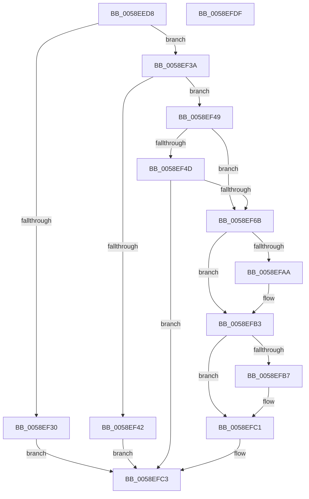

# VslQuerySecureKernelProfileInformation

- RVA: `0x0058EED8`–`0x0058EFE0` (길이 `264` bytes)
- VA: `0x000000014058EED8`
- 실행 섹션: `.text`
- PDB 이름 있음: `예`; PDB Function 태그: `아니요`
- unwind 정보 RVA: `0x000C6C8C`
- 디코드: `70`개 명령, `264/264` bytes 표시
- 미해석 바이트: `0` (있으면 어셈블리에 `.byte`로 보존)

> 이 문서는 커널 이미지의 기계어와 PDB 기호를 분석해 생성했습니다. 4번과 5번은 함수 원형과 자료형을 바이너리 사용 방식에서 추정한 C 해석이며 원본 소스 복구 결과는 아닙니다.

## 1. Dependencies

- 직접 호출 지점: **7**; 고유 호출 대상: **6**
- 직접 호출자로 확인된 함수: **1**
- RIP 상대 이미지 참조: **1**

### Outgoing calls
- `0x0058EF10` → [memset](../6C/memset_function_006C6C40.md) (function, `0x006C6C40`)
- `0x0058EF20` → [memset](../6C/memset_function_006C6C40.md) (function, `0x006C6C40`)
- `0x0058EF27` → [HvlQueryVsmConnection](../45/HvlQueryVsmConnection_function_0045D180.md) (function, `0x0045D180`)
- `0x0058EF62` → [VslpLockPagesForTransfer](../29/VslpLockPagesForTransfer_function_0029E0FC.md) (function, `0x0029E0FC`)
- `0x0058EF9F` → [VslpEnterIumSecureMode](../23/VslpEnterIumSecureMode_function_00235E50.md) (function, `0x00235E50`)
- `0x0058EFBC` → [VslpUnlockPagesForTransfer](../29/VslpUnlockPagesForTransfer_function_0029EE4C.md) (function, `0x0029EE4C`)
- `0x0058EFCE` → [_security_check_cookie](../6A/_security_check_cookie_function_006AC640.md) (function, `0x006AC640`)

### Direct callers
- [ExpQuerySystemInformation](../../page/A5/ExpQuerySystemInformation_function_00A57858.md) at `0x00A5A890`

### Static image references
- `0x0058EEE4` → RVA `0x00E0A740` (`.data`; read)

## 2. Other-region calls and transfers

- 다른 실행 섹션으로 향하는 call: **0**
- 별도 외부 분기/꼬리 이동을 확인하지 못했습니다.

## 3. Assembly (complete function range)

```asm
0058EED8  40 53                           push rbx
0058EEDA  55                              push rbp
0058EEDB  56                              push rsi
0058EEDC  57                              push rdi
0058EEDD  48 81 EC 08 01 00 00            sub rsp, 0x108
0058EEE4  48 8B 05 55 B8 87 00            mov rax, qword ptr [rip + 0x87b855]
0058EEEB  48 33 C4                        xor rax, rsp
0058EEEE  48 89 84 24 F0 00 00 00         mov qword ptr [rsp + 0xf0], rax
0058EEF6  48 8B FA                        mov rdi, rdx
0058EEF9  41 8B D8                        mov ebx, r8d
0058EEFC  33 D2                           xor edx, edx
0058EEFE  48 8B E9                        mov rbp, rcx
0058EF01  48 8D 8C 24 80 00 00 00         lea rcx, [rsp + 0x80]
0058EF09  49 8B F1                        mov rsi, r9
0058EF0C  44 8D 42 68                     lea r8d, [rdx + 0x68]
0058EF10  E8 2B 7D 13 00                  call 0x1406c6c40
0058EF15  33 D2                           xor edx, edx
0058EF17  48 8D 4C 24 30                  lea rcx, [rsp + 0x30]
0058EF1C  44 8D 42 48                     lea r8d, [rdx + 0x48]
0058EF20  E8 1B 7D 13 00                  call 0x1406c6c40
0058EF25  33 C9                           xor ecx, ecx
0058EF27  E8 54 E2 EC FF                  call 0x14045d180
0058EF2C  84 C0                           test al, al
0058EF2E  75 0A                           jne 0x14058ef3a
0058EF30  B8 1E 00 35 C0                  mov eax, 0xc035001e
0058EF35  E9 89 00 00 00                  jmp 0x14058efc3
0058EF3A  81 FB 00 A0 1F 00               cmp ebx, 0x1fa000
0058EF40  76 07                           jbe 0x14058ef49
0058EF42  B8 04 00 00 C0                  mov eax, 0xc0000004
0058EF47  EB 7A                           jmp 0x14058efc3
0058EF49  85 DB                           test ebx, ebx
0058EF4B  74 1E                           je 0x14058ef6b
0058EF4D  21 4C 24 20                     and dword ptr [rsp + 0x20], ecx
0058EF51  41 B9 02 00 00 00               mov r9d, 2
0058EF57  48 8D 4C 24 30                  lea rcx, [rsp + 0x30]
0058EF5C  44 8B C3                        mov r8d, ebx
0058EF5F  48 8B D7                        mov rdx, rdi
0058EF62  E8 95 F1 D0 FF                  call 0x14029e0fc
0058EF67  85 C0                           test eax, eax
0058EF69  78 58                           js 0x14058efc3
0058EF6B  48 8B 44 24 30                  mov rax, qword ptr [rsp + 0x30]
0058EF70  4C 8D 8C 24 80 00 00 00         lea r9, [rsp + 0x80]
0058EF78  48 89 84 24 90 00 00 00         mov qword ptr [rsp + 0x90], rax
0058EF80  BA 42 00 00 00                  mov edx, 0x42
0058EF85  48 8B 44 24 68                  mov rax, qword ptr [rsp + 0x68]
0058EF8A  45 33 C0                        xor r8d, r8d
0058EF8D  B1 02                           mov cl, 2
0058EF8F  48 89 84 24 98 00 00 00         mov qword ptr [rsp + 0x98], rax
0058EF97  48 89 AC 24 88 00 00 00         mov qword ptr [rsp + 0x88], rbp
0058EF9F  E8 AC 6E CA FF                  call 0x140235e50
0058EFA4  8B F8                           mov edi, eax
0058EFA6  85 C0                           test eax, eax
0058EFA8  78 09                           js 0x14058efb3
0058EFAA  8B 8C 24 90 00 00 00            mov ecx, dword ptr [rsp + 0x90]
0058EFB1  89 0E                           mov dword ptr [rsi], ecx
0058EFB3  85 DB                           test ebx, ebx
0058EFB5  74 0A                           je 0x14058efc1
0058EFB7  48 8D 4C 24 30                  lea rcx, [rsp + 0x30]
0058EFBC  E8 8B FE D0 FF                  call 0x14029ee4c
0058EFC1  8B C7                           mov eax, edi
0058EFC3  48 8B 8C 24 F0 00 00 00         mov rcx, qword ptr [rsp + 0xf0]
0058EFCB  48 33 CC                        xor rcx, rsp
0058EFCE  E8 6D D6 11 00                  call 0x1406ac640
0058EFD3  48 81 C4 08 01 00 00            add rsp, 0x108
0058EFDA  5F                              pop rdi
0058EFDB  5E                              pop rsi
0058EFDC  5D                              pop rbp
0058EFDD  5B                              pop rbx
0058EFDE  C3                              ret
0058EFDF  CC                              int3
```

## 4. C-style interpretation (structured pseudocode)

```c
__int64 __fastcall VslQuerySecureKernelProfileInformation(__int64 a1, __int64 a2, int a3, __int64 a4)
{
    __int64 result;
    __int64 v_rsp;
    unsigned int v_stack_m108;
    unsigned __int64 v_stack_m38;
    unsigned __int64 v_stack_m90;
    unsigned __int64 v_stack_m98;
    unsigned __int64 v_stack_mA0;
    unsigned __int64 v_stack_mA8;
    unsigned __int64 v_stack_mC0;
    unsigned __int64 v_stack_mF8;

    v_rsp = (v_rsp) - (264);
    result = (*(unsigned __int64 *)(v_rip + 8894549)) ^ (v_rsp);
    v_stack_m38 = result;
    a2 = 0;
    result = memset(v_stack_mA8, a2, a2 + 104, a4);
    a2 = 0;
    result = memset(v_stack_mF8, a2, a2 + 72, a4);
    a1 = 0;
    result = HvlQueryVsmConnection(a1, a2, a2 + 72, a4);
    if ((unsigned __int8)(result) != 0) goto loc_0058EF3A;
    goto loc_0058EFC3;
loc_0058EF3A:
    if (((unsigned int)((unsigned int)(a3))) <= 0x1FA000ULL) goto loc_0058EF49;
    goto loc_0058EFC3;
loc_0058EF49:
    if ((unsigned int)((unsigned int)(a3)) == 0) goto loc_0058EF6B;
    result = VslpLockPagesForTransfer(v_stack_mF8, 0, (unsigned int)((unsigned int)((unsigned int)(a3))), 2);
    if (sign_flag) goto loc_0058EFC3;
loc_0058EF6B:
    v_stack_m98 = v_stack_mF8;
    a3 = 0;
    v_stack_m90 = v_stack_mC0;
    v_stack_mA0 = 0;
    result = VslpEnterIumSecureMode(2, 66, a3, v_stack_mA8);
    if (!(sign_flag)) {
        a1 = v_stack_m98;
        *(unsigned int *)(a4) = (unsigned int)(a1);
    }
    if ((unsigned int)((unsigned int)(a3)) != 0) {
        a1 = v_stack_mF8;
        result = VslpUnlockPagesForTransfer(a1, 66, a3, v_stack_mA8);
    }
loc_0058EFC3:
    a1 = (v_stack_m38) ^ (v_rsp);
    result = _security_check_cookie(a1, 66, a3, v_stack_mA8);
    v_rsp = (v_rsp) + (264);
    return result;
}
```

## 5. (Beta) C Style

```c
int64_t VslQuerySecureKernelProfileInformation(int64_t Arg1, int64_t Arg2, int32_t Arg3, void *Arg4)
{
    uint8_t *arg4 = (uint8_t *)Arg4;

    int64_t result;
    int64_t local_rsp;
    uint32_t v_stack_m108;
    uint64_t v_stack_m38;
    uint64_t v_stack_m90;
    uint64_t v_stack_m98;
    uint64_t v_stack_mA0;
    uint64_t v_stack_mA8;
    uint64_t v_stack_mC0;
    uint64_t v_stack_mF8;

    local_rsp = (local_rsp) - (264);
    result = (*(uint64_t *)(v_rip + 0x87B855)) ^ (local_rsp);
    v_stack_m38 = result;
    Arg2 = 0;
    result = memset(v_stack_mA8, Arg2, Arg2 + 104, Arg4);
    Arg2 = 0;
    result = memset(v_stack_mF8, Arg2, Arg2 + 72, Arg4);
    Arg1 = 0;
    result = HvlQueryVsmConnection(Arg1, Arg2, Arg2 + 72, Arg4);
    if ((uint8_t)(result) != 0) goto loc_0058EF3A;
    goto loc_0058EFC3;
loc_0058EF3A:
    if (((uint32_t)((uint32_t)(Arg3))) <= 0x1FA000ULL) goto loc_0058EF49;
    goto loc_0058EFC3;
loc_0058EF49:
    if ((uint32_t)((uint32_t)(Arg3)) == 0) goto loc_0058EF6B;
    result = VslpLockPagesForTransfer(v_stack_mF8, 0, (uint32_t)((uint32_t)((uint32_t)(Arg3))), 2);
    if (sign_flag) goto loc_0058EFC3;
loc_0058EF6B:
    v_stack_m98 = v_stack_mF8;
    Arg3 = 0;
    v_stack_m90 = v_stack_mC0;
    v_stack_mA0 = 0;
    result = VslpEnterIumSecureMode(2, 66, Arg3, v_stack_mA8);
    if (!(sign_flag)) {
        Arg1 = v_stack_m98;
        *(uint32_t *)(arg4) = (uint32_t)(Arg1);
    }
    if ((uint32_t)((uint32_t)(Arg3)) != 0) {
        Arg1 = v_stack_mF8;
        result = VslpUnlockPagesForTransfer(Arg1, 66, Arg3, v_stack_mA8);
    }
loc_0058EFC3:
    Arg1 = (v_stack_m38) ^ (local_rsp);
    result = _security_check_cookie(Arg1, 66, Arg3, v_stack_mA8);
    local_rsp = (local_rsp) + (264);
    return result;
}
```

### 관측된 메모리 오프셋

구조체 형식이 확인되지 않은 접근은 인자 기준의 오프셋으로만 기록했습니다.

| 기준 인자 | 오프셋 표현 | 폭 (bit) | 접근 |
|---|---:|---:|---|
| `Arg4` | `+ 0x0` | `32` | `W` |

## 6. Execution-region graph

[열기: 2D/3D 그래프와 함수 탐색 컨트롤 패널](../../../control-panel.html?section=text&rva=0x0058EED8&view=graph)

- 2D 그래프는 위에서 아래로 흐르고, 3D 그래프는 빈 공간을 드래그해 회전합니다. Shift+드래그는 이동, 휠은 확대·축소, 함수 노드 선택은 대상 보고서 이동입니다.

### Static fallback


