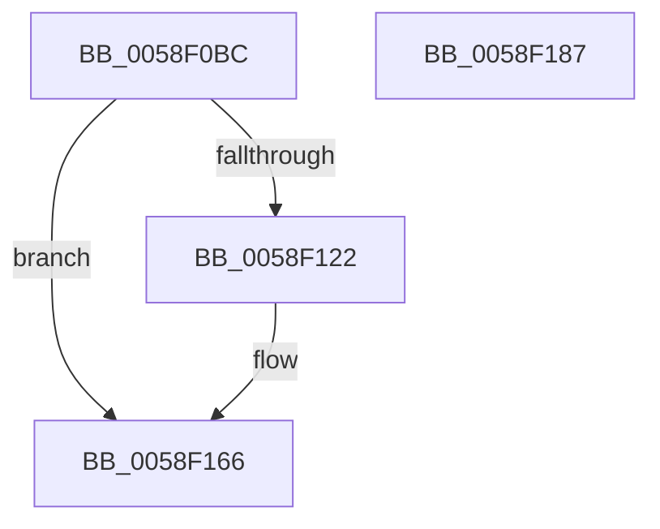

# VslRegisterSecurePatch

- RVA: `0x0058F0BC`–`0x0058F188` (길이 `204` bytes)
- VA: `0x000000014058F0BC`
- 실행 섹션: `.text`
- PDB 이름 있음: `예`; PDB Function 태그: `아니요`
- unwind 정보 RVA: `0x000C6D0C`
- 디코드: `55`개 명령, `204/204` bytes 표시
- 미해석 바이트: `0` (있으면 어셈블리에 `.byte`로 보존)

> 이 문서는 커널 이미지의 기계어와 PDB 기호를 분석해 생성했습니다. 4번과 5번은 함수 원형과 자료형을 바이너리 사용 방식에서 추정한 C 해석이며 원본 소스 복구 결과는 아닙니다.

## 1. Dependencies

- 직접 호출 지점: **6**; 고유 호출 대상: **5**
- 직접 호출자로 확인된 함수: **1**
- RIP 상대 이미지 참조: **1**

### Outgoing calls
- `0x0058F0F1` → [memset](../6C/memset_function_006C6C40.md) (function, `0x006C6C40`)
- `0x0058F100` → [memset](../6C/memset_function_006C6C40.md) (function, `0x006C6C40`)
- `0x0058F119` → [VslpLockPagesForTransfer](../29/VslpLockPagesForTransfer_function_0029E0FC.md) (function, `0x0029E0FC`)
- `0x0058F154` → [VslpEnterIumSecureMode](../23/VslpEnterIumSecureMode_function_00235E50.md) (function, `0x00235E50`)
- `0x0058F15F` → [VslpUnlockPagesForTransfer](../29/VslpUnlockPagesForTransfer_function_0029EE4C.md) (function, `0x0029EE4C`)
- `0x0058F16D` → [_security_check_cookie](../6A/_security_check_cookie_function_006AC640.md) (function, `0x006AC640`)

### Direct callers
- [MiLoadHotPatch](../../page/AB/MiLoadHotPatch_function_00AB521C.md) at `0x00AB539C`

### Static image references
- `0x0058F0D3` → RVA `0x00E0A740` (`.data`; read)

## 2. Other-region calls and transfers

- 다른 실행 섹션으로 향하는 call: **0**
- 별도 외부 분기/꼬리 이동을 확인하지 못했습니다.

## 3. Assembly (complete function range)

```asm
0058F0BC  48 89 5C 24 08                  mov qword ptr [rsp + 8], rbx
0058F0C1  48 89 7C 24 18                  mov qword ptr [rsp + 0x18], rdi
0058F0C6  55                              push rbp
0058F0C7  48 8D 6C 24 A9                  lea rbp, [rsp - 0x57]
0058F0CC  48 81 EC 00 01 00 00            sub rsp, 0x100
0058F0D3  48 8B 05 66 B6 87 00            mov rax, qword ptr [rip + 0x87b666]
0058F0DA  48 33 C4                        xor rax, rsp
0058F0DD  48 89 45 47                     mov qword ptr [rbp + 0x47], rax
0058F0E1  48 8B DA                        mov rbx, rdx
0058F0E4  48 8B F9                        mov rdi, rcx
0058F0E7  33 D2                           xor edx, edx
0058F0E9  48 8D 4D D7                     lea rcx, [rbp - 0x29]
0058F0ED  44 8D 42 68                     lea r8d, [rdx + 0x68]
0058F0F1  E8 4A 7B 13 00                  call 0x1406c6c40
0058F0F6  33 D2                           xor edx, edx
0058F0F8  48 8D 4D 87                     lea rcx, [rbp - 0x79]
0058F0FC  44 8D 42 48                     lea r8d, [rdx + 0x48]
0058F100  E8 3B 7B 13 00                  call 0x1406c6c40
0058F105  44 0F B7 03                     movzx r8d, word ptr [rbx]
0058F109  48 8D 4D 87                     lea rcx, [rbp - 0x79]
0058F10D  48 8B 53 08                     mov rdx, qword ptr [rbx + 8]
0058F111  45 33 C9                        xor r9d, r9d
0058F114  83 64 24 20 00                  and dword ptr [rsp + 0x20], 0
0058F119  E8 DE EF D0 FF                  call 0x14029e0fc
0058F11E  85 C0                           test eax, eax
0058F120  78 44                           js 0x14058f166
0058F122  8B 07                           mov eax, dword ptr [rdi]
0058F124  4C 8D 4D D7                     lea r9, [rbp - 0x29]
0058F128  48 89 45 DF                     mov qword ptr [rbp - 0x21], rax
0058F12C  BA 48 00 00 00                  mov edx, 0x48
0058F131  8B 47 04                        mov eax, dword ptr [rdi + 4]
0058F134  45 33 C0                        xor r8d, r8d
0058F137  48 89 45 E7                     mov qword ptr [rbp - 0x19], rax
0058F13B  B1 02                           mov cl, 2
0058F13D  8B 47 18                        mov eax, dword ptr [rdi + 0x18]
0058F140  48 89 45 EF                     mov qword ptr [rbp - 0x11], rax
0058F144  48 8B 45 87                     mov rax, qword ptr [rbp - 0x79]
0058F148  48 89 45 F7                     mov qword ptr [rbp - 9], rax
0058F14C  48 8B 45 BF                     mov rax, qword ptr [rbp - 0x41]
0058F150  48 89 45 FF                     mov qword ptr [rbp - 1], rax
0058F154  E8 F7 6C CA FF                  call 0x140235e50
0058F159  48 8D 4D 87                     lea rcx, [rbp - 0x79]
0058F15D  8B D8                           mov ebx, eax
0058F15F  E8 E8 FC D0 FF                  call 0x14029ee4c
0058F164  8B C3                           mov eax, ebx
0058F166  48 8B 4D 47                     mov rcx, qword ptr [rbp + 0x47]
0058F16A  48 33 CC                        xor rcx, rsp
0058F16D  E8 CE D4 11 00                  call 0x1406ac640
0058F172  4C 8D 9C 24 00 01 00 00         lea r11, [rsp + 0x100]
0058F17A  49 8B 5B 10                     mov rbx, qword ptr [r11 + 0x10]
0058F17E  49 8B 7B 20                     mov rdi, qword ptr [r11 + 0x20]
0058F182  49 8B E3                        mov rsp, r11
0058F185  5D                              pop rbp
0058F186  C3                              ret
0058F187  CC                              int3
```

## 4. C-style interpretation (structured pseudocode)

```c
__int64 __fastcall VslRegisterSecurePatch(__int64 a1, __int64 a2, __int64 a3, int a4)
{
    __int64 result;
    __int64 v_rbx;
    __int64 v_rsp;
    unsigned __int64 v_stack_m18;
    unsigned __int64 v_stack_m5F;
    unsigned __int64 v_stack_m60;
    unsigned __int64 v_stack_m68;
    unsigned __int64 v_stack_m70;
    unsigned __int64 v_stack_m78;
    unsigned __int64 v_stack_m8;
    unsigned __int64 v_stack_m80;
    unsigned __int64 v_stack_m88;
    unsigned __int64 v_stack_mA0;
    unsigned __int64 v_stack_mD8;
    unsigned int v_stack_mE8;
    unsigned __int64 v_stack_p18;
    unsigned __int64 v_stack_p8;

    v_stack_p8 = v_rbx;
    v_stack_p18 = v_rdi;
    v_rsp = (v_rsp) - (256);
    result = (*(unsigned __int64 *)(v_rip + 8894054)) ^ (v_rsp);
    v_stack_m18 = result;
    a2 = 0;
    result = memset(v_stack_m88, a2, a2 + 104, a4);
    a2 = 0;
    result = memset(v_stack_mD8, a2, a2 + 72, a4);
    a4 = 0;
    result = VslpLockPagesForTransfer(v_stack_mD8, *(unsigned __int64 *)(a2 + 8), *(unsigned __int16 *)(a2), a4);
    v_rbx = a2;
    if (!(sign_flag)) {
        result = *(unsigned int *)(a1);
        a4 = v_stack_m88;
        v_stack_m80 = result;
        a2 = 72;
        result = *(unsigned int *)(a1 + 4);
        a3 = 0;
        v_stack_m78 = result;
        a1 = 2;
        result = *(unsigned int *)(a1 + 24);
        v_stack_m70 = result;
        result = v_stack_mD8;
        v_stack_m68 = result;
        result = v_stack_mA0;
        v_stack_m60 = result;
        result = VslpEnterIumSecureMode(a1, a2, a3, a4);
        a1 = v_stack_mD8;
        v_rbx = (unsigned int)(result);
        result = VslpUnlockPagesForTransfer(a1, a2, a3, a4);
        result = (unsigned int)(v_rbx);
    }
    a1 = (v_stack_m18) ^ (v_rsp);
    result = _security_check_cookie(a1, a2, a3, a4);
    return result;
}
```

## 5. (Beta) C Style

```c
int64_t VslRegisterSecurePatch(void *Arg1, void *Arg2, int64_t Arg3, int32_t Arg4)
{
    uint8_t *arg1 = (uint8_t *)Arg1;
    uint8_t *arg2 = (uint8_t *)Arg2;

    int64_t result;
    int64_t local_rbx;
    int64_t local_rsp;
    uint64_t v_stack_m18;
    uint64_t v_stack_m5F;
    uint64_t v_stack_m60;
    uint64_t v_stack_m68;
    uint64_t v_stack_m70;
    uint64_t v_stack_m78;
    uint64_t v_stack_m8;
    uint64_t v_stack_m80;
    uint64_t v_stack_m88;
    uint64_t v_stack_mA0;
    uint64_t v_stack_mD8;
    uint32_t v_stack_mE8;
    uint64_t v_stack_p18;
    uint64_t v_stack_p8;

    v_stack_p8 = local_rbx;
    v_stack_p18 = local_rdi;
    local_rsp = (local_rsp) - (256);
    result = (*(uint64_t *)(v_rip + 0x87B666)) ^ (local_rsp);
    v_stack_m18 = result;
    Arg2 = 0;
    result = memset(v_stack_m88, Arg2, Arg2 + 104, Arg4);
    Arg2 = 0;
    result = memset(v_stack_mD8, Arg2, Arg2 + 72, Arg4);
    Arg4 = 0;
    result = VslpLockPagesForTransfer(v_stack_mD8, *(uint64_t *)(arg2 + 0x8), *(uint16_t *)(arg2), Arg4);
    local_rbx = Arg2;
    if (!(sign_flag)) {
        result = *(uint32_t *)(arg1);
        Arg4 = v_stack_m88;
        v_stack_m80 = result;
        Arg2 = 72;
        result = *(uint32_t *)(arg1 + 0x4);
        Arg3 = 0;
        v_stack_m78 = result;
        Arg1 = 2;
        result = *(uint32_t *)(arg1 + 0x18);
        v_stack_m70 = result;
        result = v_stack_mD8;
        v_stack_m68 = result;
        result = v_stack_mA0;
        v_stack_m60 = result;
        result = VslpEnterIumSecureMode(Arg1, Arg2, Arg3, Arg4);
        Arg1 = v_stack_mD8;
        local_rbx = (uint32_t)(result);
        result = VslpUnlockPagesForTransfer(Arg1, Arg2, Arg3, Arg4);
        result = (uint32_t)(local_rbx);
    }
    Arg1 = (v_stack_m18) ^ (local_rsp);
    result = _security_check_cookie(Arg1, Arg2, Arg3, Arg4);
    return result;
}
```

### 관측된 메모리 오프셋

구조체 형식이 확인되지 않은 접근은 인자 기준의 오프셋으로만 기록했습니다.

| 기준 인자 | 오프셋 표현 | 폭 (bit) | 접근 |
|---|---:|---:|---|
| `Arg1` | `+ 0x0` | `32` | `R` |
| `Arg1` | `+ 0x4` | `32` | `R` |
| `Arg1` | `+ 0x18` | `32` | `R` |
| `Arg2` | `+ 0x0` | `16` | `R` |
| `Arg2` | `+ 0x8` | `64` | `R` |

## 6. Execution-region graph

[열기: 2D/3D 그래프와 함수 탐색 컨트롤 패널](../../../control-panel.html?section=text&rva=0x0058F0BC&view=graph)

- 2D 그래프는 위에서 아래로 흐르고, 3D 그래프는 빈 공간을 드래그해 회전합니다. Shift+드래그는 이동, 휠은 확대·축소, 함수 노드 선택은 대상 보고서 이동입니다.

### Static fallback


