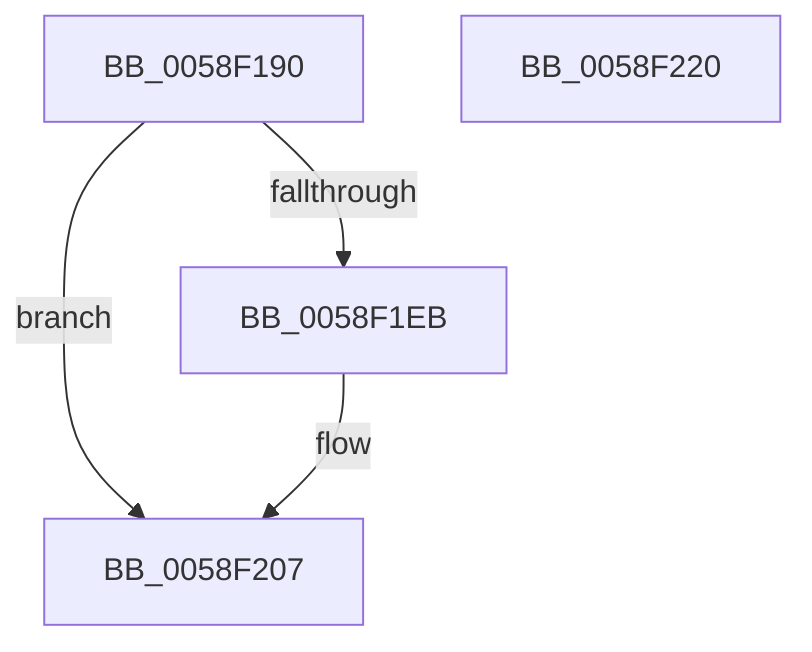

# VslRegisterSecureSystemProcess

- RVA: `0x0058F190`–`0x0058F221` (길이 `145` bytes)
- VA: `0x000000014058F190`
- 실행 섹션: `.text`
- PDB 이름 있음: `예`; PDB Function 태그: `아니요`
- unwind 정보 RVA: `0x000AF554`
- 디코드: `32`개 명령, `145/145` bytes 표시
- 미해석 바이트: `0` (있으면 어셈블리에 `.byte`로 보존)

> 이 문서는 커널 이미지의 기계어와 PDB 기호를 분석해 생성했습니다. 4번과 5번은 함수 원형과 자료형을 바이너리 사용 방식에서 추정한 C 해석이며 원본 소스 복구 결과는 아닙니다.

## 1. Dependencies

- 직접 호출 지점: **3**; 고유 호출 대상: **3**
- 직접 호출자로 확인된 함수: **1**
- RIP 상대 이미지 참조: **2**

### Outgoing calls
- `0x0058F1BD` → [memset](../6C/memset_function_006C6C40.md) (function, `0x006C6C40`)
- `0x0058F1E2` → [VslpEnterIumSecureMode](../23/VslpEnterIumSecureMode_function_00235E50.md) (function, `0x00235E50`)
- `0x0058F212` → [_security_check_cookie](../6A/_security_check_cookie_function_006AC640.md) (function, `0x006AC640`)

### Direct callers
- [PspCreateSecureSystemProcess](../../init/C4/PspCreateSecureSystemProcess_function_00C452E4.md) at `0x00C45398`

### Static image references
- `0x0058F199` → RVA `0x00E0A740` (`.data`; read)
- `0x0058F1AB` → RVA `0x00FC6CB8` (`ALMOSTRO`; read)

## 2. Other-region calls and transfers

- 다른 실행 섹션으로 향하는 call: **0**
- 별도 외부 분기/꼬리 이동을 확인하지 못했습니다.

## 3. Assembly (complete function range)

```asm
0058F190  40 53                           push rbx
0058F192  48 81 EC A0 00 00 00            sub rsp, 0xa0
0058F199  48 8B 05 A0 B5 87 00            mov rax, qword ptr [rip + 0x87b5a0]
0058F1A0  48 33 C4                        xor rax, rsp
0058F1A3  48 89 84 24 90 00 00 00         mov qword ptr [rsp + 0x90], rax
0058F1AB  48 8B 1D 06 7B A3 00            mov rbx, qword ptr [rip + 0xa37b06]
0058F1B2  48 8D 4C 24 20                  lea rcx, [rsp + 0x20]
0058F1B7  33 D2                           xor edx, edx
0058F1B9  44 8D 42 68                     lea r8d, [rdx + 0x68]
0058F1BD  E8 7E 7A 13 00                  call 0x1406c6c40
0058F1C2  48 8B 83 D0 01 00 00            mov rax, qword ptr [rbx + 0x1d0]
0058F1C9  4C 8D 4C 24 20                  lea r9, [rsp + 0x20]
0058F1CE  BA 05 00 00 00                  mov edx, 5
0058F1D3  48 89 44 24 28                  mov qword ptr [rsp + 0x28], rax
0058F1D8  45 33 C0                        xor r8d, r8d
0058F1DB  48 89 5C 24 30                  mov qword ptr [rsp + 0x30], rbx
0058F1E0  B1 02                           mov cl, 2
0058F1E2  E8 69 6C CA FF                  call 0x140235e50
0058F1E7  85 C0                           test eax, eax
0058F1E9  78 1C                           js 0x14058f207
0058F1EB  48 8B 4C 24 38                  mov rcx, qword ptr [rsp + 0x38]
0058F1F0  48 89 8B 70 01 00 00            mov qword ptr [rbx + 0x170], rcx
0058F1F7  48 8B 4C 24 38                  mov rcx, qword ptr [rsp + 0x38]
0058F1FC  48 83 C9 01                     or rcx, 1
0058F200  48 89 8B 70 01 00 00            mov qword ptr [rbx + 0x170], rcx
0058F207  48 8B 8C 24 90 00 00 00         mov rcx, qword ptr [rsp + 0x90]
0058F20F  48 33 CC                        xor rcx, rsp
0058F212  E8 29 D4 11 00                  call 0x1406ac640
0058F217  48 81 C4 A0 00 00 00            add rsp, 0xa0
0058F21E  5B                              pop rbx
0058F21F  C3                              ret
0058F220  CC                              int3
```

## 4. C-style interpretation (structured pseudocode)

```c
__int64 __fastcall VslRegisterSecureSystemProcess(__int64 a1, int a2)
{
    __int64 result;
    __int64 v_rsp;
    unsigned __int64 v_stack_m18;
    unsigned __int64 v_stack_m70;
    unsigned __int64 v_stack_m78;
    unsigned __int64 v_stack_m80;
    unsigned __int64 v_stack_m88;

    v_rsp = (v_rsp) - (160);
    result = (*(unsigned __int64 *)(v_rip + 8893856)) ^ (v_rsp);
    v_stack_m18 = result;
    a2 = 0;
    result = memset(v_stack_m88, a2, a2 + 104, a4);
    v_stack_m80 = *(unsigned __int64 *)(*(unsigned __int64 *)(v_rip + 10713862) + 464);
    a3 = 0;
    v_stack_m78 = *(unsigned __int64 *)(v_rip + 10713862);
    result = VslpEnterIumSecureMode(2, 5, a3, v_stack_m88);
    if (!(sign_flag)) {
        a1 = v_stack_m70;
        *(unsigned __int64 *)(*(unsigned __int64 *)(v_rip + 10713862) + 368) = a1;
        a1 = v_stack_m70;
        a1 = (a1) | (1);
        *(unsigned __int64 *)(*(unsigned __int64 *)(v_rip + 10713862) + 368) = a1;
    }
    a1 = (v_stack_m18) ^ (v_rsp);
    result = _security_check_cookie(a1, 5, a3, v_stack_m88);
    v_rsp = (v_rsp) + (160);
    return result;
}
```

## 5. (Beta) C Style

```c
int64_t VslRegisterSecureSystemProcess(int64_t Arg1, int32_t Arg2)
{
    int64_t result;
    int64_t local_rsp;
    uint64_t v_stack_m18;
    uint64_t v_stack_m70;
    uint64_t v_stack_m78;
    uint64_t v_stack_m80;
    uint64_t v_stack_m88;

    local_rsp = (local_rsp) - (160);
    result = (*(uint64_t *)(v_rip + 0x87B5A0)) ^ (local_rsp);
    v_stack_m18 = result;
    Arg2 = 0;
    result = memset(v_stack_m88, Arg2, Arg2 + 104, a4);
    v_stack_m80 = *(uint64_t *)(*(uint64_t *)(v_rip + 0xA37B06) + 0x1D0);
    a3 = 0;
    v_stack_m78 = *(uint64_t *)(v_rip + 0xA37B06);
    result = VslpEnterIumSecureMode(2, 5, a3, v_stack_m88);
    if (!(sign_flag)) {
        Arg1 = v_stack_m70;
        *(uint64_t *)(*(uint64_t *)(v_rip + 0xA37B06) + 0x170) = Arg1;
        Arg1 = v_stack_m70;
        Arg1 = (Arg1) | (1);
        *(uint64_t *)(*(uint64_t *)(v_rip + 0xA37B06) + 0x170) = Arg1;
    }
    Arg1 = (v_stack_m18) ^ (local_rsp);
    result = _security_check_cookie(Arg1, 5, a3, v_stack_m88);
    local_rsp = (local_rsp) + (160);
    return result;
}
```

## 6. Execution-region graph

[열기: 2D/3D 그래프와 함수 탐색 컨트롤 패널](../../../control-panel.html?section=text&rva=0x0058F190&view=graph)

- 2D 그래프는 위에서 아래로 흐르고, 3D 그래프는 빈 공간을 드래그해 회전합니다. Shift+드래그는 이동, 휠은 확대·축소, 함수 노드 선택은 대상 보고서 이동입니다.

### Static fallback


