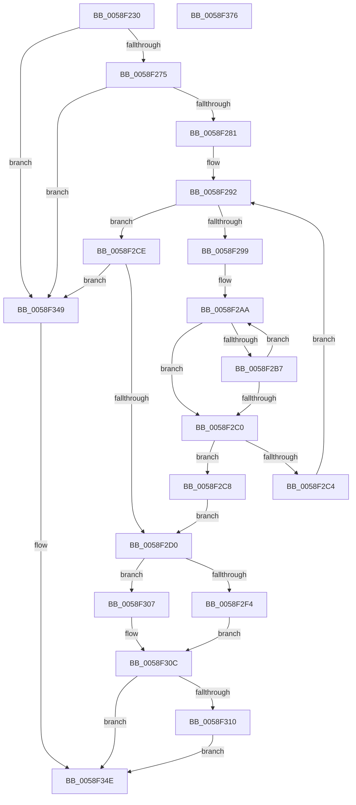

# VslReportBugCheckProgress

- RVA: `0x0058F230`–`0x0058F377` (길이 `327` bytes)
- VA: `0x000000014058F230`
- 실행 섹션: `.text`
- PDB 이름 있음: `예`; PDB Function 태그: `아니요`
- unwind 정보 RVA: `0x000C6C24`
- 디코드: `96`개 명령, `327/327` bytes 표시
- 미해석 바이트: `0` (있으면 어셈블리에 `.byte`로 보존)

> 이 문서는 커널 이미지의 기계어와 PDB 기호를 분석해 생성했습니다. 4번과 5번은 함수 원형과 자료형을 바이너리 사용 방식에서 추정한 C 해석이며 원본 소스 복구 결과는 아닙니다.

## 1. Dependencies

- 직접 호출 지점: **5**; 고유 호출 대상: **4**
- 직접 호출자로 확인된 함수: **1**
- RIP 상대 이미지 참조: **2**

### Outgoing calls
- `0x0058F28B` → [memset](../6C/memset_function_006C6C40.md) (function, `0x006C6C40`)
- `0x0058F300` → [VslpEnterIumSecureMode](../23/VslpEnterIumSecureMode_function_00235E50.md) (function, `0x00235E50`)
- `0x0058F31A` → [memcpy](../6C/memcpy_function_006C6840.md) (function, `0x006C6840`)
- `0x0058F342` → [VslpEnterIumSecureMode](../23/VslpEnterIumSecureMode_function_00235E50.md) (function, `0x00235E50`)
- `0x0058F355` → [_security_check_cookie](../6A/_security_check_cookie_function_006AC640.md) (function, `0x006AC640`)

### Direct callers
- [PopCheckpointSystemSleepUnsafe](../../pagelk/B7/PopCheckpointSystemSleepUnsafe_function_00B71950.md) at `0x00B71996`

### Static image references
- `0x0058F24E` → RVA `0x00E0A740` (`.data`; read)
- `0x0058F299` → RVA `0x00E06D30` (`.data`; read)

## 2. Other-region calls and transfers

- 다른 실행 섹션으로 향하는 call: **0**
- 별도 외부 분기/꼬리 이동을 확인하지 못했습니다.

## 3. Assembly (complete function range)

```asm
0058F230  48 89 5C 24 08                  mov qword ptr [rsp + 8], rbx
0058F235  48 89 74 24 10                  mov qword ptr [rsp + 0x10], rsi
0058F23A  55                              push rbp
0058F23B  57                              push rdi
0058F23C  41 54                           push r12
0058F23E  41 56                           push r14
0058F240  41 57                           push r15
0058F242  48 8D 6C 24 D1                  lea rbp, [rsp - 0x2f]
0058F247  48 81 EC A0 00 00 00            sub rsp, 0xa0
0058F24E  48 8B 05 EB B4 87 00            mov rax, qword ptr [rip + 0x87b4eb]
0058F255  48 33 C4                        xor rax, rsp
0058F258  48 89 45 1F                     mov qword ptr [rbp + 0x1f], rax
0058F25C  8B 75 7F                        mov esi, dword ptr [rbp + 0x7f]
0058F25F  4D 8B E0                        mov r12, r8
0058F262  41 8B D9                        mov ebx, r9d
0058F265  4C 8B F2                        mov r14, rdx
0058F268  4C 8B F9                        mov r15, rcx
0058F26B  40 F6 C6 01                     test sil, 1
0058F26F  0F 84 D4 00 00 00               je 0x14058f349
0058F275  83 CE 06                        or esi, 6
0058F278  83 FB 08                        cmp ebx, 8
0058F27B  0F 87 C8 00 00 00               ja 0x14058f349
0058F281  33 D2                           xor edx, edx
0058F283  48 8D 4D AF                     lea rcx, [rbp - 0x51]
0058F287  44 8D 42 68                     lea r8d, [rdx + 0x68]
0058F28B  E8 B0 79 13 00                  call 0x1406c6c40
0058F290  33 C0                           xor eax, eax
0058F292  8B F8                           mov edi, eax
0058F294  83 F8 04                        cmp eax, 4
0058F297  73 35                           jae 0x14058f2ce
0058F299  4C 8D 0D 90 7A 87 00            lea r9, [rip + 0x877a90]
0058F2A0  49 8B CF                        mov rcx, r15
0058F2A3  4D 8B 0C C1                     mov r9, qword ptr [r9 + rax*8]
0058F2A7  4D 2B CF                        sub r9, r15
0058F2AA  0F B7 11                        movzx edx, word ptr [rcx]
0058F2AD  46 0F B7 04 09                  movzx r8d, word ptr [rcx + r9]
0058F2B2  41 2B D0                        sub edx, r8d
0058F2B5  75 09                           jne 0x14058f2c0
0058F2B7  48 83 C1 02                     add rcx, 2
0058F2BB  45 85 C0                        test r8d, r8d
0058F2BE  75 EA                           jne 0x14058f2aa
0058F2C0  85 D2                           test edx, edx
0058F2C2  74 04                           je 0x14058f2c8
0058F2C4  FF C0                           inc eax
0058F2C6  EB CA                           jmp 0x14058f292
0058F2C8  48 89 7D B7                     mov qword ptr [rbp - 0x49], rdi
0058F2CC  EB 02                           jmp 0x14058f2d0
0058F2CE  74 79                           je 0x14058f349
0058F2D0  41 0F 10 06                     movups xmm0, xmmword ptr [r14]
0058F2D4  48 83 65 CF 00                  and qword ptr [rbp - 0x31], 0
0058F2D9  41 BF 08 01 00 00               mov r15d, 0x108
0058F2DF  48 83 65 D7 00                  and qword ptr [rbp - 0x29], 0
0058F2E4  48 83 65 DF 00                  and qword ptr [rbp - 0x21], 0
0058F2E9  F3 0F 7F 45 BF                  movdqu xmmword ptr [rbp - 0x41], xmm0
0058F2EE  40 F6 C6 40                     test sil, 0x40
0058F2F2  75 13                           jne 0x14058f307
0058F2F4  41 8B D7                        mov edx, r15d
0058F2F7  4C 8D 4D AF                     lea r9, [rbp - 0x51]
0058F2FB  45 33 C0                        xor r8d, r8d
0058F2FE  B1 02                           mov cl, 2
0058F300  E8 4B 6B CA FF                  call 0x140235e50
0058F305  EB 05                           jmp 0x14058f30c
0058F307  B8 0D 00 00 C0                  mov eax, 0xc000000d
0058F30C  85 DB                           test ebx, ebx
0058F30E  74 3E                           je 0x14058f34e
0058F310  4C 8B C3                        mov r8, rbx
0058F313  48 8D 4D CF                     lea rcx, [rbp - 0x31]
0058F317  49 8B D4                        mov rdx, r12
0058F31A  E8 21 75 13 00                  call 0x1406c6840
0058F31F  41 0F 10 06                     movups xmm0, xmmword ptr [r14]
0058F323  8B C6                           mov eax, esi
0058F325  4C 8D 4D AF                     lea r9, [rbp - 0x51]
0058F329  41 8B D7                        mov edx, r15d
0058F32C  48 89 7D B7                     mov qword ptr [rbp - 0x49], rdi
0058F330  45 33 C0                        xor r8d, r8d
0058F333  48 89 5D D7                     mov qword ptr [rbp - 0x29], rbx
0058F337  B1 02                           mov cl, 2
0058F339  48 89 45 DF                     mov qword ptr [rbp - 0x21], rax
0058F33D  F3 0F 7F 45 BF                  movdqu xmmword ptr [rbp - 0x41], xmm0
0058F342  E8 09 6B CA FF                  call 0x140235e50
0058F347  EB 05                           jmp 0x14058f34e
0058F349  B8 0D 00 00 C0                  mov eax, 0xc000000d
0058F34E  48 8B 4D 1F                     mov rcx, qword ptr [rbp + 0x1f]
0058F352  48 33 CC                        xor rcx, rsp
0058F355  E8 E6 D2 11 00                  call 0x1406ac640
0058F35A  4C 8D 9C 24 A0 00 00 00         lea r11, [rsp + 0xa0]
0058F362  49 8B 5B 30                     mov rbx, qword ptr [r11 + 0x30]
0058F366  49 8B 73 38                     mov rsi, qword ptr [r11 + 0x38]
0058F36A  49 8B E3                        mov rsp, r11
0058F36D  41 5F                           pop r15
0058F36F  41 5E                           pop r14
0058F371  41 5C                           pop r12
0058F373  5F                              pop rdi
0058F374  5D                              pop rbp
0058F375  C3                              ret
0058F376  CC                              int3
```

## 4. C-style interpretation (structured pseudocode)

```c
__int64 __fastcall VslReportBugCheckProgress(__int64 a1, __int64 a2, __int64 a3, int a4, unsigned int a5)
{
    __int64 result;
    __int64 v_rsi;
    __int64 v_rsp;
    unsigned __int64 v_stack_m28;
    unsigned __int64 v_stack_m38;
    unsigned __int64 v_stack_m57;
    unsigned __int64 v_stack_m78;
    unsigned __int64 v_stack_m80;
    unsigned __int64 v_stack_m88;
    unsigned __int64 v_stack_m98;
    unsigned __int64 v_stack_mA0;
    unsigned __int64 v_stack_mA8;
    unsigned __int64 v_stack_p10;
    unsigned __int64 v_stack_p8;

    v_stack_p8 = v_rbx;
    v_stack_p10 = v_rsi;
    v_rsp = (v_rsp) - (160);
    result = (*(unsigned __int64 *)(v_rip + 8893675)) ^ (v_rsp);
    v_stack_m38 = result;
    if ((((unsigned __int8)((unsigned int)(a5))) & (1)) == 0) goto loc_0058F349;
    v_rsi = (unsigned int)(((unsigned int)(a5)) | (6));
    if (((unsigned int)((unsigned int)(a4))) > 8) goto loc_0058F349;
    a2 = 0;
    result = memset(v_stack_mA8, a2, a2 + 104, a4);
    result = 0;
loc_0058F292:
    if (0 >= 4) goto loc_0058F2CE;
    a4 = (*(unsigned __int64 *)(v_rip + 8878736 + result * 8)) - (a1);
loc_0058F2AA:
    a2 = (unsigned int)((*(unsigned __int16 *)(a1)) - ((unsigned int)(*(unsigned __int16 *)(a1 + a4 * 1))));
    if (condition_is_not_equal) goto loc_0058F2C0;
    a1 = (a1) + (2);
    if ((unsigned int)(*(unsigned __int16 *)(a1 + a4 * 1)) != 0) goto loc_0058F2AA;
loc_0058F2C0:
    if ((unsigned int)(a2) == 0) goto loc_0058F2C8;
    result = (unsigned int)((result) + 1);
    goto loc_0058F292;
loc_0058F2C8:
    v_stack_mA0 = 0;
    goto loc_0058F2D0;
loc_0058F2CE:
    if ((unsigned int)(a2) == 0) goto loc_0058F349;
loc_0058F2D0:
    v_stack_m98 = v_xmm0;
    if ((((unsigned __int8)(v_rsi)) & (64)) != 0) goto loc_0058F307;
    a3 = 0;
    result = VslpEnterIumSecureMode(2, 264, a3, v_stack_mA8);
    goto loc_0058F30C;
loc_0058F307:
loc_0058F30C:
    if ((unsigned int)((unsigned int)(a4)) == 0) goto loc_0058F34E;
    result = memcpy(v_stack_m88, 0, (unsigned int)(a4), v_stack_mA8);
    v_stack_mA0 = 0;
    a3 = 0;
    v_stack_m80 = (unsigned int)(a4);
    v_stack_m78 = (unsigned int)((unsigned int)(v_rsi));
    v_stack_m98 = v_xmm0;
    result = VslpEnterIumSecureMode(2, 264, a3, v_stack_mA8);
    goto loc_0058F34E;
loc_0058F349:
loc_0058F34E:
    a1 = (v_stack_m38) ^ (v_rsp);
    result = _security_check_cookie(a1, 264, a3, v_stack_mA8);
    return result;
}
```

## 5. (Beta) C Style

```c
int64_t VslReportBugCheckProgress(void *Arg1, void *Arg2, int64_t Arg3, int32_t Arg4, uint32_t Arg5)
{
    uint8_t *arg1 = (uint8_t *)Arg1;
    uint8_t *arg2 = (uint8_t *)Arg2;

    int64_t result;
    int64_t local_rsi;
    int64_t local_rsp;
    uint64_t v_stack_m28;
    uint64_t v_stack_m38;
    uint64_t v_stack_m57;
    uint64_t v_stack_m78;
    uint64_t v_stack_m80;
    uint64_t v_stack_m88;
    uint64_t v_stack_m98;
    uint64_t v_stack_mA0;
    uint64_t v_stack_mA8;
    uint64_t v_stack_p10;
    uint64_t v_stack_p8;

    v_stack_p8 = local_rbx;
    v_stack_p10 = local_rsi;
    local_rsp = (local_rsp) - (160);
    result = (*(uint64_t *)(v_rip + 0x87B4EB)) ^ (local_rsp);
    v_stack_m38 = result;
    if ((((uint8_t)((uint32_t)(Arg5))) & (1)) == 0) goto loc_0058F349;
    local_rsi = (uint32_t)(((uint32_t)(Arg5)) | (6));
    if (((uint32_t)((uint32_t)(Arg4))) > 8) goto loc_0058F349;
    Arg2 = 0;
    result = memset(v_stack_mA8, Arg2, Arg2 + 104, Arg4);
    result = 0;
loc_0058F292:
    if (0 >= 4) goto loc_0058F2CE;
    Arg4 = (*(uint64_t *)(v_rip + 0x877A90 + result * 8)) - (Arg1);
loc_0058F2AA:
    Arg2 = (uint32_t)((*(uint16_t *)(arg1)) - ((uint32_t)(*(uint16_t *)(arg1 + Arg4 * 1))));
    if (condition_is_not_equal) goto loc_0058F2C0;
    Arg1 = (Arg1) + (2);
    if ((uint32_t)(*(uint16_t *)(arg1 + Arg4 * 1)) != 0) goto loc_0058F2AA;
loc_0058F2C0:
    if ((uint32_t)(Arg2) == 0) goto loc_0058F2C8;
    result = (uint32_t)((result) + 1);
    goto loc_0058F292;
loc_0058F2C8:
    v_stack_mA0 = 0;
    goto loc_0058F2D0;
loc_0058F2CE:
    if ((uint32_t)(Arg2) == 0) goto loc_0058F349;
loc_0058F2D0:
    v_stack_m98 = v_xmm0;
    if ((((uint8_t)(local_rsi)) & (64)) != 0) goto loc_0058F307;
    Arg3 = 0;
    result = VslpEnterIumSecureMode(2, 264, Arg3, v_stack_mA8);
    goto loc_0058F30C;
loc_0058F307:
loc_0058F30C:
    if ((uint32_t)((uint32_t)(Arg4)) == 0) goto loc_0058F34E;
    result = memcpy(v_stack_m88, 0, (uint32_t)(Arg4), v_stack_mA8);
    v_stack_mA0 = 0;
    Arg3 = 0;
    v_stack_m80 = (uint32_t)(Arg4);
    v_stack_m78 = (uint32_t)((uint32_t)(local_rsi));
    v_stack_m98 = v_xmm0;
    result = VslpEnterIumSecureMode(2, 264, Arg3, v_stack_mA8);
    goto loc_0058F34E;
loc_0058F349:
loc_0058F34E:
    Arg1 = (v_stack_m38) ^ (local_rsp);
    result = _security_check_cookie(Arg1, 264, Arg3, v_stack_mA8);
    return result;
}
```

### 관측된 메모리 오프셋

구조체 형식이 확인되지 않은 접근은 인자 기준의 오프셋으로만 기록했습니다.

| 기준 인자 | 오프셋 표현 | 폭 (bit) | 접근 |
|---|---:|---:|---|
| `Arg1` | `+ 0x0` | `16` | `R` |
| `Arg1` | `+ 0x0 + r9*1` | `16` | `R` |
| `Arg2` | `+ 0x0` | `128` | `R` |

## 6. Execution-region graph

[열기: 2D/3D 그래프와 함수 탐색 컨트롤 패널](../../../control-panel.html?section=text&rva=0x0058F230&view=graph)

- 2D 그래프는 위에서 아래로 흐르고, 3D 그래프는 빈 공간을 드래그해 회전합니다. Shift+드래그는 이동, 휠은 확대·축소, 함수 노드 선택은 대상 보고서 이동입니다.

### Static fallback


