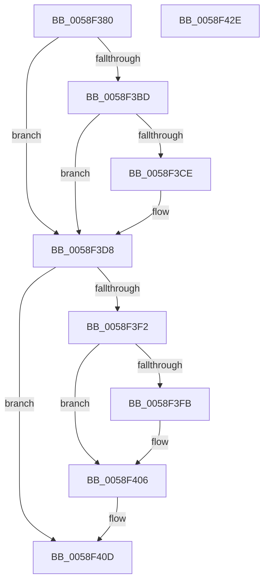

# VslRequestSecureKernelDebuggerBreakIn

- RVA: `0x0058F380`–`0x0058F42F` (길이 `175` bytes)
- VA: `0x000000014058F380`
- 실행 섹션: `.text`
- PDB 이름 있음: `예`; PDB Function 태그: `아니요`
- unwind 정보 RVA: `0x000B53F0`
- 디코드: `43`개 명령, `175/175` bytes 표시
- 미해석 바이트: `0` (있으면 어셈블리에 `.byte`로 보존)

> 이 문서는 커널 이미지의 기계어와 PDB 기호를 분석해 생성했습니다. 4번과 5번은 함수 원형과 자료형을 바이너리 사용 방식에서 추정한 C 해석이며 원본 소스 복구 결과는 아닙니다.

## 1. Dependencies

- 직접 호출 지점: **5**; 고유 호출 대상: **5**
- 직접 호출자로 확인된 함수: **1**
- RIP 상대 이미지 참조: **2**

### Outgoing calls
- `0x0058F3AA` → [memset](../6C/memset_function_006C6C40.md) (function, `0x006C6C40`)
- `0x0058F3D3` → [KiRaiseIrqlProcessIrqlFlags](../4F/KiRaiseIrqlProcessIrqlFlags_function_004F56FC.md) (function, `0x004F56FC`)
- `0x0058F3E8` → [VslpEnterIumSecureMode](../23/VslpEnterIumSecureMode_function_00235E50.md) (function, `0x00235E50`)
- `0x0058F401` → [KiLowerIrqlProcessIrqlFlags](../4F/KiLowerIrqlProcessIrqlFlags_function_004F5698.md) (function, `0x004F5698`)
- `0x0058F418` → [_security_check_cookie](../6A/_security_check_cookie_function_006AC640.md) (function, `0x006AC640`)

### Direct callers
- [KeFreezeExecution](../4D/KeFreezeExecution_function_004DFA40.md) at `0x004DFCD0`

### Static image references
- `0x0058F38D` → RVA `0x00E0A740` (`.data`; read)
- `0x0058F3C5` → RVA `0x00FC6D20` (`ALMOSTRO`; read)

## 2. Other-region calls and transfers

- 다른 실행 섹션으로 향하는 call: **0**
- 별도 외부 분기/꼬리 이동을 확인하지 못했습니다.

## 3. Assembly (complete function range)

```asm
0058F380  48 89 5C 24 08                  mov qword ptr [rsp + 8], rbx
0058F385  57                              push rdi
0058F386  48 81 EC A0 00 00 00            sub rsp, 0xa0
0058F38D  48 8B 05 AC B3 87 00            mov rax, qword ptr [rip + 0x87b3ac]
0058F394  48 33 C4                        xor rax, rsp
0058F397  48 89 84 24 90 00 00 00         mov qword ptr [rsp + 0x90], rax
0058F39F  33 D2                           xor edx, edx
0058F3A1  48 8D 4C 24 20                  lea rcx, [rsp + 0x20]
0058F3A6  44 8D 42 68                     lea r8d, [rdx + 0x68]
0058F3AA  E8 91 78 13 00                  call 0x1406c6c40
0058F3AF  44 0F 20 C3                     mov rbx, cr8
0058F3B3  BF 02 00 00 00                  mov edi, 2
0058F3B8  40 3A DF                        cmp bl, dil
0058F3BB  73 1B                           jae 0x14058f3d8
0058F3BD  44 0F 20 C3                     mov rbx, cr8
0058F3C1  44 0F 22 C7                     mov cr8, rdi
0058F3C5  83 3D 54 79 A3 00 00            cmp dword ptr [rip + 0xa37954], 0
0058F3CC  74 0A                           je 0x14058f3d8
0058F3CE  40 8A D7                        mov dl, dil
0058F3D1  8A CB                           mov cl, bl
0058F3D3  E8 24 63 F6 FF                  call 0x1404f56fc
0058F3D8  BA 14 01 00 00                  mov edx, 0x114
0058F3DD  4C 8D 4C 24 20                  lea r9, [rsp + 0x20]
0058F3E2  45 33 C0                        xor r8d, r8d
0058F3E5  40 8A CF                        mov cl, dil
0058F3E8  E8 63 6A CA FF                  call 0x140235e50
0058F3ED  40 3A DF                        cmp bl, dil
0058F3F0  73 1B                           jae 0x14058f40d
0058F3F2  83 3D 27 79 A3 00 00            cmp dword ptr [rip + 0xa37927], 0
0058F3F9  74 0B                           je 0x14058f406
0058F3FB  44 0F 20 C1                     mov rcx, cr8
0058F3FF  8A D3                           mov dl, bl
0058F401  E8 92 62 F6 FF                  call 0x1404f5698
0058F406  0F B6 C3                        movzx eax, bl
0058F409  44 0F 22 C0                     mov cr8, rax
0058F40D  48 8B 8C 24 90 00 00 00         mov rcx, qword ptr [rsp + 0x90]
0058F415  48 33 CC                        xor rcx, rsp
0058F418  E8 23 D2 11 00                  call 0x1406ac640
0058F41D  48 8B 9C 24 B0 00 00 00         mov rbx, qword ptr [rsp + 0xb0]
0058F425  48 81 C4 A0 00 00 00            add rsp, 0xa0
0058F42C  5F                              pop rdi
0058F42D  C3                              ret
0058F42E  CC                              int3
```

## 4. C-style interpretation (structured pseudocode)

```c
__int64 __fastcall VslRequestSecureKernelDebuggerBreakIn(__int64 a1, int a2)
{
    __int64 result;
    __int64 v_rsp;
    unsigned __int64 v_stack_m18;
    unsigned __int64 v_stack_m88;
    unsigned __int64 v_stack_p8;

    v_stack_p8 = v_rbx;
    v_rsp = (v_rsp) - (160);
    result = (*(unsigned __int64 *)(v_rip + 8893356)) ^ (v_rsp);
    v_stack_m18 = result;
    a2 = 0;
    result = memset(v_stack_m88, a2, a2 + 104, a4);
    if (((unsigned __int8)(v_cr8)) >= 2) goto loc_0058F3D8;
    if ((*(unsigned int *)(v_rip + 10713428)) != 0) {
        a2 = 2;
        a1 = (unsigned __int8)(v_cr8);
        result = KiRaiseIrqlProcessIrqlFlags(a1, a2, a2 + 104, a4);
    }
    a3 = 0;
    result = VslpEnterIumSecureMode(2, 276, a3, v_stack_m88);
    if (((unsigned __int8)(v_cr8)) >= 2) goto loc_0058F40D;
    if ((*(unsigned int *)(v_rip + 10713383)) != 0) {
        a1 = 2;
        a2 = (unsigned __int8)(v_cr8);
        result = KiLowerIrqlProcessIrqlFlags(a1, a2, a3, v_stack_m88);
    }
loc_0058F40D:
    a1 = (v_stack_m18) ^ (v_rsp);
    result = _security_check_cookie(a1, a2, a3, v_stack_m88);
    v_rsp = (v_rsp) + (160);
    return result;
}
```

## 5. (Beta) C Style

```c
int64_t VslRequestSecureKernelDebuggerBreakIn(int64_t Arg1, int32_t Arg2)
{
    int64_t result;
    int64_t local_rsp;
    uint64_t v_stack_m18;
    uint64_t v_stack_m88;
    uint64_t v_stack_p8;

    v_stack_p8 = local_rbx;
    local_rsp = (local_rsp) - (160);
    result = (*(uint64_t *)(v_rip + 0x87B3AC)) ^ (local_rsp);
    v_stack_m18 = result;
    Arg2 = 0;
    result = memset(v_stack_m88, Arg2, Arg2 + 104, a4);
    if (((uint8_t)(v_cr8)) >= 2) goto loc_0058F3D8;
    if ((*(uint32_t *)(v_rip + 0xA37954)) != 0) {
        Arg2 = 2;
        Arg1 = (uint8_t)(v_cr8);
        result = KiRaiseIrqlProcessIrqlFlags(Arg1, Arg2, Arg2 + 104, a4);
    }
    a3 = 0;
    result = VslpEnterIumSecureMode(2, 276, a3, v_stack_m88);
    if (((uint8_t)(v_cr8)) >= 2) goto loc_0058F40D;
    if ((*(uint32_t *)(v_rip + 0xA37927)) != 0) {
        Arg1 = 2;
        Arg2 = (uint8_t)(v_cr8);
        result = KiLowerIrqlProcessIrqlFlags(Arg1, Arg2, a3, v_stack_m88);
    }
loc_0058F40D:
    Arg1 = (v_stack_m18) ^ (local_rsp);
    result = _security_check_cookie(Arg1, Arg2, a3, v_stack_m88);
    local_rsp = (local_rsp) + (160);
    return result;
}
```

## 6. Execution-region graph

[열기: 2D/3D 그래프와 함수 탐색 컨트롤 패널](../../../control-panel.html?section=text&rva=0x0058F380&view=graph)

- 2D 그래프는 위에서 아래로 흐르고, 3D 그래프는 빈 공간을 드래그해 회전합니다. Shift+드래그는 이동, 휠은 확대·축소, 함수 노드 선택은 대상 보고서 이동입니다.

### Static fallback


