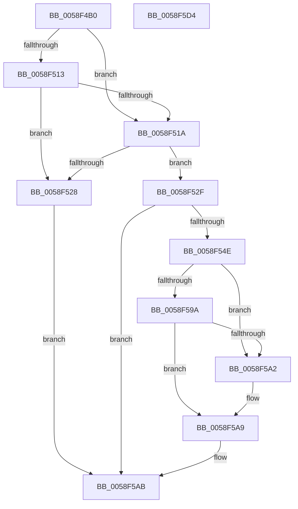

# VslRetrieveMailbox

- RVA: `0x0058F4B0`–`0x0058F5D5` (길이 `293` bytes)
- VA: `0x000000014058F4B0`
- 실행 섹션: `.text`
- PDB 이름 있음: `예`; PDB Function 태그: `아니요`
- unwind 정보 RVA: `0x000C6D2C`
- 디코드: `81`개 명령, `293/293` bytes 표시
- 미해석 바이트: `0` (있으면 어셈블리에 `.byte`로 보존)

> 이 문서는 커널 이미지의 기계어와 PDB 기호를 분석해 생성했습니다. 4번과 5번은 함수 원형과 자료형을 바이너리 사용 방식에서 추정한 C 해석이며 원본 소스 복구 결과는 아닙니다.

## 1. Dependencies

- 직접 호출 지점: **6**; 고유 호출 대상: **5**
- 직접 호출자로 확인된 함수: **0**
- RIP 상대 이미지 참조: **1**

### Outgoing calls
- `0x0058F4F8` → [memset](../6C/memset_function_006C6C40.md) (function, `0x006C6C40`)
- `0x0058F508` → [memset](../6C/memset_function_006C6C40.md) (function, `0x006C6C40`)
- `0x0058F545` → [VslpLockPagesForTransfer](../29/VslpLockPagesForTransfer_function_0029E0FC.md) (function, `0x0029E0FC`)
- `0x0058F57D` → [VslpEnterIumSecureMode](../23/VslpEnterIumSecureMode_function_00235E50.md) (function, `0x00235E50`)
- `0x0058F589` → [VslpUnlockPagesForTransfer](../29/VslpUnlockPagesForTransfer_function_0029EE4C.md) (function, `0x0029EE4C`)
- `0x0058F5B2` → [_security_check_cookie](../6A/_security_check_cookie_function_006AC640.md) (function, `0x006AC640`)

### Direct callers
- 이 함수 시작 RVA로 연결되는 직접 call은 확인되지 않았습니다. 간접 호출은 완전히 역산할 수 없습니다.

### Static image references
- `0x0058F4CF` → RVA `0x00E0A740` (`.data`; read)

## 2. Other-region calls and transfers

- 다른 실행 섹션으로 향하는 call: **0**
- 별도 외부 분기/꼬리 이동을 확인하지 못했습니다.

## 3. Assembly (complete function range)

```asm
0058F4B0  48 8B C4                        mov rax, rsp
0058F4B3  48 89 58 08                     mov qword ptr [rax + 8], rbx
0058F4B7  48 89 70 10                     mov qword ptr [rax + 0x10], rsi
0058F4BB  48 89 78 18                     mov qword ptr [rax + 0x18], rdi
0058F4BF  55                              push rbp
0058F4C0  41 56                           push r14
0058F4C2  41 57                           push r15
0058F4C4  48 8D 68 A9                     lea rbp, [rax - 0x57]
0058F4C8  48 81 EC 00 01 00 00            sub rsp, 0x100
0058F4CF  48 8B 05 6A B2 87 00            mov rax, qword ptr [rip + 0x87b26a]
0058F4D6  48 33 C4                        xor rax, rsp
0058F4D9  48 89 45 2F                     mov qword ptr [rbp + 0x2f], rax
0058F4DD  48 8B 7D 7F                     mov rdi, qword ptr [rbp + 0x7f]
0058F4E1  48 8B DA                        mov rbx, rdx
0058F4E4  33 D2                           xor edx, edx
0058F4E6  45 0F B6 F0                     movzx r14d, r8b
0058F4EA  4C 8B F9                        mov r15, rcx
0058F4ED  49 8B F1                        mov rsi, r9
0058F4F0  48 8D 4D BF                     lea rcx, [rbp - 0x41]
0058F4F4  44 8D 42 68                     lea r8d, [rdx + 0x68]
0058F4F8  E8 43 77 13 00                  call 0x1406c6c40
0058F4FD  33 D2                           xor edx, edx
0058F4FF  48 8D 4C 24 30                  lea rcx, [rsp + 0x30]
0058F504  44 8D 42 48                     lea r8d, [rdx + 0x48]
0058F508  E8 33 77 13 00                  call 0x1406c6c40
0058F50D  48 83 3B 00                     cmp qword ptr [rbx], 0
0058F511  75 07                           jne 0x14058f51a
0058F513  48 83 7B 08 00                  cmp qword ptr [rbx + 8], 0
0058F518  74 0E                           je 0x14058f528
0058F51A  48 8B 07                        mov rax, qword ptr [rdi]
0058F51D  48 FF C8                        dec rax
0058F520  48 3D FF 9F 1F 00               cmp rax, 0x1f9fff
0058F526  76 07                           jbe 0x14058f52f
0058F528  B8 0D 00 00 C0                  mov eax, 0xc000000d
0058F52D  EB 7C                           jmp 0x14058f5ab
0058F52F  44 8B 07                        mov r8d, dword ptr [rdi]
0058F532  48 8D 4C 24 30                  lea rcx, [rsp + 0x30]
0058F537  83 64 24 20 00                  and dword ptr [rsp + 0x20], 0
0058F53C  41 B9 02 00 00 00               mov r9d, 2
0058F542  48 8B D6                        mov rdx, rsi
0058F545  E8 B2 EB D0 FF                  call 0x14029e0fc
0058F54A  85 C0                           test eax, eax
0058F54C  78 5D                           js 0x14058f5ab
0058F54E  48 8B 44 24 30                  mov rax, qword ptr [rsp + 0x30]
0058F553  4C 8D 4D BF                     lea r9, [rbp - 0x41]
0058F557  0F 10 03                        movups xmm0, xmmword ptr [rbx]
0058F55A  48 89 45 C7                     mov qword ptr [rbp - 0x39], rax
0058F55E  BA 14 00 00 00                  mov edx, 0x14
0058F563  48 8B 45 A7                     mov rax, qword ptr [rbp - 0x59]
0058F567  45 33 C0                        xor r8d, r8d
0058F56A  B1 02                           mov cl, 2
0058F56C  48 89 45 CF                     mov qword ptr [rbp - 0x31], rax
0058F570  F3 0F 7F 45 D7                  movdqu xmmword ptr [rbp - 0x29], xmm0
0058F575  4C 89 7D E7                     mov qword ptr [rbp - 0x19], r15
0058F579  44 89 75 EF                     mov dword ptr [rbp - 0x11], r14d
0058F57D  E8 CE 68 CA FF                  call 0x140235e50
0058F582  48 8D 4C 24 30                  lea rcx, [rsp + 0x30]
0058F587  8B D8                           mov ebx, eax
0058F589  E8 BE F8 D0 FF                  call 0x14029ee4c
0058F58E  B8 00 00 00 80                  mov eax, 0x80000000
0058F593  8D 0C 03                        lea ecx, [rbx + rax]
0058F596  85 C8                           test eax, ecx
0058F598  75 08                           jne 0x14058f5a2
0058F59A  81 FB 23 00 00 C0               cmp ebx, 0xc0000023
0058F5A0  75 07                           jne 0x14058f5a9
0058F5A2  48 8B 4D CF                     mov rcx, qword ptr [rbp - 0x31]
0058F5A6  48 89 0F                        mov qword ptr [rdi], rcx
0058F5A9  8B C3                           mov eax, ebx
0058F5AB  48 8B 4D 2F                     mov rcx, qword ptr [rbp + 0x2f]
0058F5AF  48 33 CC                        xor rcx, rsp
0058F5B2  E8 89 D0 11 00                  call 0x1406ac640
0058F5B7  4C 8D 9C 24 00 01 00 00         lea r11, [rsp + 0x100]
0058F5BF  49 8B 5B 20                     mov rbx, qword ptr [r11 + 0x20]
0058F5C3  49 8B 73 28                     mov rsi, qword ptr [r11 + 0x28]
0058F5C7  49 8B 7B 30                     mov rdi, qword ptr [r11 + 0x30]
0058F5CB  49 8B E3                        mov rsp, r11
0058F5CE  41 5F                           pop r15
0058F5D0  41 5E                           pop r14
0058F5D2  5D                              pop rbp
0058F5D3  C3                              ret
0058F5D4  CC                              int3
```

## 4. C-style interpretation (structured pseudocode)

```c
__int64 __fastcall VslRetrieveMailbox(__int64 a1, __int64 a2, unsigned __int8 a3, __int64 a4)
{
    __int64 result;
    __int64 v_rsp;
    unsigned __int64 v_stack_m18;
    unsigned __int64 v_stack_mE8;
    unsigned int v_stack_mF8;

    *(unsigned __int64 *)(v_rsp + 8) = v_rbx;
    *(unsigned __int64 *)(v_rsp + 16) = v_rsi;
    *(unsigned __int64 *)(v_rsp + 24) = v_rdi;
    v_rsp = (v_rsp) - (256);
    result = (*(unsigned __int64 *)(v_rip + 8893034)) ^ (v_rsp);
    *(unsigned __int64 *)(v_rsp - 87 + 47) = result;
    a2 = 0;
    result = memset(v_rsp - 87 - 65, a2, a2 + 104, a4);
    a2 = 0;
    result = memset(v_stack_mE8, a2, a2 + 72, a4);
    if ((*(unsigned __int64 *)(a2)) != 0) goto loc_0058F51A;
    if ((*(unsigned __int64 *)(a2 + 8)) == 0) goto loc_0058F528;
loc_0058F51A:
    result = (*(unsigned __int64 *)(*(unsigned __int64 *)(v_rsp - 87 + 127))) - 1;
    if (result <= 0x1F9FFFULL) goto loc_0058F52F;
loc_0058F528:
    goto loc_0058F5AB;
loc_0058F52F:
    result = VslpLockPagesForTransfer(v_stack_mE8, a4, (unsigned int)(*(unsigned int *)(*(unsigned __int64 *)(v_rsp - 87 + 127))), 2);
    if (sign_flag) goto loc_0058F5AB;
    *(unsigned __int64 *)(v_rsp - 87 - 57) = v_stack_mE8;
    a3 = 0;
    *(unsigned __int64 *)(v_rsp - 87 - 49) = *(unsigned __int64 *)(v_rsp - 87 - 89);
    *(unsigned __int64 *)(v_rsp - 87 - 41) = v_xmm0;
    *(unsigned __int64 *)(v_rsp - 87 - 25) = a1;
    *(unsigned int *)(v_rsp - 87 - 17) = 0;
    result = VslpEnterIumSecureMode(2, 20, a3, v_rsp - 87 - 65);
    result = VslpUnlockPagesForTransfer(v_stack_mE8, 20, a3, v_rsp - 87 - 65);
    if ((((unsigned int)((unsigned int)(0x80000000ULL))) & ((unsigned int)((unsigned int)((unsigned int)(result)) + (unsigned int)(0x80000000ULL) * 1))) != 0) goto loc_0058F5A2;
    if (((unsigned int)((unsigned int)((unsigned int)(result)))) == 0xC0000023ULL) {
        a1 = *(unsigned __int64 *)(v_rsp - 87 - 49);
        *(unsigned __int64 *)(*(unsigned __int64 *)(v_rsp - 87 + 127)) = a1;
    }
loc_0058F5AB:
    a1 = (*(unsigned __int64 *)(v_rsp - 87 + 47)) ^ (v_rsp);
    result = _security_check_cookie(a1, 20, a3, v_rsp - 87 - 65);
    return result;
}
```

## 5. (Beta) C Style

```c
int64_t VslRetrieveMailbox(int64_t Arg1, void *Arg2, uint8_t Arg3, int64_t Arg4)
{
    uint8_t *arg2 = (uint8_t *)Arg2;

    int64_t result;
    int64_t local_rsp;
    uint64_t v_stack_m18;
    uint64_t v_stack_mE8;
    uint32_t v_stack_mF8;

    *(uint64_t *)(local_rsp + 0x8) = local_rbx;
    *(uint64_t *)(local_rsp + 0x10) = local_rsi;
    *(uint64_t *)(local_rsp + 0x18) = local_rdi;
    local_rsp = (local_rsp) - (256);
    result = (*(uint64_t *)(v_rip + 0x87B26A)) ^ (local_rsp);
    *(uint64_t *)(local_rsp - 0x57 + 0x2F) = result;
    Arg2 = 0;
    result = memset(local_rsp - 87 - 65, Arg2, Arg2 + 104, Arg4);
    Arg2 = 0;
    result = memset(v_stack_mE8, Arg2, Arg2 + 72, Arg4);
    if ((*(uint64_t *)(arg2)) != 0) goto loc_0058F51A;
    if ((*(uint64_t *)(arg2 + 0x8)) == 0) goto loc_0058F528;
loc_0058F51A:
    result = (*(uint64_t *)(*(uint64_t *)(local_rsp - 0x57 + 0x7F))) - 1;
    if (result <= 0x1F9FFFULL) goto loc_0058F52F;
loc_0058F528:
    goto loc_0058F5AB;
loc_0058F52F:
    result = VslpLockPagesForTransfer(v_stack_mE8, Arg4, (uint32_t)(*(uint32_t *)(*(uint64_t *)(local_rsp - 0x57 + 0x7F))), 2);
    if (sign_flag) goto loc_0058F5AB;
    *(uint64_t *)(local_rsp - 0x57 - 0x39) = v_stack_mE8;
    Arg3 = 0;
    *(uint64_t *)(local_rsp - 0x57 - 0x31) = *(uint64_t *)(local_rsp - 0x57 - 0x59);
    *(uint64_t *)(local_rsp - 0x57 - 0x29) = v_xmm0;
    *(uint64_t *)(local_rsp - 0x57 - 0x19) = Arg1;
    *(uint32_t *)(local_rsp - 0x57 - 0x11) = 0;
    result = VslpEnterIumSecureMode(2, 20, Arg3, local_rsp - 87 - 65);
    result = VslpUnlockPagesForTransfer(v_stack_mE8, 20, Arg3, local_rsp - 87 - 65);
    if ((((uint32_t)((uint32_t)(0x80000000ULL))) & ((uint32_t)((uint32_t)((uint32_t)(result)) + (uint32_t)(0x80000000ULL) * 1))) != 0) goto loc_0058F5A2;
    if (((uint32_t)((uint32_t)((uint32_t)(result)))) == 0xC0000023ULL) {
        Arg1 = *(uint64_t *)(local_rsp - 0x57 - 0x31);
        *(uint64_t *)(*(uint64_t *)(local_rsp - 0x57 + 0x7F)) = Arg1;
    }
loc_0058F5AB:
    Arg1 = (*(uint64_t *)(local_rsp - 0x57 + 0x2F)) ^ (local_rsp);
    result = _security_check_cookie(Arg1, 20, Arg3, local_rsp - 87 - 65);
    return result;
}
```

### 관측된 메모리 오프셋

구조체 형식이 확인되지 않은 접근은 인자 기준의 오프셋으로만 기록했습니다.

| 기준 인자 | 오프셋 표현 | 폭 (bit) | 접근 |
|---|---:|---:|---|
| `Arg2` | `+ 0x0` | `64` | `R` |
| `Arg2` | `+ 0x0` | `128` | `R` |
| `Arg2` | `+ 0x8` | `64` | `R` |

## 6. Execution-region graph

[열기: 2D/3D 그래프와 함수 탐색 컨트롤 패널](../../../control-panel.html?section=text&rva=0x0058F4B0&view=graph)

- 2D 그래프는 위에서 아래로 흐르고, 3D 그래프는 빈 공간을 드래그해 회전합니다. Shift+드래그는 이동, 휠은 확대·축소, 함수 노드 선택은 대상 보고서 이동입니다.

### Static fallback


