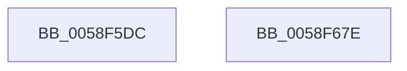

# VslStartSecurePageIteration

- RVA: `0x0058F5DC`–`0x0058F67F` (길이 `163` bytes)
- VA: `0x000000014058F5DC`
- 실행 섹션: `.text`
- PDB 이름 있음: `예`; PDB Function 태그: `아니요`
- unwind 정보 RVA: `0x00068468`
- 디코드: `38`개 명령, `163/163` bytes 표시
- 미해석 바이트: `0` (있으면 어셈블리에 `.byte`로 보존)

> 이 문서는 커널 이미지의 기계어와 PDB 기호를 분석해 생성했습니다. 4번과 5번은 함수 원형과 자료형을 바이너리 사용 방식에서 추정한 C 해석이며 원본 소스 복구 결과는 아닙니다.

## 1. Dependencies

- 직접 호출 지점: **3**; 고유 호출 대상: **3**
- 직접 호출자로 확인된 함수: **1**
- RIP 상대 이미지 참조: **1**

### Outgoing calls
- `0x0058F61C` → [memset](../6C/memset_function_006C6C40.md) (function, `0x006C6C40`)
- `0x0058F650` → [VslpEnterIumSecureMode](../23/VslpEnterIumSecureMode_function_00235E50.md) (function, `0x00235E50`)
- `0x0058F660` → [_security_check_cookie](../6A/_security_check_cookie_function_006AC640.md) (function, `0x006AC640`)

### Direct callers
- [HvlpStartSecurePageListIteration](HvlpStartSecurePageListIteration_function_0058D908.md) at `0x0058D9FF`

### Static image references
- `0x0058F5F3` → RVA `0x00E0A740` (`.data`; read)

## 2. Other-region calls and transfers

- 다른 실행 섹션으로 향하는 call: **0**
- 별도 외부 분기/꼬리 이동을 확인하지 못했습니다.

## 3. Assembly (complete function range)

```asm
0058F5DC  48 89 5C 24 08                  mov qword ptr [rsp + 8], rbx
0058F5E1  48 89 6C 24 10                  mov qword ptr [rsp + 0x10], rbp
0058F5E6  48 89 74 24 18                  mov qword ptr [rsp + 0x18], rsi
0058F5EB  57                              push rdi
0058F5EC  48 81 EC A0 00 00 00            sub rsp, 0xa0
0058F5F3  48 8B 05 46 B1 87 00            mov rax, qword ptr [rip + 0x87b146]
0058F5FA  48 33 C4                        xor rax, rsp
0058F5FD  48 89 84 24 90 00 00 00         mov qword ptr [rsp + 0x90], rax
0058F605  48 8B FA                        mov rdi, rdx
0058F608  0F B6 D9                        movzx ebx, cl
0058F60B  33 D2                           xor edx, edx
0058F60D  41 8B E9                        mov ebp, r9d
0058F610  49 8B F0                        mov rsi, r8
0058F613  48 8D 4C 24 20                  lea rcx, [rsp + 0x20]
0058F618  44 8D 42 68                     lea r8d, [rdx + 0x68]
0058F61C  E8 1F 76 13 00                  call 0x1406c6c40
0058F621  8B 84 24 D0 00 00 00            mov eax, dword ptr [rsp + 0xd0]
0058F628  4C 8D 4C 24 20                  lea r9, [rsp + 0x20]
0058F62D  BA 00 08 00 00                  mov edx, 0x800
0058F632  48 89 44 24 48                  mov qword ptr [rsp + 0x48], rax
0058F637  45 33 C0                        xor r8d, r8d
0058F63A  48 89 5C 24 28                  mov qword ptr [rsp + 0x28], rbx
0058F63F  B1 02                           mov cl, 2
0058F641  48 89 7C 24 30                  mov qword ptr [rsp + 0x30], rdi
0058F646  48 89 74 24 38                  mov qword ptr [rsp + 0x38], rsi
0058F64B  48 89 6C 24 40                  mov qword ptr [rsp + 0x40], rbp
0058F650  E8 FB 67 CA FF                  call 0x140235e50
0058F655  48 8B 8C 24 90 00 00 00         mov rcx, qword ptr [rsp + 0x90]
0058F65D  48 33 CC                        xor rcx, rsp
0058F660  E8 DB CF 11 00                  call 0x1406ac640
0058F665  4C 8D 9C 24 A0 00 00 00         lea r11, [rsp + 0xa0]
0058F66D  49 8B 5B 10                     mov rbx, qword ptr [r11 + 0x10]
0058F671  49 8B 6B 18                     mov rbp, qword ptr [r11 + 0x18]
0058F675  49 8B 73 20                     mov rsi, qword ptr [r11 + 0x20]
0058F679  49 8B E3                        mov rsp, r11
0058F67C  5F                              pop rdi
0058F67D  C3                              ret
0058F67E  CC                              int3
```

## 4. C-style interpretation (structured pseudocode)

```c
__int64 __fastcall VslStartSecurePageIteration(unsigned __int8 a1, __int64 a2, __int64 a3, int a4, unsigned int a5)
{
    __int64 result;
    __int64 v_rsp;
    unsigned __int64 v_stack_m18;
    unsigned __int64 v_stack_m60;
    unsigned __int64 v_stack_m68;
    unsigned __int64 v_stack_m70;
    unsigned __int64 v_stack_m78;
    unsigned __int64 v_stack_m8;
    unsigned __int64 v_stack_m80;
    unsigned __int64 v_stack_m88;
    unsigned __int64 v_stack_p10;
    unsigned __int64 v_stack_p18;
    unsigned __int64 v_stack_p8;

    v_stack_p8 = v_rbx;
    v_stack_p10 = v_rbp;
    v_stack_p18 = v_rsi;
    v_rsp = (v_rsp) - (160);
    result = (*(unsigned __int64 *)(v_rip + 8892742)) ^ (v_rsp);
    v_stack_m18 = result;
    a2 = 0;
    result = memset(v_stack_m88, a2, a2 + 104, a4);
    v_stack_m60 = (unsigned int)(a5);
    a3 = 0;
    v_stack_m80 = a1;
    v_stack_m78 = 0;
    v_stack_m70 = 0;
    v_stack_m68 = (unsigned int)(a4);
    result = VslpEnterIumSecureMode(2, (unsigned int)(0x800ULL), a3, v_stack_m88);
    a1 = (v_stack_m18) ^ (v_rsp);
    result = _security_check_cookie(a1, (unsigned int)(0x800ULL), a3, v_stack_m88);
    return result;
}
```

## 5. (Beta) C Style

```c
int64_t VslStartSecurePageIteration(uint8_t Arg1, int64_t Arg2, int64_t Arg3, int32_t Arg4, uint32_t Arg5)
{
    int64_t result;
    int64_t local_rsp;
    uint64_t v_stack_m18;
    uint64_t v_stack_m60;
    uint64_t v_stack_m68;
    uint64_t v_stack_m70;
    uint64_t v_stack_m78;
    uint64_t v_stack_m8;
    uint64_t v_stack_m80;
    uint64_t v_stack_m88;
    uint64_t v_stack_p10;
    uint64_t v_stack_p18;
    uint64_t v_stack_p8;

    v_stack_p8 = local_rbx;
    v_stack_p10 = local_rbp;
    v_stack_p18 = local_rsi;
    local_rsp = (local_rsp) - (160);
    result = (*(uint64_t *)(v_rip + 0x87B146)) ^ (local_rsp);
    v_stack_m18 = result;
    Arg2 = 0;
    result = memset(v_stack_m88, Arg2, Arg2 + 104, Arg4);
    v_stack_m60 = (uint32_t)(Arg5);
    Arg3 = 0;
    v_stack_m80 = Arg1;
    v_stack_m78 = 0;
    v_stack_m70 = 0;
    v_stack_m68 = (uint32_t)(Arg4);
    result = VslpEnterIumSecureMode(2, (uint32_t)(0x800ULL), Arg3, v_stack_m88);
    Arg1 = (v_stack_m18) ^ (local_rsp);
    result = _security_check_cookie(Arg1, (uint32_t)(0x800ULL), Arg3, v_stack_m88);
    return result;
}
```

## 6. Execution-region graph

[열기: 2D/3D 그래프와 함수 탐색 컨트롤 패널](../../../control-panel.html?section=text&rva=0x0058F5DC&view=graph)

- 2D 그래프는 위에서 아래로 흐르고, 3D 그래프는 빈 공간을 드래그해 회전합니다. Shift+드래그는 이동, 휠은 확대·축소, 함수 노드 선택은 대상 보고서 이동입니다.

### Static fallback


