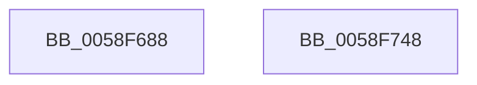

# VslSvcEnterIumSecureMode

- RVA: `0x0058F688`–`0x0058F749` (길이 `193` bytes)
- VA: `0x000000014058F688`
- 실행 섹션: `.text`
- PDB 이름 있음: `예`; PDB Function 태그: `아니요`
- unwind 정보 RVA: `0x000C6AD4`
- 디코드: `49`개 명령, `193/193` bytes 표시
- 미해석 바이트: `0` (있으면 어셈블리에 `.byte`로 보존)

> 이 문서는 커널 이미지의 기계어와 PDB 기호를 분석해 생성했습니다. 4번과 5번은 함수 원형과 자료형을 바이너리 사용 방식에서 추정한 C 해석이며 원본 소스 복구 결과는 아닙니다.

## 1. Dependencies

- 직접 호출 지점: **3**; 고유 호출 대상: **3**
- 직접 호출자로 확인된 함수: **1**
- RIP 상대 이미지 참조: **1**

### Outgoing calls
- `0x0058F6B5` → [memset](../6C/memset_function_006C6C40.md) (function, `0x006C6C40`)
- `0x0058F6F7` → [VslpEnterIumSecureMode](../23/VslpEnterIumSecureMode_function_00235E50.md) (function, `0x00235E50`)
- `0x0058F732` → [_security_check_cookie](../6A/_security_check_cookie_function_006AC640.md) (function, `0x006AC640`)

### Direct callers
- [VmCallSkSvc](../64/VmCallSkSvc_function_0064C320.md) at `0x0064C324`

### Static image references
- `0x0058F69A` → RVA `0x00E0A740` (`.data`; read)

## 2. Other-region calls and transfers

- 다른 실행 섹션으로 향하는 call: **0**
- 별도 외부 분기/꼬리 이동을 확인하지 못했습니다.

## 3. Assembly (complete function range)

```asm
0058F688  48 89 5C 24 10                  mov qword ptr [rsp + 0x10], rbx
0058F68D  55                              push rbp
0058F68E  48 8D 6C 24 A9                  lea rbp, [rsp - 0x57]
0058F693  48 81 EC A0 00 00 00            sub rsp, 0xa0
0058F69A  48 8B 05 9F B0 87 00            mov rax, qword ptr [rip + 0x87b09f]
0058F6A1  48 33 C4                        xor rax, rsp
0058F6A4  48 89 45 47                     mov qword ptr [rbp + 0x47], rax
0058F6A8  33 D2                           xor edx, edx
0058F6AA  48 8B D9                        mov rbx, rcx
0058F6AD  48 8D 4D D7                     lea rcx, [rbp - 0x29]
0058F6B1  44 8D 42 68                     lea r8d, [rdx + 0x68]
0058F6B5  E8 86 75 13 00                  call 0x1406c6c40
0058F6BA  0F 10 03                        movups xmm0, xmmword ptr [rbx]
0058F6BD  BA 11 01 00 00                  mov edx, 0x111
0058F6C2  4C 8D 4D D7                     lea r9, [rbp - 0x29]
0058F6C6  0F 10 4B 10                     movups xmm1, xmmword ptr [rbx + 0x10]
0058F6CA  45 33 C0                        xor r8d, r8d
0058F6CD  B1 02                           mov cl, 2
0058F6CF  0F 11 45 DF                     movups xmmword ptr [rbp - 0x21], xmm0
0058F6D3  0F 10 43 20                     movups xmm0, xmmword ptr [rbx + 0x20]
0058F6D7  0F 11 4D EF                     movups xmmword ptr [rbp - 0x11], xmm1
0058F6DB  0F 10 4B 30                     movups xmm1, xmmword ptr [rbx + 0x30]
0058F6DF  0F 11 45 FF                     movups xmmword ptr [rbp - 1], xmm0
0058F6E3  0F 10 43 40                     movups xmm0, xmmword ptr [rbx + 0x40]
0058F6E7  0F 11 4D 0F                     movups xmmword ptr [rbp + 0xf], xmm1
0058F6EB  0F 10 4B 50                     movups xmm1, xmmword ptr [rbx + 0x50]
0058F6EF  0F 11 45 1F                     movups xmmword ptr [rbp + 0x1f], xmm0
0058F6F3  0F 11 4D 2F                     movups xmmword ptr [rbp + 0x2f], xmm1
0058F6F7  E8 54 67 CA FF                  call 0x140235e50
0058F6FC  0F 10 45 DF                     movups xmm0, xmmword ptr [rbp - 0x21]
0058F700  0F 10 4D EF                     movups xmm1, xmmword ptr [rbp - 0x11]
0058F704  0F 11 03                        movups xmmword ptr [rbx], xmm0
0058F707  0F 10 45 FF                     movups xmm0, xmmword ptr [rbp - 1]
0058F70B  0F 11 4B 10                     movups xmmword ptr [rbx + 0x10], xmm1
0058F70F  0F 10 4D 0F                     movups xmm1, xmmword ptr [rbp + 0xf]
0058F713  0F 11 43 20                     movups xmmword ptr [rbx + 0x20], xmm0
0058F717  0F 10 45 1F                     movups xmm0, xmmword ptr [rbp + 0x1f]
0058F71B  0F 11 4B 30                     movups xmmword ptr [rbx + 0x30], xmm1
0058F71F  0F 10 4D 2F                     movups xmm1, xmmword ptr [rbp + 0x2f]
0058F723  0F 11 43 40                     movups xmmword ptr [rbx + 0x40], xmm0
0058F727  0F 11 4B 50                     movups xmmword ptr [rbx + 0x50], xmm1
0058F72B  48 8B 4D 47                     mov rcx, qword ptr [rbp + 0x47]
0058F72F  48 33 CC                        xor rcx, rsp
0058F732  E8 09 CF 11 00                  call 0x1406ac640
0058F737  48 8B 9C 24 B8 00 00 00         mov rbx, qword ptr [rsp + 0xb8]
0058F73F  48 81 C4 A0 00 00 00            add rsp, 0xa0
0058F746  5D                              pop rbp
0058F747  C3                              ret
0058F748  CC                              int3
```

## 4. C-style interpretation (structured pseudocode)

```c
__int64 __fastcall VslSvcEnterIumSecureMode(__int64 a1, int a2)
{
    __int64 result;
    __int64 v_rsp;
    unsigned __int64 v_stack_m18;
    unsigned __int64 v_stack_m30;
    unsigned __int64 v_stack_m40;
    unsigned __int64 v_stack_m50;
    unsigned __int64 v_stack_m5F;
    unsigned __int64 v_stack_m60;
    unsigned __int64 v_stack_m70;
    unsigned __int64 v_stack_m80;
    unsigned __int64 v_stack_m88;
    unsigned __int64 v_stack_p10;

    v_stack_p10 = v_rbx;
    v_rsp = (v_rsp) - (160);
    result = (*(unsigned __int64 *)(v_rip + 8892575)) ^ (v_rsp);
    v_stack_m18 = result;
    a2 = 0;
    result = memset(v_stack_m88, a2, a2 + 104, a4);
    a3 = 0;
    v_stack_m80 = v_xmm0;
    v_stack_m70 = v_xmm1;
    v_stack_m60 = v_xmm0;
    v_stack_m50 = v_xmm1;
    v_stack_m40 = v_xmm0;
    v_stack_m30 = v_xmm1;
    result = VslpEnterIumSecureMode(2, 273, a3, v_stack_m88);
    *(unsigned __int64 *)(a1) = v_xmm0;
    *(unsigned __int64 *)(a1 + 16) = v_xmm1;
    *(unsigned __int64 *)(a1 + 32) = v_xmm0;
    *(unsigned __int64 *)(a1 + 48) = v_xmm1;
    *(unsigned __int64 *)(a1 + 64) = v_xmm0;
    *(unsigned __int64 *)(a1 + 80) = v_xmm1;
    a1 = (v_stack_m18) ^ (v_rsp);
    result = _security_check_cookie(a1, 273, a3, v_stack_m88);
    v_rsp = (v_rsp) + (160);
    return result;
}
```

## 5. (Beta) C Style

```c
int64_t VslSvcEnterIumSecureMode(void *Arg1, int32_t Arg2)
{
    uint8_t *arg1 = (uint8_t *)Arg1;

    int64_t result;
    int64_t local_rsp;
    uint64_t v_stack_m18;
    uint64_t v_stack_m30;
    uint64_t v_stack_m40;
    uint64_t v_stack_m50;
    uint64_t v_stack_m5F;
    uint64_t v_stack_m60;
    uint64_t v_stack_m70;
    uint64_t v_stack_m80;
    uint64_t v_stack_m88;
    uint64_t v_stack_p10;

    v_stack_p10 = local_rbx;
    local_rsp = (local_rsp) - (160);
    result = (*(uint64_t *)(v_rip + 0x87B09F)) ^ (local_rsp);
    v_stack_m18 = result;
    Arg2 = 0;
    result = memset(v_stack_m88, Arg2, Arg2 + 104, a4);
    a3 = 0;
    v_stack_m80 = v_xmm0;
    v_stack_m70 = v_xmm1;
    v_stack_m60 = v_xmm0;
    v_stack_m50 = v_xmm1;
    v_stack_m40 = v_xmm0;
    v_stack_m30 = v_xmm1;
    result = VslpEnterIumSecureMode(2, 273, a3, v_stack_m88);
    *(uint64_t *)(arg1) = v_xmm0;
    *(uint64_t *)(arg1 + 0x10) = v_xmm1;
    *(uint64_t *)(arg1 + 0x20) = v_xmm0;
    *(uint64_t *)(arg1 + 0x30) = v_xmm1;
    *(uint64_t *)(arg1 + 0x40) = v_xmm0;
    *(uint64_t *)(arg1 + 0x50) = v_xmm1;
    Arg1 = (v_stack_m18) ^ (local_rsp);
    result = _security_check_cookie(Arg1, 273, a3, v_stack_m88);
    local_rsp = (local_rsp) + (160);
    return result;
}
```

### 관측된 메모리 오프셋

구조체 형식이 확인되지 않은 접근은 인자 기준의 오프셋으로만 기록했습니다.

| 기준 인자 | 오프셋 표현 | 폭 (bit) | 접근 |
|---|---:|---:|---|
| `Arg1` | `+ 0x0` | `128` | `R` |
| `Arg1` | `+ 0x10` | `128` | `R` |
| `Arg1` | `+ 0x20` | `128` | `R` |
| `Arg1` | `+ 0x30` | `128` | `R` |
| `Arg1` | `+ 0x40` | `128` | `R` |
| `Arg1` | `+ 0x50` | `128` | `R` |

## 6. Execution-region graph

[열기: 2D/3D 그래프와 함수 탐색 컨트롤 패널](../../../control-panel.html?section=text&rva=0x0058F688&view=graph)

- 2D 그래프는 위에서 아래로 흐르고, 3D 그래프는 빈 공간을 드래그해 회전합니다. Shift+드래그는 이동, 휠은 확대·축소, 함수 노드 선택은 대상 보고서 이동입니다.

### Static fallback


