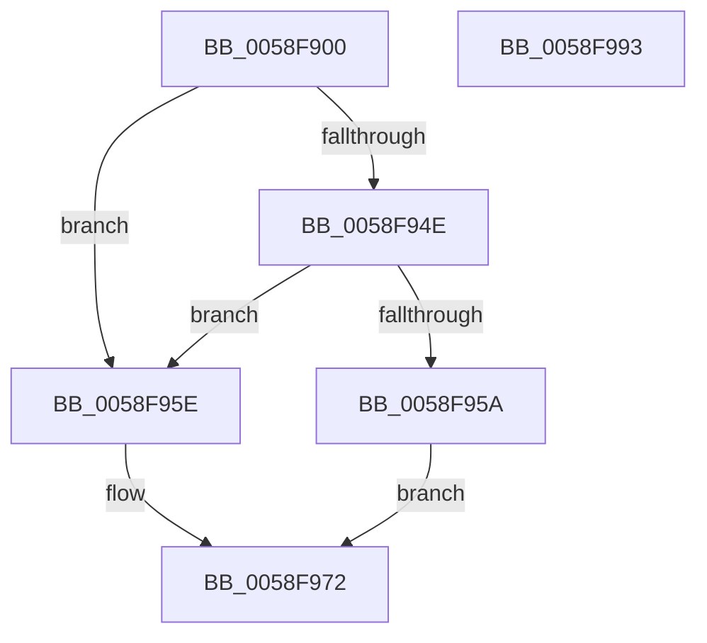

# VslVerifyPage

- RVA: `0x0058F900`–`0x0058F994` (길이 `148` bytes)
- VA: `0x000000014058F900`
- 실행 섹션: `.text`
- PDB 이름 있음: `예`; PDB Function 태그: `아니요`
- unwind 정보 RVA: `0x000C6C70`
- 디코드: `39`개 명령, `148/148` bytes 표시
- 미해석 바이트: `0` (있으면 어셈블리에 `.byte`로 보존)

> 이 문서는 커널 이미지의 기계어와 PDB 기호를 분석해 생성했습니다. 4번과 5번은 함수 원형과 자료형을 바이너리 사용 방식에서 추정한 C 해석이며 원본 소스 복구 결과는 아닙니다.

## 1. Dependencies

- 직접 호출 지점: **3**; 고유 호출 대상: **3**
- 직접 호출자로 확인된 함수: **2**
- RIP 상대 이미지 참조: **1**

### Outgoing calls
- `0x0058F92F` → [memset](../6C/memset_function_006C6C40.md) (function, `0x006C6C40`)
- `0x0058F96D` → [VslpEnterIumSecureMode](../23/VslpEnterIumSecureMode_function_00235E50.md) (function, `0x00235E50`)
- `0x0058F97D` → [_security_check_cookie](../6A/_security_check_cookie_function_006AC640.md) (function, `0x006AC640`)

### Direct callers
- [CcBcbProfiler](../50/CcBcbProfiler_function_005099B0.md) at `0x00509C01`
- [CcBcbProfiler](../50/CcBcbProfiler_function_005099B0.md) at `0x00509C37`
- [sub_00705ED0](../../page/70/Unknown_function_00705ED0.md) at `0x007060EB`
- [sub_00705ED0](../../page/70/Unknown_function_00705ED0.md) at `0x00706122`

### Static image references
- `0x0058F90D` → RVA `0x00E0A740` (`.data`; read)

## 2. Other-region calls and transfers

- 다른 실행 섹션으로 향하는 call: **0**
- 별도 외부 분기/꼬리 이동을 확인하지 못했습니다.

## 3. Assembly (complete function range)

```asm
0058F900  48 89 5C 24 10                  mov qword ptr [rsp + 0x10], rbx
0058F905  57                              push rdi
0058F906  48 81 EC A0 00 00 00            sub rsp, 0xa0
0058F90D  48 8B 05 2C AE 87 00            mov rax, qword ptr [rip + 0x87ae2c]
0058F914  48 33 C4                        xor rax, rsp
0058F917  48 89 84 24 90 00 00 00         mov qword ptr [rsp + 0x90], rax
0058F91F  8B DA                           mov ebx, edx
0058F921  48 8B F9                        mov rdi, rcx
0058F924  33 D2                           xor edx, edx
0058F926  48 8D 4C 24 20                  lea rcx, [rsp + 0x20]
0058F92B  44 8D 42 68                     lea r8d, [rdx + 0x68]
0058F92F  E8 0C 73 13 00                  call 0x1406c6c40
0058F934  B9 01 00 00 00                  mov ecx, 1
0058F939  48 89 7C 24 28                  mov qword ptr [rsp + 0x28], rdi
0058F93E  84 D9                           test cl, bl
0058F940  8D 41 FF                        lea eax, [rcx - 1]
0058F943  0F 45 C1                        cmovne eax, ecx
0058F946  89 44 24 30                     mov dword ptr [rsp + 0x30], eax
0058F94A  85 DB                           test ebx, ebx
0058F94C  79 10                           jns 0x14058f95e
0058F94E  83 C8 02                        or eax, 2
0058F951  89 44 24 30                     mov dword ptr [rsp + 0x30], eax
0058F955  48 85 FF                        test rdi, rdi
0058F958  75 04                           jne 0x14058f95e
0058F95A  33 C0                           xor eax, eax
0058F95C  EB 14                           jmp 0x14058f972
0058F95E  BA 05 01 00 00                  mov edx, 0x105
0058F963  4C 8D 4C 24 20                  lea r9, [rsp + 0x20]
0058F968  45 33 C0                        xor r8d, r8d
0058F96B  B1 02                           mov cl, 2
0058F96D  E8 DE 64 CA FF                  call 0x140235e50
0058F972  48 8B 8C 24 90 00 00 00         mov rcx, qword ptr [rsp + 0x90]
0058F97A  48 33 CC                        xor rcx, rsp
0058F97D  E8 BE CC 11 00                  call 0x1406ac640
0058F982  48 8B 9C 24 B8 00 00 00         mov rbx, qword ptr [rsp + 0xb8]
0058F98A  48 81 C4 A0 00 00 00            add rsp, 0xa0
0058F991  5F                              pop rdi
0058F992  C3                              ret
0058F993  CC                              int3
```

## 4. C-style interpretation (structured pseudocode)

```c
__int64 __fastcall VslVerifyPage(__int64 a1, int a2)
{
    __int64 result;
    __int64 v_rsp;
    unsigned __int64 v_stack_m18;
    unsigned int v_stack_m78;
    unsigned __int64 v_stack_m80;
    unsigned __int64 v_stack_m88;
    unsigned __int64 v_stack_p10;

    v_stack_p10 = v_rbx;
    v_rsp = (v_rsp) - (160);
    result = (*(unsigned __int64 *)(v_rip + 8891948)) ^ (v_rsp);
    v_stack_m18 = result;
    a2 = 0;
    result = memset(v_stack_m88, a2, a2 + 104, a4);
    v_stack_m80 = a1;
    result = 1 - 1;
    if (((1) & ((unsigned __int8)((unsigned int)(a2)))) != 0) { result = 1; }
    v_stack_m78 = (unsigned int)(result);
    if (!sign_flag) goto loc_0058F95E;
    result = (unsigned int)((result) | (2));
    v_stack_m78 = (unsigned int)(result);
    if (a1 != 0) goto loc_0058F95E;
    result = 0;
    goto loc_0058F972;
loc_0058F95E:
    a3 = 0;
    result = VslpEnterIumSecureMode(2, 261, a3, v_stack_m88);
loc_0058F972:
    a1 = (v_stack_m18) ^ (v_rsp);
    result = _security_check_cookie(a1, 261, a3, v_stack_m88);
    v_rsp = (v_rsp) + (160);
    return result;
}
```

## 5. (Beta) C Style

```c
int64_t VslVerifyPage(int64_t Arg1, int32_t Arg2)
{
    int64_t result;
    int64_t local_rsp;
    uint64_t v_stack_m18;
    uint32_t v_stack_m78;
    uint64_t v_stack_m80;
    uint64_t v_stack_m88;
    uint64_t v_stack_p10;

    v_stack_p10 = local_rbx;
    local_rsp = (local_rsp) - (160);
    result = (*(uint64_t *)(v_rip + 0x87AE2C)) ^ (local_rsp);
    v_stack_m18 = result;
    Arg2 = 0;
    result = memset(v_stack_m88, Arg2, Arg2 + 104, a4);
    v_stack_m80 = Arg1;
    result = 1 - 1;
    if (((1) & ((uint8_t)((uint32_t)(Arg2)))) != 0) { result = 1; }
    v_stack_m78 = (uint32_t)(result);
    if (!sign_flag) goto loc_0058F95E;
    result = (uint32_t)((result) | (2));
    v_stack_m78 = (uint32_t)(result);
    if (Arg1 != 0) goto loc_0058F95E;
    result = 0;
    goto loc_0058F972;
loc_0058F95E:
    a3 = 0;
    result = VslpEnterIumSecureMode(2, 261, a3, v_stack_m88);
loc_0058F972:
    Arg1 = (v_stack_m18) ^ (local_rsp);
    result = _security_check_cookie(Arg1, 261, a3, v_stack_m88);
    local_rsp = (local_rsp) + (160);
    return result;
}
```

## 6. Execution-region graph

[열기: 2D/3D 그래프와 함수 탐색 컨트롤 패널](../../../control-panel.html?section=text&rva=0x0058F900&view=graph)

- 2D 그래프는 위에서 아래로 흐르고, 3D 그래프는 빈 공간을 드래그해 회전합니다. Shift+드래그는 이동, 휠은 확대·축소, 함수 노드 선택은 대상 보고서 이동입니다.

### Static fallback


