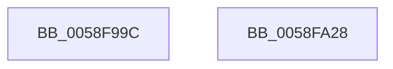

# VslWriteProtectedPage

- RVA: `0x0058F99C`–`0x0058FA29` (길이 `141` bytes)
- VA: `0x000000014058F99C`
- 실행 섹션: `.text`
- PDB 이름 있음: `예`; PDB Function 태그: `아니요`
- unwind 정보 RVA: `0x0009A9C4`
- 디코드: `38`개 명령, `141/141` bytes 표시
- 미해석 바이트: `0` (있으면 어셈블리에 `.byte`로 보존)

> 이 문서는 커널 이미지의 기계어와 PDB 기호를 분석해 생성했습니다. 4번과 5번은 함수 원형과 자료형을 바이너리 사용 방식에서 추정한 C 해석이며 원본 소스 복구 결과는 아닙니다.

## 1. Dependencies

- 직접 호출 지점: **3**; 고유 호출 대상: **3**
- 직접 호출자로 확인된 함수: **1**
- RIP 상대 이미지 참조: **1**

### Outgoing calls
- `0x0058F9D1` → [memset](../6C/memset_function_006C6C40.md) (function, `0x006C6C40`)
- `0x0058FA07` → [VslpEnterIumSecureMode](../23/VslpEnterIumSecureMode_function_00235E50.md) (function, `0x00235E50`)
- `0x0058FA17` → [_security_check_cookie](../6A/_security_check_cookie_function_006AC640.md) (function, `0x006AC640`)

### Direct callers
- [MiDbgCopyPrivilegedData](../68/MiDbgCopyPrivilegedData_function_00685198.md) at `0x0068520D`

### Static image references
- `0x0058F9A8` → RVA `0x00E0A740` (`.data`; read)

## 2. Other-region calls and transfers

- 다른 실행 섹션으로 향하는 call: **0**
- 별도 외부 분기/꼬리 이동을 확인하지 못했습니다.

## 3. Assembly (complete function range)

```asm
0058F99C  40 53                           push rbx
0058F99E  55                              push rbp
0058F99F  56                              push rsi
0058F9A0  57                              push rdi
0058F9A1  48 81 EC A8 00 00 00            sub rsp, 0xa8
0058F9A8  48 8B 05 91 AD 87 00            mov rax, qword ptr [rip + 0x87ad91]
0058F9AF  48 33 C4                        xor rax, rsp
0058F9B2  48 89 84 24 90 00 00 00         mov qword ptr [rsp + 0x90], rax
0058F9BA  48 8B F2                        mov rsi, rdx
0058F9BD  41 8B E8                        mov ebp, r8d
0058F9C0  33 D2                           xor edx, edx
0058F9C2  48 8B F9                        mov rdi, rcx
0058F9C5  48 8D 4C 24 20                  lea rcx, [rsp + 0x20]
0058F9CA  49 8B D9                        mov rbx, r9
0058F9CD  44 8D 42 68                     lea r8d, [rdx + 0x68]
0058F9D1  E8 6A 72 13 00                  call 0x1406c6c40
0058F9D6  0F 10 06                        movups xmm0, xmmword ptr [rsi]
0058F9D9  8B 84 24 F0 00 00 00            mov eax, dword ptr [rsp + 0xf0]
0058F9E0  4C 8D 4C 24 20                  lea r9, [rsp + 0x20]
0058F9E5  BA F5 00 00 00                  mov edx, 0xf5
0058F9EA  48 89 7C 24 28                  mov qword ptr [rsp + 0x28], rdi
0058F9EF  45 33 C0                        xor r8d, r8d
0058F9F2  89 6C 24 40                     mov dword ptr [rsp + 0x40], ebp
0058F9F6  B1 02                           mov cl, 2
0058F9F8  48 89 5C 24 48                  mov qword ptr [rsp + 0x48], rbx
0058F9FD  F3 0F 7F 44 24 30               movdqu xmmword ptr [rsp + 0x30], xmm0
0058FA03  89 44 24 44                     mov dword ptr [rsp + 0x44], eax
0058FA07  E8 44 64 CA FF                  call 0x140235e50
0058FA0C  48 8B 8C 24 90 00 00 00         mov rcx, qword ptr [rsp + 0x90]
0058FA14  48 33 CC                        xor rcx, rsp
0058FA17  E8 24 CC 11 00                  call 0x1406ac640
0058FA1C  48 81 C4 A8 00 00 00            add rsp, 0xa8
0058FA23  5F                              pop rdi
0058FA24  5E                              pop rsi
0058FA25  5D                              pop rbp
0058FA26  5B                              pop rbx
0058FA27  C3                              ret
0058FA28  CC                              int3
```

## 4. C-style interpretation (structured pseudocode)

```c
__int64 __fastcall VslWriteProtectedPage(__int64 a1, __int64 a2, int a3, __int64 a4, unsigned int a5)
{
    __int64 result;
    __int64 v_rsp;
    unsigned __int64 v_stack_m38;
    unsigned __int64 v_stack_m80;
    unsigned int v_stack_m84;
    unsigned int v_stack_m88;
    unsigned __int64 v_stack_m98;
    unsigned __int64 v_stack_mA0;
    unsigned __int64 v_stack_mA8;

    v_rsp = (v_rsp) - (168);
    result = (*(unsigned __int64 *)(v_rip + 8891793)) ^ (v_rsp);
    v_stack_m38 = result;
    a2 = 0;
    result = memset(v_stack_mA8, a2, a2 + 104, a4);
    v_stack_mA0 = a1;
    a3 = 0;
    v_stack_m88 = (unsigned int)((unsigned int)(a3));
    v_stack_m80 = a4;
    v_stack_m98 = v_xmm0;
    v_stack_m84 = (unsigned int)((unsigned int)(a5));
    result = VslpEnterIumSecureMode(2, 245, a3, v_stack_mA8);
    a1 = (v_stack_m38) ^ (v_rsp);
    result = _security_check_cookie(a1, 245, a3, v_stack_mA8);
    v_rsp = (v_rsp) + (168);
    return result;
}
```

## 5. (Beta) C Style

```c
int64_t VslWriteProtectedPage(int64_t Arg1, void *Arg2, int32_t Arg3, int64_t Arg4, uint32_t Arg5)
{
    uint8_t *arg2 = (uint8_t *)Arg2;

    int64_t result;
    int64_t local_rsp;
    uint64_t v_stack_m38;
    uint64_t v_stack_m80;
    uint32_t v_stack_m84;
    uint32_t v_stack_m88;
    uint64_t v_stack_m98;
    uint64_t v_stack_mA0;
    uint64_t v_stack_mA8;

    local_rsp = (local_rsp) - (168);
    result = (*(uint64_t *)(v_rip + 0x87AD91)) ^ (local_rsp);
    v_stack_m38 = result;
    Arg2 = 0;
    result = memset(v_stack_mA8, Arg2, Arg2 + 104, Arg4);
    v_stack_mA0 = Arg1;
    Arg3 = 0;
    v_stack_m88 = (uint32_t)((uint32_t)(Arg3));
    v_stack_m80 = Arg4;
    v_stack_m98 = v_xmm0;
    v_stack_m84 = (uint32_t)((uint32_t)(Arg5));
    result = VslpEnterIumSecureMode(2, 245, Arg3, v_stack_mA8);
    Arg1 = (v_stack_m38) ^ (local_rsp);
    result = _security_check_cookie(Arg1, 245, Arg3, v_stack_mA8);
    local_rsp = (local_rsp) + (168);
    return result;
}
```

### 관측된 메모리 오프셋

구조체 형식이 확인되지 않은 접근은 인자 기준의 오프셋으로만 기록했습니다.

| 기준 인자 | 오프셋 표현 | 폭 (bit) | 접근 |
|---|---:|---:|---|
| `Arg2` | `+ 0x0` | `128` | `R` |

## 6. Execution-region graph

[열기: 2D/3D 그래프와 함수 탐색 컨트롤 패널](../../../control-panel.html?section=text&rva=0x0058F99C&view=graph)

- 2D 그래프는 위에서 아래로 흐르고, 3D 그래프는 빈 공간을 드래그해 회전합니다. Shift+드래그는 이동, 휠은 확대·축소, 함수 노드 선택은 대상 보고서 이동입니다.

### Static fallback


