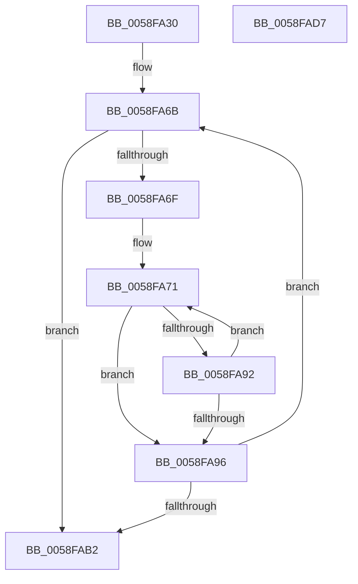

# VslpAddLiveDumpBufferChunk

- RVA: `0x0058FA30`–`0x0058FAD8` (길이 `168` bytes)
- VA: `0x000000014058FA30`
- 실행 섹션: `.text`
- PDB 이름 있음: `예`; PDB Function 태그: `아니요`
- unwind 정보 RVA: `0x000C6C04`
- 디코드: `46`개 명령, `168/168` bytes 표시
- 미해석 바이트: `0` (있으면 어셈블리에 `.byte`로 보존)

> 이 문서는 커널 이미지의 기계어와 PDB 기호를 분석해 생성했습니다. 4번과 5번은 함수 원형과 자료형을 바이너리 사용 방식에서 추정한 C 해석이며 원본 소스 복구 결과는 아닙니다.

## 1. Dependencies

- 직접 호출 지점: **4**; 고유 호출 대상: **4**
- 직접 호출자로 확인된 함수: **1**
- RIP 상대 이미지 참조: **1**

### Outgoing calls
- `0x0058FA64` → [memset](../6C/memset_function_006C6C40.md) (function, `0x006C6C40`)
- `0x0058FA74` → [MmGetPhysicalAddress](../23/MmGetPhysicalAddress_function_0023A500.md) (function, `0x0023A500`)
- `0x0058FAA9` → [VslpEnterIumSecureMode](../23/VslpEnterIumSecureMode_function_00235E50.md) (function, `0x00235E50`)
- `0x0058FABD` → [_security_check_cookie](../6A/_security_check_cookie_function_006AC640.md) (function, `0x006AC640`)

### Direct callers
- [HvlPrepareLivedumpDescriptor](HvlPrepareLivedumpDescriptor_function_0058B734.md) at `0x0058B7BC`

### Static image references
- `0x0058FA42` → RVA `0x00E0A740` (`.data`; read)

## 2. Other-region calls and transfers

- 다른 실행 섹션으로 향하는 call: **0**
- 별도 외부 분기/꼬리 이동을 확인하지 못했습니다.

## 3. Assembly (complete function range)

```asm
0058FA30  48 89 5C 24 10                  mov qword ptr [rsp + 0x10], rbx
0058FA35  48 89 74 24 18                  mov qword ptr [rsp + 0x18], rsi
0058FA3A  57                              push rdi
0058FA3B  48 81 EC A0 00 00 00            sub rsp, 0xa0
0058FA42  48 8B 05 F7 AC 87 00            mov rax, qword ptr [rip + 0x87acf7]
0058FA49  48 33 C4                        xor rax, rsp
0058FA4C  48 89 84 24 90 00 00 00         mov qword ptr [rsp + 0x90], rax
0058FA54  8B FA                           mov edi, edx
0058FA56  48 8B F1                        mov rsi, rcx
0058FA59  33 D2                           xor edx, edx
0058FA5B  48 8D 4C 24 20                  lea rcx, [rsp + 0x20]
0058FA60  44 8D 42 68                     lea r8d, [rdx + 0x68]
0058FA64  E8 D7 71 13 00                  call 0x1406c6c40
0058FA69  33 C0                           xor eax, eax
0058FA6B  85 FF                           test edi, edi
0058FA6D  74 43                           je 0x14058fab2
0058FA6F  33 DB                           xor ebx, ebx
0058FA71  48 8B CE                        mov rcx, rsi
0058FA74  E8 87 AA CA FF                  call 0x14023a500
0058FA79  48 C1 E8 0C                     shr rax, 0xc
0058FA7D  FF CF                           dec edi
0058FA7F  48 89 44 DC 30                  mov qword ptr [rsp + rbx*8 + 0x30], rax
0058FA84  48 81 C6 00 10 00 00            add rsi, 0x1000
0058FA8B  FF C3                           inc ebx
0058FA8D  83 FB 0B                        cmp ebx, 0xb
0058FA90  73 04                           jae 0x14058fa96
0058FA92  85 FF                           test edi, edi
0058FA94  75 DB                           jne 0x14058fa71
0058FA96  BA 3C 00 00 00                  mov edx, 0x3c
0058FA9B  89 5C 24 28                     mov dword ptr [rsp + 0x28], ebx
0058FA9F  4C 8D 4C 24 20                  lea r9, [rsp + 0x20]
0058FAA4  45 33 C0                        xor r8d, r8d
0058FAA7  B1 02                           mov cl, 2
0058FAA9  E8 A2 63 CA FF                  call 0x140235e50
0058FAAE  85 C0                           test eax, eax
0058FAB0  79 B9                           jns 0x14058fa6b
0058FAB2  48 8B 8C 24 90 00 00 00         mov rcx, qword ptr [rsp + 0x90]
0058FABA  48 33 CC                        xor rcx, rsp
0058FABD  E8 7E CB 11 00                  call 0x1406ac640
0058FAC2  4C 8D 9C 24 A0 00 00 00         lea r11, [rsp + 0xa0]
0058FACA  49 8B 5B 18                     mov rbx, qword ptr [r11 + 0x18]
0058FACE  49 8B 73 20                     mov rsi, qword ptr [r11 + 0x20]
0058FAD2  49 8B E3                        mov rsp, r11
0058FAD5  5F                              pop rdi
0058FAD6  C3                              ret
0058FAD7  CC                              int3
```

## 4. C-style interpretation (structured pseudocode)

```c
__int64 __fastcall VslpAddLiveDumpBufferChunk(__int64 a1, int a2)
{
    __int64 result;
    __int64 v_rbx;
    __int64 v_rdi;
    __int64 v_rsi;
    __int64 v_rsp;
    unsigned __int64 v_stack_m18;
    unsigned __int64 v_stack_m8;
    unsigned int v_stack_m80;
    unsigned __int64 v_stack_m88;
    unsigned __int64 v_stack_p10;
    unsigned __int64 v_stack_p18;

    v_stack_p10 = v_rbx;
    v_stack_p18 = v_rsi;
    v_rsp = (v_rsp) - (160);
    result = (*(unsigned __int64 *)(v_rip + 8891639)) ^ (v_rsp);
    v_stack_m18 = result;
    a2 = 0;
    result = memset(v_stack_m88, a2, a2 + 104, a4);
    result = 0;
loc_0058FA6B:
    if ((unsigned int)((unsigned int)(a2)) == 0) goto loc_0058FAB2;
    v_rbx = 0;
loc_0058FA71:
    result = MmGetPhysicalAddress(a1, a2, a2 + 104, a4);
    result = (result) >> (12);
    v_rdi = (unsigned int)(((unsigned int)(a2)) - 1);
    *(unsigned __int64 *)(v_rsp + v_rbx * 8 + 48) = result;
    v_rsi = (a1) + (0x1000ULL);
    v_rbx = (unsigned int)((v_rbx) + 1);
    if (((unsigned int)(v_rbx)) >= 11) goto loc_0058FA96;
    if ((unsigned int)(v_rdi) != 0) goto loc_0058FA71;
loc_0058FA96:
    v_stack_m80 = (unsigned int)(v_rbx);
    a3 = 0;
    result = VslpEnterIumSecureMode(2, 60, a3, v_stack_m88);
    if (!sign_flag) goto loc_0058FA6B;
loc_0058FAB2:
    a1 = (v_stack_m18) ^ (v_rsp);
    result = _security_check_cookie(a1, 60, a3, v_stack_m88);
    return result;
}
```

## 5. (Beta) C Style

```c
int64_t VslpAddLiveDumpBufferChunk(int64_t Arg1, int32_t Arg2)
{
    int64_t result;
    int64_t local_rbx;
    int64_t local_rdi;
    int64_t local_rsi;
    int64_t local_rsp;
    uint64_t v_stack_m18;
    uint64_t v_stack_m8;
    uint32_t v_stack_m80;
    uint64_t v_stack_m88;
    uint64_t v_stack_p10;
    uint64_t v_stack_p18;

    v_stack_p10 = local_rbx;
    v_stack_p18 = local_rsi;
    local_rsp = (local_rsp) - (160);
    result = (*(uint64_t *)(v_rip + 0x87ACF7)) ^ (local_rsp);
    v_stack_m18 = result;
    Arg2 = 0;
    result = memset(v_stack_m88, Arg2, Arg2 + 104, a4);
    result = 0;
loc_0058FA6B:
    if ((uint32_t)((uint32_t)(Arg2)) == 0) goto loc_0058FAB2;
    local_rbx = 0;
loc_0058FA71:
    result = MmGetPhysicalAddress(Arg1, Arg2, Arg2 + 104, a4);
    result = (result) >> (12);
    local_rdi = (uint32_t)(((uint32_t)(Arg2)) - 1);
    *(uint64_t *)(local_rsp + local_rbx * 8 + 0x30) = result;
    local_rsi = (Arg1) + (0x1000ULL);
    local_rbx = (uint32_t)((local_rbx) + 1);
    if (((uint32_t)(local_rbx)) >= 11) goto loc_0058FA96;
    if ((uint32_t)(local_rdi) != 0) goto loc_0058FA71;
loc_0058FA96:
    v_stack_m80 = (uint32_t)(local_rbx);
    a3 = 0;
    result = VslpEnterIumSecureMode(2, 60, a3, v_stack_m88);
    if (!sign_flag) goto loc_0058FA6B;
loc_0058FAB2:
    Arg1 = (v_stack_m18) ^ (local_rsp);
    result = _security_check_cookie(Arg1, 60, a3, v_stack_m88);
    return result;
}
```

## 6. Execution-region graph

[열기: 2D/3D 그래프와 함수 탐색 컨트롤 패널](../../../control-panel.html?section=text&rva=0x0058FA30&view=graph)

- 2D 그래프는 위에서 아래로 흐르고, 3D 그래프는 빈 공간을 드래그해 회전합니다. Shift+드래그는 이동, 휠은 확대·축소, 함수 노드 선택은 대상 보고서 이동입니다.

### Static fallback


