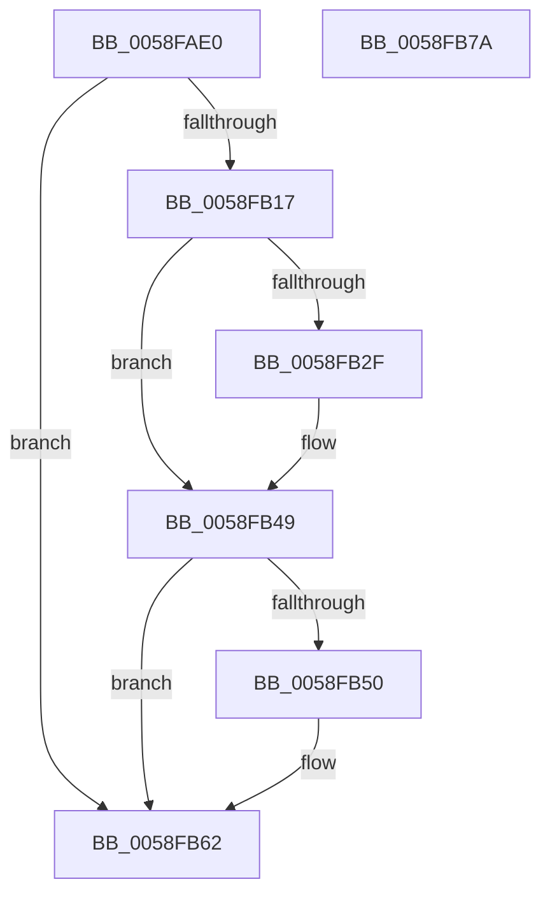

# VslpIumPhase4Initialize

- RVA: `0x0058FAE0`–`0x0058FB7B` (길이 `155` bytes)
- VA: `0x000000014058FAE0`
- 실행 섹션: `.text`
- PDB 이름 있음: `예`; PDB Function 태그: `아니요`
- unwind 정보 RVA: `0x00073604`
- 디코드: `37`개 명령, `155/155` bytes 표시
- 미해석 바이트: `0` (있으면 어셈블리에 `.byte`로 보존)

> 이 문서는 커널 이미지의 기계어와 PDB 기호를 분석해 생성했습니다. 4번과 5번은 함수 원형과 자료형을 바이너리 사용 방식에서 추정한 C 해석이며 원본 소스 복구 결과는 아닙니다.

## 1. Dependencies

- 직접 호출 지점: **6**; 고유 호출 대상: **6**
- 직접 호출자로 확인된 함수: **1**
- RIP 상대 이미지 참조: **2**

### Outgoing calls
- `0x0058FB04` → [memset](../6C/memset_function_006C6C40.md) (function, `0x006C6C40`)
- `0x0058FB09` → [VslpIumInitializeTelemetry](../../init/C2/VslpIumInitializeTelemetry_function_00C29EA0.md) (function, `0x00C29EA0`)
- `0x0058FB26` → [VslpEnterIumSecureMode](../23/VslpEnterIumSecureMode_function_00235E50.md) (function, `0x00235E50`)
- `0x0058FB43` → [KeBugCheckEx](../4F/KeBugCheckEx_function_004FD660.md) (function, `0x004FD660`)
- `0x0058FB5D` → [PoDisableSleepStates](../../page/75/PoDisableSleepStates_function_00757EE0.md) (function, `0x00757EE0`)
- `0x0058FB6D` → [_security_check_cookie](../6A/_security_check_cookie_function_006AC640.md) (function, `0x006AC640`)

### Direct callers
- [IoInitSystemPreDrivers](../../init/C2/IoInitSystemPreDrivers_function_00C2AC3C.md) at `0x00C2B93A`

### Static image references
- `0x0058FAE7` → RVA `0x00E0A740` (`.data`; read)
- `0x0058FB0E` → RVA `0x00FC6A84` (`ALMOSTRO`; read)

## 2. Other-region calls and transfers

- 다른 실행 섹션으로 향하는 call: **2**
  - `0x0058FB09` → [VslpIumInitializeTelemetry](../../init/C2/VslpIumInitializeTelemetry_function_00C29EA0.md) (`.text` → `INIT`)
  - `0x0058FB5D` → [PoDisableSleepStates](../../page/75/PoDisableSleepStates_function_00757EE0.md) (`.text` → `PAGE`)
- 별도 외부 분기/꼬리 이동을 확인하지 못했습니다.

## 3. Assembly (complete function range)

```asm
0058FAE0  48 81 EC C8 00 00 00            sub rsp, 0xc8
0058FAE7  48 8B 05 52 AC 87 00            mov rax, qword ptr [rip + 0x87ac52]
0058FAEE  48 33 C4                        xor rax, rsp
0058FAF1  48 89 84 24 B0 00 00 00         mov qword ptr [rsp + 0xb0], rax
0058FAF9  33 D2                           xor edx, edx
0058FAFB  48 8D 4C 24 40                  lea rcx, [rsp + 0x40]
0058FB00  44 8D 42 68                     lea r8d, [rdx + 0x68]
0058FB04  E8 37 71 13 00                  call 0x1406c6c40
0058FB09  E8 92 A3 69 00                  call 0x140c29ea0
0058FB0E  80 3D 6F 6F A3 00 00            cmp byte ptr [rip + 0xa36f6f], 0
0058FB15  74 4B                           je 0x14058fb62
0058FB17  BA 01 00 00 00                  mov edx, 1
0058FB1C  4C 8D 4C 24 40                  lea r9, [rsp + 0x40]
0058FB21  45 33 C0                        xor r8d, r8d
0058FB24  B1 02                           mov cl, 2
0058FB26  E8 25 63 CA FF                  call 0x140235e50
0058FB2B  85 C0                           test eax, eax
0058FB2D  79 1A                           jns 0x14058fb49
0058FB2F  48 83 64 24 20 00               and qword ptr [rsp + 0x20], 0
0058FB35  45 33 C9                        xor r9d, r9d
0058FB38  48 63 D0                        movsxd rdx, eax
0058FB3B  41 8D 49 6F                     lea ecx, [r9 + 0x6f]
0058FB3F  45 8D 41 03                     lea r8d, [r9 + 3]
0058FB43  E8 18 DB F6 FF                  call 0x1404fd660
0058FB48  CC                              int3
0058FB49  83 7C 24 50 00                  cmp dword ptr [rsp + 0x50], 0
0058FB4E  7D 12                           jge 0x14058fb62
0058FB50  BA 08 00 00 00                  mov edx, 8
0058FB55  4C 8D 44 24 30                  lea r8, [rsp + 0x30]
0058FB5A  8D 4A F9                        lea ecx, [rdx - 7]
0058FB5D  E8 7E 83 1C 00                  call 0x140757ee0
0058FB62  48 8B 8C 24 B0 00 00 00         mov rcx, qword ptr [rsp + 0xb0]
0058FB6A  48 33 CC                        xor rcx, rsp
0058FB6D  E8 CE CA 11 00                  call 0x1406ac640
0058FB72  48 81 C4 C8 00 00 00            add rsp, 0xc8
0058FB79  C3                              ret
0058FB7A  CC                              int3
```

## 4. C-style interpretation (structured pseudocode)

```c
__int64 __fastcall VslpIumPhase4Initialize(__int64 a1, int a2)
{
    __int64 result;
    __int64 v_rsp;
    unsigned __int64 v_stack_m18;
    unsigned int v_stack_m78;
    unsigned __int64 v_stack_m88;
    unsigned __int64 v_stack_m98;
    unsigned __int64 v_stack_mA8;

    v_rsp = (v_rsp) - (200);
    result = (*(unsigned __int64 *)(v_rip + 8891474)) ^ (v_rsp);
    v_stack_m18 = result;
    a2 = 0;
    result = memset(v_stack_m88, a2, a2 + 104, a4);
    result = VslpIumInitializeTelemetry(v_stack_m88, a2, a2 + 104, a4);
    if ((*(unsigned __int8 *)(v_rip + 10710895)) == 0) goto loc_0058FB62;
    a3 = 0;
    result = VslpEnterIumSecureMode(2, 1, a3, v_stack_m88);
    if (sign_flag) {
        a4 = 0;
        a2 = (int)((unsigned int)(result));
        a1 = a4 + 111;
        a3 = a4 + 3;
        result = KeBugCheckEx(a1, a2, a3, a4);
    }
    if (v_stack_m78 < 0) {
        a2 = 8;
        a3 = v_stack_m98;
        a1 = a2 - 7;
        result = PoDisableSleepStates(a1, a2, a3, a4);
    }
    a1 = (v_stack_m18) ^ (v_rsp);
    result = _security_check_cookie(a1, a2, a3, a4);
    v_rsp = (v_rsp) + (200);
    return result;
}
```

## 5. (Beta) C Style

```c
int64_t VslpIumPhase4Initialize(int64_t Arg1, int32_t Arg2)
{
    int64_t result;
    int64_t local_rsp;
    uint64_t v_stack_m18;
    uint32_t v_stack_m78;
    uint64_t v_stack_m88;
    uint64_t v_stack_m98;
    uint64_t v_stack_mA8;

    local_rsp = (local_rsp) - (200);
    result = (*(uint64_t *)(v_rip + 0x87AC52)) ^ (local_rsp);
    v_stack_m18 = result;
    Arg2 = 0;
    result = memset(v_stack_m88, Arg2, Arg2 + 104, a4);
    result = VslpIumInitializeTelemetry(v_stack_m88, Arg2, Arg2 + 104, a4);
    if ((*(uint8_t *)(v_rip + 0xA36F6F)) == 0) goto loc_0058FB62;
    a3 = 0;
    result = VslpEnterIumSecureMode(2, 1, a3, v_stack_m88);
    if (sign_flag) {
        a4 = 0;
        Arg2 = (int32_t)((uint32_t)(result));
        Arg1 = a4 + 111;
        a3 = a4 + 3;
        result = KeBugCheckEx(Arg1, Arg2, a3, a4);
    }
    if (v_stack_m78 < 0) {
        Arg2 = 8;
        a3 = v_stack_m98;
        Arg1 = Arg2 - 7;
        result = PoDisableSleepStates(Arg1, Arg2, a3, a4);
    }
    Arg1 = (v_stack_m18) ^ (local_rsp);
    result = _security_check_cookie(Arg1, Arg2, a3, a4);
    local_rsp = (local_rsp) + (200);
    return result;
}
```

## 6. Execution-region graph

[열기: 2D/3D 그래프와 함수 탐색 컨트롤 패널](../../../control-panel.html?section=text&rva=0x0058FAE0&view=graph)

- 2D 그래프는 위에서 아래로 흐르고, 3D 그래프는 빈 공간을 드래그해 회전합니다. Shift+드래그는 이동, 휠은 확대·축소, 함수 노드 선택은 대상 보고서 이동입니다.

### Static fallback


