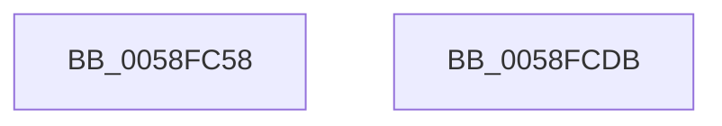

# VslpLiveDumpStart

- RVA: `0x0058FC58`–`0x0058FCDC` (길이 `132` bytes)
- VA: `0x000000014058FC58`
- 실행 섹션: `.text`
- PDB 이름 있음: `예`; PDB Function 태그: `아니요`
- unwind 정보 RVA: `0x000AFF04`
- 디코드: `32`개 명령, `132/132` bytes 표시
- 미해석 바이트: `0` (있으면 어셈블리에 `.byte`로 보존)

> 이 문서는 커널 이미지의 기계어와 PDB 기호를 분석해 생성했습니다. 4번과 5번은 함수 원형과 자료형을 바이너리 사용 방식에서 추정한 C 해석이며 원본 소스 복구 결과는 아닙니다.

## 1. Dependencies

- 직접 호출 지점: **3**; 고유 호출 대상: **3**
- 직접 호출자로 확인된 함수: **1**
- RIP 상대 이미지 참조: **1**

### Outgoing calls
- `0x0058FC8E` → [memset](../6C/memset_function_006C6C40.md) (function, `0x006C6C40`)
- `0x0058FCB1` → [VslpEnterIumSecureMode](../23/VslpEnterIumSecureMode_function_00235E50.md) (function, `0x00235E50`)
- `0x0058FCC1` → [_security_check_cookie](../6A/_security_check_cookie_function_006AC640.md) (function, `0x006AC640`)

### Direct callers
- [HvlPrepareLivedumpDescriptor](HvlPrepareLivedumpDescriptor_function_0058B734.md) at `0x0058B7A7`

### Static image references
- `0x0058FC6A` → RVA `0x00E0A740` (`.data`; read)

## 2. Other-region calls and transfers

- 다른 실행 섹션으로 향하는 call: **0**
- 별도 외부 분기/꼬리 이동을 확인하지 못했습니다.

## 3. Assembly (complete function range)

```asm
0058FC58  48 89 5C 24 08                  mov qword ptr [rsp + 8], rbx
0058FC5D  48 89 74 24 10                  mov qword ptr [rsp + 0x10], rsi
0058FC62  57                              push rdi
0058FC63  48 81 EC A0 00 00 00            sub rsp, 0xa0
0058FC6A  48 8B 05 CF AA 87 00            mov rax, qword ptr [rip + 0x87aacf]
0058FC71  48 33 C4                        xor rax, rsp
0058FC74  48 89 84 24 90 00 00 00         mov qword ptr [rsp + 0x90], rax
0058FC7C  8B FA                           mov edi, edx
0058FC7E  33 D2                           xor edx, edx
0058FC80  41 8B F0                        mov esi, r8d
0058FC83  8B D9                           mov ebx, ecx
0058FC85  48 8D 4C 24 20                  lea rcx, [rsp + 0x20]
0058FC8A  44 8D 42 68                     lea r8d, [rdx + 0x68]
0058FC8E  E8 AD 6F 13 00                  call 0x1406c6c40
0058FC93  BA 3B 00 00 00                  mov edx, 0x3b
0058FC98  48 89 5C 24 28                  mov qword ptr [rsp + 0x28], rbx
0058FC9D  4C 8D 4C 24 20                  lea r9, [rsp + 0x20]
0058FCA2  48 89 7C 24 30                  mov qword ptr [rsp + 0x30], rdi
0058FCA7  45 33 C0                        xor r8d, r8d
0058FCAA  48 89 74 24 38                  mov qword ptr [rsp + 0x38], rsi
0058FCAF  B1 02                           mov cl, 2
0058FCB1  E8 9A 61 CA FF                  call 0x140235e50
0058FCB6  48 8B 8C 24 90 00 00 00         mov rcx, qword ptr [rsp + 0x90]
0058FCBE  48 33 CC                        xor rcx, rsp
0058FCC1  E8 7A C9 11 00                  call 0x1406ac640
0058FCC6  4C 8D 9C 24 A0 00 00 00         lea r11, [rsp + 0xa0]
0058FCCE  49 8B 5B 10                     mov rbx, qword ptr [r11 + 0x10]
0058FCD2  49 8B 73 18                     mov rsi, qword ptr [r11 + 0x18]
0058FCD6  49 8B E3                        mov rsp, r11
0058FCD9  5F                              pop rdi
0058FCDA  C3                              ret
0058FCDB  CC                              int3
```

## 4. C-style interpretation (structured pseudocode)

```c
__int64 __fastcall VslpLiveDumpStart(int a1, int a2, int a3)
{
    __int64 result;
    __int64 v_rsp;
    unsigned __int64 v_stack_m18;
    unsigned __int64 v_stack_m70;
    unsigned __int64 v_stack_m78;
    unsigned __int64 v_stack_m8;
    unsigned __int64 v_stack_m80;
    unsigned __int64 v_stack_m88;
    unsigned __int64 v_stack_p10;
    unsigned __int64 v_stack_p8;

    v_stack_p8 = v_rbx;
    v_stack_p10 = v_rsi;
    v_rsp = (v_rsp) - (160);
    result = (*(unsigned __int64 *)(v_rip + 8891087)) ^ (v_rsp);
    v_stack_m18 = result;
    a2 = 0;
    result = memset(v_stack_m88, a2, a2 + 104, a4);
    v_stack_m80 = (unsigned int)(a1);
    v_stack_m78 = (unsigned int)(a2);
    a3 = 0;
    v_stack_m70 = (unsigned int)(a3);
    result = VslpEnterIumSecureMode(2, 59, a3, v_stack_m88);
    a1 = (v_stack_m18) ^ (v_rsp);
    result = _security_check_cookie(a1, 59, a3, v_stack_m88);
    return result;
}
```

## 5. (Beta) C Style

```c
int64_t VslpLiveDumpStart(int32_t Arg1, int32_t Arg2, int32_t Arg3)
{
    int64_t result;
    int64_t local_rsp;
    uint64_t v_stack_m18;
    uint64_t v_stack_m70;
    uint64_t v_stack_m78;
    uint64_t v_stack_m8;
    uint64_t v_stack_m80;
    uint64_t v_stack_m88;
    uint64_t v_stack_p10;
    uint64_t v_stack_p8;

    v_stack_p8 = local_rbx;
    v_stack_p10 = local_rsi;
    local_rsp = (local_rsp) - (160);
    result = (*(uint64_t *)(v_rip + 0x87AACF)) ^ (local_rsp);
    v_stack_m18 = result;
    Arg2 = 0;
    result = memset(v_stack_m88, Arg2, Arg2 + 104, a4);
    v_stack_m80 = (uint32_t)(Arg1);
    v_stack_m78 = (uint32_t)(Arg2);
    Arg3 = 0;
    v_stack_m70 = (uint32_t)(Arg3);
    result = VslpEnterIumSecureMode(2, 59, Arg3, v_stack_m88);
    Arg1 = (v_stack_m18) ^ (local_rsp);
    result = _security_check_cookie(Arg1, 59, Arg3, v_stack_m88);
    return result;
}
```

## 6. Execution-region graph

[열기: 2D/3D 그래프와 함수 탐색 컨트롤 패널](../../../control-panel.html?section=text&rva=0x0058FC58&view=graph)

- 2D 그래프는 위에서 아래로 흐르고, 3D 그래프는 빈 공간을 드래그해 회전합니다. Shift+드래그는 이동, 휠은 확대·축소, 함수 노드 선택은 대상 보고서 이동입니다.

### Static fallback


