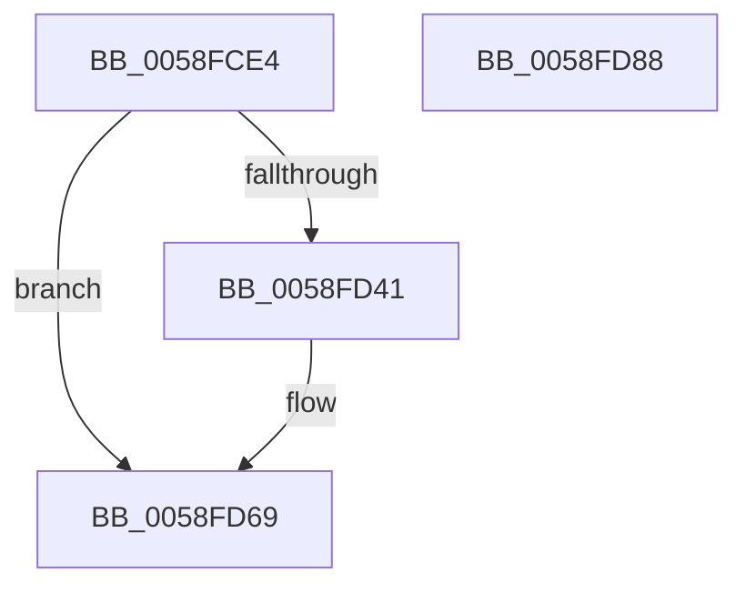

# VslpSetupLiveDumpBuffer

- RVA: `0x0058FCE4`–`0x0058FD89` (길이 `165` bytes)
- VA: `0x000000014058FCE4`
- 실행 섹션: `.text`
- PDB 이름 있음: `예`; PDB Function 태그: `아니요`
- unwind 정보 RVA: `0x000C6BE4`
- 디코드: `46`개 명령, `165/165` bytes 표시
- 미해석 바이트: `0` (있으면 어셈블리에 `.byte`로 보존)

> 이 문서는 커널 이미지의 기계어와 PDB 기호를 분석해 생성했습니다. 4번과 5번은 함수 원형과 자료형을 바이너리 사용 방식에서 추정한 C 해석이며 원본 소스 복구 결과는 아닙니다.

## 1. Dependencies

- 직접 호출 지점: **3**; 고유 호출 대상: **3**
- 직접 호출자로 확인된 함수: **1**
- RIP 상대 이미지 참조: **1**

### Outgoing calls
- `0x0058FD24` → [memset](../6C/memset_function_006C6C40.md) (function, `0x006C6C40`)
- `0x0058FD38` → [VslpEnterIumSecureMode](../23/VslpEnterIumSecureMode_function_00235E50.md) (function, `0x00235E50`)
- `0x0058FD74` → [_security_check_cookie](../6A/_security_check_cookie_function_006AC640.md) (function, `0x006AC640`)

### Direct callers
- [HvlPrepareLivedumpDescriptor](HvlPrepareLivedumpDescriptor_function_0058B734.md) at `0x0058B7F7`

### Static image references
- `0x0058FCF3` → RVA `0x00E0A740` (`.data`; read)

## 2. Other-region calls and transfers

- 다른 실행 섹션으로 향하는 call: **0**
- 별도 외부 분기/꼬리 이동을 확인하지 못했습니다.

## 3. Assembly (complete function range)

```asm
0058FCE4  40 53                           push rbx
0058FCE6  56                              push rsi
0058FCE7  57                              push rdi
0058FCE8  41 56                           push r14
0058FCEA  41 57                           push r15
0058FCEC  48 81 EC A0 00 00 00            sub rsp, 0xa0
0058FCF3  48 8B 05 46 AA 87 00            mov rax, qword ptr [rip + 0x87aa46]
0058FCFA  48 33 C4                        xor rax, rsp
0058FCFD  48 89 84 24 90 00 00 00         mov qword ptr [rsp + 0x90], rax
0058FD05  4C 8B BC 24 F0 00 00 00         mov r15, qword ptr [rsp + 0xf0]
0058FD0D  48 8B FA                        mov rdi, rdx
0058FD10  33 D2                           xor edx, edx
0058FD12  49 8B F0                        mov rsi, r8
0058FD15  48 8B D9                        mov rbx, rcx
0058FD18  4D 8B F1                        mov r14, r9
0058FD1B  48 8D 4C 24 20                  lea rcx, [rsp + 0x20]
0058FD20  44 8D 42 68                     lea r8d, [rdx + 0x68]
0058FD24  E8 17 6F 13 00                  call 0x1406c6c40
0058FD29  BA 3D 00 00 00                  mov edx, 0x3d
0058FD2E  4C 8D 4C 24 20                  lea r9, [rsp + 0x20]
0058FD33  45 33 C0                        xor r8d, r8d
0058FD36  B1 02                           mov cl, 2
0058FD38  E8 13 61 CA FF                  call 0x140235e50
0058FD3D  85 C0                           test eax, eax
0058FD3F  78 28                           js 0x14058fd69
0058FD41  48 8B 4C 24 30                  mov rcx, qword ptr [rsp + 0x30]
0058FD46  48 89 0B                        mov qword ptr [rbx], rcx
0058FD49  48 8B 4C 24 38                  mov rcx, qword ptr [rsp + 0x38]
0058FD4E  48 89 0F                        mov qword ptr [rdi], rcx
0058FD51  48 8B 4C 24 40                  mov rcx, qword ptr [rsp + 0x40]
0058FD56  48 89 0E                        mov qword ptr [rsi], rcx
0058FD59  48 8B 4C 24 48                  mov rcx, qword ptr [rsp + 0x48]
0058FD5E  49 89 0E                        mov qword ptr [r14], rcx
0058FD61  48 8B 4C 24 50                  mov rcx, qword ptr [rsp + 0x50]
0058FD66  49 89 0F                        mov qword ptr [r15], rcx
0058FD69  48 8B 8C 24 90 00 00 00         mov rcx, qword ptr [rsp + 0x90]
0058FD71  48 33 CC                        xor rcx, rsp
0058FD74  E8 C7 C8 11 00                  call 0x1406ac640
0058FD79  48 81 C4 A0 00 00 00            add rsp, 0xa0
0058FD80  41 5F                           pop r15
0058FD82  41 5E                           pop r14
0058FD84  5F                              pop rdi
0058FD85  5E                              pop rsi
0058FD86  5B                              pop rbx
0058FD87  C3                              ret
0058FD88  CC                              int3
```

## 4. C-style interpretation (structured pseudocode)

```c
__int64 __fastcall VslpSetupLiveDumpBuffer(__int64 a1, __int64 a2, __int64 a3, __int64 a4, __int64 a5)
{
    __int64 result;
    __int64 v_rsp;
    unsigned __int64 v_stack_m38;
    unsigned __int64 v_stack_m78;
    unsigned __int64 v_stack_m80;
    unsigned __int64 v_stack_m88;
    unsigned __int64 v_stack_m90;
    unsigned __int64 v_stack_m98;
    unsigned __int64 v_stack_mA8;

    v_rsp = (v_rsp) - (160);
    result = (*(unsigned __int64 *)(v_rip + 8890950)) ^ (v_rsp);
    v_stack_m38 = result;
    a2 = 0;
    result = memset(v_stack_mA8, a2, a2 + 104, a4);
    a3 = 0;
    result = VslpEnterIumSecureMode(2, 61, a3, v_stack_mA8);
    if (!(sign_flag)) {
        a1 = v_stack_m98;
        *(unsigned __int64 *)(a1) = a1;
        a1 = v_stack_m90;
        *(unsigned __int64 *)(a2) = a1;
        a1 = v_stack_m88;
        *(unsigned __int64 *)(a3) = a1;
        a1 = v_stack_m80;
        *(unsigned __int64 *)(a4) = a1;
        a1 = v_stack_m78;
        *(unsigned __int64 *)(a5) = a1;
    }
    a1 = (v_stack_m38) ^ (v_rsp);
    result = _security_check_cookie(a1, 61, a3, v_stack_mA8);
    v_rsp = (v_rsp) + (160);
    return result;
}
```

## 5. (Beta) C Style

```c
int64_t VslpSetupLiveDumpBuffer(void *Arg1, void *Arg2, void *Arg3, void *Arg4, void *Arg5)
{
    uint8_t *arg1 = (uint8_t *)Arg1;
    uint8_t *arg2 = (uint8_t *)Arg2;
    uint8_t *arg3 = (uint8_t *)Arg3;
    uint8_t *arg4 = (uint8_t *)Arg4;
    uint8_t *arg5 = (uint8_t *)Arg5;

    int64_t result;
    int64_t local_rsp;
    uint64_t v_stack_m38;
    uint64_t v_stack_m78;
    uint64_t v_stack_m80;
    uint64_t v_stack_m88;
    uint64_t v_stack_m90;
    uint64_t v_stack_m98;
    uint64_t v_stack_mA8;

    local_rsp = (local_rsp) - (160);
    result = (*(uint64_t *)(v_rip + 0x87AA46)) ^ (local_rsp);
    v_stack_m38 = result;
    Arg2 = 0;
    result = memset(v_stack_mA8, Arg2, Arg2 + 104, Arg4);
    Arg3 = 0;
    result = VslpEnterIumSecureMode(2, 61, Arg3, v_stack_mA8);
    if (!(sign_flag)) {
        Arg1 = v_stack_m98;
        *(void **)(arg1) = Arg1;
        Arg1 = v_stack_m90;
        *(void **)(arg2) = Arg1;
        Arg1 = v_stack_m88;
        *(void **)(arg3) = Arg1;
        Arg1 = v_stack_m80;
        *(void **)(arg4) = Arg1;
        Arg1 = v_stack_m78;
        *(void **)(arg5) = Arg1;
    }
    Arg1 = (v_stack_m38) ^ (local_rsp);
    result = _security_check_cookie(Arg1, 61, Arg3, v_stack_mA8);
    local_rsp = (local_rsp) + (160);
    return result;
}
```

### 관측된 메모리 오프셋

구조체 형식이 확인되지 않은 접근은 인자 기준의 오프셋으로만 기록했습니다.

| 기준 인자 | 오프셋 표현 | 폭 (bit) | 접근 |
|---|---:|---:|---|
| `Arg1` | `+ 0x0` | `64` | `W` |
| `Arg2` | `+ 0x0` | `64` | `W` |
| `Arg3` | `+ 0x0` | `64` | `W` |
| `Arg4` | `+ 0x0` | `64` | `W` |
| `Arg5` | `+ 0x0` | `64` | `W` |

## 6. Execution-region graph

[열기: 2D/3D 그래프와 함수 탐색 컨트롤 패널](../../../control-panel.html?section=text&rva=0x0058FCE4&view=graph)

- 2D 그래프는 위에서 아래로 흐르고, 3D 그래프는 빈 공간을 드래그해 회전합니다. Shift+드래그는 이동, 휠은 확대·축소, 함수 노드 선택은 대상 보고서 이동입니다.

### Static fallback


