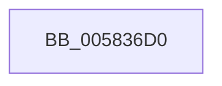

# xHalAssignSlotResources

- RVA: `0x005836D0`–`0x005836EE` (길이 `30` bytes)
- VA: `0x00000001405836D0`
- 실행 섹션: `.text`
- PDB 이름 있음: `예`; PDB Function 태그: `아니요`
- unwind 정보 RVA: `0x000622F0`
- 디코드: `8`개 명령, `30/30` bytes 표시
- 미해석 바이트: `0` (있으면 어셈블리에 `.byte`로 보존)

> 이 문서는 커널 이미지의 기계어와 PDB 기호를 분석해 생성했습니다. 4번과 5번은 함수 원형과 자료형을 바이너리 사용 방식에서 추정한 C 해석이며 원본 소스 복구 결과는 아닙니다.

## 1. Dependencies

- 직접 호출 지점: **1**; 고유 호출 대상: **1**
- 직접 호출자로 확인된 함수: **0**
- RIP 상대 이미지 참조: **0**

### Outgoing calls
- `0x005836E8` → [KeBugCheckEx](../4F/KeBugCheckEx_function_004FD660.md) (function, `0x004FD660`)

### Direct callers
- 이 함수 시작 RVA로 연결되는 직접 call은 확인되지 않았습니다. 간접 호출은 완전히 역산할 수 없습니다.

### Static image references
- 디코드된 RIP-relative 메모리 참조가 없습니다.

## 2. Other-region calls and transfers

- 다른 실행 섹션으로 향하는 call: **0**
- 별도 외부 분기/꼬리 이동을 확인하지 못했습니다.

## 3. Assembly (complete function range)

```asm
005836D0  48 83 EC 38                     sub rsp, 0x38
005836D4  33 D2                           xor edx, edx
005836D6  48 C7 44 24 20 07 00 00 00      mov qword ptr [rsp + 0x20], 7
005836DF  45 33 C9                        xor r9d, r9d
005836E2  45 33 C0                        xor r8d, r8d
005836E5  8D 4A 5C                        lea ecx, [rdx + 0x5c]
005836E8  E8 73 9F F7 FF                  call 0x1404fd660
005836ED  CC                              int3
```

## 4. C-style interpretation (structured pseudocode)

```c
__int64 __fastcall xHalAssignSlotResources(__int64 a1, int a2, int a3, int a4)
{
    __int64 result;
    __int64 v_rsp;
    unsigned __int64 v_stack_m18;

    v_rsp = (v_rsp) - (56);
    a2 = 0;
    v_stack_m18 = 7;
    a4 = 0;
    a3 = 0;
    result = KeBugCheckEx(a2 + 92, a2, a3, a4);
    return result;
}
```

## 5. (Beta) C Style

```c
int64_t xHalAssignSlotResources(int64_t Arg1, int32_t Arg2, int32_t Arg3, int32_t Arg4)
{
    int64_t result;
    int64_t local_rsp;
    uint64_t v_stack_m18;

    local_rsp = (local_rsp) - (56);
    Arg2 = 0;
    v_stack_m18 = 7;
    Arg4 = 0;
    Arg3 = 0;
    result = KeBugCheckEx(Arg2 + 92, Arg2, Arg3, Arg4);
    return result;
}
```

## 6. Execution-region graph

[열기: 2D/3D 그래프와 함수 탐색 컨트롤 패널](../../../control-panel.html?section=text&rva=0x005836D0&view=graph)

- 2D 그래프는 위에서 아래로 흐르고, 3D 그래프는 빈 공간을 드래그해 회전합니다. Shift+드래그는 이동, 휠은 확대·축소, 함수 노드 선택은 대상 보고서 이동입니다.

### Static fallback


