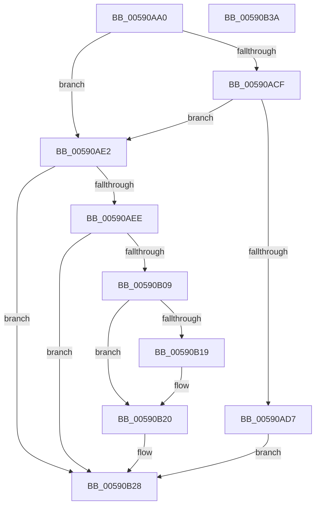

# BgkAcquireDisplayOwnership

- RVA: `0x00590AA0`–`0x00590B3B` (길이 `155` bytes)
- VA: `0x0000000140590AA0`
- 실행 섹션: `.text`
- PDB 이름 있음: `예`; PDB Function 태그: `아니요`
- unwind 정보 RVA: `0x0006F9F8`
- 디코드: `40`개 명령, `155/155` bytes 표시
- 미해석 바이트: `0` (있으면 어셈블리에 `.byte`로 보존)

> 이 문서는 커널 이미지의 기계어와 PDB 기호를 분석해 생성했습니다. 4번과 5번은 함수 원형과 자료형을 바이너리 사용 방식에서 추정한 C 해석이며 원본 소스 복구 결과는 아닙니다.

## 1. Dependencies

- 직접 호출 지점: **4**; 고유 호출 대상: **3**
- 직접 호출자로 확인된 함수: **0**
- RIP 상대 이미지 참조: **6**

### Outgoing calls
- `0x00590ADB` → [BgLibraryEnable](../69/BgLibraryEnable_function_0069E9CC.md) (function, `0x0069E9CC`)
- `0x00590B00` → [guard_dispatch_icall](../6B/guard_dispatch_icall_function_006BAAD0.md) (function, `0x006BAAD0`)
- `0x00590B10` → [BgLibraryEnable](../69/BgLibraryEnable_function_0069E9CC.md) (function, `0x0069E9CC`)
- `0x00590B30` → [_security_check_cookie](../6A/_security_check_cookie_function_006AC640.md) (function, `0x006AC640`)

### Direct callers
- 이 함수 시작 RVA로 연결되는 직접 call은 확인되지 않았습니다. 간접 호출은 완전히 역산할 수 없습니다.

### Static image references
- `0x00590AA4` → RVA `0x00E0A740` (`.data`; read)
- `0x00590AB8` → RVA `0x00E65EBA` (`.data`; read)
- `0x00590ACF` → RVA `0x00E65E80` (`.data`; read)
- `0x00590AE2` → RVA `0x00E65E88` (`.data`; read)
- `0x00590B19` → RVA `0x00E65EBA` (`.data`; write)
- `0x00590B20` → RVA `0x00E65E70` (`.data`; read/write)

## 2. Other-region calls and transfers

- 다른 실행 섹션으로 향하는 call: **0**
- 별도 외부 분기/꼬리 이동을 확인하지 못했습니다.

## 3. Assembly (complete function range)

```asm
00590AA0  48 83 EC 68                     sub rsp, 0x68
00590AA4  48 8B 05 95 9C 87 00            mov rax, qword ptr [rip + 0x879c95]
00590AAB  48 33 C4                        xor rax, rsp
00590AAE  48 89 44 24 50                  mov qword ptr [rsp + 0x50], rax
00590AB3  33 C0                           xor eax, eax
00590AB5  0F 57 C0                        xorps xmm0, xmm0
00590AB8  38 05 FC 53 8D 00               cmp byte ptr [rip + 0x8d53fc], al
00590ABE  0F 11 44 24 28                  movups xmmword ptr [rsp + 0x28], xmm0
00590AC3  48 89 44 24 48                  mov qword ptr [rsp + 0x48], rax
00590AC8  0F 11 44 24 38                  movups xmmword ptr [rsp + 0x38], xmm0
00590ACD  74 13                           je 0x140590ae2
00590ACF  38 05 AB 53 8D 00               cmp byte ptr [rip + 0x8d53ab], al
00590AD5  75 0B                           jne 0x140590ae2
00590AD7  B2 01                           mov dl, 1
00590AD9  33 C9                           xor ecx, ecx
00590ADB  E8 EC DE 10 00                  call 0x14069e9cc
00590AE0  EB 46                           jmp 0x140590b28
00590AE2  48 8B 05 9F 53 8D 00            mov rax, qword ptr [rip + 0x8d539f]
00590AE9  48 85 C0                        test rax, rax
00590AEC  74 3A                           je 0x140590b28
00590AEE  48 83 64 24 20 00               and qword ptr [rsp + 0x20], 0
00590AF4  4C 8D 44 24 20                  lea r8, [rsp + 0x20]
00590AF9  48 8D 54 24 28                  lea rdx, [rsp + 0x28]
00590AFE  B1 01                           mov cl, 1
00590B00  E8 CB 9F 12 00                  call 0x1406baad0
00590B05  85 C0                           test eax, eax
00590B07  78 1F                           js 0x140590b28
00590B09  B2 01                           mov dl, 1
00590B0B  48 8D 4C 24 28                  lea rcx, [rsp + 0x28]
00590B10  E8 B7 DE 10 00                  call 0x14069e9cc
00590B15  85 C0                           test eax, eax
00590B17  78 07                           js 0x140590b20
00590B19  C6 05 9A 53 8D 00 01            mov byte ptr [rip + 0x8d539a], 1
00590B20  48 83 25 48 53 8D 00 00         and qword ptr [rip + 0x8d5348], 0
00590B28  48 8B 4C 24 50                  mov rcx, qword ptr [rsp + 0x50]
00590B2D  48 33 CC                        xor rcx, rsp
00590B30  E8 0B BB 11 00                  call 0x1406ac640
00590B35  48 83 C4 68                     add rsp, 0x68
00590B39  C3                              ret
00590B3A  CC                              int3
```

## 4. C-style interpretation (structured pseudocode)

```c
__int64 __fastcall BgkAcquireDisplayOwnership(int a1)
{
    __int64 result;
    __int64 v_rsp;
    unsigned __int64 v_stack_m18;
    unsigned __int64 v_stack_m20;
    unsigned __int64 v_stack_m30;
    unsigned __int64 v_stack_m40;
    unsigned __int64 v_stack_m48;

    v_rsp = (v_rsp) - (104);
    result = (*(unsigned __int64 *)(v_rip + 8887445)) ^ (v_rsp);
    v_stack_m18 = result;
    result = 0;
    v_stack_m40 = v_xmm0;
    v_stack_m20 = 0;
    v_stack_m30 = v_xmm0;
    if ((*(unsigned __int8 *)(v_rip + 9262076)) == 0) goto loc_00590AE2;
    if ((*(unsigned __int8 *)(v_rip + 9261995)) != 0) goto loc_00590AE2;
    a1 = 0;
    result = BgLibraryEnable(a1, 1, a3, a4);
    goto loc_00590B28;
loc_00590AE2:
    if (*(unsigned __int64 *)(v_rip + 9261983) == 0) goto loc_00590B28;
    result = guard_dispatch_icall(1, v_stack_m40, v_stack_m48, a4);
    if (sign_flag) goto loc_00590B28;
    result = BgLibraryEnable(v_stack_m40, 1, v_stack_m48, a4);
    if (!(sign_flag)) {
        *(unsigned __int8 *)(v_rip + 9261978) = 1;
    }
loc_00590B28:
    a1 = (v_stack_m18) ^ (v_rsp);
    result = _security_check_cookie(a1, 1, v_stack_m48, a4);
    v_rsp = (v_rsp) + (104);
    return result;
}
```

## 5. (Beta) C Style

```c
int64_t BgkAcquireDisplayOwnership(int32_t Arg1)
{
    int64_t result;
    int64_t local_rsp;
    uint64_t v_stack_m18;
    uint64_t v_stack_m20;
    uint64_t v_stack_m30;
    uint64_t v_stack_m40;
    uint64_t v_stack_m48;

    local_rsp = (local_rsp) - (104);
    result = (*(uint64_t *)(v_rip + 0x879C95)) ^ (local_rsp);
    v_stack_m18 = result;
    result = 0;
    v_stack_m40 = v_xmm0;
    v_stack_m20 = 0;
    v_stack_m30 = v_xmm0;
    if ((*(uint8_t *)(v_rip + 0x8D53FC)) == 0) goto loc_00590AE2;
    if ((*(uint8_t *)(v_rip + 0x8D53AB)) != 0) goto loc_00590AE2;
    Arg1 = 0;
    result = BgLibraryEnable(Arg1, 1, a3, a4);
    goto loc_00590B28;
loc_00590AE2:
    if (*(uint64_t *)(v_rip + 0x8D539F) == 0) goto loc_00590B28;
    result = guard_dispatch_icall(1, v_stack_m40, v_stack_m48, a4);
    if (sign_flag) goto loc_00590B28;
    result = BgLibraryEnable(v_stack_m40, 1, v_stack_m48, a4);
    if (!(sign_flag)) {
        *(uint8_t *)(v_rip + 0x8D539A) = 1;
    }
loc_00590B28:
    Arg1 = (v_stack_m18) ^ (local_rsp);
    result = _security_check_cookie(Arg1, 1, v_stack_m48, a4);
    local_rsp = (local_rsp) + (104);
    return result;
}
```

## 6. Execution-region graph

[열기: 2D/3D 그래프와 함수 탐색 컨트롤 패널](../../../control-panel.html?section=text&rva=0x00590AA0&view=graph)

- 2D 그래프는 위에서 아래로 흐르고, 3D 그래프는 빈 공간을 드래그해 회전합니다. Shift+드래그는 이동, 휠은 확대·축소, 함수 노드 선택은 대상 보고서 이동입니다.

### Static fallback


