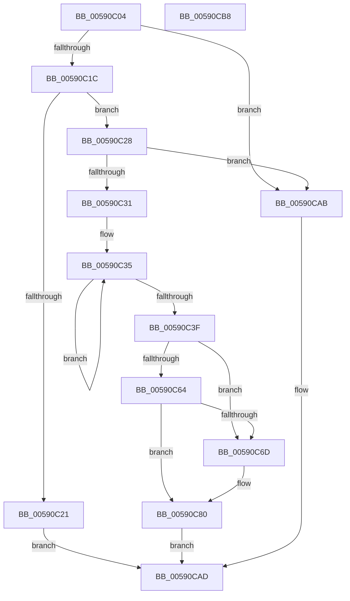

# BgkDisplayStringEx

- RVA: `0x00590C04`–`0x00590CB9` (길이 `181` bytes)
- VA: `0x0000000140590C04`
- 실행 섹션: `.text`
- PDB 이름 있음: `예`; PDB Function 태그: `아니요`
- unwind 정보 RVA: `0x0006E5F8`
- 디코드: `48`개 명령, `181/181` bytes 표시
- 미해석 바이트: `0` (있으면 어셈블리에 `.byte`로 보존)

> 이 문서는 커널 이미지의 기계어와 PDB 기호를 분석해 생성했습니다. 4번과 5번은 함수 원형과 자료형을 바이너리 사용 방식에서 추정한 C 해석이며 원본 소스 복구 결과는 아닙니다.

## 1. Dependencies

- 직접 호출 지점: **5**; 고유 호출 대상: **5**
- 직접 호출자로 확인된 함수: **2**
- RIP 상대 이미지 참조: **6**

### Outgoing calls
- `0x00590C28` → [BgkpAcquireConsole](BgkpAcquireConsole_function_005911C8.md) (function, `0x005911C8`)
- `0x00590C56` → [HeadlessDispatch](../65/HeadlessDispatch_function_00655C40.md) (function, `0x00655C40`)
- `0x00590C7B` → [BgDisplayFade](../../pagebgfx/BC/BgDisplayFade_function_00BC36A4.md) (function, `0x00BC36A4`)
- `0x00590C8E` → [guard_dispatch_icall](../6B/guard_dispatch_icall_function_006BAAD0.md) (function, `0x006BAAD0`)
- `0x00590CA2` → [ExReleaseRundownProtection](../34/ExReleaseRundownProtection_function_00349E80.md) (function, `0x00349E80`)

### Direct callers
- [BgkDisplayString](BgkDisplayString_function_00590B50.md) at `0x00590BCC`
- [NtDisplayString](../../page/7C/NtDisplayString_function_007C7270.md) at `0x007C73D8`

### Static image references
- `0x00590C5B` → RVA `0x00E65EB8` (`.data`; read)
- `0x00590C64` → RVA `0x00E65E81` (`.data`; read)
- `0x00590C6D` → RVA `0x00E65EB8` (`.data`; write)
- `0x00590C74` → RVA `0x00E65E81` (`.data`; write)
- `0x00590C80` → RVA `0x00E65E70` (`.data`; read)
- `0x00590C95` → RVA `0x00E0A9A0` (`.data`; read)

## 2. Other-region calls and transfers

- 다른 실행 섹션으로 향하는 call: **1**
  - `0x00590C7B` → [BgDisplayFade](../../pagebgfx/BC/BgDisplayFade_function_00BC36A4.md) (`.text` → `PAGEBGFX`)
- 별도 외부 분기/꼬리 이동을 확인하지 못했습니다.

## 3. Assembly (complete function range)

```asm
00590C04  48 89 5C 24 08                  mov qword ptr [rsp + 8], rbx
00590C09  57                              push rdi
00590C0A  48 83 EC 30                     sub rsp, 0x30
00590C0E  33 FF                           xor edi, edi
00590C10  48 8B D9                        mov rbx, rcx
00590C13  48 85 C9                        test rcx, rcx
00590C16  0F 84 8F 00 00 00               je 0x140590cab
00590C1C  66 39 39                        cmp word ptr [rcx], di
00590C1F  75 07                           jne 0x140590c28
00590C21  B0 01                           mov al, 1
00590C23  E9 85 00 00 00                  jmp 0x140590cad
00590C28  E8 9B 05 00 00                  call 0x1405911c8
00590C2D  84 C0                           test al, al
00590C2F  74 7A                           je 0x140590cab
00590C31  49 83 C8 FF                     or r8, 0xffffffffffffffff
00590C35  49 FF C0                        inc r8
00590C38  66 42 39 3C 43                  cmp word ptr [rbx + r8*2], di
00590C3D  75 F6                           jne 0x140590c35
00590C3F  45 33 C9                        xor r9d, r9d
00590C42  48 89 7C 24 20                  mov qword ptr [rsp + 0x20], rdi
00590C47  4E 8D 04 45 02 00 00 00         lea r8, [r8*2 + 2]
00590C4F  48 8B D3                        mov rdx, rbx
00590C52  41 8D 49 17                     lea ecx, [r9 + 0x17]
00590C56  E8 E5 4F 0C 00                  call 0x140655c40
00590C5B  40 38 3D 56 52 8D 00            cmp byte ptr [rip + 0x8d5256], dil
00590C62  75 09                           jne 0x140590c6d
00590C64  40 38 3D 16 52 8D 00            cmp byte ptr [rip + 0x8d5216], dil
00590C6B  74 13                           je 0x140590c80
00590C6D  40 88 3D 44 52 8D 00            mov byte ptr [rip + 0x8d5244], dil
00590C74  40 88 3D 06 52 8D 00            mov byte ptr [rip + 0x8d5206], dil
00590C7B  E8 24 2A 63 00                  call 0x140bc36a4
00590C80  48 8B 05 E9 51 8D 00            mov rax, qword ptr [rip + 0x8d51e9]
00590C87  48 8B CB                        mov rcx, rbx
00590C8A  48 8B 40 18                     mov rax, qword ptr [rax + 0x18]
00590C8E  E8 3D 9E 12 00                  call 0x1406baad0
00590C93  8B D8                           mov ebx, eax
00590C95  48 8D 0D 04 9D 87 00            lea rcx, [rip + 0x879d04]
00590C9C  C1 EB 1F                        shr ebx, 0x1f
00590C9F  80 F3 01                        xor bl, 1
00590CA2  E8 D9 91 DB FF                  call 0x140349e80
00590CA7  8A C3                           mov al, bl
00590CA9  EB 02                           jmp 0x140590cad
00590CAB  32 C0                           xor al, al
00590CAD  48 8B 5C 24 40                  mov rbx, qword ptr [rsp + 0x40]
00590CB2  48 83 C4 30                     add rsp, 0x30
00590CB6  5F                              pop rdi
00590CB7  C3                              ret
00590CB8  CC                              int3
```

## 4. C-style interpretation (structured pseudocode)

```c
__int64 __fastcall BgkDisplayStringEx(__int64 a1, __int64 a2, __int64 a3, int a4)
{
    __int64 result;
    __int64 v_rbx;
    __int64 v_rdi;
    __int64 v_rsp;
    unsigned __int64 v_stack_m18;
    unsigned __int64 v_stack_p8;

    v_stack_p8 = v_rbx;
    v_rsp = (v_rsp) - (48);
    v_rdi = 0;
    if (a1 == 0) goto loc_00590CAB;
    if ((*(unsigned __int16 *)(a1)) != 0) goto loc_00590C28;
    goto loc_00590CAD;
loc_00590C28:
    result = BgkpAcquireConsole(a1, a2, a3, a4);
    if ((unsigned __int8)(result) == 0) goto loc_00590CAB;
    a3 = (a3) | (-1);
loc_00590C35:
    a3 = (a3) + 1;
    if ((*(unsigned __int16 *)(a1 + a3 * 2)) != 0) goto loc_00590C35;
    a4 = 0;
    v_stack_m18 = 0;
    result = HeadlessDispatch(a4 + 23, a1, a3 * 2 + 2, a4);
    if ((*(unsigned __int8 *)(v_rip + 9261654)) != 0) goto loc_00590C6D;
    if ((*(unsigned __int8 *)(v_rip + 9261590)) != 0) {
        *(unsigned __int8 *)(v_rip + 9261636) = 0;
        *(unsigned __int8 *)(v_rip + 9261574) = 0;
        result = BgDisplayFade(a4 + 23, a1, a3 * 2 + 2, a4);
    }
    result = guard_dispatch_icall(a1, a1, a3 * 2 + 2, a4);
    v_rbx = (unsigned int)(((unsigned int)((unsigned int)(result))) >> (31));
    v_rbx = (unsigned __int8)((v_rbx) ^ (1));
    result = ExReleaseRundownProtection(v_rip + 8887556, a1, a3 * 2 + 2, a4);
    goto loc_00590CAD;
loc_00590CAB:
    result = 0;
loc_00590CAD:
    v_rsp = (v_rsp) + (48);
    return result;
}
```

## 5. (Beta) C Style

```c
int64_t BgkDisplayStringEx(void *Arg1, int64_t Arg2, int64_t Arg3, int32_t Arg4)
{
    uint8_t *arg1 = (uint8_t *)Arg1;

    int64_t result;
    int64_t local_rbx;
    int64_t local_rdi;
    int64_t local_rsp;
    uint64_t v_stack_m18;
    uint64_t v_stack_p8;

    v_stack_p8 = local_rbx;
    local_rsp = (local_rsp) - (48);
    local_rdi = 0;
    if (Arg1 == NULL) goto loc_00590CAB;
    if ((*(uint16_t *)(arg1)) != 0) goto loc_00590C28;
    goto loc_00590CAD;
loc_00590C28:
    result = BgkpAcquireConsole(Arg1, Arg2, Arg3, Arg4);
    if ((uint8_t)(result) == 0) goto loc_00590CAB;
    Arg3 = (Arg3) | (-1);
loc_00590C35:
    Arg3 = (Arg3) + 1;
    if ((*(uint16_t *)(arg1 + Arg3 * 2)) != 0) goto loc_00590C35;
    Arg4 = 0;
    v_stack_m18 = 0;
    result = HeadlessDispatch(Arg4 + 23, Arg1, Arg3 * 2 + 2, Arg4);
    if ((*(uint8_t *)(v_rip + 0x8D5256)) != 0) goto loc_00590C6D;
    if ((*(uint8_t *)(v_rip + 0x8D5216)) != 0) {
        *(uint8_t *)(v_rip + 0x8D5244) = 0;
        *(uint8_t *)(v_rip + 0x8D5206) = 0;
        result = BgDisplayFade(Arg4 + 23, Arg1, Arg3 * 2 + 2, Arg4);
    }
    result = guard_dispatch_icall(Arg1, Arg1, Arg3 * 2 + 2, Arg4);
    local_rbx = (uint32_t)(((uint32_t)((uint32_t)(result))) >> (31));
    local_rbx = (uint8_t)((local_rbx) ^ (1));
    result = ExReleaseRundownProtection(v_rip + 8887556, Arg1, Arg3 * 2 + 2, Arg4);
    goto loc_00590CAD;
loc_00590CAB:
    result = 0;
loc_00590CAD:
    local_rsp = (local_rsp) + (48);
    return result;
}
```

### 관측된 메모리 오프셋

구조체 형식이 확인되지 않은 접근은 인자 기준의 오프셋으로만 기록했습니다.

| 기준 인자 | 오프셋 표현 | 폭 (bit) | 접근 |
|---|---:|---:|---|
| `Arg1` | `+ 0x0 + r8*2` | `16` | `R` |

## 6. Execution-region graph

[열기: 2D/3D 그래프와 함수 탐색 컨트롤 패널](../../../control-panel.html?section=text&rva=0x00590C04&view=graph)

- 2D 그래프는 위에서 아래로 흐르고, 3D 그래프는 빈 공간을 드래그해 회전합니다. Shift+드래그는 이동, 휠은 확대·축소, 함수 노드 선택은 대상 보고서 이동입니다.

### Static fallback


