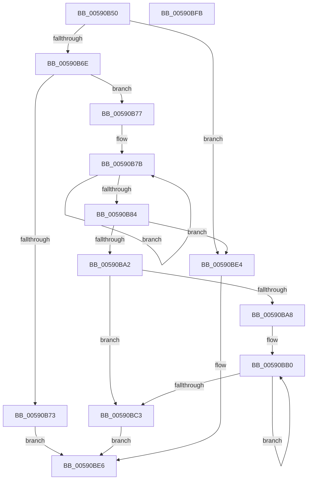

# BgkDisplayString

- RVA: `0x00590B50`–`0x00590BFC` (길이 `172` bytes)
- VA: `0x0000000140590B50`
- 실행 섹션: `.text`
- PDB 이름 있음: `예`; PDB Function 태그: `아니요`
- unwind 정보 RVA: `0x0005C954`
- 디코드: `55`개 명령, `172/172` bytes 표시
- 미해석 바이트: `0` (있으면 어셈블리에 `.byte`로 보존)

> 이 문서는 커널 이미지의 기계어와 PDB 기호를 분석해 생성했습니다. 4번과 5번은 함수 원형과 자료형을 바이너리 사용 방식에서 추정한 C 해석이며 원본 소스 복구 결과는 아닙니다.

## 1. Dependencies

- 직접 호출 지점: **3**; 고유 호출 대상: **3**
- 직접 호출자로 확인된 함수: **0**
- RIP 상대 이미지 참조: **0**

### Outgoing calls
- `0x00590B95` → [ExAllocatePool2](../../poolcode/B8/ExAllocatePool2_function_00B820F0.md) (function, `0x00B820F0`)
- `0x00590BCC` → [BgkDisplayStringEx](BgkDisplayStringEx_function_00590C04.md) (function, `0x00590C04`)
- `0x00590BDB` → [ExFreePoolWithTag](../../poolcode/B8/ExFreePoolWithTag_function_00B82870.md) (function, `0x00B82870`)

### Direct callers
- 이 함수 시작 RVA로 연결되는 직접 call은 확인되지 않았습니다. 간접 호출은 완전히 역산할 수 없습니다.

### Static image references
- 디코드된 RIP-relative 메모리 참조가 없습니다.

## 2. Other-region calls and transfers

- 다른 실행 섹션으로 향하는 call: **2**
  - `0x00590B95` → [ExAllocatePool2](../../poolcode/B8/ExAllocatePool2_function_00B820F0.md) (`.text` → `POOLCODE`)
  - `0x00590BDB` → [ExFreePoolWithTag](../../poolcode/B8/ExFreePoolWithTag_function_00B82870.md) (`.text` → `POOLCODE`)
- 별도 외부 분기/꼬리 이동을 확인하지 못했습니다.

## 3. Assembly (complete function range)

```asm
00590B50  48 89 5C 24 08                  mov qword ptr [rsp + 8], rbx
00590B55  48 89 6C 24 10                  mov qword ptr [rsp + 0x10], rbp
00590B5A  48 89 74 24 18                  mov qword ptr [rsp + 0x18], rsi
00590B5F  57                              push rdi
00590B60  48 83 EC 20                     sub rsp, 0x20
00590B64  33 ED                           xor ebp, ebp
00590B66  48 8B D9                        mov rbx, rcx
00590B69  48 85 C9                        test rcx, rcx
00590B6C  74 76                           je 0x140590be4
00590B6E  40 38 29                        cmp byte ptr [rcx], bpl
00590B71  75 04                           jne 0x140590b77
00590B73  B0 01                           mov al, 1
00590B75  EB 6F                           jmp 0x140590be6
00590B77  48 83 CF FF                     or rdi, 0xffffffffffffffff
00590B7B  48 FF C7                        inc rdi
00590B7E  40 38 2C 39                     cmp byte ptr [rcx + rdi], bpl
00590B82  75 F7                           jne 0x140590b7b
00590B84  8D 57 01                        lea edx, [rdi + 1]
00590B87  B9 40 00 00 00                  mov ecx, 0x40
00590B8C  48 03 D2                        add rdx, rdx
00590B8F  41 B8 42 47 49 4B               mov r8d, 0x4b494742
00590B95  E8 56 15 5F 00                  call 0x140b820f0
00590B9A  48 8B F0                        mov rsi, rax
00590B9D  48 85 C0                        test rax, rax
00590BA0  74 42                           je 0x140590be4
00590BA2  8B D5                           mov edx, ebp
00590BA4  85 FF                           test edi, edi
00590BA6  74 1B                           je 0x140590bc3
00590BA8  48 8B C8                        mov rcx, rax
00590BAB  44 8B C7                        mov r8d, edi
00590BAE  8B D7                           mov edx, edi
00590BB0  0F BE 03                        movsx eax, byte ptr [rbx]
00590BB3  48 FF C3                        inc rbx
00590BB6  66 89 01                        mov word ptr [rcx], ax
00590BB9  48 8D 49 02                     lea rcx, [rcx + 2]
00590BBD  49 83 E8 01                     sub r8, 1
00590BC1  75 ED                           jne 0x140590bb0
00590BC3  8B C2                           mov eax, edx
00590BC5  48 8B CE                        mov rcx, rsi
00590BC8  66 89 2C 46                     mov word ptr [rsi + rax*2], bp
00590BCC  E8 33 00 00 00                  call 0x140590c04
00590BD1  BA 42 47 49 4B                  mov edx, 0x4b494742
00590BD6  48 8B CE                        mov rcx, rsi
00590BD9  8A D8                           mov bl, al
00590BDB  E8 90 1C 5F 00                  call 0x140b82870
00590BE0  8A C3                           mov al, bl
00590BE2  EB 02                           jmp 0x140590be6
00590BE4  32 C0                           xor al, al
00590BE6  48 8B 5C 24 30                  mov rbx, qword ptr [rsp + 0x30]
00590BEB  48 8B 6C 24 38                  mov rbp, qword ptr [rsp + 0x38]
00590BF0  48 8B 74 24 40                  mov rsi, qword ptr [rsp + 0x40]
00590BF5  48 83 C4 20                     add rsp, 0x20
00590BF9  5F                              pop rdi
00590BFA  C3                              ret
00590BFB  CC                              int3
```

## 4. C-style interpretation (structured pseudocode)

```c
__int64 __fastcall BgkDisplayString(__int64 a1)
{
    __int64 result;
    __int64 v_rbp;
    __int64 v_rbx;
    __int64 v_rdi;
    __int64 v_rsp;
    unsigned __int64 v_stack_p10;
    unsigned __int64 v_stack_p18;
    unsigned __int64 v_stack_p8;

    v_stack_p8 = v_rbx;
    v_stack_p10 = v_rbp;
    v_stack_p18 = v_rsi;
    v_rsp = (v_rsp) - (32);
    v_rbp = 0;
    if (a1 == 0) goto loc_00590BE4;
    if ((*(unsigned __int8 *)(a1)) != 0) goto loc_00590B77;
    goto loc_00590BE6;
loc_00590B77:
    v_rdi = (v_rdi) | (-1);
loc_00590B7B:
    v_rdi = (v_rdi) + 1;
    if ((*(unsigned __int8 *)(a1 + v_rdi * 1)) != 0) goto loc_00590B7B;
    a2 = (v_rdi + 1) + (v_rdi + 1);
    result = ExAllocatePool2(64, a2, (unsigned int)(0x4B494742ULL), a4);
    if (result == 0) goto loc_00590BE4;
    if ((unsigned int)(v_rdi) == 0) goto loc_00590BC3;
loc_00590BB0:
    v_rbx = (a1) + 1;
    *(unsigned __int16 *)(result) = (unsigned __int16)((__int8)(*(unsigned __int8 *)(a1)));
    a3 = ((unsigned int)((unsigned int)(v_rdi))) - (1);
    if (condition_is_not_equal) goto loc_00590BB0;
loc_00590BC3:
    *(unsigned __int16 *)(result + (unsigned int)((unsigned int)((unsigned int)((unsigned int)(v_rdi)))) * 2) = 0;
    result = BgkDisplayStringEx(result, (unsigned int)((unsigned int)(v_rdi)), a3, a4);
    result = ExFreePoolWithTag(result, (unsigned int)(0x4B494742ULL), a3, a4);
    goto loc_00590BE6;
loc_00590BE4:
    result = 0;
loc_00590BE6:
    v_rsp = (v_rsp) + (32);
    return result;
}
```

## 5. (Beta) C Style

```c
int64_t BgkDisplayString(int64_t Arg1)
{
    int64_t result;
    int64_t local_rbp;
    int64_t local_rbx;
    int64_t local_rdi;
    int64_t local_rsp;
    uint64_t v_stack_p10;
    uint64_t v_stack_p18;
    uint64_t v_stack_p8;

    v_stack_p8 = local_rbx;
    v_stack_p10 = local_rbp;
    v_stack_p18 = local_rsi;
    local_rsp = (local_rsp) - (32);
    local_rbp = 0;
    if (Arg1 == 0) goto loc_00590BE4;
    if ((*(uint8_t *)(Arg1)) != 0) goto loc_00590B77;
    goto loc_00590BE6;
loc_00590B77:
    local_rdi = (local_rdi) | (-1);
loc_00590B7B:
    local_rdi = (local_rdi) + 1;
    if ((*(uint8_t *)(Arg1 + local_rdi * 1)) != 0) goto loc_00590B7B;
    a2 = (local_rdi + 1) + (local_rdi + 1);
    result = ExAllocatePool2(64, a2, (uint32_t)(0x4B494742ULL), a4);
    if (result == 0) goto loc_00590BE4;
    if ((uint32_t)(local_rdi) == 0) goto loc_00590BC3;
loc_00590BB0:
    local_rbx = (Arg1) + 1;
    *(uint16_t *)(result) = (uint16_t)((int8_t)(*(uint8_t *)(Arg1)));
    a3 = ((uint32_t)((uint32_t)(local_rdi))) - (1);
    if (condition_is_not_equal) goto loc_00590BB0;
loc_00590BC3:
    *(uint16_t *)(result + (uint32_t)((uint32_t)((uint32_t)((uint32_t)(local_rdi)))) * 2) = 0;
    result = BgkDisplayStringEx(result, (uint32_t)((uint32_t)(local_rdi)), a3, a4);
    result = ExFreePoolWithTag(result, (uint32_t)(0x4B494742ULL), a3, a4);
    goto loc_00590BE6;
loc_00590BE4:
    result = 0;
loc_00590BE6:
    local_rsp = (local_rsp) + (32);
    return result;
}
```

## 6. Execution-region graph

[열기: 2D/3D 그래프와 함수 탐색 컨트롤 패널](../../../control-panel.html?section=text&rva=0x00590B50&view=graph)

- 2D 그래프는 위에서 아래로 흐르고, 3D 그래프는 빈 공간을 드래그해 회전합니다. Shift+드래그는 이동, 휠은 확대·축소, 함수 노드 선택은 대상 보고서 이동입니다.

### Static fallback


