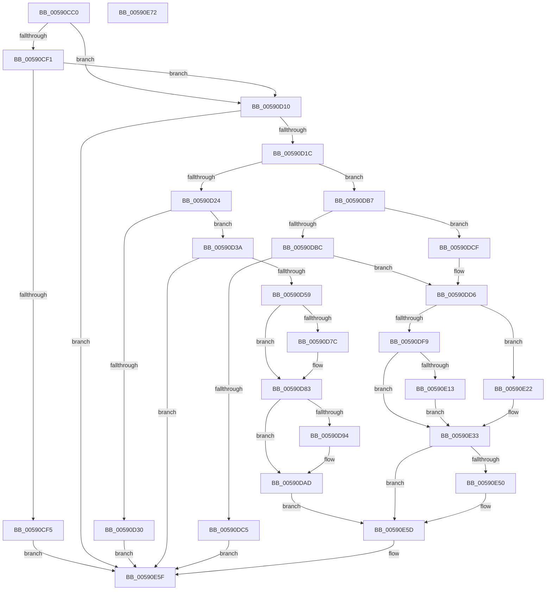

# BgkNotifyDisplayOwnershipChange

- RVA: `0x00590CC0`–`0x00590E73` (길이 `435` bytes)
- VA: `0x0000000140590CC0`
- 실행 섹션: `.text`
- PDB 이름 있음: `예`; PDB Function 태그: `아니요`
- unwind 정보 RVA: `0x00087EC4`
- 디코드: `102`개 명령, `435/435` bytes 표시
- 미해석 바이트: `0` (있으면 어셈블리에 `.byte`로 보존)

> 이 문서는 커널 이미지의 기계어와 PDB 기호를 분석해 생성했습니다. 4번과 5번은 함수 원형과 자료형을 바이너리 사용 방식에서 추정한 C 해석이며 원본 소스 복구 결과는 아닙니다.

## 1. Dependencies

- 직접 호출 지점: **17**; 고유 호출 대상: **15**
- 직접 호출자로 확인된 함수: **3**
- RIP 상대 이미지 참조: **16**

### Outgoing calls
- `0x00590CF5` → [BgkResumeFinished](../../pagelk/B7/BgkResumeFinished_function_00B7C7FC.md) (function, `0x00B7C7FC`)
- `0x00590D4C` → [guard_dispatch_icall](../6B/guard_dispatch_icall_function_006BAAD0.md) (function, `0x006BAAD0`)
- `0x00590D65` → [BgkpLockBgfxCodeSection](../../pagebgfx/BC/BgkpLockBgfxCodeSection_function_00BC04F0.md) (function, `0x00BC04F0`)
- `0x00590D71` → [BgLibraryEnable](../69/BgLibraryEnable_function_0069E9CC.md) (function, `0x0069E9CC`)
- `0x00590D83` → [BgConsoleGetInterface](../../pagebgfx/BC/BgConsoleGetInterface_function_00BC09A0.md) (function, `0x00BC09A0`)
- `0x00590DA8` → [guard_dispatch_icall](../6B/guard_dispatch_icall_function_006BAAD0.md) (function, `0x006BAAD0`)
- `0x00590DAD` → [BgkpTryEnableConsole](BgkpTryEnableConsole_function_005912D0.md) (function, `0x005912D0`)
- `0x00590DD6` → [BgDisplayFade](../../pagebgfx/BC/BgDisplayFade_function_00BC36A4.md) (function, `0x00BC36A4`)
- `0x00590DE9` → [BgkpDisableConsole](BgkpDisableConsole_function_005911EC.md) (function, `0x005911EC`)
- `0x00590DEE` → [BgLibraryDisable](../../pagebgfx/BC/BgLibraryDisable_function_00BC0724.md) (function, `0x00BC0724`)
- `0x00590E13` → [BgConsoleDestroyInterface](../../pagebgfx/BC/BgConsoleDestroyInterface_function_00BC0940.md) (function, `0x00BC0940`)
- `0x00590E22` → [BgkDestroy](../../pagebgfx/BC/BgkDestroy_function_00BC0170.md) (function, `0x00BC0170`)
- `0x00590E2C` → [InbvSetFunction](InbvSetFunction_function_00590450.md) (function, `0x00590450`)
- `0x00590E3A` → [BgSetFrameBufferAccess](../../pagebgfx/BC/BgSetFrameBufferAccess_function_00BC0814.md) (function, `0x00BC0814`)
- `0x00590E3F` → [BgkpUnlockBgfxCodeSection](../../pagebgfx/BC/BgkpUnlockBgfxCodeSection_function_00BC4910.md) (function, `0x00BC4910`)
- `0x00590E50` → [guard_dispatch_icall](../6B/guard_dispatch_icall_function_006BAAD0.md) (function, `0x006BAAD0`)
- `0x00590E67` → [_security_check_cookie](../6A/_security_check_cookie_function_006AC640.md) (function, `0x006AC640`)

### Direct callers
- [BgkNotifyDisplayOwnershipLost](BgkNotifyDisplayOwnershipLost_function_00590E80.md) at `0x00590E99`
- [BgkSetDisplayOwnership](BgkSetDisplayOwnership_function_00590EE0.md) at `0x00590EE6`
- [BvgaNotifyDisplayOwnershipChange](BvgaNotifyDisplayOwnershipChange_function_005915C0.md) at `0x005915F8`

### Static image references
- `0x00590CC6` → RVA `0x00E0A740` (`.data`; read)
- `0x00590CDA` → RVA `0x00E65EB9` (`.data`; read)
- `0x00590CFA` → RVA `0x00E65EA0` (`.data`; read/write)
- `0x00590D04` → RVA `0x00E65EBA` (`.data`; write)
- `0x00590D10` → RVA `0x00E65EBA` (`.data`; read)
- `0x00590D24` → RVA `0x00E65E88` (`.data`; read)
- `0x00590D5E` → RVA `0x00E65EA0` (`.data`; write)
- `0x00590D88` → RVA `0x00E65E70` (`.data`; write)
- `0x00590D9A` → RVA `0x00E65EB4` (`.data`; read)
- `0x00590DCF` → RVA `0x00E65E88` (`.data`; write)
- `0x00590DDB` → RVA `0x00E65EB8` (`.data`; write)
- `0x00590DE2` → RVA `0x00E65E81` (`.data`; write)
- `0x00590DF9` → RVA `0x00E65E70` (`.data`; read)
- `0x00590E07` → RVA `0x00E65E80` (`.data`; write)
- `0x00590E18` → RVA `0x00E65E70` (`.data`; read/write)
- `0x00590E44` → RVA `0x00E65EA0` (`.data`; read)

## 2. Other-region calls and transfers

- 다른 실행 섹션으로 향하는 call: **9**
  - `0x00590CF5` → [BgkResumeFinished](../../pagelk/B7/BgkResumeFinished_function_00B7C7FC.md) (`.text` → `PAGELK`)
  - `0x00590D65` → [BgkpLockBgfxCodeSection](../../pagebgfx/BC/BgkpLockBgfxCodeSection_function_00BC04F0.md) (`.text` → `PAGEBGFX`)
  - `0x00590D83` → [BgConsoleGetInterface](../../pagebgfx/BC/BgConsoleGetInterface_function_00BC09A0.md) (`.text` → `PAGEBGFX`)
  - `0x00590DD6` → [BgDisplayFade](../../pagebgfx/BC/BgDisplayFade_function_00BC36A4.md) (`.text` → `PAGEBGFX`)
  - `0x00590DEE` → [BgLibraryDisable](../../pagebgfx/BC/BgLibraryDisable_function_00BC0724.md) (`.text` → `PAGEBGFX`)
  - `0x00590E13` → [BgConsoleDestroyInterface](../../pagebgfx/BC/BgConsoleDestroyInterface_function_00BC0940.md) (`.text` → `PAGEBGFX`)
  - `0x00590E22` → [BgkDestroy](../../pagebgfx/BC/BgkDestroy_function_00BC0170.md) (`.text` → `PAGEBGFX`)
  - `0x00590E3A` → [BgSetFrameBufferAccess](../../pagebgfx/BC/BgSetFrameBufferAccess_function_00BC0814.md) (`.text` → `PAGEBGFX`)
  - `0x00590E3F` → [BgkpUnlockBgfxCodeSection](../../pagebgfx/BC/BgkpUnlockBgfxCodeSection_function_00BC4910.md) (`.text` → `PAGEBGFX`)
- 별도 외부 분기/꼬리 이동을 확인하지 못했습니다.

## 3. Assembly (complete function range)

```asm
00590CC0  40 53                           push rbx
00590CC2  48 83 EC 70                     sub rsp, 0x70
00590CC6  48 8B 05 73 9A 87 00            mov rax, qword ptr [rip + 0x879a73]
00590CCD  48 33 C4                        xor rax, rsp
00590CD0  48 89 44 24 60                  mov qword ptr [rsp + 0x60], rax
00590CD5  33 C0                           xor eax, eax
00590CD7  0F 57 C0                        xorps xmm0, xmm0
00590CDA  38 05 D9 51 8D 00               cmp byte ptr [rip + 0x8d51d9], al
00590CE0  0F 11 44 24 38                  movups xmmword ptr [rsp + 0x38], xmm0
00590CE5  48 89 44 24 58                  mov qword ptr [rsp + 0x58], rax
00590CEA  0F 11 44 24 48                  movups xmmword ptr [rsp + 0x48], xmm0
00590CEF  74 1F                           je 0x140590d10
00590CF1  84 C9                           test cl, cl
00590CF3  75 1B                           jne 0x140590d10
00590CF5  E8 02 BB 5E 00                  call 0x140b7c7fc
00590CFA  48 83 25 9E 51 8D 00 00         and qword ptr [rip + 0x8d519e], 0
00590D02  33 C0                           xor eax, eax
00590D04  C6 05 AF 51 8D 00 00            mov byte ptr [rip + 0x8d51af], 0
00590D0B  E9 4F 01 00 00                  jmp 0x140590e5f
00590D10  3A 0D A4 51 8D 00               cmp cl, byte ptr [rip + 0x8d51a4]
00590D16  0F 84 43 01 00 00               je 0x140590e5f
00590D1C  84 C9                           test cl, cl
00590D1E  0F 84 93 00 00 00               je 0x140590db7
00590D24  48 8B 05 5D 51 8D 00            mov rax, qword ptr [rip + 0x8d515d]
00590D2B  48 85 C0                        test rax, rax
00590D2E  75 0A                           jne 0x140590d3a
00590D30  B8 01 00 00 C0                  mov eax, 0xc0000001
00590D35  E9 25 01 00 00                  jmp 0x140590e5f
00590D3A  48 83 64 24 30 00               and qword ptr [rsp + 0x30], 0
00590D40  4C 8D 44 24 30                  lea r8, [rsp + 0x30]
00590D45  48 8D 54 24 38                  lea rdx, [rsp + 0x38]
00590D4A  33 C9                           xor ecx, ecx
00590D4C  E8 7F 9D 12 00                  call 0x1406baad0
00590D51  85 C0                           test eax, eax
00590D53  0F 88 06 01 00 00               js 0x140590e5f
00590D59  48 8B 44 24 30                  mov rax, qword ptr [rsp + 0x30]
00590D5E  48 89 05 3B 51 8D 00            mov qword ptr [rip + 0x8d513b], rax
00590D65  E8 86 F7 62 00                  call 0x140bc04f0
00590D6A  33 D2                           xor edx, edx
00590D6C  48 8D 4C 24 38                  lea rcx, [rsp + 0x38]
00590D71  E8 56 DC 10 00                  call 0x14069e9cc
00590D76  8B D8                           mov ebx, eax
00590D78  85 C0                           test eax, eax
00590D7A  78 07                           js 0x140590d83
00590D7C  C6 05 37 51 8D 00 01            mov byte ptr [rip + 0x8d5137], 1
00590D83  E8 18 FC 62 00                  call 0x140bc09a0
00590D88  48 89 05 E1 50 8D 00            mov qword ptr [rip + 0x8d50e1], rax
00590D8F  48 85 C0                        test rax, rax
00590D92  74 19                           je 0x140590dad
00590D94  48 8B 00                        mov rax, qword ptr [rax]
00590D97  45 33 C9                        xor r9d, r9d
00590D9A  44 8B 05 13 51 8D 00            mov r8d, dword ptr [rip + 0x8d5113]
00590DA1  BA C6 C6 C6 FF                  mov edx, 0xffc6c6c6
00590DA6  33 C9                           xor ecx, ecx
00590DA8  E8 23 9D 12 00                  call 0x1406baad0
00590DAD  E8 1E 05 00 00                  call 0x1405912d0
00590DB2  E9 A6 00 00 00                  jmp 0x140590e5d
00590DB7  48 85 D2                        test rdx, rdx
00590DBA  75 13                           jne 0x140590dcf
00590DBC  48 39 05 C5 50 8D 00            cmp qword ptr [rip + 0x8d50c5], rax
00590DC3  75 11                           jne 0x140590dd6
00590DC5  B8 F0 00 00 C0                  mov eax, 0xc00000f0
00590DCA  E9 90 00 00 00                  jmp 0x140590e5f
00590DCF  48 89 15 B2 50 8D 00            mov qword ptr [rip + 0x8d50b2], rdx
00590DD6  E8 C9 28 63 00                  call 0x140bc36a4
00590DDB  C6 05 D6 50 8D 00 00            mov byte ptr [rip + 0x8d50d6], 0
00590DE2  C6 05 98 50 8D 00 00            mov byte ptr [rip + 0x8d5098], 0
00590DE9  E8 FE 03 00 00                  call 0x1405911ec
00590DEE  E8 31 F9 62 00                  call 0x140bc0724
00590DF3  8B D8                           mov ebx, eax
00590DF5  85 C0                           test eax, eax
00590DF7  78 29                           js 0x140590e22
00590DF9  48 8B 0D 70 50 8D 00            mov rcx, qword ptr [rip + 0x8d5070]
00590E00  C6 05 B3 50 8D 00 00            mov byte ptr [rip + 0x8d50b3], 0
00590E07  C6 05 72 50 8D 00 00            mov byte ptr [rip + 0x8d5072], 0
00590E0E  48 85 C9                        test rcx, rcx
00590E11  74 20                           je 0x140590e33
00590E13  E8 28 FB 62 00                  call 0x140bc0940
00590E18  48 83 25 50 50 8D 00 00         and qword ptr [rip + 0x8d5050], 0
00590E20  EB 11                           jmp 0x140590e33
00590E22  E8 49 F3 62 00                  call 0x140bc0170
00590E27  B9 03 00 00 00                  mov ecx, 3
00590E2C  E8 1F F6 FF FF                  call 0x140590450
00590E31  33 DB                           xor ebx, ebx
00590E33  45 33 C0                        xor r8d, r8d
00590E36  33 D2                           xor edx, edx
00590E38  33 C9                           xor ecx, ecx
00590E3A  E8 D5 F9 62 00                  call 0x140bc0814
00590E3F  E8 CC 3A 63 00                  call 0x140bc4910
00590E44  48 8B 05 55 50 8D 00            mov rax, qword ptr [rip + 0x8d5055]
00590E4B  48 85 C0                        test rax, rax
00590E4E  74 0D                           je 0x140590e5d
00590E50  E8 7B 9C 12 00                  call 0x1406baad0
00590E55  48 83 25 43 50 8D 00 00         and qword ptr [rip + 0x8d5043], 0
00590E5D  8B C3                           mov eax, ebx
00590E5F  48 8B 4C 24 60                  mov rcx, qword ptr [rsp + 0x60]
00590E64  48 33 CC                        xor rcx, rsp
00590E67  E8 D4 B7 11 00                  call 0x1406ac640
00590E6C  48 83 C4 70                     add rsp, 0x70
00590E70  5B                              pop rbx
00590E71  C3                              ret
00590E72  CC                              int3
```

## 4. C-style interpretation (structured pseudocode)

```c
__int64 __fastcall BgkNotifyDisplayOwnershipChange(int a1, __int64 a2, __int64 a3, int a4)
{
    __int64 result;
    __int64 v_rbx;
    __int64 v_rsp;
    unsigned __int64 v_stack_m18;
    unsigned __int64 v_stack_m20;
    unsigned __int64 v_stack_m30;
    unsigned __int64 v_stack_m40;
    unsigned __int64 v_stack_m48;

    v_rsp = (v_rsp) - (112);
    result = (*(unsigned __int64 *)(v_rip + 8886899)) ^ (v_rsp);
    v_stack_m18 = result;
    result = 0;
    v_stack_m40 = v_xmm0;
    v_stack_m20 = 0;
    v_stack_m30 = v_xmm0;
    if ((*(unsigned __int8 *)(v_rip + 9261529)) == 0) goto loc_00590D10;
    if ((unsigned __int8)(a1) != 0) goto loc_00590D10;
    result = BgkResumeFinished(a1, a2, a3, a4);
    result = 0;
    *(unsigned __int8 *)(v_rip + 9261487) = 0;
    goto loc_00590E5F;
loc_00590D10:
    if (((unsigned __int8)(a1)) == (*(unsigned __int8 *)(v_rip + 9261476))) goto loc_00590E5F;
    if ((unsigned __int8)(a1) == 0) goto loc_00590DB7;
    if (*(unsigned __int64 *)(v_rip + 9261405) != 0) goto loc_00590D3A;
    goto loc_00590E5F;
loc_00590D3A:
    a1 = 0;
    result = guard_dispatch_icall(a1, v_stack_m40, v_stack_m48, a4);
    if (sign_flag) goto loc_00590E5F;
    *(unsigned __int64 *)(v_rip + 9261371) = v_stack_m48;
    result = BgkpLockBgfxCodeSection(a1, v_stack_m40, v_stack_m48, a4);
    a2 = 0;
    result = BgLibraryEnable(v_stack_m40, a2, v_stack_m48, a4);
    if (!(sign_flag)) {
        *(unsigned __int8 *)(v_rip + 9261367) = 1;
    }
    result = BgConsoleGetInterface(v_stack_m40, a2, v_stack_m48, a4);
    *(unsigned __int64 *)(v_rip + 9261281) = result;
    if (result != 0) {
        result = *(unsigned __int64 *)(result);
        a4 = 0;
        a3 = *(unsigned int *)(v_rip + 9261331);
        a2 = 0xFFC6C6C6ULL;
        a1 = 0;
        result = guard_dispatch_icall(a1, a2, a3, a4);
    }
    result = BgkpTryEnableConsole(a1, a2, a3, a4);
    goto loc_00590E5D;
loc_00590DB7:
    if (a2 != 0) goto loc_00590DCF;
    if ((*(unsigned __int64 *)(v_rip + 9261253)) != result) goto loc_00590DD6;
    goto loc_00590E5F;
loc_00590DCF:
    *(unsigned __int64 *)(v_rip + 9261234) = a2;
loc_00590DD6:
    result = BgDisplayFade(a1, a2, a3, a4);
    *(unsigned __int8 *)(v_rip + 9261270) = 0;
    *(unsigned __int8 *)(v_rip + 9261208) = 0;
    result = BgkpDisableConsole(a1, a2, a3, a4);
    result = BgLibraryDisable(a1, a2, a3, a4);
    if (sign_flag) goto loc_00590E22;
    *(unsigned __int8 *)(v_rip + 9261235) = 0;
    *(unsigned __int8 *)(v_rip + 9261170) = 0;
    if (*(unsigned __int64 *)(v_rip + 9261168) == 0) goto loc_00590E33;
    result = BgConsoleDestroyInterface(*(unsigned __int64 *)(v_rip + 9261168), a2, a3, a4);
    goto loc_00590E33;
loc_00590E22:
    result = BgkDestroy(*(unsigned __int64 *)(v_rip + 9261168), a2, a3, a4);
    result = InbvSetFunction(3, a2, a3, a4);
    v_rbx = 0;
loc_00590E33:
    a3 = 0;
    a2 = 0;
    a1 = 0;
    result = BgSetFrameBufferAccess(a1, a2, a3, a4);
    result = BgkpUnlockBgfxCodeSection(a1, a2, a3, a4);
    result = *(unsigned __int64 *)(v_rip + 9261141);
    if (*(unsigned __int64 *)(v_rip + 9261141) != 0) {
        result = guard_dispatch_icall(a1, a2, a3, a4);
    }
loc_00590E5F:
    a1 = (v_stack_m18) ^ (v_rsp);
    result = _security_check_cookie(a1, a2, a3, a4);
    v_rsp = (v_rsp) + (112);
    return result;
}
```

## 5. (Beta) C Style

```c
int64_t BgkNotifyDisplayOwnershipChange(int32_t Arg1, int64_t Arg2, int64_t Arg3, int32_t Arg4)
{
    int64_t result;
    int64_t local_rbx;
    int64_t local_rsp;
    uint64_t v_stack_m18;
    uint64_t v_stack_m20;
    uint64_t v_stack_m30;
    uint64_t v_stack_m40;
    uint64_t v_stack_m48;

    local_rsp = (local_rsp) - (112);
    result = (*(uint64_t *)(v_rip + 0x879A73)) ^ (local_rsp);
    v_stack_m18 = result;
    result = 0;
    v_stack_m40 = v_xmm0;
    v_stack_m20 = 0;
    v_stack_m30 = v_xmm0;
    if ((*(uint8_t *)(v_rip + 0x8D51D9)) == 0) goto loc_00590D10;
    if ((uint8_t)(Arg1) != 0) goto loc_00590D10;
    result = BgkResumeFinished(Arg1, Arg2, Arg3, Arg4);
    result = 0;
    *(uint8_t *)(v_rip + 0x8D51AF) = 0;
    goto loc_00590E5F;
loc_00590D10:
    if (((uint8_t)(Arg1)) == (*(uint8_t *)(v_rip + 0x8D51A4))) goto loc_00590E5F;
    if ((uint8_t)(Arg1) == 0) goto loc_00590DB7;
    if (*(uint64_t *)(v_rip + 0x8D515D) != 0) goto loc_00590D3A;
    goto loc_00590E5F;
loc_00590D3A:
    Arg1 = 0;
    result = guard_dispatch_icall(Arg1, v_stack_m40, v_stack_m48, Arg4);
    if (sign_flag) goto loc_00590E5F;
    *(uint64_t *)(v_rip + 0x8D513B) = v_stack_m48;
    result = BgkpLockBgfxCodeSection(Arg1, v_stack_m40, v_stack_m48, Arg4);
    Arg2 = 0;
    result = BgLibraryEnable(v_stack_m40, Arg2, v_stack_m48, Arg4);
    if (!(sign_flag)) {
        *(uint8_t *)(v_rip + 0x8D5137) = 1;
    }
    result = BgConsoleGetInterface(v_stack_m40, Arg2, v_stack_m48, Arg4);
    *(uint64_t *)(v_rip + 0x8D50E1) = result;
    if (result != 0) {
        result = *(uint64_t *)(result);
        Arg4 = 0;
        Arg3 = *(uint32_t *)(v_rip + 0x8D5113);
        Arg2 = 0xFFC6C6C6ULL;
        Arg1 = 0;
        result = guard_dispatch_icall(Arg1, Arg2, Arg3, Arg4);
    }
    result = BgkpTryEnableConsole(Arg1, Arg2, Arg3, Arg4);
    goto loc_00590E5D;
loc_00590DB7:
    if (Arg2 != 0) goto loc_00590DCF;
    if ((*(uint64_t *)(v_rip + 0x8D50C5)) != result) goto loc_00590DD6;
    goto loc_00590E5F;
loc_00590DCF:
    *(uint64_t *)(v_rip + 0x8D50B2) = Arg2;
loc_00590DD6:
    result = BgDisplayFade(Arg1, Arg2, Arg3, Arg4);
    *(uint8_t *)(v_rip + 0x8D50D6) = 0;
    *(uint8_t *)(v_rip + 0x8D5098) = 0;
    result = BgkpDisableConsole(Arg1, Arg2, Arg3, Arg4);
    result = BgLibraryDisable(Arg1, Arg2, Arg3, Arg4);
    if (sign_flag) goto loc_00590E22;
    *(uint8_t *)(v_rip + 0x8D50B3) = 0;
    *(uint8_t *)(v_rip + 0x8D5072) = 0;
    if (*(uint64_t *)(v_rip + 0x8D5070) == 0) goto loc_00590E33;
    result = BgConsoleDestroyInterface(*(uint64_t *)(v_rip + 0x8D5070), Arg2, Arg3, Arg4);
    goto loc_00590E33;
loc_00590E22:
    result = BgkDestroy(*(uint64_t *)(v_rip + 0x8D5070), Arg2, Arg3, Arg4);
    result = InbvSetFunction(3, Arg2, Arg3, Arg4);
    local_rbx = 0;
loc_00590E33:
    Arg3 = 0;
    Arg2 = 0;
    Arg1 = 0;
    result = BgSetFrameBufferAccess(Arg1, Arg2, Arg3, Arg4);
    result = BgkpUnlockBgfxCodeSection(Arg1, Arg2, Arg3, Arg4);
    result = *(uint64_t *)(v_rip + 0x8D5055);
    if (*(uint64_t *)(v_rip + 0x8D5055) != 0) {
        result = guard_dispatch_icall(Arg1, Arg2, Arg3, Arg4);
    }
loc_00590E5F:
    Arg1 = (v_stack_m18) ^ (local_rsp);
    result = _security_check_cookie(Arg1, Arg2, Arg3, Arg4);
    local_rsp = (local_rsp) + (112);
    return result;
}
```

## 6. Execution-region graph

[열기: 2D/3D 그래프와 함수 탐색 컨트롤 패널](../../../control-panel.html?section=text&rva=0x00590CC0&view=graph)

- 2D 그래프는 위에서 아래로 흐르고, 3D 그래프는 빈 공간을 드래그해 회전합니다. Shift+드래그는 이동, 휠은 확대·축소, 함수 노드 선택은 대상 보고서 이동입니다.

### Static fallback


