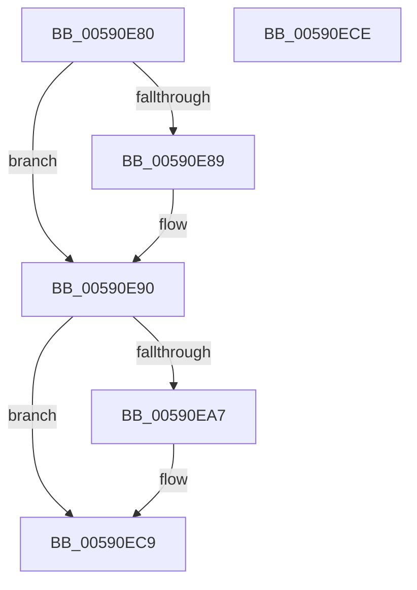

# BgkNotifyDisplayOwnershipLost

- RVA: `0x00590E80`–`0x00590ECF` (길이 `79` bytes)
- VA: `0x0000000140590E80`
- 실행 섹션: `.text`
- PDB 이름 있음: `예`; PDB Function 태그: `아니요`
- unwind 정보 RVA: `0x0005C788`
- 디코드: `18`개 명령, `79/79` bytes 표시
- 미해석 바이트: `0` (있으면 어셈블리에 `.byte`로 보존)

> 이 문서는 커널 이미지의 기계어와 PDB 기호를 분석해 생성했습니다. 4번과 5번은 함수 원형과 자료형을 바이너리 사용 방식에서 추정한 C 해석이며 원본 소스 복구 결과는 아닙니다.

## 1. Dependencies

- 직접 호출 지점: **2**; 고유 호출 대상: **2**
- 직접 호출자로 확인된 함수: **0**
- RIP 상대 이미지 참조: **3**

### Outgoing calls
- `0x00590E99` → [BgkNotifyDisplayOwnershipChange](BgkNotifyDisplayOwnershipChange_function_00590CC0.md) (function, `0x00590CC0`)
- `0x00590EC4` → [MmMapIoSpaceEx](../32/MmMapIoSpaceEx_function_00327830.md) (function, `0x00327830`)

### Direct callers
- 이 함수 시작 RVA로 연결되는 직접 call은 확인되지 않았습니다. 간접 호출은 완전히 역산할 수 없습니다.

### Static image references
- `0x00590E89` → RVA `0x00E65EA8` (`.data`; write)
- `0x00590E90` → RVA `0x00591230` (`BgkpResetDisplay`; read)
- `0x00590E9E` → RVA `0x00E3EE18` (`.data`; read)

## 2. Other-region calls and transfers

- 다른 실행 섹션으로 향하는 call: **0**
- 별도 외부 분기/꼬리 이동을 확인하지 못했습니다.

## 3. Assembly (complete function range)

```asm
00590E80  48 83 EC 28                     sub rsp, 0x28
00590E84  48 85 C9                        test rcx, rcx
00590E87  74 07                           je 0x140590e90
00590E89  48 89 0D 18 50 8D 00            mov qword ptr [rip + 0x8d5018], rcx
00590E90  48 8D 15 99 03 00 00            lea rdx, [rip + 0x399]
00590E97  33 C9                           xor ecx, ecx
00590E99  E8 22 FE FF FF                  call 0x140590cc0
00590E9E  83 3D 73 DF 8A 00 02            cmp dword ptr [rip + 0x8adf73], 2
00590EA5  74 22                           je 0x140590ec9
00590EA7  83 64 24 34 00                  and dword ptr [rsp + 0x34], 0
00590EAC  BA 00 00 02 00                  mov edx, 0x20000
00590EB1  C7 44 24 30 00 00 0A 00         mov dword ptr [rsp + 0x30], 0xa0000
00590EB9  41 B8 04 02 00 00               mov r8d, 0x204
00590EBF  48 8B 4C 24 30                  mov rcx, qword ptr [rsp + 0x30]
00590EC4  E8 67 69 D9 FF                  call 0x140327830
00590EC9  48 83 C4 28                     add rsp, 0x28
00590ECD  C3                              ret
00590ECE  CC                              int3
```

## 4. C-style interpretation (structured pseudocode)

```c
__int64 __fastcall BgkNotifyDisplayOwnershipLost(__int64 a1)
{
    __int64 result;
    __int64 v_rsp;
    unsigned int v_stack_p8;
    unsigned int v_stack_pC;

    v_rsp = (v_rsp) - (40);
    if (a1 != 0) {
        *(unsigned __int64 *)(v_rip + 9261080) = a1;
    }
    a1 = 0;
    result = BgkNotifyDisplayOwnershipChange(a1, v_rip + 921, a3, a4);
    if ((*(unsigned int *)(v_rip + 9101171)) != 2) {
        a2 = 0x20000ULL;
        v_stack_p8 = 0xA0000ULL;
        a3 = 516;
        a1 = v_stack_p8;
        result = MmMapIoSpaceEx(a1, a2, a3, a4);
    }
    v_rsp = (v_rsp) + (40);
    return result;
}
```

## 5. (Beta) C Style

```c
int64_t BgkNotifyDisplayOwnershipLost(int64_t Arg1)
{
    int64_t result;
    int64_t local_rsp;
    uint32_t v_stack_p8;
    uint32_t v_stack_pC;

    local_rsp = (local_rsp) - (40);
    if (Arg1 != 0) {
        *(uint64_t *)(v_rip + 0x8D5018) = Arg1;
    }
    Arg1 = 0;
    result = BgkNotifyDisplayOwnershipChange(Arg1, v_rip + 921, a3, a4);
    if ((*(uint32_t *)(v_rip + 0x8ADF73)) != 2) {
        a2 = 0x20000ULL;
        v_stack_p8 = 0xA0000ULL;
        a3 = 516;
        Arg1 = v_stack_p8;
        result = MmMapIoSpaceEx(Arg1, a2, a3, a4);
    }
    local_rsp = (local_rsp) + (40);
    return result;
}
```

## 6. Execution-region graph

[열기: 2D/3D 그래프와 함수 탐색 컨트롤 패널](../../../control-panel.html?section=text&rva=0x00590E80&view=graph)

- 2D 그래프는 위에서 아래로 흐르고, 3D 그래프는 빈 공간을 드래그해 회전합니다. Shift+드래그는 이동, 휠은 확대·축소, 함수 노드 선택은 대상 보고서 이동입니다.

### Static fallback


