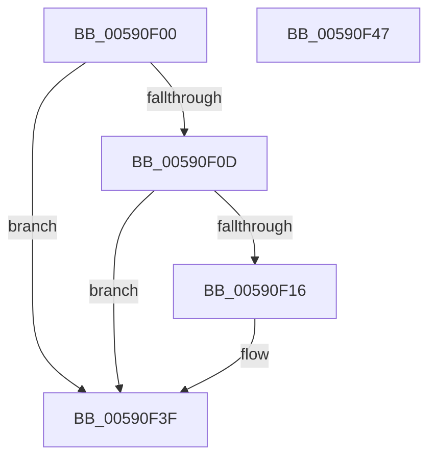

# BgkSetTextColor

- RVA: `0x00590F00`–`0x00590F48` (길이 `72` bytes)
- VA: `0x0000000140590F00`
- 실행 섹션: `.text`
- PDB 이름 있음: `예`; PDB Function 태그: `아니요`
- unwind 정보 RVA: `0x0005CF00`
- 디코드: `21`개 명령, `72/72` bytes 표시
- 미해석 바이트: `0` (있으면 어셈블리에 `.byte`로 보존)

> 이 문서는 커널 이미지의 기계어와 PDB 기호를 분석해 생성했습니다. 4번과 5번은 함수 원형과 자료형을 바이너리 사용 방식에서 추정한 C 해석이며 원본 소스 복구 결과는 아닙니다.

## 1. Dependencies

- 직접 호출 지점: **3**; 고유 호출 대상: **3**
- 직접 호출자로 확인된 함수: **0**
- RIP 상대 이미지 참조: **3**

### Outgoing calls
- `0x00590F0D` → [BgkpAcquireConsole](BgkpAcquireConsole_function_005911C8.md) (function, `0x005911C8`)
- `0x00590F2E` → [guard_dispatch_icall](../6B/guard_dispatch_icall_function_006BAAD0.md) (function, `0x006BAAD0`)
- `0x00590F3A` → [ExReleaseRundownProtection](../34/ExReleaseRundownProtection_function_00349E80.md) (function, `0x00349E80`)

### Direct callers
- 이 함수 시작 RVA로 연결되는 직접 call은 확인되지 않았습니다. 간접 호출은 완전히 역산할 수 없습니다.

### Static image references
- `0x00590F16` → RVA `0x00E65E70` (`.data`; read)
- `0x00590F1D` → RVA `0x00026AE0` (`.rdata`; read)
- `0x00590F33` → RVA `0x00E0A9A0` (`.data`; read)

## 2. Other-region calls and transfers

- 다른 실행 섹션으로 향하는 call: **0**
- 별도 외부 분기/꼬리 이동을 확인하지 못했습니다.

## 3. Assembly (complete function range)

```asm
00590F00  40 53                           push rbx
00590F02  48 83 EC 20                     sub rsp, 0x20
00590F06  8B D9                           mov ebx, ecx
00590F08  83 F9 10                        cmp ecx, 0x10
00590F0B  73 32                           jae 0x140590f3f
00590F0D  E8 B6 02 00 00                  call 0x1405911c8
00590F12  84 C0                           test al, al
00590F14  74 29                           je 0x140590f3f
00590F16  48 8B 05 53 4F 8D 00            mov rax, qword ptr [rip + 0x8d4f53]
00590F1D  48 8D 0D BC 5B A9 FF            lea rcx, [rip - 0x56a444]
00590F24  48 8D 0C 99                     lea rcx, [rcx + rbx*4]
00590F28  33 D2                           xor edx, edx
00590F2A  48 8B 40 10                     mov rax, qword ptr [rax + 0x10]
00590F2E  E8 9D 9B 12 00                  call 0x1406baad0
00590F33  48 8D 0D 66 9A 87 00            lea rcx, [rip + 0x879a66]
00590F3A  E8 41 8F DB FF                  call 0x140349e80
00590F3F  33 C0                           xor eax, eax
00590F41  48 83 C4 20                     add rsp, 0x20
00590F45  5B                              pop rbx
00590F46  C3                              ret
00590F47  CC                              int3
```

## 4. C-style interpretation (structured pseudocode)

```c
__int64 __fastcall BgkSetTextColor(int a1, int a2)
{
    __int64 result;
    __int64 v_rsp;

    v_rsp = (v_rsp) - (32);
    if (a1 >= 16) goto loc_00590F3F;
    result = BgkpAcquireConsole(a1, a2, a3, a4);
    if ((unsigned __int8)(result) != 0) {
        result = *(unsigned __int64 *)(v_rip + 9260883);
        a1 = v_rip - 5678148;
        a1 = a1 + (unsigned int)(a1) * 4;
        a2 = 0;
        result = *(unsigned __int64 *)(result + 16);
        result = guard_dispatch_icall(a1, a2, a3, a4);
        a1 = v_rip + 8886886;
        result = ExReleaseRundownProtection(a1, a2, a3, a4);
    }
    result = 0;
    v_rsp = (v_rsp) + (32);
    return result;
}
```

## 5. (Beta) C Style

```c
int64_t BgkSetTextColor(int32_t Arg1, int32_t Arg2)
{
    int64_t result;
    int64_t local_rsp;

    local_rsp = (local_rsp) - (32);
    if (Arg1 >= 16) goto loc_00590F3F;
    result = BgkpAcquireConsole(Arg1, Arg2, a3, a4);
    if ((uint8_t)(result) != 0) {
        result = *(uint64_t *)(v_rip + 0x8D4F53);
        Arg1 = v_rip - 5678148;
        Arg1 = Arg1 + (uint32_t)(Arg1) * 4;
        Arg2 = 0;
        result = *(uint64_t *)(result + 0x10);
        result = guard_dispatch_icall(Arg1, Arg2, a3, a4);
        Arg1 = v_rip + 8886886;
        result = ExReleaseRundownProtection(Arg1, Arg2, a3, a4);
    }
    result = 0;
    local_rsp = (local_rsp) + (32);
    return result;
}
```

## 6. Execution-region graph

[열기: 2D/3D 그래프와 함수 탐색 컨트롤 패널](../../../control-panel.html?section=text&rva=0x00590F00&view=graph)

- 2D 그래프는 위에서 아래로 흐르고, 3D 그래프는 빈 공간을 드래그해 회전합니다. Shift+드래그는 이동, 휠은 확대·축소, 함수 노드 선택은 대상 보고서 이동입니다.

### Static fallback


