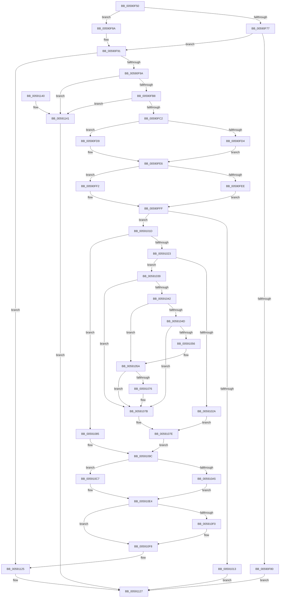

# BgkSetVirtualFrameBuffer

- RVA: `0x00590F50`–`0x00591148` (길이 `504` bytes)
- VA: `0x0000000140590F50`
- 실행 섹션: `.text`
- PDB 이름 있음: `예`; PDB Function 태그: `아니요`
- unwind 정보 RVA: `0x000C6EDC`
- 디코드: `143`개 명령, `504/504` bytes 표시
- 미해석 바이트: `0` (있으면 어셈블리에 `.byte`로 보존)

> 이 문서는 커널 이미지의 기계어와 PDB 기호를 분석해 생성했습니다. 4번과 5번은 함수 원형과 자료형을 바이너리 사용 방식에서 추정한 C 해석이며 원본 소스 복구 결과는 아닙니다.

## 1. Dependencies

- 직접 호출 지점: **9**; 고유 호출 대상: **8**
- 직접 호출자로 확인된 함수: **0**
- RIP 상대 이미지 참조: **3**

### Outgoing calls
- `0x00590F9A` → [BgGetDisplayContext](../../pagebgfx/BC/BgGetDisplayContext_function_00BC06F4.md) (function, `0x00BC06F4`)
- `0x00590FA7` → [BgGetIsColorOverridden](../../pagebgfx/BC/BgGetIsColorOverridden_function_00BC0704.md) (function, `0x00BC0704`)
- `0x00591032` → [memset](../6C/memset_function_006C6C40.md) (function, `0x006C6C40`)
- `0x0059107E` → [BgAcquireSpinLock](../../pagebgfx/BC/BgAcquireSpinLock_function_00BC05B4.md) (function, `0x00BC05B4`)
- `0x00591085` → [BgAcquireSpinLock](../../pagebgfx/BC/BgAcquireSpinLock_function_00BC05B4.md) (function, `0x00BC05B4`)
- `0x00591094` → [memcpy](../6C/memcpy_function_006C6840.md) (function, `0x006C6840`)
- `0x005910F3` → [BgConvertResources](../../pagebgfx/BC/BgConvertResources_function_00BC05CC.md) (function, `0x00BC05CC`)
- `0x00591114` → [BgSetFrameBufferAccess](../../pagebgfx/BC/BgSetFrameBufferAccess_function_00BC0814.md) (function, `0x00BC0814`)
- `0x00591120` → [BgReleaseSpinLock](../../pagebgfx/BC/BgReleaseSpinLock_function_00BC07FC.md) (function, `0x00BC07FC`)

### Direct callers
- 이 함수 시작 RVA로 연결되는 직접 call은 확인되지 않았습니다. 간접 호출은 완전히 역산할 수 없습니다.

### Static image references
- `0x00590F77` → RVA `0x00E65E88` (`.data`; read)
- `0x00590F8A` → RVA `0x00E65E88` (`.data`; write)
- `0x00591119` → RVA `0x00E65E80` (`.data`; write)

## 2. Other-region calls and transfers

- 다른 실행 섹션으로 향하는 call: **7**
  - `0x00590F9A` → [BgGetDisplayContext](../../pagebgfx/BC/BgGetDisplayContext_function_00BC06F4.md) (`.text` → `PAGEBGFX`)
  - `0x00590FA7` → [BgGetIsColorOverridden](../../pagebgfx/BC/BgGetIsColorOverridden_function_00BC0704.md) (`.text` → `PAGEBGFX`)
  - `0x0059107E` → [BgAcquireSpinLock](../../pagebgfx/BC/BgAcquireSpinLock_function_00BC05B4.md) (`.text` → `PAGEBGFX`)
  - `0x00591085` → [BgAcquireSpinLock](../../pagebgfx/BC/BgAcquireSpinLock_function_00BC05B4.md) (`.text` → `PAGEBGFX`)
  - `0x005910F3` → [BgConvertResources](../../pagebgfx/BC/BgConvertResources_function_00BC05CC.md) (`.text` → `PAGEBGFX`)
  - `0x00591114` → [BgSetFrameBufferAccess](../../pagebgfx/BC/BgSetFrameBufferAccess_function_00BC0814.md) (`.text` → `PAGEBGFX`)
  - `0x00591120` → [BgReleaseSpinLock](../../pagebgfx/BC/BgReleaseSpinLock_function_00BC07FC.md) (`.text` → `PAGEBGFX`)
- 별도 외부 분기/꼬리 이동을 확인하지 못했습니다.

## 3. Assembly (complete function range)

```asm
00590F50  48 8B C4                        mov rax, rsp
00590F53  48 89 58 08                     mov qword ptr [rax + 8], rbx
00590F57  48 89 68 18                     mov qword ptr [rax + 0x18], rbp
00590F5B  48 89 70 20                     mov qword ptr [rax + 0x20], rsi
00590F5F  57                              push rdi
00590F60  41 56                           push r14
00590F62  41 57                           push r15
00590F64  48 83 EC 20                     sub rsp, 0x20
00590F68  83 60 10 00                     and dword ptr [rax + 0x10], 0
00590F6C  40 32 FF                        xor dil, dil
00590F6F  48 8B D9                        mov rbx, rcx
00590F72  48 85 D2                        test rdx, rdx
00590F75  75 13                           jne 0x140590f8a
00590F77  48 39 15 0A 4F 8D 00            cmp qword ptr [rip + 0x8d4f0a], rdx
00590F7E  75 11                           jne 0x140590f91
00590F80  B8 F0 00 00 C0                  mov eax, 0xc00000f0
00590F85  E9 9D 01 00 00                  jmp 0x140591127
00590F8A  48 89 15 F7 4E 8D 00            mov qword ptr [rip + 0x8d4ef7], rdx
00590F91  48 85 DB                        test rbx, rbx
00590F94  0F 84 8B 01 00 00               je 0x140591125
00590F9A  E8 55 F7 62 00                  call 0x140bc06f4
00590F9F  48 8D 4C 24 48                  lea rcx, [rsp + 0x48]
00590FA4  48 8B E8                        mov rbp, rax
00590FA7  E8 58 F7 62 00                  call 0x140bc0704
00590FAC  8A D0                           mov dl, al
00590FAE  40 38 7D 00                     cmp byte ptr [rbp], dil
00590FB2  0F 84 89 01 00 00               je 0x140591141
00590FB8  40 38 7D 01                     cmp byte ptr [rbp + 1], dil
00590FBC  0F 84 7F 01 00 00               je 0x140591141
00590FC2  8B 4D 10                        mov ecx, dword ptr [rbp + 0x10]
00590FC5  41 B8 20 00 00 00               mov r8d, 0x20
00590FCB  45 8D 70 F8                     lea r14d, [r8 - 8]
00590FCF  83 F9 04                        cmp ecx, 4
00590FD2  75 05                           jne 0x140590fd9
00590FD4  45 8B FE                        mov r15d, r14d
00590FD7  EB 0D                           jmp 0x140590fe6
00590FD9  83 F9 05                        cmp ecx, 5
00590FDC  41 BF 01 00 00 00               mov r15d, 1
00590FE2  45 0F 44 F8                     cmove r15d, r8d
00590FE6  8B 43 24                        mov eax, dword ptr [rbx + 0x24]
00590FE9  83 F8 04                        cmp eax, 4
00590FEC  75 04                           jne 0x140590ff2
00590FEE  32 D2                           xor dl, dl
00590FF0  EB 0D                           jmp 0x140590fff
00590FF2  83 F8 05                        cmp eax, 5
00590FF5  41 BE 01 00 00 00               mov r14d, 1
00590FFB  45 0F 44 F0                     cmove r14d, r8d
00590FFF  41 8B F7                        mov esi, r15d
00591002  C1 EE 03                        shr esi, 3
00591005  0F AF 75 0C                     imul esi, dword ptr [rbp + 0xc]
00591009  0F AF 75 04                     imul esi, dword ptr [rbp + 4]
0059100D  48 3B 73 08                     cmp rsi, qword ptr [rbx + 8]
00591011  74 0A                           je 0x14059101d
00591013  B8 01 00 00 C0                  mov eax, 0xc0000001
00591018  E9 0A 01 00 00                  jmp 0x140591127
0059101D  40 38 7B 28                     cmp byte ptr [rbx + 0x28], dil
00591021  74 62                           je 0x140591085
00591023  4C 8B 0B                        mov r9, qword ptr [rbx]
00591026  84 D2                           test dl, dl
00591028  75 0F                           jne 0x140591039
0059102A  4C 8B C6                        mov r8, rsi
0059102D  33 D2                           xor edx, edx
0059102F  49 8B C9                        mov rcx, r9
00591032  E8 09 5C 13 00                  call 0x1406c6c40
00591037  EB 45                           jmp 0x14059107e
00591039  48 C1 EE 02                     shr rsi, 2
0059103D  48 85 F6                        test rsi, rsi
00591040  74 39                           je 0x14059107b
00591042  44 8B 44 24 48                  mov r8d, dword ptr [rsp + 0x48]
00591047  41 F6 C1 04                     test r9b, 4
0059104B  74 0D                           je 0x14059105a
0059104D  45 89 01                        mov dword ptr [r9], r8d
00591050  48 83 EE 01                     sub rsi, 1
00591054  74 25                           je 0x14059107b
00591056  49 83 C1 04                     add r9, 4
0059105A  49 8B C0                        mov rax, r8
0059105D  48 8B CE                        mov rcx, rsi
00591060  48 C1 E0 20                     shl rax, 0x20
00591064  49 8B F9                        mov rdi, r9
00591067  49 0B C0                        or rax, r8
0059106A  48 D1 E9                        shr rcx, 1
0059106D  F3 48 AB                        rep stosq qword ptr [rdi], rax
00591070  40 F6 C6 01                     test sil, 1
00591074  74 05                           je 0x14059107b
00591076  45 89 44 B1 FC                  mov dword ptr [r9 + rsi*4 - 4], r8d
0059107B  40 B7 01                        mov dil, 1
0059107E  E8 31 F5 62 00                  call 0x140bc05b4
00591083  EB 17                           jmp 0x14059109c
00591085  E8 2A F5 62 00                  call 0x140bc05b4
0059108A  48 8B 55 20                     mov rdx, qword ptr [rbp + 0x20]
0059108E  4C 8B C6                        mov r8, rsi
00591091  48 8B 0B                        mov rcx, qword ptr [rbx]
00591094  E8 A7 57 13 00                  call 0x1406c6840
00591099  40 B7 01                        mov dil, 1
0059109C  48 8B 43 10                     mov rax, qword ptr [rbx + 0x10]
005910A0  40 84 FF                        test dil, dil
005910A3  74 22                           je 0x1405910c7
005910A5  83 60 04 00                     and dword ptr [rax + 4], 0
005910A9  48 8B 43 10                     mov rax, qword ptr [rbx + 0x10]
005910AD  83 60 0C 00                     and dword ptr [rax + 0xc], 0
005910B1  48 8B 4B 10                     mov rcx, qword ptr [rbx + 0x10]
005910B5  8B 45 08                        mov eax, dword ptr [rbp + 8]
005910B8  89 41 08                        mov dword ptr [rcx + 8], eax
005910BB  48 8B 4B 10                     mov rcx, qword ptr [rbx + 0x10]
005910BF  8B 45 04                        mov eax, dword ptr [rbp + 4]
005910C2  89 41 10                        mov dword ptr [rcx + 0x10], eax
005910C5  EB 1D                           jmp 0x1405910e4
005910C7  83 C9 FF                        or ecx, 0xffffffff
005910CA  89 48 04                        mov dword ptr [rax + 4], ecx
005910CD  48 8B 43 10                     mov rax, qword ptr [rbx + 0x10]
005910D1  89 48 0C                        mov dword ptr [rax + 0xc], ecx
005910D4  48 8B 43 10                     mov rax, qword ptr [rbx + 0x10]
005910D8  83 60 08 00                     and dword ptr [rax + 8], 0
005910DC  48 8B 43 10                     mov rax, qword ptr [rbx + 0x10]
005910E0  83 60 10 00                     and dword ptr [rax + 0x10], 0
005910E4  48 8B 43 10                     mov rax, qword ptr [rbx + 0x10]
005910E8  83 20 00                        and dword ptr [rax], 0
005910EB  45 3B FE                        cmp r15d, r14d
005910EE  74 08                           je 0x1405910f8
005910F0  41 8B CE                        mov ecx, r14d
005910F3  E8 D4 F4 62 00                  call 0x140bc05cc
005910F8  48 8B 03                        mov rax, qword ptr [rbx]
005910FB  48 89 45 20                     mov qword ptr [rbp + 0x20], rax
005910FF  0F 10 43 18                     movups xmm0, xmmword ptr [rbx + 0x18]
00591103  F3 0F 7F 45 04                  movdqu xmmword ptr [rbp + 4], xmm0
00591108  48 8B 4B 10                     mov rcx, qword ptr [rbx + 0x10]
0059110C  4C 8D 41 18                     lea r8, [rcx + 0x18]
00591110  48 8D 51 04                     lea rdx, [rcx + 4]
00591114  E8 FB F6 62 00                  call 0x140bc0814
00591119  C6 05 60 4D 8D 00 01            mov byte ptr [rip + 0x8d4d60], 1
00591120  E8 D7 F6 62 00                  call 0x140bc07fc
00591125  33 C0                           xor eax, eax
00591127  48 8B 5C 24 40                  mov rbx, qword ptr [rsp + 0x40]
0059112C  48 8B 6C 24 50                  mov rbp, qword ptr [rsp + 0x50]
00591131  48 8B 74 24 58                  mov rsi, qword ptr [rsp + 0x58]
00591136  48 83 C4 20                     add rsp, 0x20
0059113A  41 5F                           pop r15
0059113C  41 5E                           pop r14
0059113E  5F                              pop rdi
0059113F  C3                              ret
00591140  CC                              int3
00591141  B8 02 00 00 C0                  mov eax, 0xc0000002
00591146  EB DF                           jmp 0x140591127
```

## 4. C-style interpretation (structured pseudocode)

```c
__int64 __fastcall BgkSetVirtualFrameBuffer(__int64 a1, __int64 a2)
{
    __int64 result;
    __int64 v_r14;
    __int64 v_r15;
    __int64 v_rdi;
    __int64 v_rsi;
    __int64 v_rsp;
    unsigned __int64 v_stack_p10;
    unsigned __int64 v_stack_p18;
    unsigned __int64 v_stack_p20;
    unsigned __int64 v_stack_p8;

    *(unsigned __int64 *)(v_rsp + 8) = v_rbx;
    *(unsigned __int64 *)(v_rsp + 24) = v_rbp;
    *(unsigned __int64 *)(v_rsp + 32) = v_rsi;
    v_rsp = (v_rsp) - (32);
    v_rdi = 0;
    if (a2 != 0) goto loc_00590F8A;
    if ((*(unsigned __int64 *)(v_rip + 9260810)) != a2) goto loc_00590F91;
    goto loc_00591127;
loc_00590F8A:
    *(unsigned __int64 *)(v_rip + 9260791) = a2;
loc_00590F91:
    if (a1 == 0) goto loc_00591125;
    result = BgGetDisplayContext(a1, a2, a3, a4);
    result = BgGetIsColorOverridden(v_stack_p10, a2, a3, a4);
    if ((*(unsigned __int8 *)(result)) == 0) goto loc_00591141;
    if ((*(unsigned __int8 *)(result + 1)) == 0) goto loc_00591141;
    if (((unsigned int)((unsigned int)(*(unsigned int *)(result + 16)))) != 4) goto loc_00590FD9;
    goto loc_00590FE6;
loc_00590FD9:
    v_r15 = 1;
    if (((unsigned int)((unsigned int)(*(unsigned int *)(result + 16)))) == 5) { v_r15 = 32; }
loc_00590FE6:
    if (((unsigned int)((unsigned int)(*(unsigned int *)(a1 + 36)))) != 4) goto loc_00590FF2;
    a2 = 0;
    goto loc_00590FFF;
loc_00590FF2:
    v_r14 = 1;
    if (((unsigned int)((unsigned int)(*(unsigned int *)(a1 + 36)))) == 5) { v_r14 = 32; }
loc_00590FFF:
    v_rsi = (unsigned int)(((unsigned int)((unsigned int)(v_r15))) >> (3));
    v_rsi = (unsigned int)((v_rsi) * (*(unsigned int *)(result + 12)));
    v_rsi = (unsigned int)((v_rsi) * (*(unsigned int *)(result + 4)));
    if (v_rsi == (*(unsigned __int64 *)(a1 + 8))) goto loc_0059101D;
    goto loc_00591127;
loc_0059101D:
    if ((*(unsigned __int8 *)(a1 + 40)) == 0) goto loc_00591085;
    if (0 != 0) goto loc_00591039;
    a2 = 0;
    result = memset(*(unsigned __int64 *)(a1), a2, v_rsi, *(unsigned __int64 *)(a1));
    goto loc_0059107E;
loc_00591039:
    v_rsi = (v_rsi) >> (2);
    if (v_rsi == 0) goto loc_0059107B;
    if ((((unsigned __int8)(*(unsigned __int64 *)(a1))) & (4)) == 0) goto loc_0059105A;
    *(unsigned int *)(*(unsigned __int64 *)(a1)) = (unsigned int)((unsigned int)(v_stack_p10));
    v_rsi = (v_rsi) - (1);
    if (condition_is_equal) goto loc_0059107B;
    a4 = (*(unsigned __int64 *)(a1)) + (4);
loc_0059105A:
    result = ((unsigned int)(v_stack_p10)) << (32);
    result = (result) | ((unsigned int)(v_stack_p10));
    a1 = (v_rsi) >> (1);
    if ((((unsigned __int8)(v_rsi)) & (1)) != 0) {
        *(unsigned int *)(a4 + v_rsi * 4 - 4) = (unsigned int)((unsigned int)(v_stack_p10));
    }
loc_0059107E:
    result = BgAcquireSpinLock(a1, a2, (unsigned int)(v_stack_p10), a4);
    goto loc_0059109C;
loc_00591085:
    result = BgAcquireSpinLock(a1, a2, (unsigned int)(v_stack_p10), a4);
    result = memcpy(*(unsigned __int64 *)(a1), *(unsigned __int64 *)(result + 32), v_rsi, a4);
loc_0059109C:
    if (1 == 0) goto loc_005910C7;
    *(unsigned int *)(*(unsigned __int64 *)(a1 + 16) + 8) = (unsigned int)((unsigned int)(*(unsigned int *)(result + 8)));
    *(unsigned int *)(*(unsigned __int64 *)(a1 + 16) + 16) = (unsigned int)((unsigned int)(*(unsigned int *)(result + 4)));
    goto loc_005910E4;
loc_005910C7:
    a1 = (unsigned int)((*(unsigned __int64 *)(a1 + 16)) | (0xFFFFFFFFULL));
    *(unsigned int *)((unsigned int)(*(unsigned int *)(result + 4)) + 4) = (unsigned int)(a1);
    *(unsigned int *)(*(unsigned __int64 *)(a1 + 16) + 12) = (unsigned int)(a1);
loc_005910E4:
    result = *(unsigned __int64 *)(a1 + 16);
    if (((unsigned int)(v_r15)) != ((unsigned int)(v_r14))) {
        a1 = (unsigned int)(v_r14);
        result = BgConvertResources(a1, *(unsigned __int64 *)(result + 32), v_rsi, a4);
    }
    *(unsigned __int64 *)(result + 32) = *(unsigned __int64 *)(a1);
    *(unsigned __int64 *)(result + 4) = v_xmm0;
    result = BgSetFrameBufferAccess(*(unsigned __int64 *)(a1 + 16), *(unsigned __int64 *)(a1 + 16) + 4, *(unsigned __int64 *)(a1 + 16) + 24, a4);
    *(unsigned __int8 *)(v_rip + 9260384) = 1;
    result = BgReleaseSpinLock(*(unsigned __int64 *)(a1 + 16), *(unsigned __int64 *)(a1 + 16) + 4, *(unsigned __int64 *)(a1 + 16) + 24, a4);
loc_00591125:
    result = 0;
loc_00591127:
    v_rsp = (v_rsp) + (32);
    return result;
loc_00591141:
    goto loc_00591127;
}
```

## 5. (Beta) C Style

```c
int64_t BgkSetVirtualFrameBuffer(int64_t Arg1, int64_t Arg2)
{
    int64_t result;
    int64_t local_r14;
    int64_t local_r15;
    int64_t local_rdi;
    int64_t local_rsi;
    int64_t local_rsp;
    uint64_t v_stack_p10;
    uint64_t v_stack_p18;
    uint64_t v_stack_p20;
    uint64_t v_stack_p8;

    *(uint64_t *)(local_rsp + 0x8) = local_rbx;
    *(uint64_t *)(local_rsp + 0x18) = local_rbp;
    *(uint64_t *)(local_rsp + 0x20) = local_rsi;
    local_rsp = (local_rsp) - (32);
    local_rdi = 0;
    if (Arg2 != 0) goto loc_00590F8A;
    if ((*(uint64_t *)(v_rip + 0x8D4F0A)) != Arg2) goto loc_00590F91;
    goto loc_00591127;
loc_00590F8A:
    *(uint64_t *)(v_rip + 0x8D4EF7) = Arg2;
loc_00590F91:
    if (Arg1 == 0) goto loc_00591125;
    result = BgGetDisplayContext(Arg1, Arg2, a3, a4);
    result = BgGetIsColorOverridden(v_stack_p10, Arg2, a3, a4);
    if ((*(uint8_t *)(result)) == 0) goto loc_00591141;
    if ((*(uint8_t *)(result + 0x1)) == 0) goto loc_00591141;
    if (((uint32_t)((uint32_t)(*(uint32_t *)(result + 0x10)))) != 4) goto loc_00590FD9;
    goto loc_00590FE6;
loc_00590FD9:
    local_r15 = 1;
    if (((uint32_t)((uint32_t)(*(uint32_t *)(result + 0x10)))) == 5) { local_r15 = 32; }
loc_00590FE6:
    if (((uint32_t)((uint32_t)(*(uint32_t *)(Arg1 + 0x24)))) != 4) goto loc_00590FF2;
    Arg2 = 0;
    goto loc_00590FFF;
loc_00590FF2:
    local_r14 = 1;
    if (((uint32_t)((uint32_t)(*(uint32_t *)(Arg1 + 0x24)))) == 5) { local_r14 = 32; }
loc_00590FFF:
    local_rsi = (uint32_t)(((uint32_t)((uint32_t)(local_r15))) >> (3));
    local_rsi = (uint32_t)((local_rsi) * (*(uint32_t *)(result + 0xC)));
    local_rsi = (uint32_t)((local_rsi) * (*(uint32_t *)(result + 0x4)));
    if (local_rsi == (*(uint64_t *)(Arg1 + 0x8))) goto loc_0059101D;
    goto loc_00591127;
loc_0059101D:
    if ((*(uint8_t *)(Arg1 + 0x28)) == 0) goto loc_00591085;
    if (0 != 0) goto loc_00591039;
    Arg2 = 0;
    result = memset(*(uint64_t *)(Arg1), Arg2, local_rsi, *(uint64_t *)(Arg1));
    goto loc_0059107E;
loc_00591039:
    local_rsi = (local_rsi) >> (2);
    if (local_rsi == 0) goto loc_0059107B;
    if ((((uint8_t)(*(uint64_t *)(Arg1))) & (4)) == 0) goto loc_0059105A;
    *(uint32_t *)(*(uint64_t *)(Arg1)) = (uint32_t)((uint32_t)(v_stack_p10));
    local_rsi = (local_rsi) - (1);
    if (condition_is_equal) goto loc_0059107B;
    a4 = (*(uint64_t *)(Arg1)) + (4);
loc_0059105A:
    result = ((uint32_t)(v_stack_p10)) << (32);
    result = (result) | ((uint32_t)(v_stack_p10));
    Arg1 = (local_rsi) >> (1);
    if ((((uint8_t)(local_rsi)) & (1)) != 0) {
        *(uint32_t *)(a4 + local_rsi * 4 - 0x4) = (uint32_t)((uint32_t)(v_stack_p10));
    }
loc_0059107E:
    result = BgAcquireSpinLock(Arg1, Arg2, (uint32_t)(v_stack_p10), a4);
    goto loc_0059109C;
loc_00591085:
    result = BgAcquireSpinLock(Arg1, Arg2, (uint32_t)(v_stack_p10), a4);
    result = memcpy(*(uint64_t *)(Arg1), *(uint64_t *)(result + 0x20), local_rsi, a4);
loc_0059109C:
    if (1 == 0) goto loc_005910C7;
    *(uint32_t *)(*(uint64_t *)(Arg1 + 0x10) + 0x8) = (uint32_t)((uint32_t)(*(uint32_t *)(result + 0x8)));
    *(uint32_t *)(*(uint64_t *)(Arg1 + 0x10) + 0x10) = (uint32_t)((uint32_t)(*(uint32_t *)(result + 0x4)));
    goto loc_005910E4;
loc_005910C7:
    Arg1 = (uint32_t)((*(uint64_t *)(Arg1 + 0x10)) | (0xFFFFFFFFULL));
    *(uint32_t *)((uint32_t)(*(uint32_t *)(result + 0x4)) + 0x4) = (uint32_t)(Arg1);
    *(uint32_t *)(*(uint64_t *)(Arg1 + 0x10) + 0xC) = (uint32_t)(Arg1);
loc_005910E4:
    result = *(uint64_t *)(Arg1 + 0x10);
    if (((uint32_t)(local_r15)) != ((uint32_t)(local_r14))) {
        Arg1 = (uint32_t)(local_r14);
        result = BgConvertResources(Arg1, *(uint64_t *)(result + 0x20), local_rsi, a4);
    }
    *(uint64_t *)(result + 0x20) = *(uint64_t *)(Arg1);
    *(uint64_t *)(result + 0x4) = v_xmm0;
    result = BgSetFrameBufferAccess(*(uint64_t *)(Arg1 + 0x10), *(uint64_t *)(Arg1 + 0x10) + 4, *(uint64_t *)(Arg1 + 0x10) + 24, a4);
    *(uint8_t *)(v_rip + 0x8D4D60) = 1;
    result = BgReleaseSpinLock(*(uint64_t *)(Arg1 + 0x10), *(uint64_t *)(Arg1 + 0x10) + 4, *(uint64_t *)(Arg1 + 0x10) + 24, a4);
loc_00591125:
    result = 0;
loc_00591127:
    local_rsp = (local_rsp) + (32);
    return result;
loc_00591141:
    goto loc_00591127;
}
```

## 6. Execution-region graph

[열기: 2D/3D 그래프와 함수 탐색 컨트롤 패널](../../../control-panel.html?section=text&rva=0x00590F50&view=graph)

- 2D 그래프는 위에서 아래로 흐르고, 3D 그래프는 빈 공간을 드래그해 회전합니다. Shift+드래그는 이동, 휠은 확대·축소, 함수 노드 선택은 대상 보고서 이동입니다.

### Static fallback


