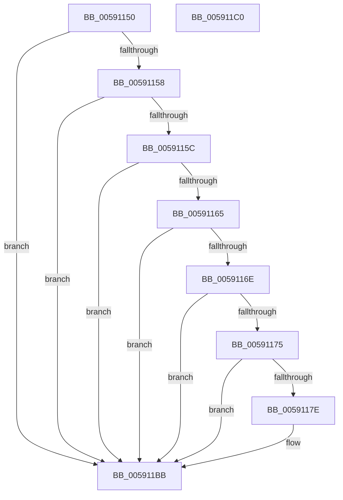

# BgkSolidColorFill

- RVA: `0x00591150`–`0x005911C1` (길이 `113` bytes)
- VA: `0x0000000140591150`
- 실행 섹션: `.text`
- PDB 이름 있음: `예`; PDB Function 태그: `아니요`
- unwind 정보 RVA: `0x0005C788`
- 디코드: `29`개 명령, `113/113` bytes 표시
- 미해석 바이트: `0` (있으면 어셈블리에 `.byte`로 보존)

> 이 문서는 커널 이미지의 기계어와 PDB 기호를 분석해 생성했습니다. 4번과 5번은 함수 원형과 자료형을 바이너리 사용 방식에서 추정한 C 해석이며 원본 소스 복구 결과는 아닙니다.

## 1. Dependencies

- 직접 호출 지점: **4**; 고유 호출 대상: **3**
- 직접 호출자로 확인된 함수: **0**
- RIP 상대 이미지 참조: **3**

### Outgoing calls
- `0x00591175` → [BgkpAcquireConsole](BgkpAcquireConsole_function_005911C8.md) (function, `0x005911C8`)
- `0x0059119A` → [guard_dispatch_icall](../6B/guard_dispatch_icall_function_006BAAD0.md) (function, `0x006BAAD0`)
- `0x005911AA` → [guard_dispatch_icall](../6B/guard_dispatch_icall_function_006BAAD0.md) (function, `0x006BAAD0`)
- `0x005911B6` → [ExReleaseRundownProtection](../34/ExReleaseRundownProtection_function_00349E80.md) (function, `0x00349E80`)

### Direct callers
- 이 함수 시작 RVA로 연결되는 직접 call은 확인되지 않았습니다. 간접 호출은 완전히 역산할 수 없습니다.

### Static image references
- `0x00591182` → RVA `0x00026AE0` (`.rdata`; read)
- `0x0059118D` → RVA `0x00E65E70` (`.data`; read)
- `0x005911AF` → RVA `0x00E0A9A0` (`.data`; read)

## 2. Other-region calls and transfers

- 다른 실행 섹션으로 향하는 call: **0**
- 별도 외부 분기/꼬리 이동을 확인하지 못했습니다.

## 3. Assembly (complete function range)

```asm
00591150  48 83 EC 28                     sub rsp, 0x28
00591154  85 C9                           test ecx, ecx
00591156  75 63                           jne 0x1405911bb
00591158  85 D2                           test edx, edx
0059115A  75 5F                           jne 0x1405911bb
0059115C  41 81 F8 7F 02 00 00            cmp r8d, 0x27f
00591163  75 56                           jne 0x1405911bb
00591165  41 81 F9 DF 01 00 00            cmp r9d, 0x1df
0059116C  75 4D                           jne 0x1405911bb
0059116E  83 7C 24 50 10                  cmp dword ptr [rsp + 0x50], 0x10
00591173  73 46                           jae 0x1405911bb
00591175  E8 4E 00 00 00                  call 0x1405911c8
0059117A  84 C0                           test al, al
0059117C  74 3D                           je 0x1405911bb
0059117E  8B 44 24 50                     mov eax, dword ptr [rsp + 0x50]
00591182  48 8D 0D 57 59 A9 FF            lea rcx, [rip - 0x56a6a9]
00591189  48 8D 14 81                     lea rdx, [rcx + rax*4]
0059118D  48 8B 05 DC 4C 8D 00            mov rax, qword ptr [rip + 0x8d4cdc]
00591194  33 C9                           xor ecx, ecx
00591196  48 8B 40 10                     mov rax, qword ptr [rax + 0x10]
0059119A  E8 31 99 12 00                  call 0x1406baad0
0059119F  48 8B 05 CA 4C 8D 00            mov rax, qword ptr [rip + 0x8d4cca]
005911A6  48 8B 40 08                     mov rax, qword ptr [rax + 8]
005911AA  E8 21 99 12 00                  call 0x1406baad0
005911AF  48 8D 0D EA 97 87 00            lea rcx, [rip + 0x8797ea]
005911B6  E8 C5 8C DB FF                  call 0x140349e80
005911BB  48 83 C4 28                     add rsp, 0x28
005911BF  C3                              ret
005911C0  CC                              int3
```

## 4. C-style interpretation (structured pseudocode)

```c
__int64 __fastcall BgkSolidColorFill(int a1, int a2, int a3, int a4, unsigned int a5)
{
    __int64 result;
    __int64 v_rsp;

    v_rsp = (v_rsp) - (40);
    if (a1 != 0) goto loc_005911BB;
    if (a2 != 0) goto loc_005911BB;
    if (a3 != 639) goto loc_005911BB;
    if (a4 != 479) goto loc_005911BB;
    if (a5 >= 16) goto loc_005911BB;
    result = BgkpAcquireConsole(a1, a2, a3, a4);
    if ((unsigned __int8)(result) != 0) {
        result = a5;
        a1 = v_rip - 5678761;
        a2 = a1 + result * 4;
        result = *(unsigned __int64 *)(v_rip + 9260252);
        a1 = 0;
        result = *(unsigned __int64 *)(result + 16);
        result = guard_dispatch_icall(a1, a2, a3, a4);
        result = *(unsigned __int64 *)(v_rip + 9260234);
        result = *(unsigned __int64 *)(result + 8);
        result = guard_dispatch_icall(a1, a2, a3, a4);
        a1 = v_rip + 8886250;
        result = ExReleaseRundownProtection(a1, a2, a3, a4);
    }
    v_rsp = (v_rsp) + (40);
    return result;
}
```

## 5. (Beta) C Style

```c
int64_t BgkSolidColorFill(int32_t Arg1, int32_t Arg2, int32_t Arg3, int32_t Arg4, uint32_t Arg5)
{
    int64_t result;
    int64_t local_rsp;

    local_rsp = (local_rsp) - (40);
    if (Arg1 != 0) goto loc_005911BB;
    if (Arg2 != 0) goto loc_005911BB;
    if (Arg3 != 639) goto loc_005911BB;
    if (Arg4 != 479) goto loc_005911BB;
    if (Arg5 >= 16) goto loc_005911BB;
    result = BgkpAcquireConsole(Arg1, Arg2, Arg3, Arg4);
    if ((uint8_t)(result) != 0) {
        result = Arg5;
        Arg1 = v_rip - 5678761;
        Arg2 = Arg1 + result * 4;
        result = *(uint64_t *)(v_rip + 0x8D4CDC);
        Arg1 = 0;
        result = *(uint64_t *)(result + 0x10);
        result = guard_dispatch_icall(Arg1, Arg2, Arg3, Arg4);
        result = *(uint64_t *)(v_rip + 0x8D4CCA);
        result = *(uint64_t *)(result + 0x8);
        result = guard_dispatch_icall(Arg1, Arg2, Arg3, Arg4);
        Arg1 = v_rip + 8886250;
        result = ExReleaseRundownProtection(Arg1, Arg2, Arg3, Arg4);
    }
    local_rsp = (local_rsp) + (40);
    return result;
}
```

## 6. Execution-region graph

[열기: 2D/3D 그래프와 함수 탐색 컨트롤 패널](../../../control-panel.html?section=text&rva=0x00591150&view=graph)

- 2D 그래프는 위에서 아래로 흐르고, 3D 그래프는 빈 공간을 드래그해 회전합니다. Shift+드래그는 이동, 휠은 확대·축소, 함수 노드 선택은 대상 보고서 이동입니다.

### Static fallback


