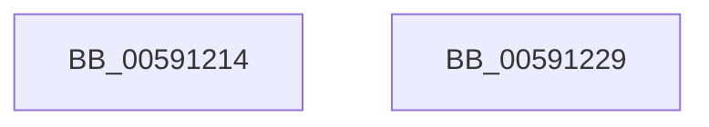

# BgkpReleaseConsole

- RVA: `0x00591214`–`0x0059122A` (길이 `22` bytes)
- VA: `0x0000000140591214`
- 실행 섹션: `.text`
- PDB 이름 있음: `예`; PDB Function 태그: `아니요`
- unwind 정보 RVA: `0x0005C788`
- 디코드: `6`개 명령, `22/22` bytes 표시
- 미해석 바이트: `0` (있으면 어셈블리에 `.byte`로 보존)

> 이 문서는 커널 이미지의 기계어와 PDB 기호를 분석해 생성했습니다. 4번과 5번은 함수 원형과 자료형을 바이너리 사용 방식에서 추정한 C 해석이며 원본 소스 복구 결과는 아닙니다.

## 1. Dependencies

- 직접 호출 지점: **1**; 고유 호출 대상: **1**
- 직접 호출자로 확인된 함수: **4**
- RIP 상대 이미지 참조: **1**

### Outgoing calls
- `0x0059121F` → [ExReleaseRundownProtection](../34/ExReleaseRundownProtection_function_00349E80.md) (function, `0x00349E80`)

### Direct callers
- [BgkDisplayCharacter](../../pagebgfx/BC/BgkDisplayCharacter_function_00BC0240.md) at `0x00BC02B7`
- [BgkGetConsoleState](../../pagebgfx/BC/BgkGetConsoleState_function_00BC0370.md) at `0x00BC039E`
- [BgkGetCursorState](../../pagebgfx/BC/BgkGetCursorState_function_00BC03C0.md) at `0x00BC0403`
- [BgkSetCursor](../../pagebgfx/BC/BgkSetCursor_function_00BC0490.md) at `0x00BC04CF`

### Static image references
- `0x00591218` → RVA `0x00E0A9A0` (`.data`; read)

## 2. Other-region calls and transfers

- 다른 실행 섹션으로 향하는 call: **0**
- 별도 외부 분기/꼬리 이동을 확인하지 못했습니다.

## 3. Assembly (complete function range)

```asm
00591214  48 83 EC 28                     sub rsp, 0x28
00591218  48 8D 0D 81 97 87 00            lea rcx, [rip + 0x879781]
0059121F  E8 5C 8C DB FF                  call 0x140349e80
00591224  48 83 C4 28                     add rsp, 0x28
00591228  C3                              ret
00591229  CC                              int3
```

## 4. C-style interpretation (structured pseudocode)

```c
__int64 __fastcall BgkpReleaseConsole(void)
{
    __int64 result;
    __int64 v_rsp;

    v_rsp = (v_rsp) - (40);
    result = ExReleaseRundownProtection(v_rip + 8886145, a2, a3, a4);
    v_rsp = (v_rsp) + (40);
    return result;
}
```

## 5. (Beta) C Style

```c
void BgkpReleaseConsole(void)
{
    int64_t result;
    int64_t local_rsp;

    local_rsp = (local_rsp) - (40);
    result = ExReleaseRundownProtection(v_rip + 8886145, a2, a3, a4);
    local_rsp = (local_rsp) + (40);
    return result;
}
```

## 6. Execution-region graph

[열기: 2D/3D 그래프와 함수 탐색 컨트롤 패널](../../../control-panel.html?section=text&rva=0x00591214&view=graph)

- 2D 그래프는 위에서 아래로 흐르고, 3D 그래프는 빈 공간을 드래그해 회전합니다. Shift+드래그는 이동, 휠은 확대·축소, 함수 노드 선택은 대상 보고서 이동입니다.

### Static fallback


