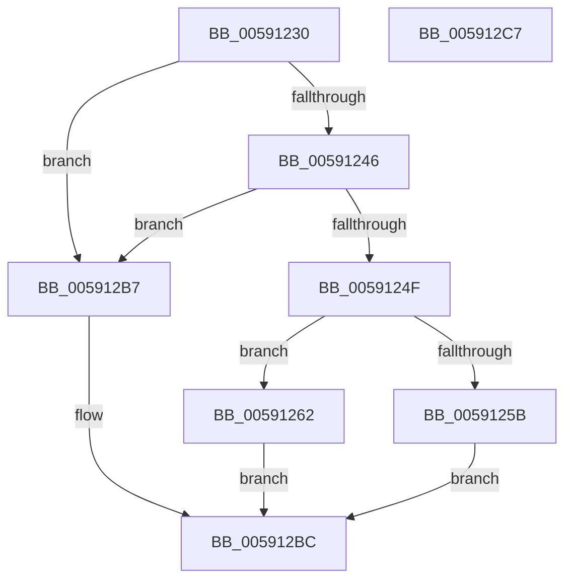

# BgkpResetDisplay

- RVA: `0x00591230`–`0x005912C8` (길이 `152` bytes)
- VA: `0x0000000140591230`
- 실행 섹션: `.text`
- PDB 이름 있음: `예`; PDB Function 태그: `아니요`
- unwind 정보 RVA: `0x0005CAAC`
- 디코드: `41`개 명령, `152/152` bytes 표시
- 미해석 바이트: `0` (있으면 어셈블리에 `.byte`로 보존)

> 이 문서는 커널 이미지의 기계어와 PDB 기호를 분석해 생성했습니다. 4번과 5번은 함수 원형과 자료형을 바이너리 사용 방식에서 추정한 C 해석이며 원본 소스 복구 결과는 아닙니다.

## 1. Dependencies

- 직접 호출 지점: **2**; 고유 호출 대상: **2**
- 직접 호출자로 확인된 함수: **0**
- RIP 상대 이미지 참조: **4**

### Outgoing calls
- `0x0059126A` → [guard_dispatch_icall](../6B/guard_dispatch_icall_function_006BAAD0.md) (function, `0x006BAAD0`)
- `0x00591271` → `BOOTVID.dll!VidResetDisplay` (import, 간접 대상; import `BOOTVID.dll!VidResetDisplay`)

### Direct callers
- 이 함수 시작 RVA로 연결되는 직접 call은 확인되지 않았습니다. 간접 호출은 완전히 역산할 수 없습니다.

### Static image references
- `0x00591246` → RVA `0x00E3EE18` (`.data`; read)
- `0x0059124F` → RVA `0x00E65EA8` (`.data`; read)
- `0x00591271` → RVA `0x00151008` (`BOOTVID.dll!VidResetDisplay (IAT)`; read)
- `0x00591297` → RVA `0x00591300` (`BgkpVgaBltRoutine`; read)

## 2. Other-region calls and transfers

- 다른 실행 섹션으로 향하는 call: **0**
- 별도 외부 분기/꼬리 이동을 확인하지 못했습니다.

## 3. Assembly (complete function range)

```asm
00591230  48 89 5C 24 08                  mov qword ptr [rsp + 8], rbx
00591235  57                              push rdi
00591236  48 83 EC 20                     sub rsp, 0x20
0059123A  33 FF                           xor edi, edi
0059123C  48 8B DA                        mov rbx, rdx
0059123F  49 89 38                        mov qword ptr [r8], rdi
00591242  84 C9                           test cl, cl
00591244  74 71                           je 0x1405912b7
00591246  83 3D CB DB 8A 00 02            cmp dword ptr [rip + 0x8adbcb], 2
0059124D  74 68                           je 0x1405912b7
0059124F  48 8B 05 52 4C 8D 00            mov rax, qword ptr [rip + 0x8d4c52]
00591256  48 85 C0                        test rax, rax
00591259  75 07                           jne 0x140591262
0059125B  B8 01 00 00 C0                  mov eax, 0xc0000001
00591260  EB 5A                           jmp 0x1405912bc
00591262  BA 32 00 00 00                  mov edx, 0x32
00591267  8D 4A 1E                        lea ecx, [rdx + 0x1e]
0059126A  E8 61 98 12 00                  call 0x1406baad0
0059126F  B1 01                           mov cl, 1
00591271  48 FF 15 90 FD BB FF            call qword ptr [rip - 0x440270]
00591278  0F 1F 44 00 00                  nop dword ptr [rax + rax]
0059127D  66 89 7B 01                     mov word ptr [rbx + 1], di
00591281  B8 80 02 00 00                  mov eax, 0x280
00591286  40 88 7B 03                     mov byte ptr [rbx + 3], dil
0059128A  48 89 7B 14                     mov qword ptr [rbx + 0x14], rdi
0059128E  89 7B 1C                        mov dword ptr [rbx + 0x1c], edi
00591291  89 43 08                        mov dword ptr [rbx + 8], eax
00591294  89 43 0C                        mov dword ptr [rbx + 0xc], eax
00591297  48 8D 05 62 00 00 00            lea rax, [rip + 0x62]
0059129E  48 89 43 20                     mov qword ptr [rbx + 0x20], rax
005912A2  33 C0                           xor eax, eax
005912A4  40 88 3B                        mov byte ptr [rbx], dil
005912A7  C7 43 04 E0 01 00 00            mov dword ptr [rbx + 4], 0x1e0
005912AE  C7 43 10 01 00 00 00            mov dword ptr [rbx + 0x10], 1
005912B5  EB 05                           jmp 0x1405912bc
005912B7  B8 BB 00 00 C0                  mov eax, 0xc00000bb
005912BC  48 8B 5C 24 30                  mov rbx, qword ptr [rsp + 0x30]
005912C1  48 83 C4 20                     add rsp, 0x20
005912C5  5F                              pop rdi
005912C6  C3                              ret
005912C7  CC                              int3
```

## 4. C-style interpretation (structured pseudocode)

```c
__int64 __fastcall BgkpResetDisplay(unsigned __int8 a1, __int64 a2, __int64 a3)
{
    __int64 result;
    __int64 v_rdi;
    __int64 v_rsp;
    unsigned __int64 v_stack_p8;

    v_stack_p8 = v_rbx;
    v_rsp = (v_rsp) - (32);
    v_rdi = 0;
    *(unsigned __int64 *)(a3) = 0;
    if (a1 == 0) goto loc_005912B7;
    if ((*(unsigned int *)(v_rip + 9100235)) == 2) goto loc_005912B7;
    if (*(unsigned __int64 *)(v_rip + 9260114) != 0) goto loc_00591262;
    goto loc_005912BC;
loc_00591262:
    result = guard_dispatch_icall(50 + 30, 50, a3, a4);
    result = BOOTVID_dll_VidResetDisplay(1, 50, a3, a4);
    *(unsigned __int16 *)(a2 + 1) = 0;
    *(unsigned __int8 *)(a2 + 3) = 0;
    *(unsigned __int64 *)(a2 + 20) = 0;
    *(unsigned int *)(a2 + 28) = 0;
    *(unsigned int *)(a2 + 8) = 640;
    *(unsigned int *)(a2 + 12) = 640;
    *(unsigned __int64 *)(a2 + 32) = v_rip + 98;
    result = 0;
    *(unsigned __int8 *)(a2) = 0;
    *(unsigned int *)(a2 + 4) = 480;
    *(unsigned int *)(a2 + 16) = 1;
    goto loc_005912BC;
loc_005912B7:
loc_005912BC:
    v_rsp = (v_rsp) + (32);
    return (unsigned int)(0xC00000BBULL);
}
```

## 5. (Beta) C Style

```c
int64_t BgkpResetDisplay(uint8_t Arg1, void *Arg2, void *Arg3)
{
    uint8_t *arg2 = (uint8_t *)Arg2;
    uint8_t *arg3 = (uint8_t *)Arg3;

    int64_t result;
    int64_t local_rdi;
    int64_t local_rsp;
    uint64_t v_stack_p8;

    v_stack_p8 = local_rbx;
    local_rsp = (local_rsp) - (32);
    local_rdi = 0;
    *(uint64_t *)(arg3) = 0;
    if (Arg1 == 0) goto loc_005912B7;
    if ((*(uint32_t *)(v_rip + 0x8ADBCB)) == 2) goto loc_005912B7;
    if (*(uint64_t *)(v_rip + 0x8D4C52) != 0) goto loc_00591262;
    goto loc_005912BC;
loc_00591262:
    result = guard_dispatch_icall(50 + 30, 50, Arg3, a4);
    result = kernel_indirect_call(1, 50, Arg3, a4);
    *(uint16_t *)(arg2 + 0x1) = 0;
    *(uint8_t *)(arg2 + 0x3) = 0;
    *(uint64_t *)(arg2 + 0x14) = 0;
    *(uint32_t *)(arg2 + 0x1C) = 0;
    *(uint32_t *)(arg2 + 0x8) = 640;
    *(uint32_t *)(arg2 + 0xC) = 640;
    *(uint64_t *)(arg2 + 0x20) = v_rip + 98;
    result = 0;
    *(uint8_t *)(arg2) = 0;
    *(uint32_t *)(arg2 + 0x4) = 480;
    *(uint32_t *)(arg2 + 0x10) = 1;
    goto loc_005912BC;
loc_005912B7:
loc_005912BC:
    local_rsp = (local_rsp) + (32);
    return (uint32_t)(0xC00000BBULL);
}
```

### 관측된 메모리 오프셋

구조체 형식이 확인되지 않은 접근은 인자 기준의 오프셋으로만 기록했습니다.

| 기준 인자 | 오프셋 표현 | 폭 (bit) | 접근 |
|---|---:|---:|---|
| `Arg2` | `+ 0x0` | `8` | `W` |
| `Arg2` | `+ 0x1` | `16` | `W` |
| `Arg2` | `+ 0x3` | `8` | `W` |
| `Arg2` | `+ 0x4` | `32` | `W` |
| `Arg2` | `+ 0x8` | `32` | `W` |
| `Arg2` | `+ 0xC` | `32` | `W` |
| `Arg2` | `+ 0x10` | `32` | `W` |
| `Arg2` | `+ 0x14` | `64` | `W` |
| `Arg2` | `+ 0x1C` | `32` | `W` |
| `Arg2` | `+ 0x20` | `64` | `W` |
| `Arg3` | `+ 0x0` | `64` | `W` |

## 6. Execution-region graph

[열기: 2D/3D 그래프와 함수 탐색 컨트롤 패널](../../../control-panel.html?section=text&rva=0x00591230&view=graph)

- 2D 그래프는 위에서 아래로 흐르고, 3D 그래프는 빈 공간을 드래그해 회전합니다. Shift+드래그는 이동, 휠은 확대·축소, 함수 노드 선택은 대상 보고서 이동입니다.

### Static fallback


