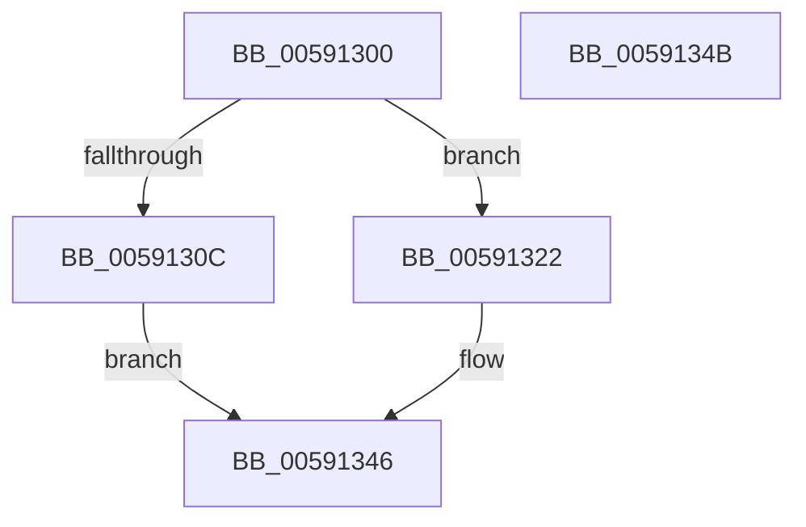

# BgkpVgaBltRoutine

- RVA: `0x00591300`–`0x0059134C` (길이 `76` bytes)
- VA: `0x0000000140591300`
- 실행 섹션: `.text`
- PDB 이름 있음: `예`; PDB Function 태그: `아니요`
- unwind 정보 RVA: `0x0005D2F4`
- 디코드: `22`개 명령, `76/76` bytes 표시
- 미해석 바이트: `0` (있으면 어셈블리에 `.byte`로 보존)

> 이 문서는 커널 이미지의 기계어와 PDB 기호를 분석해 생성했습니다. 4번과 5번은 함수 원형과 자료형을 바이너리 사용 방식에서 추정한 C 해석이며 원본 소스 복구 결과는 아닙니다.

## 1. Dependencies

- 직접 호출 지점: **2**; 고유 호출 대상: **2**
- 직접 호출자로 확인된 함수: **0**
- RIP 상대 이미지 참조: **1**

### Outgoing calls
- `0x00591316` → [memset](../6C/memset_function_006C6C40.md) (function, `0x006C6C40`)
- `0x00591338` → `BOOTVID.dll!VidBitBltEx` (import, 간접 대상; import `BOOTVID.dll!VidBitBltEx`)

### Direct callers
- 이 함수 시작 RVA로 연결되는 직접 call은 확인되지 않았습니다. 간접 호출은 완전히 역산할 수 없습니다.

### Static image references
- `0x00591338` → RVA `0x00151010` (`BOOTVID.dll!VidBitBltEx (IAT)`; read)

## 2. Other-region calls and transfers

- 다른 실행 섹션으로 향하는 call: **0**
- 별도 외부 분기/꼬리 이동을 확인하지 못했습니다.

## 3. Assembly (complete function range)

```asm
00591300  48 83 EC 38                     sub rsp, 0x38
00591304  4C 8B D2                        mov r10, rdx
00591307  45 84 C0                        test r8b, r8b
0059130A  74 16                           je 0x140591322
0059130C  44 8B 41 0C                     mov r8d, dword ptr [rcx + 0xc]
00591310  33 D2                           xor edx, edx
00591312  48 8B 49 10                     mov rcx, qword ptr [rcx + 0x10]
00591316  E8 25 59 13 00                  call 0x1406c6c40
0059131B  B8 01 00 00 C0                  mov eax, 0xc0000001
00591320  EB 24                           jmp 0x140591346
00591322  48 8B 41 10                     mov rax, qword ptr [rcx + 0x10]
00591326  44 8B 09                        mov r9d, dword ptr [rcx]
00591329  44 8B 41 04                     mov r8d, dword ptr [rcx + 4]
0059132D  41 8B 0A                        mov ecx, dword ptr [r10]
00591330  8B 52 04                        mov edx, dword ptr [rdx + 4]
00591333  48 89 44 24 20                  mov qword ptr [rsp + 0x20], rax
00591338  48 FF 15 D1 FC BB FF            call qword ptr [rip - 0x44032f]
0059133F  0F 1F 44 00 00                  nop dword ptr [rax + rax]
00591344  33 C0                           xor eax, eax
00591346  48 83 C4 38                     add rsp, 0x38
0059134A  C3                              ret
0059134B  CC                              int3
```

## 4. C-style interpretation (structured pseudocode)

```c
__int64 __fastcall BgkpVgaBltRoutine(__int64 a1, __int64 a2, unsigned __int8 a3)
{
    __int64 result;
    __int64 v_rsp;
    unsigned __int64 v_stack_m18;

    v_rsp = (v_rsp) - (56);
    if (a3 == 0) goto loc_00591322;
    a2 = 0;
    result = memset(*(unsigned __int64 *)(a1 + 16), a2, (unsigned int)(*(unsigned int *)(a1 + 12)), a4);
    goto loc_00591346;
loc_00591322:
    v_stack_m18 = *(unsigned __int64 *)(*(unsigned __int64 *)(a1 + 16) + 16);
    result = BOOTVID_dll_VidBitBltEx((unsigned int)(*(unsigned int *)(a2)), (unsigned int)(*(unsigned int *)(a2 + 4)), (unsigned int)(*(unsigned int *)(*(unsigned __int64 *)(a1 + 16) + 4)), (unsigned int)(*(unsigned int *)(*(unsigned __int64 *)(a1 + 16))));
    result = 0;
loc_00591346:
    v_rsp = (v_rsp) + (56);
    return result;
}
```

## 5. (Beta) C Style

```c
int64_t BgkpVgaBltRoutine(void *Arg1, void *Arg2, uint8_t Arg3)
{
    uint8_t *arg1 = (uint8_t *)Arg1;
    uint8_t *arg2 = (uint8_t *)Arg2;

    int64_t result;
    int64_t local_rsp;
    uint64_t v_stack_m18;

    local_rsp = (local_rsp) - (56);
    if (Arg3 == 0) goto loc_00591322;
    Arg2 = 0;
    result = memset(*(uint64_t *)(arg1 + 0x10), Arg2, (uint32_t)(*(uint32_t *)(arg1 + 0xC)), a4);
    goto loc_00591346;
loc_00591322:
    v_stack_m18 = *(uint64_t *)(*(uint64_t *)(arg1 + 0x10) + 0x10);
    result = kernel_indirect_call((uint32_t)(*(uint32_t *)(arg2)), (uint32_t)(*(uint32_t *)(arg2 + 0x4)), (uint32_t)(*(uint32_t *)(*(uint64_t *)(arg1 + 0x10) + 0x4)), (uint32_t)(*(uint32_t *)(*(uint64_t *)(arg1 + 0x10))));
    result = 0;
loc_00591346:
    local_rsp = (local_rsp) + (56);
    return result;
}
```

### 관측된 메모리 오프셋

구조체 형식이 확인되지 않은 접근은 인자 기준의 오프셋으로만 기록했습니다.

| 기준 인자 | 오프셋 표현 | 폭 (bit) | 접근 |
|---|---:|---:|---|
| `Arg1` | `+ 0x0` | `32` | `R` |
| `Arg1` | `+ 0x4` | `32` | `R` |
| `Arg1` | `+ 0xC` | `32` | `R` |
| `Arg1` | `+ 0x10` | `64` | `R` |
| `Arg2` | `+ 0x0` | `32` | `R` |
| `Arg2` | `+ 0x4` | `32` | `R` |

## 6. Execution-region graph

[열기: 2D/3D 그래프와 함수 탐색 컨트롤 패널](../../../control-panel.html?section=text&rva=0x00591300&view=graph)

- 2D 그래프는 위에서 아래로 흐르고, 3D 그래프는 빈 공간을 드래그해 회전합니다. Shift+드래그는 이동, 휠은 확대·축소, 함수 노드 선택은 대상 보고서 이동입니다.

### Static fallback


