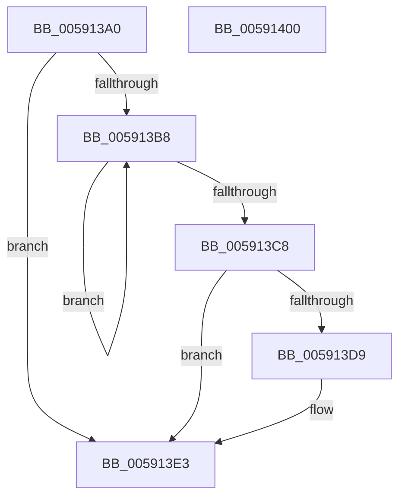

# BvgaAcquireLock

- RVA: `0x005913A0`–`0x00591401` (길이 `97` bytes)
- VA: `0x00000001405913A0`
- 실행 섹션: `.text`
- PDB 이름 있음: `예`; PDB Function 태그: `아니요`
- unwind 정보 RVA: `0x0005CAAC`
- 디코드: `26`개 명령, `97/97` bytes 표시
- 미해석 바이트: `0` (있으면 어셈블리에 `.byte`로 보존)

> 이 문서는 커널 이미지의 기계어와 PDB 기호를 분석해 생성했습니다. 4번과 5번은 함수 원형과 자료형을 바이너리 사용 방식에서 추정한 C 해석이며 원본 소스 복구 결과는 아닙니다.

## 1. Dependencies

- 직접 호출 지점: **3**; 고유 호출 대상: **3**
- 직접 호출자로 확인된 함수: **6**
- RIP 상대 이미지 참조: **3**

### Outgoing calls
- `0x005913BF` → [KeTestSpinLock](../41/KeTestSpinLock_function_00419C10.md) (function, `0x00419C10`)
- `0x005913DE` → [KiRaiseIrqlProcessIrqlFlags](../4F/KiRaiseIrqlProcessIrqlFlags_function_004F56FC.md) (function, `0x004F56FC`)
- `0x005913EA` → [KeAcquireSpinLockAtDpcLevel](../20/KeAcquireSpinLockAtDpcLevel_function_00208430.md) (function, `0x00208430`)

### Direct callers
- [BvgaBitBlt](BvgaBitBlt_function_00591410.md) at `0x00591439`
- [BvgaDisplayString](BvgaDisplayString_function_00591490.md) at `0x005914A2`
- [BvgaEnableBootDriver](BvgaEnableBootDriver_function_00591500.md) at `0x00591520`
- [BvgaNotifyDisplayOwnershipLost](BvgaNotifyDisplayOwnershipLost_function_00591620.md) at `0x00591632`
- [BvgaSolidColorFill](BvgaSolidColorFill_function_00591870.md) at `0x00591897`
- [BvgaUpdateProgressBar](BvgaUpdateProgressBar_function_00591930.md) at `0x0059197D`

### Static image references
- `0x005913B8` → RVA `0x00F8E9E0` (`.data`; read)
- `0x005913D0` → RVA `0x00FC6D20` (`ALMOSTRO`; read)
- `0x005913EF` → RVA `0x00F8E9DC` (`.data`; write)

## 2. Other-region calls and transfers

- 다른 실행 섹션으로 향하는 call: **0**
- 별도 외부 분기/꼬리 이동을 확인하지 못했습니다.

## 3. Assembly (complete function range)

```asm
005913A0  48 89 5C 24 08                  mov qword ptr [rsp + 8], rbx
005913A5  57                              push rdi
005913A6  48 83 EC 20                     sub rsp, 0x20
005913AA  44 0F 20 C3                     mov rbx, cr8
005913AE  BF 02 00 00 00                  mov edi, 2
005913B3  40 3A DF                        cmp bl, dil
005913B6  77 2B                           ja 0x1405913e3
005913B8  48 8D 0D 21 D6 9F 00            lea rcx, [rip + 0x9fd621]
005913BF  E8 4C 88 E8 FF                  call 0x140419c10
005913C4  84 C0                           test al, al
005913C6  74 F0                           je 0x1405913b8
005913C8  44 0F 20 C3                     mov rbx, cr8
005913CC  44 0F 22 C7                     mov cr8, rdi
005913D0  83 3D 49 59 A3 00 00            cmp dword ptr [rip + 0xa35949], 0
005913D7  74 0A                           je 0x1405913e3
005913D9  40 8A D7                        mov dl, dil
005913DC  8A CB                           mov cl, bl
005913DE  E8 19 43 F6 FF                  call 0x1404f56fc
005913E3  48 8D 0D F6 D5 9F 00            lea rcx, [rip + 0x9fd5f6]
005913EA  E8 41 70 C7 FF                  call 0x140208430
005913EF  88 1D E7 D5 9F 00               mov byte ptr [rip + 0x9fd5e7], bl
005913F5  48 8B 5C 24 30                  mov rbx, qword ptr [rsp + 0x30]
005913FA  48 83 C4 20                     add rsp, 0x20
005913FE  5F                              pop rdi
005913FF  C3                              ret
00591400  CC                              int3
```

## 4. C-style interpretation (structured pseudocode)

```c
__int64 __fastcall BvgaAcquireLock(void)
{
    __int64 result;
    __int64 v_rsp;
    unsigned __int64 v_stack_p8;

    v_stack_p8 = v_rbx;
    v_rsp = (v_rsp) - (32);
    if (((unsigned __int8)(v_cr8)) > 2) goto loc_005913E3;
loc_005913B8:
    result = KeTestSpinLock(v_rip + 10475041, a2, a3, a4);
    if ((unsigned __int8)(result) == 0) goto loc_005913B8;
    if ((*(unsigned int *)(v_rip + 10705225)) != 0) {
        a2 = 2;
        a1 = (unsigned __int8)(v_cr8);
        result = KiRaiseIrqlProcessIrqlFlags(a1, a2, a3, a4);
    }
    result = KeAcquireSpinLockAtDpcLevel(v_rip + 10474998, a2, a3, a4);
    *(unsigned __int8 *)(v_rip + 10474983) = (unsigned __int8)(v_cr8);
    v_rsp = (v_rsp) + (32);
    return result;
}
```

## 5. (Beta) C Style

```c
void BvgaAcquireLock(void)
{
    int64_t result;
    int64_t local_rsp;
    uint64_t v_stack_p8;

    v_stack_p8 = local_rbx;
    local_rsp = (local_rsp) - (32);
    if (((uint8_t)(v_cr8)) > 2) goto loc_005913E3;
loc_005913B8:
    result = KeTestSpinLock(v_rip + 10475041, a2, a3, a4);
    if ((uint8_t)(result) == 0) goto loc_005913B8;
    if ((*(uint32_t *)(v_rip + 0xA35949)) != 0) {
        a2 = 2;
        a1 = (uint8_t)(v_cr8);
        result = KiRaiseIrqlProcessIrqlFlags(a1, a2, a3, a4);
    }
    result = KeAcquireSpinLockAtDpcLevel(v_rip + 10474998, a2, a3, a4);
    *(uint8_t *)(v_rip + 0x9FD5E7) = (uint8_t)(v_cr8);
    local_rsp = (local_rsp) + (32);
    return result;
}
```

## 6. Execution-region graph

[열기: 2D/3D 그래프와 함수 탐색 컨트롤 패널](../../../control-panel.html?section=text&rva=0x005913A0&view=graph)

- 2D 그래프는 위에서 아래로 흐르고, 3D 그래프는 빈 공간을 드래그해 회전합니다. Shift+드래그는 이동, 휠은 확대·축소, 함수 노드 선택은 대상 보고서 이동입니다.

### Static fallback


