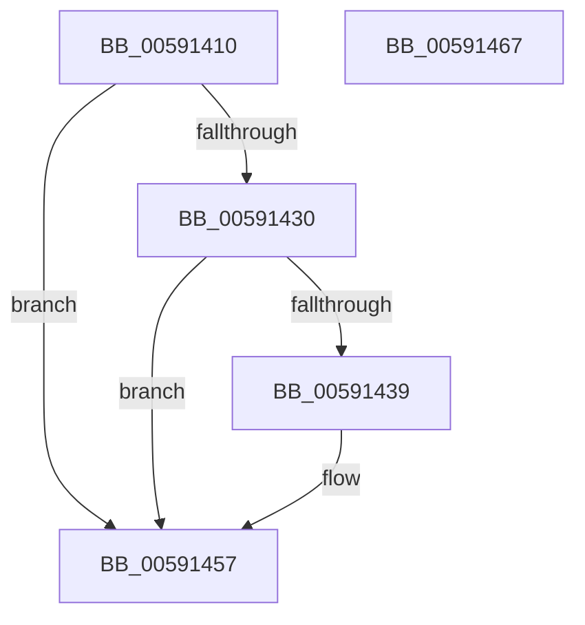

# BvgaBitBlt

- RVA: `0x00591410`–`0x00591468` (길이 `88` bytes)
- VA: `0x0000000140591410`
- 실행 섹션: `.text`
- PDB 이름 있음: `예`; PDB Function 태그: `아니요`
- unwind 정보 RVA: `0x00060BC4`
- 디코드: `24`개 명령, `88/88` bytes 표시
- 미해석 바이트: `0` (있으면 어셈블리에 `.byte`로 보존)

> 이 문서는 커널 이미지의 기계어와 PDB 기호를 분석해 생성했습니다. 4번과 5번은 함수 원형과 자료형을 바이너리 사용 방식에서 추정한 C 해석이며 원본 소스 복구 결과는 아닙니다.

## 1. Dependencies

- 직접 호출 지점: **3**; 고유 호출 대상: **3**
- 직접 호출자로 확인된 함수: **0**
- RIP 상대 이미지 참조: **3**

### Outgoing calls
- `0x00591439` → [BvgaAcquireLock](BvgaAcquireLock_function_005913A0.md) (function, `0x005913A0`)
- `0x00591446` → `BOOTVID.dll!VidBitBlt` (import, 간접 대상; import `BOOTVID.dll!VidBitBlt`)
- `0x00591452` → [BvgaReleaseLock](BvgaReleaseLock_function_00591690.md) (function, `0x00591690`)

### Direct callers
- 이 함수 시작 RVA로 연결되는 직접 call은 확인되지 않았습니다. 간접 호출은 완전히 역산할 수 없습니다.

### Static image references
- `0x0059141F` → RVA `0x00E65EC8` (`.data`; read)
- `0x00591430` → RVA `0x00E65ED0` (`.data`; read)
- `0x00591446` → RVA `0x00151050` (`BOOTVID.dll!VidBitBlt (IAT)`; read)

## 2. Other-region calls and transfers

- 다른 실행 섹션으로 향하는 call: **0**
- 별도 외부 분기/꼬리 이동을 확인하지 못했습니다.

## 3. Assembly (complete function range)

```asm
00591410  48 89 5C 24 08                  mov qword ptr [rsp + 8], rbx
00591415  48 89 74 24 10                  mov qword ptr [rsp + 0x10], rsi
0059141A  57                              push rdi
0059141B  48 83 EC 20                     sub rsp, 0x20
0059141F  80 3D A2 4A 8D 00 00            cmp byte ptr [rip + 0x8d4aa2], 0
00591426  41 8B D8                        mov ebx, r8d
00591429  8B FA                           mov edi, edx
0059142B  48 8B F1                        mov rsi, rcx
0059142E  74 27                           je 0x140591457
00591430  83 3D 99 4A 8D 00 00            cmp dword ptr [rip + 0x8d4a99], 0
00591437  75 1E                           jne 0x140591457
00591439  E8 62 FF FF FF                  call 0x1405913a0
0059143E  44 8B C3                        mov r8d, ebx
00591441  8B D7                           mov edx, edi
00591443  48 8B CE                        mov rcx, rsi
00591446  48 FF 15 03 FC BB FF            call qword ptr [rip - 0x4403fd]
0059144D  0F 1F 44 00 00                  nop dword ptr [rax + rax]
00591452  E8 39 02 00 00                  call 0x140591690
00591457  48 8B 5C 24 30                  mov rbx, qword ptr [rsp + 0x30]
0059145C  48 8B 74 24 38                  mov rsi, qword ptr [rsp + 0x38]
00591461  48 83 C4 20                     add rsp, 0x20
00591465  5F                              pop rdi
00591466  C3                              ret
00591467  CC                              int3
```

## 4. C-style interpretation (structured pseudocode)

```c
__int64 __fastcall BvgaBitBlt(__int64 a1, int a2, int a3)
{
    __int64 result;
    __int64 v_rsp;
    unsigned __int64 v_stack_p10;
    unsigned __int64 v_stack_p8;

    v_stack_p8 = v_rbx;
    v_stack_p10 = v_rsi;
    v_rsp = (v_rsp) - (32);
    if ((*(unsigned __int8 *)(v_rip + 9259682)) == 0) goto loc_00591457;
    if ((*(unsigned int *)(v_rip + 9259673)) == 0) {
        result = BvgaAcquireLock(a1, a2, a3, a4);
        a3 = (unsigned int)((unsigned int)(a3));
        a2 = (unsigned int)((unsigned int)(a2));
        a1 = a1;
        result = BOOTVID_dll_VidBitBlt(a1, a2, a3, a4);
        result = BvgaReleaseLock(a1, a2, a3, a4);
    }
    v_rsp = (v_rsp) + (32);
    return result;
}
```

## 5. (Beta) C Style

```c
int64_t BvgaBitBlt(int64_t Arg1, int32_t Arg2, int32_t Arg3)
{
    int64_t result;
    int64_t local_rsp;
    uint64_t v_stack_p10;
    uint64_t v_stack_p8;

    v_stack_p8 = local_rbx;
    v_stack_p10 = local_rsi;
    local_rsp = (local_rsp) - (32);
    if ((*(uint8_t *)(v_rip + 0x8D4AA2)) == 0) goto loc_00591457;
    if ((*(uint32_t *)(v_rip + 0x8D4A99)) == 0) {
        result = BvgaAcquireLock(Arg1, Arg2, Arg3, a4);
        Arg3 = (uint32_t)((uint32_t)(Arg3));
        Arg2 = (uint32_t)((uint32_t)(Arg2));
        Arg1 = Arg1;
        result = kernel_indirect_call(Arg1, Arg2, Arg3, a4);
        result = BvgaReleaseLock(Arg1, Arg2, Arg3, a4);
    }
    local_rsp = (local_rsp) + (32);
    return result;
}
```

## 6. Execution-region graph

[열기: 2D/3D 그래프와 함수 탐색 컨트롤 패널](../../../control-panel.html?section=text&rva=0x00591410&view=graph)

- 2D 그래프는 위에서 아래로 흐르고, 3D 그래프는 빈 공간을 드래그해 회전합니다. Shift+드래그는 이동, 휠은 확대·축소, 함수 노드 선택은 대상 보고서 이동입니다.

### Static fallback


