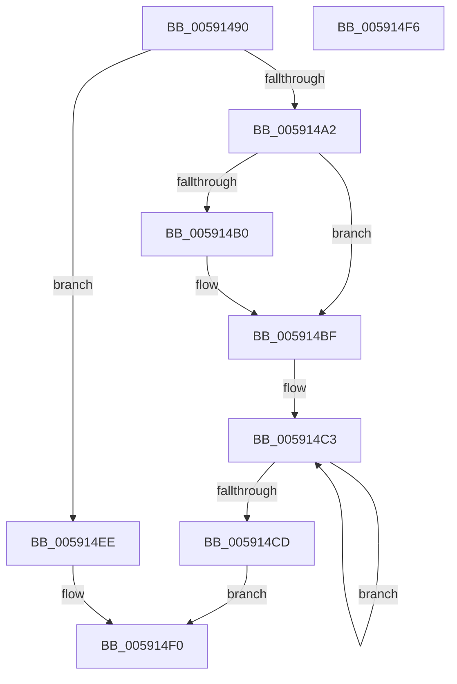

# BvgaDisplayString

- RVA: `0x00591490`–`0x005914F7` (길이 `103` bytes)
- VA: `0x0000000140591490`
- 실행 섹션: `.text`
- PDB 이름 있음: `예`; PDB Function 태그: `아니요`
- unwind 정보 RVA: `0x00064C80`
- 디코드: `29`개 명령, `103/103` bytes 표시
- 미해석 바이트: `0` (있으면 어셈블리에 `.byte`로 보존)

> 이 문서는 커널 이미지의 기계어와 PDB 기호를 분석해 생성했습니다. 4번과 5번은 함수 원형과 자료형을 바이너리 사용 방식에서 추정한 C 해석이며 원본 소스 복구 결과는 아닙니다.

## 1. Dependencies

- 직접 호출 지점: **4**; 고유 호출 대상: **4**
- 직접 호출자로 확인된 함수: **0**
- RIP 상대 이미지 참조: **3**

### Outgoing calls
- `0x005914A2` → [BvgaAcquireLock](BvgaAcquireLock_function_005913A0.md) (function, `0x005913A0`)
- `0x005914B3` → `BOOTVID.dll!VidDisplayString` (import, 간접 대상; import `BOOTVID.dll!VidDisplayString`)
- `0x005914E0` → [HeadlessDispatch](../65/HeadlessDispatch_function_00655C40.md) (function, `0x00655C40`)
- `0x005914E5` → [BvgaReleaseLock](BvgaReleaseLock_function_00591690.md) (function, `0x00591690`)

### Direct callers
- 이 함수 시작 RVA로 연결되는 직접 call은 확인되지 않았습니다. 간접 호출은 완전히 역산할 수 없습니다.

### Static image references
- `0x00591496` → RVA `0x00E65ED0` (`.data`; read)
- `0x005914A7` → RVA `0x00E65EC8` (`.data`; read)
- `0x005914B3` → RVA `0x00151018` (`BOOTVID.dll!VidDisplayString (IAT)`; read)

## 2. Other-region calls and transfers

- 다른 실행 섹션으로 향하는 call: **0**
- 별도 외부 분기/꼬리 이동을 확인하지 못했습니다.

## 3. Assembly (complete function range)

```asm
00591490  40 53                           push rbx
00591492  48 83 EC 30                     sub rsp, 0x30
00591496  83 3D 33 4A 8D 00 00            cmp dword ptr [rip + 0x8d4a33], 0
0059149D  48 8B D9                        mov rbx, rcx
005914A0  75 4C                           jne 0x1405914ee
005914A2  E8 F9 FE FF FF                  call 0x1405913a0
005914A7  80 3D 1A 4A 8D 00 00            cmp byte ptr [rip + 0x8d4a1a], 0
005914AE  74 0F                           je 0x1405914bf
005914B0  48 8B CB                        mov rcx, rbx
005914B3  48 FF 15 5E FB BB FF            call qword ptr [rip - 0x4404a2]
005914BA  0F 1F 44 00 00                  nop dword ptr [rax + rax]
005914BF  49 83 C8 FF                     or r8, 0xffffffffffffffff
005914C3  49 FF C0                        inc r8
005914C6  42 80 3C 03 00                  cmp byte ptr [rbx + r8], 0
005914CB  75 F6                           jne 0x1405914c3
005914CD  48 83 64 24 20 00               and qword ptr [rsp + 0x20], 0
005914D3  45 33 C9                        xor r9d, r9d
005914D6  49 FF C0                        inc r8
005914D9  48 8B D3                        mov rdx, rbx
005914DC  41 8D 49 03                     lea ecx, [r9 + 3]
005914E0  E8 5B 47 0C 00                  call 0x140655c40
005914E5  E8 A6 01 00 00                  call 0x140591690
005914EA  B0 01                           mov al, 1
005914EC  EB 02                           jmp 0x1405914f0
005914EE  32 C0                           xor al, al
005914F0  48 83 C4 30                     add rsp, 0x30
005914F4  5B                              pop rbx
005914F5  C3                              ret
005914F6  CC                              int3
```

## 4. C-style interpretation (structured pseudocode)

```c
__int64 __fastcall BvgaDisplayString(__int64 a1, __int64 a2, __int64 a3, int a4)
{
    __int64 result;
    __int64 v_rsp;
    unsigned __int64 v_stack_m18;

    v_rsp = (v_rsp) - (48);
    if ((*(unsigned int *)(v_rip + 9259571)) != 0) goto loc_005914EE;
    result = BvgaAcquireLock(a1, a2, a3, a4);
    if ((*(unsigned __int8 *)(v_rip + 9259546)) != 0) {
        a1 = a1;
        result = BOOTVID_dll_VidDisplayString(a1, a2, a3, a4);
    }
    a3 = (a3) | (-1);
loc_005914C3:
    a3 = (a3) + 1;
    if ((*(unsigned __int8 *)(a1 + a3 * 1)) != 0) goto loc_005914C3;
    a4 = 0;
    a3 = (a3) + 1;
    result = HeadlessDispatch(a4 + 3, a1, a3, a4);
    result = BvgaReleaseLock(a4 + 3, a1, a3, a4);
    goto loc_005914F0;
loc_005914EE:
    result = 0;
loc_005914F0:
    v_rsp = (v_rsp) + (48);
    return result;
}
```

## 5. (Beta) C Style

```c
int64_t BvgaDisplayString(void *Arg1, int64_t Arg2, int64_t Arg3, int32_t Arg4)
{
    uint8_t *arg1 = (uint8_t *)Arg1;

    int64_t result;
    int64_t local_rsp;
    uint64_t v_stack_m18;

    local_rsp = (local_rsp) - (48);
    if ((*(uint32_t *)(v_rip + 0x8D4A33)) != 0) goto loc_005914EE;
    result = BvgaAcquireLock(Arg1, Arg2, Arg3, Arg4);
    if ((*(uint8_t *)(v_rip + 0x8D4A1A)) != 0) {
        Arg1 = Arg1;
        result = kernel_indirect_call(Arg1, Arg2, Arg3, Arg4);
    }
    Arg3 = (Arg3) | (-1);
loc_005914C3:
    Arg3 = (Arg3) + 1;
    if ((*(uint8_t *)(arg1 + Arg3 * 1)) != 0) goto loc_005914C3;
    Arg4 = 0;
    Arg3 = (Arg3) + 1;
    result = HeadlessDispatch(Arg4 + 3, Arg1, Arg3, Arg4);
    result = BvgaReleaseLock(Arg4 + 3, Arg1, Arg3, Arg4);
    goto loc_005914F0;
loc_005914EE:
    result = 0;
loc_005914F0:
    local_rsp = (local_rsp) + (48);
    return result;
}
```

### 관측된 메모리 오프셋

구조체 형식이 확인되지 않은 접근은 인자 기준의 오프셋으로만 기록했습니다.

| 기준 인자 | 오프셋 표현 | 폭 (bit) | 접근 |
|---|---:|---:|---|
| `Arg1` | `+ 0x0 + r8*1` | `8` | `R` |

## 6. Execution-region graph

[열기: 2D/3D 그래프와 함수 탐색 컨트롤 패널](../../../control-panel.html?section=text&rva=0x00591490&view=graph)

- 2D 그래프는 위에서 아래로 흐르고, 3D 그래프는 빈 공간을 드래그해 회전합니다. Shift+드래그는 이동, 휠은 확대·축소, 함수 노드 선택은 대상 보고서 이동입니다.

### Static fallback


