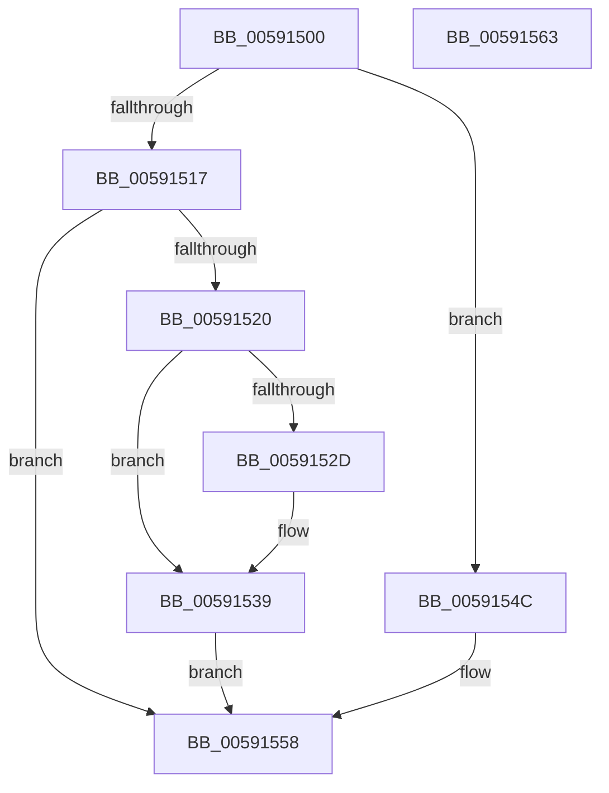

# BvgaEnableBootDriver

- RVA: `0x00591500`–`0x00591564` (길이 `100` bytes)
- VA: `0x0000000140591500`
- 실행 섹션: `.text`
- PDB 이름 있음: `예`; PDB Function 태그: `아니요`
- unwind 정보 RVA: `0x0005CAAC`
- 디코드: `27`개 명령, `100/100` bytes 표시
- 미해석 바이트: `0` (있으면 어셈블리에 `.byte`로 보존)

> 이 문서는 커널 이미지의 기계어와 PDB 기호를 분석해 생성했습니다. 4번과 5번은 함수 원형과 자료형을 바이너리 사용 방식에서 추정한 C 해석이며 원본 소스 복구 결과는 아닙니다.

## 1. Dependencies

- 직접 호출 지점: **3**; 고유 호출 대상: **3**
- 직접 호출자로 확인된 함수: **0**
- RIP 상대 이미지 참조: **4**

### Outgoing calls
- `0x00591520` → [BvgaAcquireLock](BvgaAcquireLock_function_005913A0.md) (function, `0x005913A0`)
- `0x0059152D` → `BOOTVID.dll!VidCleanUp` (import, 간접 대상; import `BOOTVID.dll!VidCleanUp`)
- `0x00591545` → [BvgaReleaseLock](BvgaReleaseLock_function_00591690.md) (function, `0x00591690`)

### Direct callers
- 이 함수 시작 RVA로 연결되는 직접 call은 확인되지 않았습니다. 간접 호출은 완전히 역산할 수 없습니다.

### Static image references
- `0x0059150F` → RVA `0x00E65EC9` (`.data`; read)
- `0x00591517` → RVA `0x00E65ED0` (`.data`; read)
- `0x0059152D` → RVA `0x00151038` (`BOOTVID.dll!VidCleanUp (IAT)`; read)
- `0x0059153F` → RVA `0x00E65ED0` (`.data`; write)

## 2. Other-region calls and transfers

- 다른 실행 섹션으로 향하는 call: **0**
- 별도 외부 분기/꼬리 이동을 확인하지 못했습니다.

## 3. Assembly (complete function range)

```asm
00591500  48 89 5C 24 08                  mov qword ptr [rsp + 8], rbx
00591505  57                              push rdi
00591506  48 83 EC 20                     sub rsp, 0x20
0059150A  33 DB                           xor ebx, ebx
0059150C  40 8A F9                        mov dil, cl
0059150F  38 1D B4 49 8D 00               cmp byte ptr [rip + 0x8d49b4], bl
00591515  74 35                           je 0x14059154c
00591517  83 3D B2 49 8D 00 02            cmp dword ptr [rip + 0x8d49b2], 2
0059151E  7D 38                           jge 0x140591558
00591520  E8 7B FE FF FF                  call 0x1405913a0
00591525  39 1D A5 49 8D 00               cmp dword ptr [rip + 0x8d49a5], ebx
0059152B  75 0C                           jne 0x140591539
0059152D  48 FF 15 04 FB BB FF            call qword ptr [rip - 0x4404fc]
00591534  0F 1F 44 00 00                  nop dword ptr [rax + rax]
00591539  40 84 FF                        test dil, dil
0059153C  0F 94 C3                        sete bl
0059153F  89 1D 8B 49 8D 00               mov dword ptr [rip + 0x8d498b], ebx
00591545  E8 46 01 00 00                  call 0x140591690
0059154A  EB 0C                           jmp 0x140591558
0059154C  40 84 FF                        test dil, dil
0059154F  0F 94 C3                        sete bl
00591552  89 1D 78 49 8D 00               mov dword ptr [rip + 0x8d4978], ebx
00591558  48 8B 5C 24 30                  mov rbx, qword ptr [rsp + 0x30]
0059155D  48 83 C4 20                     add rsp, 0x20
00591561  5F                              pop rdi
00591562  C3                              ret
00591563  CC                              int3
```

## 4. C-style interpretation (structured pseudocode)

```c
__int64 __fastcall BvgaEnableBootDriver(unsigned __int8 a1)
{
    __int64 result;
    __int64 v_rbx;
    __int64 v_rsp;
    unsigned __int64 v_stack_p8;

    v_stack_p8 = v_rbx;
    v_rsp = (v_rsp) - (32);
    v_rbx = 0;
    if ((*(unsigned __int8 *)(v_rip + 9259444)) == 0) goto loc_0059154C;
    if ((*(unsigned int *)(v_rip + 9259442)) >= 2) goto loc_00591558;
    result = BvgaAcquireLock(a1, a2, a3, a4);
    if ((*(unsigned int *)(v_rip + 9259429)) == 0) {
        result = BOOTVID_dll_VidCleanUp(a1, a2, a3, a4);
    }
    v_rbx = (a1 == 0) ? 1 : 0;
    *(unsigned int *)(v_rip + 9259403) = (unsigned int)(v_rbx);
    result = BvgaReleaseLock(a1, a2, a3, a4);
    goto loc_00591558;
loc_0059154C:
    v_rbx = (a1 == 0) ? 1 : 0;
    *(unsigned int *)(v_rip + 9259384) = (unsigned int)(v_rbx);
loc_00591558:
    v_rsp = (v_rsp) + (32);
    return result;
}
```

## 5. (Beta) C Style

```c
int64_t BvgaEnableBootDriver(uint8_t Arg1)
{
    int64_t result;
    int64_t local_rbx;
    int64_t local_rsp;
    uint64_t v_stack_p8;

    v_stack_p8 = local_rbx;
    local_rsp = (local_rsp) - (32);
    local_rbx = 0;
    if ((*(uint8_t *)(v_rip + 0x8D49B4)) == 0) goto loc_0059154C;
    if ((*(uint32_t *)(v_rip + 0x8D49B2)) >= 2) goto loc_00591558;
    result = BvgaAcquireLock(Arg1, a2, a3, a4);
    if ((*(uint32_t *)(v_rip + 0x8D49A5)) == 0) {
        result = kernel_indirect_call(Arg1, a2, a3, a4);
    }
    local_rbx = (Arg1 == 0) ? 1 : 0;
    *(uint32_t *)(v_rip + 0x8D498B) = (uint32_t)(local_rbx);
    result = BvgaReleaseLock(Arg1, a2, a3, a4);
    goto loc_00591558;
loc_0059154C:
    local_rbx = (Arg1 == 0) ? 1 : 0;
    *(uint32_t *)(v_rip + 0x8D4978) = (uint32_t)(local_rbx);
loc_00591558:
    local_rsp = (local_rsp) + (32);
    return result;
}
```

## 6. Execution-region graph

[열기: 2D/3D 그래프와 함수 탐색 컨트롤 패널](../../../control-panel.html?section=text&rva=0x00591500&view=graph)

- 2D 그래프는 위에서 아래로 흐르고, 3D 그래프는 빈 공간을 드래그해 회전합니다. Shift+드래그는 이동, 휠은 확대·축소, 함수 노드 선택은 대상 보고서 이동입니다.

### Static fallback


