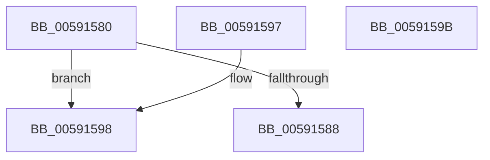

# BvgaGetResourceAddress

- RVA: `0x00591580`–`0x0059159C` (길이 `28` bytes)
- VA: `0x0000000140591580`
- 실행 섹션: `.text`
- PDB 이름 있음: `예`; PDB Function 태그: `아니요`
- unwind 정보 RVA: `0x000DB714`
- 디코드: `10`개 명령, `28/28` bytes 표시
- 미해석 바이트: `0` (있으면 어셈블리에 `.byte`로 보존)

> 이 문서는 커널 이미지의 기계어와 PDB 기호를 분석해 생성했습니다. 4번과 5번은 함수 원형과 자료형을 바이너리 사용 방식에서 추정한 C 해석이며 원본 소스 복구 결과는 아닙니다.

## 1. Dependencies

- 직접 호출 지점: **0**; 고유 호출 대상: **0**
- 직접 호출자로 확인된 함수: **0**
- RIP 상대 이미지 참조: **2**

### Outgoing calls
- 직접 디코드된 call 명령이 없습니다.

### Direct callers
- 이 함수 시작 RVA로 연결되는 직접 call은 확인되지 않았습니다. 간접 호출은 완전히 역산할 수 없습니다.

### Static image references
- `0x00591580` → RVA `0x00E65ECC` (`.data`; read)
- `0x0059158B` → RVA `0x00F8E980` (`.data`; read)

## 2. Other-region calls and transfers

- 다른 실행 섹션으로 향하는 call: **0**
- 별도 외부 분기/꼬리 이동을 확인하지 못했습니다.

## 3. Assembly (complete function range)

```asm
00591580  3B 0D 46 49 8D 00               cmp ecx, dword ptr [rip + 0x8d4946]
00591586  77 10                           ja 0x140591598
00591588  8D 41 FF                        lea eax, [rcx - 1]
0059158B  48 8D 0D EE D3 9F 00            lea rcx, [rip + 0x9fd3ee]
00591592  48 8B 04 C1                     mov rax, qword ptr [rcx + rax*8]
00591596  C3                              ret
00591597  CC                              int3
00591598  33 C0                           xor eax, eax
0059159A  C3                              ret
0059159B  CC                              int3
```

## 4. C-style interpretation (structured pseudocode)

```c
__int64 __fastcall BvgaGetResourceAddress(__int64 a1)
{
    __int64 result;

    if (((unsigned int)(a1)) > (*(unsigned int *)(v_rip + 9259334))) goto loc_00591598;
    return *(unsigned __int64 *)(v_rip + 10474478 + a1 - 1 * 8);
loc_00591598:
    result = 0;
    return result;
}
```

## 5. (Beta) C Style

```c
int64_t BvgaGetResourceAddress(int64_t Arg1)
{
    int64_t result;

    if (((uint32_t)(Arg1)) > (*(uint32_t *)(v_rip + 0x8D4946))) goto loc_00591598;
    return *(uint64_t *)(v_rip + 0x9FD3EE + Arg1 - 0x1 * 8);
loc_00591598:
    result = 0;
    return result;
}
```

## 6. Execution-region graph

[열기: 2D/3D 그래프와 함수 탐색 컨트롤 패널](../../../control-panel.html?section=text&rva=0x00591580&view=graph)

- 2D 그래프는 위에서 아래로 흐르고, 3D 그래프는 빈 공간을 드래그해 회전합니다. Shift+드래그는 이동, 휠은 확대·축소, 함수 노드 선택은 대상 보고서 이동입니다.

### Static fallback


