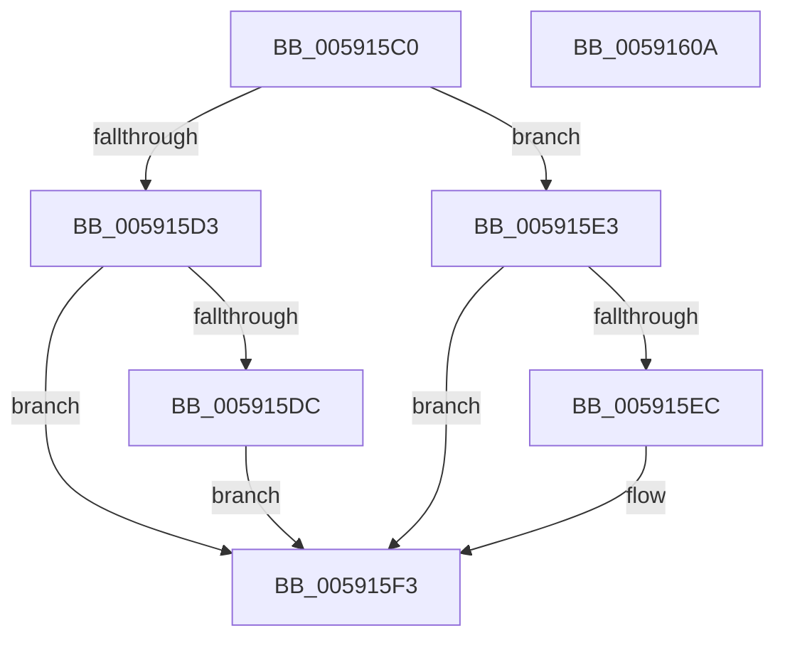

# BvgaNotifyDisplayOwnershipChange

- RVA: `0x005915C0`–`0x0059160B` (길이 `75` bytes)
- VA: `0x00000001405915C0`
- 실행 섹션: `.text`
- PDB 이름 있음: `예`; PDB Function 태그: `아니요`
- unwind 정보 RVA: `0x0005CAAC`
- 디코드: `24`개 명령, `75/75` bytes 표시
- 미해석 바이트: `0` (있으면 어셈블리에 `.byte`로 보존)

> 이 문서는 커널 이미지의 기계어와 PDB 기호를 분석해 생성했습니다. 4번과 5번은 함수 원형과 자료형을 바이너리 사용 방식에서 추정한 C 해석이며 원본 소스 복구 결과는 아닙니다.

## 1. Dependencies

- 직접 호출 지점: **3**; 고유 호출 대상: **3**
- 직접 호출자로 확인된 함수: **0**
- RIP 상대 이미지 참조: **1**

### Outgoing calls
- `0x005915DC` → [BvgaAcquireDisplayOwnership](BvgaAcquireDisplayOwnership_function_00591360.md) (function, `0x00591360`)
- `0x005915EE` → [BvgaNotifyDisplayOwnershipLost](BvgaNotifyDisplayOwnershipLost_function_00591620.md) (function, `0x00591620`)
- `0x005915F8` → [BgkNotifyDisplayOwnershipChange](BgkNotifyDisplayOwnershipChange_function_00590CC0.md) (function, `0x00590CC0`)

### Direct callers
- 이 함수 시작 RVA로 연결되는 직접 call은 확인되지 않았습니다. 간접 호출은 완전히 역산할 수 없습니다.

### Static image references
- `0x005915D3` → RVA `0x00E65ED0` (`.data`; read)

## 2. Other-region calls and transfers

- 다른 실행 섹션으로 향하는 call: **0**
- 별도 외부 분기/꼬리 이동을 확인하지 못했습니다.

## 3. Assembly (complete function range)

```asm
005915C0  48 89 5C 24 08                  mov qword ptr [rsp + 8], rbx
005915C5  57                              push rdi
005915C6  48 83 EC 20                     sub rsp, 0x20
005915CA  48 8B FA                        mov rdi, rdx
005915CD  8A D9                           mov bl, cl
005915CF  84 C9                           test cl, cl
005915D1  74 10                           je 0x1405915e3
005915D3  83 3D F6 48 8D 00 00            cmp dword ptr [rip + 0x8d48f6], 0
005915DA  74 17                           je 0x1405915f3
005915DC  E8 7F FD FF FF                  call 0x140591360
005915E1  EB 10                           jmp 0x1405915f3
005915E3  83 3D E6 48 8D 00 02            cmp dword ptr [rip + 0x8d48e6], 2
005915EA  74 07                           je 0x1405915f3
005915EC  33 C9                           xor ecx, ecx
005915EE  E8 2D 00 00 00                  call 0x140591620
005915F3  48 8B D7                        mov rdx, rdi
005915F6  8A CB                           mov cl, bl
005915F8  E8 C3 F6 FF FF                  call 0x140590cc0
005915FD  48 8B 5C 24 30                  mov rbx, qword ptr [rsp + 0x30]
00591602  33 C0                           xor eax, eax
00591604  48 83 C4 20                     add rsp, 0x20
00591608  5F                              pop rdi
00591609  C3                              ret
0059160A  CC                              int3
```

## 4. C-style interpretation (structured pseudocode)

```c
__int64 __fastcall BvgaNotifyDisplayOwnershipChange(int a1, __int64 a2)
{
    __int64 result;
    __int64 v_rsp;
    unsigned __int64 v_stack_p8;

    v_stack_p8 = v_rbx;
    v_rsp = (v_rsp) - (32);
    if ((unsigned __int8)(a1) == 0) goto loc_005915E3;
    if ((*(unsigned int *)(v_rip + 9259254)) == 0) goto loc_005915F3;
    result = BvgaAcquireDisplayOwnership(a1, a2, a3, a4);
    goto loc_005915F3;
loc_005915E3:
    if ((*(unsigned int *)(v_rip + 9259238)) != 2) {
        a1 = 0;
        result = BvgaNotifyDisplayOwnershipLost(a1, a2, a3, a4);
    }
    result = BgkNotifyDisplayOwnershipChange((unsigned __int8)((unsigned __int8)(a1)), a2, a3, a4);
    result = 0;
    v_rsp = (v_rsp) + (32);
    return result;
}
```

## 5. (Beta) C Style

```c
int64_t BvgaNotifyDisplayOwnershipChange(int32_t Arg1, int64_t Arg2)
{
    int64_t result;
    int64_t local_rsp;
    uint64_t v_stack_p8;

    v_stack_p8 = local_rbx;
    local_rsp = (local_rsp) - (32);
    if ((uint8_t)(Arg1) == 0) goto loc_005915E3;
    if ((*(uint32_t *)(v_rip + 0x8D48F6)) == 0) goto loc_005915F3;
    result = BvgaAcquireDisplayOwnership(Arg1, Arg2, a3, a4);
    goto loc_005915F3;
loc_005915E3:
    if ((*(uint32_t *)(v_rip + 0x8D48E6)) != 2) {
        Arg1 = 0;
        result = BvgaNotifyDisplayOwnershipLost(Arg1, Arg2, a3, a4);
    }
    result = BgkNotifyDisplayOwnershipChange((uint8_t)((uint8_t)(Arg1)), Arg2, a3, a4);
    result = 0;
    local_rsp = (local_rsp) + (32);
    return result;
}
```

## 6. Execution-region graph

[열기: 2D/3D 그래프와 함수 탐색 컨트롤 패널](../../../control-panel.html?section=text&rva=0x005915C0&view=graph)

- 2D 그래프는 위에서 아래로 흐르고, 3D 그래프는 빈 공간을 드래그해 회전합니다. Shift+드래그는 이동, 휠은 확대·축소, 함수 노드 선택은 대상 보고서 이동입니다.

### Static fallback


