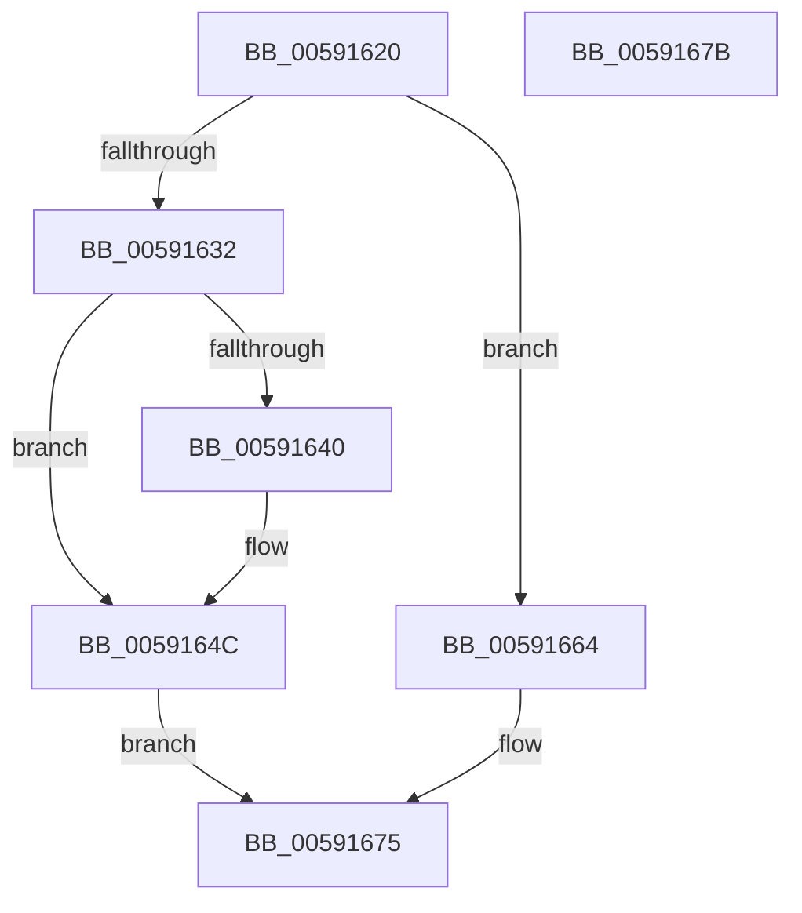

# BvgaNotifyDisplayOwnershipLost

- RVA: `0x00591620`–`0x0059167C` (길이 `92` bytes)
- VA: `0x0000000140591620`
- 실행 섹션: `.text`
- PDB 이름 있음: `예`; PDB Function 태그: `아니요`
- unwind 정보 RVA: `0x0005CF00`
- 디코드: `20`개 명령, `92/92` bytes 표시
- 미해석 바이트: `0` (있으면 어셈블리에 `.byte`로 보존)

> 이 문서는 커널 이미지의 기계어와 PDB 기호를 분석해 생성했습니다. 4번과 5번은 함수 원형과 자료형을 바이너리 사용 방식에서 추정한 C 해석이며 원본 소스 복구 결과는 아닙니다.

## 1. Dependencies

- 직접 호출 지점: **3**; 고유 호출 대상: **3**
- 직접 호출자로 확인된 함수: **1**
- RIP 상대 이미지 참조: **5**

### Outgoing calls
- `0x00591632` → [BvgaAcquireLock](BvgaAcquireLock_function_005913A0.md) (function, `0x005913A0`)
- `0x00591640` → `BOOTVID.dll!VidCleanUp` (import, 간접 대상; import `BOOTVID.dll!VidCleanUp`)
- `0x0059165D` → [BvgaReleaseLock](BvgaReleaseLock_function_00591690.md) (function, `0x00591690`)

### Direct callers
- [BvgaNotifyDisplayOwnershipChange](BvgaNotifyDisplayOwnershipChange_function_005915C0.md) at `0x005915EE`

### Static image references
- `0x00591626` → RVA `0x00E65EC8` (`.data`; read)
- `0x00591637` → RVA `0x00E65ED0` (`.data`; read)
- `0x00591640` → RVA `0x00151038` (`BOOTVID.dll!VidCleanUp (IAT)`; read)
- `0x0059164C` → RVA `0x00E65ED0` (`.data`; write)
- `0x00591656` → RVA `0x00E65EC0` (`.data`; write)

## 2. Other-region calls and transfers

- 다른 실행 섹션으로 향하는 call: **0**
- 별도 외부 분기/꼬리 이동을 확인하지 못했습니다.

## 3. Assembly (complete function range)

```asm
00591620  40 53                           push rbx
00591622  48 83 EC 20                     sub rsp, 0x20
00591626  80 3D 9B 48 8D 00 00            cmp byte ptr [rip + 0x8d489b], 0
0059162D  48 8B D9                        mov rbx, rcx
00591630  74 32                           je 0x140591664
00591632  E8 69 FD FF FF                  call 0x1405913a0
00591637  83 3D 92 48 8D 00 02            cmp dword ptr [rip + 0x8d4892], 2
0059163E  74 0C                           je 0x14059164c
00591640  48 FF 15 F1 F9 BB FF            call qword ptr [rip - 0x44060f]
00591647  0F 1F 44 00 00                  nop dword ptr [rax + rax]
0059164C  C7 05 7A 48 8D 00 02 00 00 00   mov dword ptr [rip + 0x8d487a], 2
00591656  48 89 1D 63 48 8D 00            mov qword ptr [rip + 0x8d4863], rbx
0059165D  E8 2E 00 00 00                  call 0x140591690
00591662  EB 11                           jmp 0x140591675
00591664  C7 05 62 48 8D 00 02 00 00 00   mov dword ptr [rip + 0x8d4862], 2
0059166E  48 89 1D 4B 48 8D 00            mov qword ptr [rip + 0x8d484b], rbx
00591675  48 83 C4 20                     add rsp, 0x20
00591679  5B                              pop rbx
0059167A  C3                              ret
0059167B  CC                              int3
```

## 4. C-style interpretation (structured pseudocode)

```c
__int64 __fastcall BvgaNotifyDisplayOwnershipLost(__int64 a1)
{
    __int64 result;
    __int64 v_rsp;

    v_rsp = (v_rsp) - (32);
    if ((*(unsigned __int8 *)(v_rip + 9259163)) == 0) goto loc_00591664;
    result = BvgaAcquireLock(a1, a2, a3, a4);
    if ((*(unsigned int *)(v_rip + 9259154)) != 2) {
        result = BOOTVID_dll_VidCleanUp(a1, a2, a3, a4);
    }
    *(unsigned int *)(v_rip + 9259130) = 2;
    *(unsigned __int64 *)(v_rip + 9259107) = a1;
    result = BvgaReleaseLock(a1, a2, a3, a4);
    goto loc_00591675;
loc_00591664:
    *(unsigned int *)(v_rip + 9259106) = 2;
    *(unsigned __int64 *)(v_rip + 9259083) = a1;
loc_00591675:
    v_rsp = (v_rsp) + (32);
    return result;
}
```

## 5. (Beta) C Style

```c
int64_t BvgaNotifyDisplayOwnershipLost(int64_t Arg1)
{
    int64_t result;
    int64_t local_rsp;

    local_rsp = (local_rsp) - (32);
    if ((*(uint8_t *)(v_rip + 0x8D489B)) == 0) goto loc_00591664;
    result = BvgaAcquireLock(Arg1, a2, a3, a4);
    if ((*(uint32_t *)(v_rip + 0x8D4892)) != 2) {
        result = kernel_indirect_call(Arg1, a2, a3, a4);
    }
    *(uint32_t *)(v_rip + 0x8D487A) = 2;
    *(uint64_t *)(v_rip + 0x8D4863) = Arg1;
    result = BvgaReleaseLock(Arg1, a2, a3, a4);
    goto loc_00591675;
loc_00591664:
    *(uint32_t *)(v_rip + 0x8D4862) = 2;
    *(uint64_t *)(v_rip + 0x8D484B) = Arg1;
loc_00591675:
    local_rsp = (local_rsp) + (32);
    return result;
}
```

## 6. Execution-region graph

[열기: 2D/3D 그래프와 함수 탐색 컨트롤 패널](../../../control-panel.html?section=text&rva=0x00591620&view=graph)

- 2D 그래프는 위에서 아래로 흐르고, 3D 그래프는 빈 공간을 드래그해 회전합니다. Shift+드래그는 이동, 휠은 확대·축소, 함수 노드 선택은 대상 보고서 이동입니다.

### Static fallback


