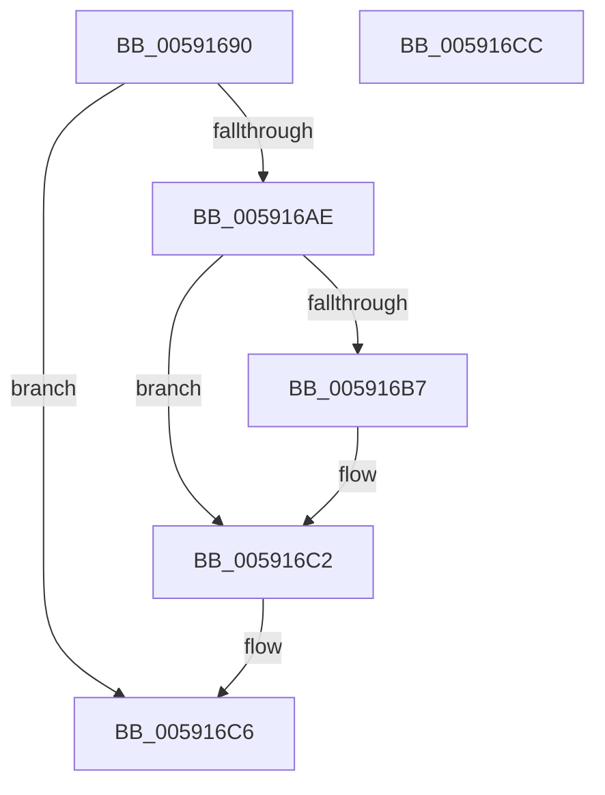

# BvgaReleaseLock

- RVA: `0x00591690`–`0x005916CD` (길이 `61` bytes)
- VA: `0x0000000140591690`
- 실행 섹션: `.text`
- PDB 이름 있음: `예`; PDB Function 태그: `아니요`
- unwind 정보 RVA: `0x0005CF00`
- 디코드: `17`개 명령, `61/61` bytes 표시
- 미해석 바이트: `0` (있으면 어셈블리에 `.byte`로 보존)

> 이 문서는 커널 이미지의 기계어와 PDB 기호를 분석해 생성했습니다. 4번과 5번은 함수 원형과 자료형을 바이너리 사용 방식에서 추정한 C 해석이며 원본 소스 복구 결과는 아닙니다.

## 1. Dependencies

- 직접 호출 지점: **2**; 고유 호출 대상: **2**
- 직접 호출자로 확인된 함수: **6**
- RIP 상대 이미지 참조: **3**

### Outgoing calls
- `0x005916A4` → [KxReleaseSpinLock](../20/KxReleaseSpinLock_function_00206670.md) (function, `0x00206670`)
- `0x005916BD` → [KiLowerIrqlProcessIrqlFlags](../4F/KiLowerIrqlProcessIrqlFlags_function_004F5698.md) (function, `0x004F5698`)

### Direct callers
- [BvgaBitBlt](BvgaBitBlt_function_00591410.md) at `0x00591452`
- [BvgaDisplayString](BvgaDisplayString_function_00591490.md) at `0x005914E5`
- [BvgaEnableBootDriver](BvgaEnableBootDriver_function_00591500.md) at `0x00591545`
- [BvgaNotifyDisplayOwnershipLost](BvgaNotifyDisplayOwnershipLost_function_00591620.md) at `0x0059165D`
- [BvgaSolidColorFill](BvgaSolidColorFill_function_00591870.md) at `0x0059190A`
- [BvgaUpdateProgressBar](BvgaUpdateProgressBar_function_00591930.md) at `0x005919AC`

### Static image references
- `0x00591696` → RVA `0x00F8E9DC` (`.data`; read)
- `0x0059169D` → RVA `0x00F8E9E0` (`.data`; read)
- `0x005916AE` → RVA `0x00FC6D20` (`ALMOSTRO`; read)

## 2. Other-region calls and transfers

- 다른 실행 섹션으로 향하는 call: **0**
- 별도 외부 분기/꼬리 이동을 확인하지 못했습니다.

## 3. Assembly (complete function range)

```asm
00591690  40 53                           push rbx
00591692  48 83 EC 20                     sub rsp, 0x20
00591696  0F B6 1D 3F D3 9F 00            movzx ebx, byte ptr [rip + 0x9fd33f]
0059169D  48 8D 0D 3C D3 9F 00            lea rcx, [rip + 0x9fd33c]
005916A4  E8 C7 4F C7 FF                  call 0x140206670
005916A9  80 FB 02                        cmp bl, 2
005916AC  77 18                           ja 0x1405916c6
005916AE  83 3D 6B 56 A3 00 00            cmp dword ptr [rip + 0xa3566b], 0
005916B5  74 0B                           je 0x1405916c2
005916B7  44 0F 20 C1                     mov rcx, cr8
005916BB  8A D3                           mov dl, bl
005916BD  E8 D6 3F F6 FF                  call 0x1404f5698
005916C2  44 0F 22 C3                     mov cr8, rbx
005916C6  48 83 C4 20                     add rsp, 0x20
005916CA  5B                              pop rbx
005916CB  C3                              ret
005916CC  CC                              int3
```

## 4. C-style interpretation (structured pseudocode)

```c
__int64 __fastcall BvgaReleaseLock(void)
{
    __int64 result;
    __int64 v_rsp;

    v_rsp = (v_rsp) - (32);
    result = KxReleaseSpinLock(v_rip + 10474300, a2, a3, a4);
    if (((unsigned __int8)(*(unsigned __int8 *)(v_rip + 10474303))) > 2) goto loc_005916C6;
    if ((*(unsigned int *)(v_rip + 10704491)) != 0) {
        a1 = v_cr8;
        a2 = (unsigned __int8)(*(unsigned __int8 *)(v_rip + 10474303));
        result = KiLowerIrqlProcessIrqlFlags(a1, a2, a3, a4);
    }
loc_005916C6:
    v_rsp = (v_rsp) + (32);
    return result;
}
```

## 5. (Beta) C Style

```c
void BvgaReleaseLock(void)
{
    int64_t result;
    int64_t local_rsp;

    local_rsp = (local_rsp) - (32);
    result = KxReleaseSpinLock(v_rip + 10474300, a2, a3, a4);
    if (((uint8_t)(*(uint8_t *)(v_rip + 0x9FD33F))) > 2) goto loc_005916C6;
    if ((*(uint32_t *)(v_rip + 0xA3566B)) != 0) {
        a1 = v_cr8;
        a2 = (uint8_t)(*(uint8_t *)(v_rip + 0x9FD33F));
        result = KiLowerIrqlProcessIrqlFlags(a1, a2, a3, a4);
    }
loc_005916C6:
    local_rsp = (local_rsp) + (32);
    return result;
}
```

## 6. Execution-region graph

[열기: 2D/3D 그래프와 함수 탐색 컨트롤 패널](../../../control-panel.html?section=text&rva=0x00591690&view=graph)

- 2D 그래프는 위에서 아래로 흐르고, 3D 그래프는 빈 공간을 드래그해 회전합니다. Shift+드래그는 이동, 휠은 확대·축소, 함수 노드 선택은 대상 보고서 이동입니다.

### Static fallback


