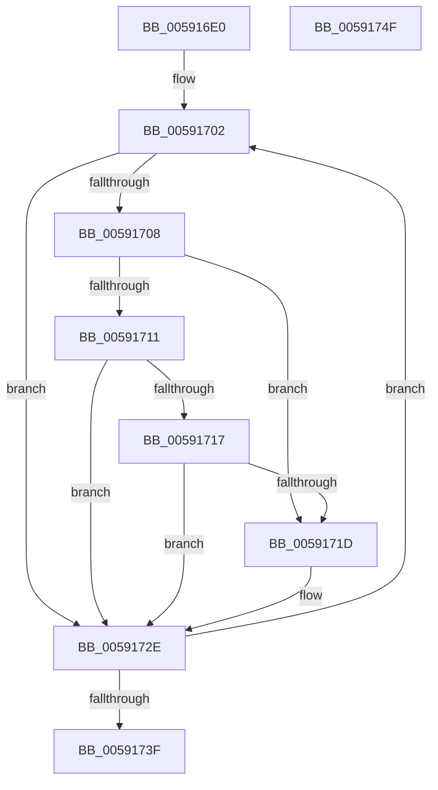

# BvgaReleaseResources

- RVA: `0x005916E0`–`0x00591750` (길이 `112` bytes)
- VA: `0x00000001405916E0`
- 실행 섹션: `.text`
- PDB 이름 있음: `예`; PDB Function 태그: `아니요`
- unwind 정보 RVA: `0x00060BC4`
- 디코드: `32`개 명령, `112/112` bytes 표시
- 미해석 바이트: `0` (있으면 어셈블리에 `.byte`로 보존)

> 이 문서는 커널 이미지의 기계어와 PDB 기호를 분석해 생성했습니다. 4번과 5번은 함수 원형과 자료형을 바이너리 사용 방식에서 추정한 C 해석이며 원본 소스 복구 결과는 아닙니다.

## 1. Dependencies

- 직접 호출 지점: **2**; 고유 호출 대상: **2**
- 직접 호출자로 확인된 함수: **0**
- RIP 상대 이미지 참조: **2**

### Outgoing calls
- `0x00591708` → [InbvIsBootDriverInstalled](../4F/InbvIsBootDriverInstalled_function_004FC1E0.md) (function, `0x004FC1E0`)
- `0x00591722` → [ExFreePoolWithTag](../../poolcode/B8/ExFreePoolWithTag_function_00B82870.md) (function, `0x00B82870`)

### Direct callers
- 이 함수 시작 RVA로 연결되는 직접 call은 확인되지 않았습니다. 간접 호출은 완전히 역산할 수 없습니다.

### Static image references
- `0x005916F4` → RVA `0x00F8E9C0` (`.data`; read)
- `0x005916FB` → RVA `0x00F8E980` (`.data`; read)

## 2. Other-region calls and transfers

- 다른 실행 섹션으로 향하는 call: **1**
  - `0x00591722` → [ExFreePoolWithTag](../../poolcode/B8/ExFreePoolWithTag_function_00B82870.md) (`.text` → `POOLCODE`)
- 별도 외부 분기/꼬리 이동을 확인하지 못했습니다.

## 3. Assembly (complete function range)

```asm
005916E0  48 89 5C 24 08                  mov qword ptr [rsp + 8], rbx
005916E5  48 89 74 24 10                  mov qword ptr [rsp + 0x10], rsi
005916EA  57                              push rdi
005916EB  48 83 EC 20                     sub rsp, 0x20
005916EF  BB 01 00 00 00                  mov ebx, 1
005916F4  48 8D 35 C5 D2 9F 00            lea rsi, [rip + 0x9fd2c5]
005916FB  48 8D 3D 7E D2 9F 00            lea rdi, [rip + 0x9fd27e]
00591702  48 83 3F 00                     cmp qword ptr [rdi], 0
00591706  74 26                           je 0x14059172e
00591708  E8 D3 AA F6 FF                  call 0x1404fc1e0
0059170D  84 C0                           test al, al
0059170F  74 0C                           je 0x14059171d
00591711  48 83 FB 03                     cmp rbx, 3
00591715  74 17                           je 0x14059172e
00591717  48 83 FB 05                     cmp rbx, 5
0059171B  74 11                           je 0x14059172e
0059171D  48 8B 0F                        mov rcx, qword ptr [rdi]
00591720  33 D2                           xor edx, edx
00591722  E8 49 11 5F 00                  call 0x140b82870
00591727  48 83 27 00                     and qword ptr [rdi], 0
0059172B  83 26 00                        and dword ptr [rsi], 0
0059172E  48 FF C3                        inc rbx
00591731  48 83 C7 08                     add rdi, 8
00591735  48 83 C6 04                     add rsi, 4
00591739  48 83 FB 07                     cmp rbx, 7
0059173D  72 C3                           jb 0x140591702
0059173F  48 8B 5C 24 30                  mov rbx, qword ptr [rsp + 0x30]
00591744  48 8B 74 24 38                  mov rsi, qword ptr [rsp + 0x38]
00591749  48 83 C4 20                     add rsp, 0x20
0059174D  5F                              pop rdi
0059174E  C3                              ret
0059174F  CC                              int3
```

## 4. C-style interpretation (structured pseudocode)

```c
__int64 __fastcall BvgaReleaseResources(__int64 a1, int a2)
{
    __int64 result;
    __int64 v_rbx;
    __int64 v_rdi;
    __int64 v_rsi;
    __int64 v_rsp;
    unsigned __int64 v_stack_p10;
    unsigned __int64 v_stack_p8;

    v_stack_p8 = v_rbx;
    v_stack_p10 = v_rsi;
    v_rsp = (v_rsp) - (32);
loc_00591702:
    if ((*(unsigned __int64 *)(v_rip + 10474110)) == 0) goto loc_0059172E;
    result = InbvIsBootDriverInstalled(a1, a2, a3, a4);
    if ((unsigned __int8)(result) == 0) goto loc_0059171D;
    if (1 == 3) goto loc_0059172E;
    if (1 != 5) {
        a1 = *(unsigned __int64 *)(v_rip + 10474110);
        a2 = 0;
        result = ExFreePoolWithTag(a1, a2, a3, a4);
    }
    v_rbx = (1) + 1;
    v_rdi = (v_rip + 10474110) + (8);
    v_rsi = (v_rip + 10474181) + (4);
    if (v_rbx < 7) goto loc_00591702;
    v_rsp = (v_rsp) + (32);
    return result;
}
```

## 5. (Beta) C Style

```c
int64_t BvgaReleaseResources(int64_t Arg1, int32_t Arg2)
{
    int64_t result;
    int64_t local_rbx;
    int64_t local_rdi;
    int64_t local_rsi;
    int64_t local_rsp;
    uint64_t v_stack_p10;
    uint64_t v_stack_p8;

    v_stack_p8 = local_rbx;
    v_stack_p10 = local_rsi;
    local_rsp = (local_rsp) - (32);
loc_00591702:
    if ((*(uint64_t *)(v_rip + 0x9FD27E)) == 0) goto loc_0059172E;
    result = InbvIsBootDriverInstalled(Arg1, Arg2, a3, a4);
    if ((uint8_t)(result) == 0) goto loc_0059171D;
    if (1 == 3) goto loc_0059172E;
    if (1 != 5) {
        Arg1 = *(uint64_t *)(v_rip + 0x9FD27E);
        Arg2 = 0;
        result = ExFreePoolWithTag(Arg1, Arg2, a3, a4);
    }
    local_rbx = (1) + 1;
    local_rdi = (v_rip + 10474110) + (8);
    local_rsi = (v_rip + 10474181) + (4);
    if (local_rbx < 7) goto loc_00591702;
    local_rsp = (local_rsp) + (32);
    return result;
}
```

## 6. Execution-region graph

[열기: 2D/3D 그래프와 함수 탐색 컨트롤 패널](../../../control-panel.html?section=text&rva=0x005916E0&view=graph)

- 2D 그래프는 위에서 아래로 흐르고, 3D 그래프는 빈 공간을 드래그해 회전합니다. Shift+드래그는 이동, 휠은 확대·축소, 함수 노드 선택은 대상 보고서 이동입니다.

### Static fallback


