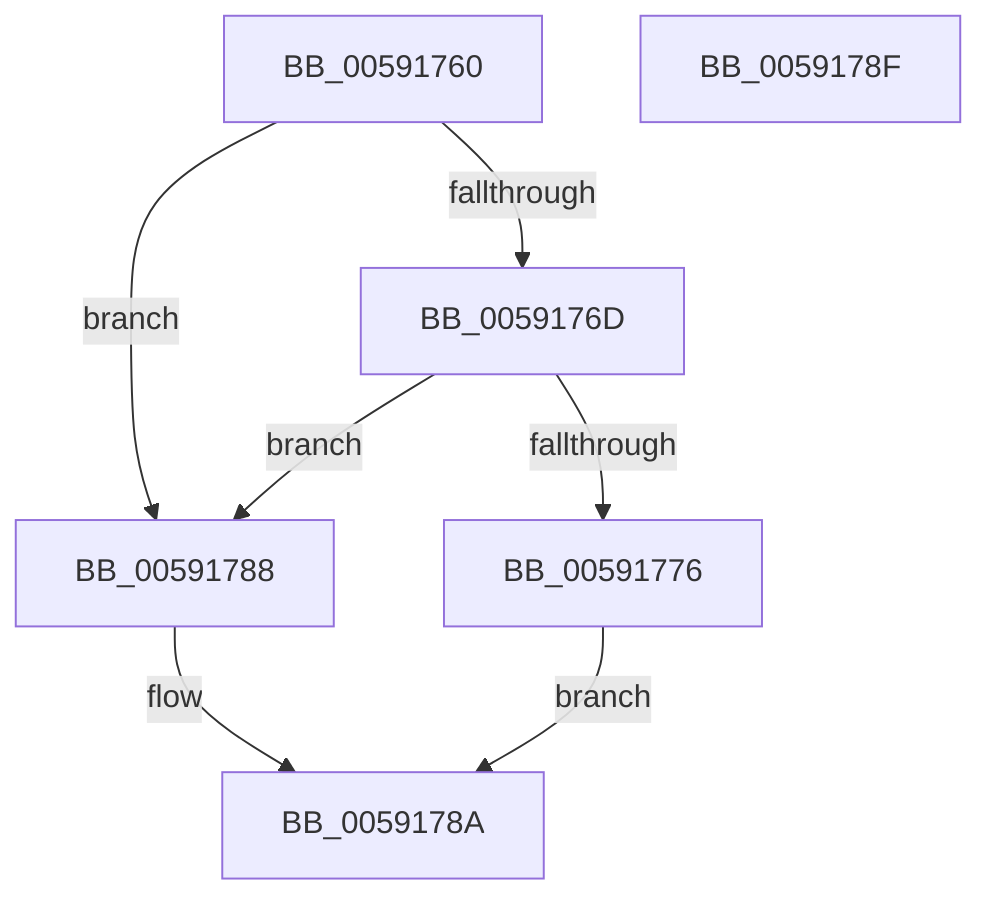

# BvgaResetDisplay

- RVA: `0x00591760`–`0x00591790` (길이 `48` bytes)
- VA: `0x0000000140591760`
- 실행 섹션: `.text`
- PDB 이름 있음: `예`; PDB Function 태그: `아니요`
- unwind 정보 RVA: `0x0005C788`
- 디코드: `14`개 명령, `48/48` bytes 표시
- 미해석 바이트: `0` (있으면 어셈블리에 `.byte`로 보존)

> 이 문서는 커널 이미지의 기계어와 PDB 기호를 분석해 생성했습니다. 4번과 5번은 함수 원형과 자료형을 바이너리 사용 방식에서 추정한 C 해석이며 원본 소스 복구 결과는 아닙니다.

## 1. Dependencies

- 직접 호출 지점: **1**; 고유 호출 대상: **1**
- 직접 호출자로 확인된 함수: **0**
- RIP 상대 이미지 참조: **3**

### Outgoing calls
- `0x00591778` → `BOOTVID.dll!VidResetDisplay` (import, 간접 대상; import `BOOTVID.dll!VidResetDisplay`)

### Direct callers
- 이 함수 시작 RVA로 연결되는 직접 call은 확인되지 않았습니다. 간접 호출은 완전히 역산할 수 없습니다.

### Static image references
- `0x00591764` → RVA `0x00E65EC8` (`.data`; read)
- `0x0059176D` → RVA `0x00E65ED0` (`.data`; read)
- `0x00591778` → RVA `0x00151008` (`BOOTVID.dll!VidResetDisplay (IAT)`; read)

## 2. Other-region calls and transfers

- 다른 실행 섹션으로 향하는 call: **0**
- 별도 외부 분기/꼬리 이동을 확인하지 못했습니다.

## 3. Assembly (complete function range)

```asm
00591760  48 83 EC 28                     sub rsp, 0x28
00591764  80 3D 5D 47 8D 00 00            cmp byte ptr [rip + 0x8d475d], 0
0059176B  74 1B                           je 0x140591788
0059176D  83 3D 5C 47 8D 00 00            cmp dword ptr [rip + 0x8d475c], 0
00591774  75 12                           jne 0x140591788
00591776  B1 01                           mov cl, 1
00591778  48 FF 15 89 F8 BB FF            call qword ptr [rip - 0x440777]
0059177F  0F 1F 44 00 00                  nop dword ptr [rax + rax]
00591784  B0 01                           mov al, 1
00591786  EB 02                           jmp 0x14059178a
00591788  32 C0                           xor al, al
0059178A  48 83 C4 28                     add rsp, 0x28
0059178E  C3                              ret
0059178F  CC                              int3
```

## 4. C-style interpretation (structured pseudocode)

```c
__int64 __fastcall BvgaResetDisplay(void)
{
    __int64 result;
    __int64 v_rsp;

    v_rsp = (v_rsp) - (40);
    if ((*(unsigned __int8 *)(v_rip + 9258845)) == 0) goto loc_00591788;
    if ((*(unsigned int *)(v_rip + 9258844)) != 0) goto loc_00591788;
    result = BOOTVID_dll_VidResetDisplay(1, a2, a3, a4);
    goto loc_0059178A;
loc_00591788:
    result = 0;
loc_0059178A:
    v_rsp = (v_rsp) + (40);
    return result;
}
```

## 5. (Beta) C Style

```c
void BvgaResetDisplay(void)
{
    int64_t result;
    int64_t local_rsp;

    local_rsp = (local_rsp) - (40);
    if ((*(uint8_t *)(v_rip + 0x8D475D)) == 0) goto loc_00591788;
    if ((*(uint32_t *)(v_rip + 0x8D475C)) != 0) goto loc_00591788;
    result = kernel_indirect_call(1, a2, a3, a4);
    goto loc_0059178A;
loc_00591788:
    result = 0;
loc_0059178A:
    local_rsp = (local_rsp) + (40);
    return result;
}
```

## 6. Execution-region graph

[열기: 2D/3D 그래프와 함수 탐색 컨트롤 패널](../../../control-panel.html?section=text&rva=0x00591760&view=graph)

- 2D 그래프는 위에서 아래로 흐르고, 3D 그래프는 빈 공간을 드래그해 회전합니다. Shift+드래그는 이동, 휠은 확대·축소, 함수 노드 선택은 대상 보고서 이동입니다.

### Static fallback


