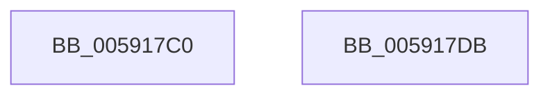

# BvgaSetProgressBarSubset

- RVA: `0x005917C0`–`0x005917DC` (길이 `28` bytes)
- VA: `0x00000001405917C0`
- 실행 섹션: `.text`
- PDB 이름 있음: `예`; PDB Function 태그: `아니요`
- unwind 정보 RVA: `0x000DB714`
- 디코드: `8`개 명령, `28/28` bytes 표시
- 미해석 바이트: `0` (있으면 어셈블리에 `.byte`로 보존)

> 이 문서는 커널 이미지의 기계어와 PDB 기호를 분석해 생성했습니다. 4번과 5번은 함수 원형과 자료형을 바이너리 사용 방식에서 추정한 C 해석이며 원본 소스 복구 결과는 아닙니다.

## 1. Dependencies

- 직접 호출 지점: **0**; 고유 호출 대상: **0**
- 직접 호출자로 확인된 함수: **0**
- RIP 상대 이미지 참조: **3**

### Outgoing calls
- 직접 디코드된 call 명령이 없습니다.

### Direct callers
- 이 함수 시작 RVA로 연결되는 직접 call은 확인되지 않았습니다. 간접 호출은 완전히 역산할 수 없습니다.

### Static image references
- `0x005917C3` → RVA `0x00F8E9F0` (`.data`; write)
- `0x005917CE` → RVA `0x00F8E9F8` (`.data`; write)
- `0x005917D4` → RVA `0x00F8E9F4` (`.data`; write)

## 2. Other-region calls and transfers

- 다른 실행 섹션으로 향하는 call: **0**
- 별도 외부 분기/꼬리 이동을 확인하지 못했습니다.

## 3. Assembly (complete function range)

```asm
005917C0  6B C1 64                        imul eax, ecx, 0x64
005917C3  89 05 27 D2 9F 00               mov dword ptr [rip + 0x9fd227], eax
005917C9  6B C2 64                        imul eax, edx, 0x64
005917CC  2B D1                           sub edx, ecx
005917CE  89 15 24 D2 9F 00               mov dword ptr [rip + 0x9fd224], edx
005917D4  89 05 1A D2 9F 00               mov dword ptr [rip + 0x9fd21a], eax
005917DA  C3                              ret
005917DB  CC                              int3
```

## 4. C-style interpretation (structured pseudocode)

```c
__int64 __fastcall BvgaSetProgressBarSubset(int a1, int a2)
{
    __int64 result;

    result = (unsigned int)((result) * (a1));
    *(unsigned int *)(v_rip + 10474023) = (unsigned int)(result);
    result = (unsigned int)((result) * (a2));
    a2 = (unsigned int)((a2) - (a1));
    *(unsigned int *)(v_rip + 10474020) = a2;
    *(unsigned int *)(v_rip + 10474010) = (unsigned int)(result);
    return result;
}
```

## 5. (Beta) C Style

```c
int64_t BvgaSetProgressBarSubset(int32_t Arg1, int32_t Arg2)
{
    int64_t result;

    result = (uint32_t)((result) * (Arg1));
    *(uint32_t *)(v_rip + 0x9FD227) = (uint32_t)(result);
    result = (uint32_t)((result) * (Arg2));
    Arg2 = (uint32_t)((Arg2) - (Arg1));
    *(uint32_t *)(v_rip + 0x9FD224) = Arg2;
    *(uint32_t *)(v_rip + 0x9FD21A) = (uint32_t)(result);
    return result;
}
```

## 6. Execution-region graph

[열기: 2D/3D 그래프와 함수 탐색 컨트롤 패널](../../../control-panel.html?section=text&rva=0x005917C0&view=graph)

- 2D 그래프는 위에서 아래로 흐르고, 3D 그래프는 빈 공간을 드래그해 회전합니다. Shift+드래그는 이동, 휠은 확대·축소, 함수 노드 선택은 대상 보고서 이동입니다.

### Static fallback


