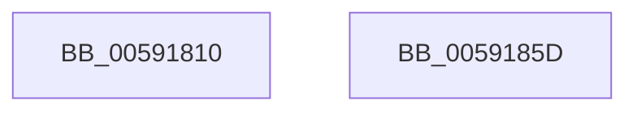

# BvgaSetTextColor

- RVA: `0x00591810`–`0x0059185E` (길이 `78` bytes)
- VA: `0x0000000140591810`
- 실행 섹션: `.text`
- PDB 이름 있음: `예`; PDB Function 태그: `아니요`
- unwind 정보 RVA: `0x00064C80`
- 디코드: `20`개 명령, `78/78` bytes 표시
- 미해석 바이트: `0` (있으면 어셈블리에 `.byte`로 보존)

> 이 문서는 커널 이미지의 기계어와 PDB 기호를 분석해 생성했습니다. 4번과 5번은 함수 원형과 자료형을 바이너리 사용 방식에서 추정한 C 해석이며 원본 소스 복구 결과는 아닙니다.

## 1. Dependencies

- 직접 호출 지점: **2**; 고유 호출 대상: **2**
- 직접 호출자로 확인된 함수: **0**
- RIP 상대 이미지 참조: **2**

### Outgoing calls
- `0x00591844` → [HeadlessDispatch](../65/HeadlessDispatch_function_00655C40.md) (function, `0x00655C40`)
- `0x0059184B` → `BOOTVID.dll!VidSetTextColor` (import, 간접 대상; import `BOOTVID.dll!VidSetTextColor`)

### Direct callers
- 이 함수 시작 RVA로 연결되는 직접 call은 확인되지 않았습니다. 간접 호출은 완전히 역산할 수 없습니다.

### Static image references
- `0x00591830` → RVA `0x00E0A9A8` (`.data`; write)
- `0x0059184B` → RVA `0x00151030` (`BOOTVID.dll!VidSetTextColor (IAT)`; read)

## 2. Other-region calls and transfers

- 다른 실행 섹션으로 향하는 call: **0**
- 별도 외부 분기/꼬리 이동을 확인하지 못했습니다.

## 3. Assembly (complete function range)

```asm
00591810  40 53                           push rbx
00591812  48 83 EC 30                     sub rsp, 0x30
00591816  48 83 64 24 20 00               and qword ptr [rsp + 0x20], 0
0059181C  48 8D 54 24 48                  lea rdx, [rsp + 0x48]
00591821  B8 25 00 00 00                  mov eax, 0x25
00591826  C7 44 24 4C 28 00 00 00         mov dword ptr [rsp + 0x4c], 0x28
0059182E  8B D9                           mov ebx, ecx
00591830  89 05 72 91 87 00               mov dword ptr [rip + 0x879172], eax
00591836  45 33 C9                        xor r9d, r9d
00591839  89 44 24 48                     mov dword ptr [rsp + 0x48], eax
0059183D  44 8D 40 E3                     lea r8d, [rax - 0x1d]
00591841  8D 48 E4                        lea ecx, [rax - 0x1c]
00591844  E8 F7 43 0C 00                  call 0x140655c40
00591849  8B CB                           mov ecx, ebx
0059184B  48 FF 15 DE F7 BB FF            call qword ptr [rip - 0x440822]
00591852  0F 1F 44 00 00                  nop dword ptr [rax + rax]
00591857  48 83 C4 30                     add rsp, 0x30
0059185B  5B                              pop rbx
0059185C  C3                              ret
0059185D  CC                              int3
```

## 4. C-style interpretation (structured pseudocode)

```c
__int64 __fastcall BvgaSetTextColor(int a1, __int64 a2, __int64 a3, int a4)
{
    __int64 result;
    __int64 v_rsp;
    unsigned __int64 v_stack_m18;
    unsigned __int64 v_stack_p10;
    unsigned int v_stack_p14;

    v_rsp = (v_rsp) - (48);
    v_stack_p14 = 40;
    *(unsigned int *)(v_rip + 8884594) = 37;
    a4 = 0;
    v_stack_p10 = 37;
    result = HeadlessDispatch(37 - 28, v_stack_p10, 37 - 29, a4);
    result = BOOTVID_dll_VidSetTextColor((unsigned int)((unsigned int)((unsigned int)(a1))), v_stack_p10, 37 - 29, a4);
    v_rsp = (v_rsp) + (48);
    return result;
}
```

## 5. (Beta) C Style

```c
int64_t BvgaSetTextColor(int32_t Arg1, int64_t Arg2, int64_t Arg3, int32_t Arg4)
{
    int64_t result;
    int64_t local_rsp;
    uint64_t v_stack_m18;
    uint64_t v_stack_p10;
    uint32_t v_stack_p14;

    local_rsp = (local_rsp) - (48);
    v_stack_p14 = 40;
    *(uint32_t *)(v_rip + 0x879172) = 37;
    Arg4 = 0;
    v_stack_p10 = 37;
    result = HeadlessDispatch(37 - 28, v_stack_p10, 37 - 29, Arg4);
    result = kernel_indirect_call((uint32_t)((uint32_t)((uint32_t)(Arg1))), v_stack_p10, 37 - 29, Arg4);
    local_rsp = (local_rsp) + (48);
    return result;
}
```

## 6. Execution-region graph

[열기: 2D/3D 그래프와 함수 탐색 컨트롤 패널](../../../control-panel.html?section=text&rva=0x00591810&view=graph)

- 2D 그래프는 위에서 아래로 흐르고, 3D 그래프는 빈 공간을 드래그해 회전합니다. Shift+드래그는 이동, 휠은 확대·축소, 함수 노드 선택은 대상 보고서 이동입니다.

### Static fallback


