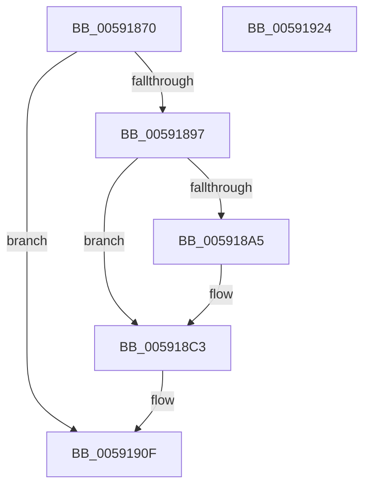

# BvgaSolidColorFill

- RVA: `0x00591870`–`0x00591925` (길이 `181` bytes)
- VA: `0x0000000140591870`
- 실행 섹션: `.text`
- PDB 이름 있음: `예`; PDB Function 태그: `아니요`
- unwind 정보 RVA: `0x0007D3C0`
- 디코드: `46`개 명령, `181/181` bytes 표시
- 미해석 바이트: `0` (있으면 어셈블리에 `.byte`로 보존)

> 이 문서는 커널 이미지의 기계어와 PDB 기호를 분석해 생성했습니다. 4번과 5번은 함수 원형과 자료형을 바이너리 사용 방식에서 추정한 C 해석이며 원본 소스 복구 결과는 아닙니다.

## 1. Dependencies

- 직접 호출 지점: **5**; 고유 호출 대상: **4**
- 직접 호출자로 확인된 함수: **0**
- RIP 상대 이미지 참조: **4**

### Outgoing calls
- `0x00591897` → [BvgaAcquireLock](BvgaAcquireLock_function_005913A0.md) (function, `0x005913A0`)
- `0x005918B7` → `BOOTVID.dll!VidSolidColorFill` (import, 간접 대상; import `BOOTVID.dll!VidSolidColorFill`)
- `0x005918EF` → [HeadlessDispatch](../65/HeadlessDispatch_function_00655C40.md) (function, `0x00655C40`)
- `0x00591905` → [HeadlessDispatch](../65/HeadlessDispatch_function_00655C40.md) (function, `0x00655C40`)
- `0x0059190A` → [BvgaReleaseLock](BvgaReleaseLock_function_00591690.md) (function, `0x00591690`)

### Direct callers
- 이 함수 시작 RVA로 연결되는 직접 call은 확인되지 않았습니다. 간접 호출은 완전히 역산할 수 없습니다.

### Static image references
- `0x00591884` → RVA `0x00E65ED0` (`.data`; read)
- `0x0059189C` → RVA `0x00E65EC8` (`.data`; read)
- `0x005918B7` → RVA `0x00151048` (`BOOTVID.dll!VidSolidColorFill (IAT)`; read)
- `0x005918DE` → RVA `0x00E0A9AC` (`.data`; write)

## 2. Other-region calls and transfers

- 다른 실행 섹션으로 향하는 call: **0**
- 별도 외부 분기/꼬리 이동을 확인하지 못했습니다.

## 3. Assembly (complete function range)

```asm
00591870  48 89 5C 24 08                  mov qword ptr [rsp + 8], rbx
00591875  48 89 6C 24 10                  mov qword ptr [rsp + 0x10], rbp
0059187A  48 89 74 24 18                  mov qword ptr [rsp + 0x18], rsi
0059187F  57                              push rdi
00591880  48 83 EC 40                     sub rsp, 0x40
00591884  83 3D 45 46 8D 00 00            cmp dword ptr [rip + 0x8d4645], 0
0059188B  41 8B D9                        mov ebx, r9d
0059188E  41 8B F8                        mov edi, r8d
00591891  8B F2                           mov esi, edx
00591893  8B E9                           mov ebp, ecx
00591895  75 78                           jne 0x14059190f
00591897  E8 04 FB FF FF                  call 0x1405913a0
0059189C  80 3D 25 46 8D 00 00            cmp byte ptr [rip + 0x8d4625], 0
005918A3  74 1E                           je 0x1405918c3
005918A5  8B 44 24 70                     mov eax, dword ptr [rsp + 0x70]
005918A9  44 8B CB                        mov r9d, ebx
005918AC  44 8B C7                        mov r8d, edi
005918AF  89 44 24 20                     mov dword ptr [rsp + 0x20], eax
005918B3  8B D6                           mov edx, esi
005918B5  8B CD                           mov ecx, ebp
005918B7  48 FF 15 8A F7 BB FF            call qword ptr [rip - 0x440876]
005918BE  0F 1F 44 00 00                  nop dword ptr [rax + rax]
005918C3  48 83 64 24 20 00               and qword ptr [rsp + 0x20], 0
005918C9  48 8D 54 24 30                  lea rdx, [rsp + 0x30]
005918CE  B8 28 00 00 00                  mov eax, 0x28
005918D3  C7 44 24 30 25 00 00 00         mov dword ptr [rsp + 0x30], 0x25
005918DB  45 33 C9                        xor r9d, r9d
005918DE  89 05 C8 90 87 00               mov dword ptr [rip + 0x8790c8], eax
005918E4  89 44 24 34                     mov dword ptr [rsp + 0x34], eax
005918E8  44 8D 40 E0                     lea r8d, [rax - 0x20]
005918EC  8D 48 E1                        lea ecx, [rax - 0x1f]
005918EF  E8 4C 43 0C 00                  call 0x140655c40
005918F4  48 83 64 24 20 00               and qword ptr [rsp + 0x20], 0
005918FA  33 D2                           xor edx, edx
005918FC  45 33 C9                        xor r9d, r9d
005918FF  45 33 C0                        xor r8d, r8d
00591902  8D 4A 04                        lea ecx, [rdx + 4]
00591905  E8 36 43 0C 00                  call 0x140655c40
0059190A  E8 81 FD FF FF                  call 0x140591690
0059190F  48 8B 5C 24 50                  mov rbx, qword ptr [rsp + 0x50]
00591914  48 8B 6C 24 58                  mov rbp, qword ptr [rsp + 0x58]
00591919  48 8B 74 24 60                  mov rsi, qword ptr [rsp + 0x60]
0059191E  48 83 C4 40                     add rsp, 0x40
00591922  5F                              pop rdi
00591923  C3                              ret
00591924  CC                              int3
```

## 4. C-style interpretation (structured pseudocode)

```c
__int64 __fastcall BvgaSolidColorFill(int a1, int a2, int a3, int a4, unsigned int a5)
{
    __int64 result;
    __int64 v_rsp;
    unsigned int v_stack_m14;
    unsigned __int64 v_stack_m18;
    unsigned int v_stack_m28;
    unsigned __int64 v_stack_p10;
    unsigned __int64 v_stack_p18;
    unsigned __int64 v_stack_p8;

    v_stack_p8 = v_rbx;
    v_stack_p10 = v_rbp;
    v_stack_p18 = v_rsi;
    v_rsp = (v_rsp) - (64);
    if ((*(unsigned int *)(v_rip + 9258565)) != 0) goto loc_0059190F;
    result = BvgaAcquireLock(a1, a2, a3, a4);
    if ((*(unsigned __int8 *)(v_rip + 9258533)) != 0) {
        result = a5;
        a4 = (unsigned int)((unsigned int)(a4));
        a3 = (unsigned int)((unsigned int)(a3));
        v_stack_m28 = (unsigned int)(result);
        a2 = (unsigned int)((unsigned int)(a2));
        a1 = (unsigned int)((unsigned int)(a1));
        result = BOOTVID_dll_VidSolidColorFill(a1, a2, a3, a4);
    }
    v_stack_m18 = 37;
    a4 = 0;
    *(unsigned int *)(v_rip + 8884424) = 40;
    v_stack_m14 = 40;
    result = HeadlessDispatch(40 - 31, v_stack_m18, 40 - 32, a4);
    a2 = 0;
    a4 = 0;
    a3 = 0;
    result = HeadlessDispatch(a2 + 4, a2, a3, a4);
    result = BvgaReleaseLock(a2 + 4, a2, a3, a4);
loc_0059190F:
    v_rsp = (v_rsp) + (64);
    return result;
}
```

## 5. (Beta) C Style

```c
int64_t BvgaSolidColorFill(int32_t Arg1, int32_t Arg2, int32_t Arg3, int32_t Arg4, uint32_t Arg5)
{
    int64_t result;
    int64_t local_rsp;
    uint32_t v_stack_m14;
    uint64_t v_stack_m18;
    uint32_t v_stack_m28;
    uint64_t v_stack_p10;
    uint64_t v_stack_p18;
    uint64_t v_stack_p8;

    v_stack_p8 = local_rbx;
    v_stack_p10 = local_rbp;
    v_stack_p18 = local_rsi;
    local_rsp = (local_rsp) - (64);
    if ((*(uint32_t *)(v_rip + 0x8D4645)) != 0) goto loc_0059190F;
    result = BvgaAcquireLock(Arg1, Arg2, Arg3, Arg4);
    if ((*(uint8_t *)(v_rip + 0x8D4625)) != 0) {
        result = Arg5;
        Arg4 = (uint32_t)((uint32_t)(Arg4));
        Arg3 = (uint32_t)((uint32_t)(Arg3));
        v_stack_m28 = (uint32_t)(result);
        Arg2 = (uint32_t)((uint32_t)(Arg2));
        Arg1 = (uint32_t)((uint32_t)(Arg1));
        result = kernel_indirect_call(Arg1, Arg2, Arg3, Arg4);
    }
    v_stack_m18 = 37;
    Arg4 = 0;
    *(uint32_t *)(v_rip + 0x8790C8) = 40;
    v_stack_m14 = 40;
    result = HeadlessDispatch(40 - 31, v_stack_m18, 40 - 32, Arg4);
    Arg2 = 0;
    Arg4 = 0;
    Arg3 = 0;
    result = HeadlessDispatch(Arg2 + 4, Arg2, Arg3, Arg4);
    result = BvgaReleaseLock(Arg2 + 4, Arg2, Arg3, Arg4);
loc_0059190F:
    local_rsp = (local_rsp) + (64);
    return result;
}
```

## 6. Execution-region graph

[열기: 2D/3D 그래프와 함수 탐색 컨트롤 패널](../../../control-panel.html?section=text&rva=0x00591870&view=graph)

- 2D 그래프는 위에서 아래로 흐르고, 3D 그래프는 빈 공간을 드래그해 회전합니다. Shift+드래그는 이동, 휠은 확대·축소, 함수 노드 선택은 대상 보고서 이동입니다.

### Static fallback


