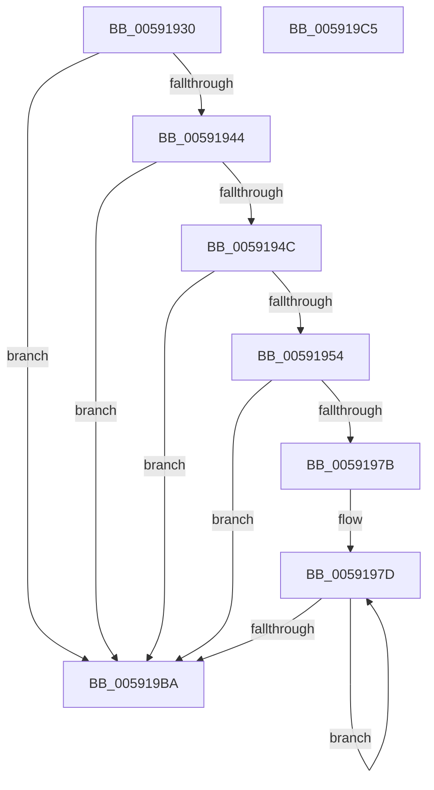

# BvgaUpdateProgressBar

- RVA: `0x00591930`–`0x005919C6` (길이 `150` bytes)
- VA: `0x0000000140591930`
- 실행 섹션: `.text`
- PDB 이름 있음: `예`; PDB Function 태그: `아니요`
- unwind 정보 RVA: `0x0006E5F8`
- 디코드: `41`개 명령, `150/150` bytes 표시
- 미해석 바이트: `0` (있으면 어셈블리에 `.byte`로 보존)

> 이 문서는 커널 이미지의 기계어와 PDB 기호를 분석해 생성했습니다. 4번과 5번은 함수 원형과 자료형을 바이너리 사용 방식에서 추정한 C 해석이며 원본 소스 복구 결과는 아닙니다.

## 1. Dependencies

- 직접 호출 지점: **3**; 고유 호출 대상: **3**
- 직접 호출자로 확인된 함수: **1**
- RIP 상대 이미지 참조: **8**

### Outgoing calls
- `0x0059197D` → [BvgaAcquireLock](BvgaAcquireLock_function_005913A0.md) (function, `0x005913A0`)
- `0x005919A0` → `BOOTVID.dll!VidSolidColorFill` (import, 간접 대상; import `BOOTVID.dll!VidSolidColorFill`)
- `0x005919AC` → [BvgaReleaseLock](BvgaReleaseLock_function_00591690.md) (function, `0x00591690`)

### Direct callers
- [BvgaIndicateProgress](../../init/C2/BvgaIndicateProgress_function_00C2A620.md) at `0x00C2A657`

### Static image references
- `0x0059193C` → RVA `0x00E0A9B0` (`.data`; read)
- `0x00591944` → RVA `0x00E65EC8` (`.data`; read)
- `0x0059194C` → RVA `0x00E65ED0` (`.data`; read)
- `0x00591954` → RVA `0x00F8E9F8` (`.data`; read)
- `0x00591960` → RVA `0x00F8E9F0` (`.data`; read)
- `0x00591982` → RVA `0x00F8E9FC` (`.data`; read)
- `0x00591988` → RVA `0x00F8EA00` (`.data`; read)
- `0x005919A0` → RVA `0x00151048` (`BOOTVID.dll!VidSolidColorFill (IAT)`; read)

## 2. Other-region calls and transfers

- 다른 실행 섹션으로 향하는 call: **0**
- 별도 외부 분기/꼬리 이동을 확인하지 못했습니다.

## 3. Assembly (complete function range)

```asm
00591930  48 89 5C 24 08                  mov qword ptr [rsp + 8], rbx
00591935  57                              push rdi
00591936  48 83 EC 30                     sub rsp, 0x30
0059193A  33 DB                           xor ebx, ebx
0059193C  38 1D 6E 90 87 00               cmp byte ptr [rip + 0x87906e], bl
00591942  74 76                           je 0x1405919ba
00591944  38 1D 7E 45 8D 00               cmp byte ptr [rip + 0x8d457e], bl
0059194A  74 6E                           je 0x1405919ba
0059194C  39 1D 7E 45 8D 00               cmp dword ptr [rip + 0x8d457e], ebx
00591952  75 66                           jne 0x1405919ba
00591954  0F AF 0D 9D D0 9F 00            imul ecx, dword ptr [rip + 0x9fd09d]
0059195B  B8 AD 8B DB 68                  mov eax, 0x68db8bad
00591960  03 0D 8A D0 9F 00               add ecx, dword ptr [rip + 0x9fd08a]
00591966  8D 0C C9                        lea ecx, [rcx + rcx*8]
00591969  03 C9                           add ecx, ecx
0059196B  F7 E9                           imul ecx
0059196D  C1 FA 0C                        sar edx, 0xc
00591970  8B C2                           mov eax, edx
00591972  C1 E8 1F                        shr eax, 0x1f
00591975  03 D0                           add edx, eax
00591977  85 D2                           test edx, edx
00591979  7E 3F                           jle 0x1405919ba
0059197B  8B FA                           mov edi, edx
0059197D  E8 1E FA FF FF                  call 0x1405913a0
00591982  8B 0D 74 D0 9F 00               mov ecx, dword ptr [rip + 0x9fd074]
00591988  8B 15 72 D0 9F 00               mov edx, dword ptr [rip + 0x9fd072]
0059198E  03 CB                           add ecx, ebx
00591990  C7 44 24 20 0B 00 00 00         mov dword ptr [rsp + 0x20], 0xb
00591998  44 8D 41 07                     lea r8d, [rcx + 7]
0059199C  44 8D 4A 07                     lea r9d, [rdx + 7]
005919A0  48 FF 15 A1 F6 BB FF            call qword ptr [rip - 0x44095f]
005919A7  0F 1F 44 00 00                  nop dword ptr [rax + rax]
005919AC  E8 DF FC FF FF                  call 0x140591690
005919B1  83 C3 09                        add ebx, 9
005919B4  48 83 EF 01                     sub rdi, 1
005919B8  75 C3                           jne 0x14059197d
005919BA  48 8B 5C 24 40                  mov rbx, qword ptr [rsp + 0x40]
005919BF  48 83 C4 30                     add rsp, 0x30
005919C3  5F                              pop rdi
005919C4  C3                              ret
005919C5  CC                              int3
```

## 4. C-style interpretation (structured pseudocode)

```c
__int64 __fastcall BvgaUpdateProgressBar(int a1, int a2)
{
    __int64 result;
    __int64 v_rbx;
    __int64 v_rdi;
    __int64 v_rsp;
    unsigned int v_stack_m18;
    unsigned __int64 v_stack_p8;

    v_stack_p8 = v_rbx;
    v_rsp = (v_rsp) - (48);
    v_rbx = 0;
    if ((*(unsigned __int8 *)(v_rip + 8884334)) == 0) goto loc_005919BA;
    if ((*(unsigned __int8 *)(v_rip + 9258366)) == 0) goto loc_005919BA;
    if ((*(unsigned int *)(v_rip + 9258366)) != 0) goto loc_005919BA;
    a1 = (unsigned int)((a1) * (*(unsigned int *)(v_rip + 10473629)));
    a1 = (unsigned int)((a1) + (*(unsigned int *)(v_rip + 10473610)));
    a1 = (unsigned int)((a1 + a1 * 8) + ((unsigned int)(a1 + a1 * 8)));
    a2 = (unsigned int)((a2) >> (12));
    result = (unsigned int)(((unsigned int)(a2)) >> (31));
    a2 = (unsigned int)((a2) + ((unsigned int)(result)));
    if (condition_is_less_or_equal) goto loc_005919BA;
loc_0059197D:
    result = BvgaAcquireLock(a1, a2, a3, a4);
    a1 = (unsigned int)(((unsigned int)(*(unsigned int *)(v_rip + 10473588))) + (0));
    v_stack_m18 = 11;
    result = BOOTVID_dll_VidSolidColorFill(a1, (unsigned int)(*(unsigned int *)(v_rip + 10473586)), a1 + 7, (unsigned int)(*(unsigned int *)(v_rip + 10473586)) + 7);
    result = BvgaReleaseLock(a1, (unsigned int)(*(unsigned int *)(v_rip + 10473586)), a1 + 7, (unsigned int)(*(unsigned int *)(v_rip + 10473586)) + 7);
    v_rbx = (unsigned int)((v_rbx) + (9));
    v_rdi = ((unsigned int)(a2)) - (1);
    if (condition_is_not_equal) goto loc_0059197D;
loc_005919BA:
    v_rsp = (v_rsp) + (48);
    return result;
}
```

## 5. (Beta) C Style

```c
int64_t BvgaUpdateProgressBar(void *Arg1, int32_t Arg2)
{
    uint8_t *arg1 = (uint8_t *)Arg1;

    int64_t result;
    int64_t local_rbx;
    int64_t local_rdi;
    int64_t local_rsp;
    uint32_t v_stack_m18;
    uint64_t v_stack_p8;

    v_stack_p8 = local_rbx;
    local_rsp = (local_rsp) - (48);
    local_rbx = 0;
    if ((*(uint8_t *)(v_rip + 0x87906E)) == 0) goto loc_005919BA;
    if ((*(uint8_t *)(v_rip + 0x8D457E)) == 0) goto loc_005919BA;
    if ((*(uint32_t *)(v_rip + 0x8D457E)) != 0) goto loc_005919BA;
    Arg1 = (uint32_t)((Arg1) * (*(uint32_t *)(v_rip + 0x9FD09D)));
    Arg1 = (uint32_t)((Arg1) + (*(uint32_t *)(v_rip + 0x9FD08A)));
    Arg1 = (uint32_t)((Arg1 + Arg1 * 8) + ((uint32_t)(Arg1 + Arg1 * 8)));
    Arg2 = (uint32_t)((Arg2) >> (12));
    result = (uint32_t)(((uint32_t)(Arg2)) >> (31));
    Arg2 = (uint32_t)((Arg2) + ((uint32_t)(result)));
    if (condition_is_less_or_equal) goto loc_005919BA;
loc_0059197D:
    result = BvgaAcquireLock(Arg1, Arg2, a3, a4);
    Arg1 = (uint32_t)(((uint32_t)(*(uint32_t *)(v_rip + 0x9FD074))) + (0));
    v_stack_m18 = 11;
    result = kernel_indirect_call(Arg1, (uint32_t)(*(uint32_t *)(v_rip + 0x9FD072)), Arg1 + 7, (uint32_t)(*(uint32_t *)(v_rip + 0x9FD072)) + 7);
    result = BvgaReleaseLock(Arg1, (uint32_t)(*(uint32_t *)(v_rip + 0x9FD072)), Arg1 + 7, (uint32_t)(*(uint32_t *)(v_rip + 0x9FD072)) + 7);
    local_rbx = (uint32_t)((local_rbx) + (9));
    local_rdi = ((uint32_t)(Arg2)) - (1);
    if (condition_is_not_equal) goto loc_0059197D;
loc_005919BA:
    local_rsp = (local_rsp) + (48);
    return result;
}
```

### 관측된 메모리 오프셋

구조체 형식이 확인되지 않은 접근은 인자 기준의 오프셋으로만 기록했습니다.

| 기준 인자 | 오프셋 표현 | 폭 (bit) | 접근 |
|---|---:|---:|---|
| `Arg1` | `+ 0x0 + rcx*8` | `32` | `R` |

## 6. Execution-region graph

[열기: 2D/3D 그래프와 함수 탐색 컨트롤 패널](../../../control-panel.html?section=text&rva=0x00591930&view=graph)

- 2D 그래프는 위에서 아래로 흐르고, 3D 그래프는 빈 공간을 드래그해 회전합니다. Shift+드래그는 이동, 휠은 확대·축소, 함수 노드 선택은 대상 보고서 이동입니다.

### Static fallback


