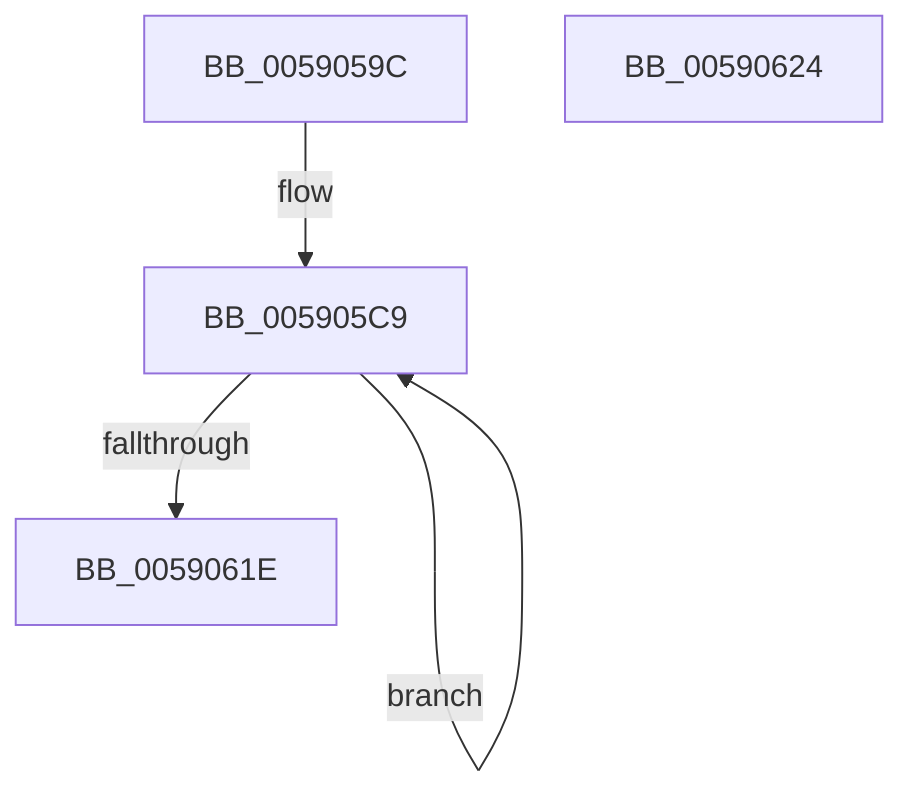

# FadePalette

- RVA: `0x0059059C`–`0x00590625` (길이 `137` bytes)
- VA: `0x000000014059059C`
- 실행 섹션: `.text`
- PDB 이름 있음: `예`; PDB Function 태그: `아니요`
- unwind 정보 RVA: `0x00071750`
- 디코드: `34`개 명령, `137/137` bytes 표시
- 미해석 바이트: `0` (있으면 어셈블리에 `.byte`로 보존)

> 이 문서는 커널 이미지의 기계어와 PDB 기호를 분석해 생성했습니다. 4번과 5번은 함수 원형과 자료형을 바이너리 사용 방식에서 추정한 C 해석이며 원본 소스 복구 결과는 아닙니다.

## 1. Dependencies

- 직접 호출 지점: **0**; 고유 호출 대상: **0**
- 직접 호출자로 확인된 함수: **1**
- RIP 상대 이미지 참조: **3**

### Outgoing calls
- 직접 디코드된 call 명령이 없습니다.

### Direct callers
- [RotBarUpdate](RotBarUpdate_function_005907DC.md) at `0x00590A2F`

### Static image references
- `0x005905A1` → RVA `0x00E06D88` (`.data`; read)
- `0x005905A8` → RVA `0x00E0A960` (`.data`; read)
- `0x005905B6` → RVA `0x00E0A961` (`.data`; read)

## 2. Other-region calls and transfers

- 다른 실행 섹션으로 향하는 call: **0**
- 별도 외부 분기/꼬리 이동을 확인하지 못했습니다.

## 3. Assembly (complete function range)

```asm
0059059C  48 89 5C 24 08                  mov qword ptr [rsp + 8], rbx
005905A1  48 8B 05 E0 67 87 00            mov rax, qword ptr [rip + 0x8767e0]
005905A8  4C 8D 0D B1 A3 87 00            lea r9, [rip + 0x87a3b1]
005905AF  4C 2B C8                        sub r9, rax
005905B2  44 0F B6 D9                     movzx r11d, cl
005905B6  4C 8D 15 A4 A3 87 00            lea r10, [rip + 0x87a3a4]
005905BD  BB 10 00 00 00                  mov ebx, 0x10
005905C2  4C 2B D0                        sub r10, rax
005905C5  4C 8D 40 02                     lea r8, [rax + 2]
005905C9  43 0F B6 4C 01 FE               movzx ecx, byte ptr [r9 + r8 - 2]
005905CF  B8 CD CC CC CC                  mov eax, 0xcccccccd
005905D4  41 0F AF CB                     imul ecx, r11d
005905D8  F7 E1                           mul ecx
005905DA  B8 CD CC CC CC                  mov eax, 0xcccccccd
005905DF  C1 EA 04                        shr edx, 4
005905E2  41 88 50 FE                     mov byte ptr [r8 - 2], dl
005905E6  43 0F B6 4C 02 FE               movzx ecx, byte ptr [r10 + r8 - 2]
005905EC  41 0F AF CB                     imul ecx, r11d
005905F0  F7 E1                           mul ecx
005905F2  B8 CD CC CC CC                  mov eax, 0xcccccccd
005905F7  C1 EA 04                        shr edx, 4
005905FA  41 88 50 FF                     mov byte ptr [r8 - 1], dl
005905FE  43 0F B6 0C 01                  movzx ecx, byte ptr [r9 + r8]
00590603  41 0F AF CB                     imul ecx, r11d
00590607  41 C6 40 01 00                  mov byte ptr [r8 + 1], 0
0059060C  F7 E1                           mul ecx
0059060E  C1 EA 04                        shr edx, 4
00590611  41 88 10                        mov byte ptr [r8], dl
00590614  4D 8D 40 04                     lea r8, [r8 + 4]
00590618  48 83 EB 01                     sub rbx, 1
0059061C  75 AB                           jne 0x1405905c9
0059061E  48 8B 5C 24 08                  mov rbx, qword ptr [rsp + 8]
00590623  C3                              ret
00590624  CC                              int3
```

## 4. C-style interpretation (structured pseudocode)

```c
__int64 __fastcall FadePalette(unsigned __int8 a1, int a2)
{
    __int64 v_r10;
    __int64 v_rbx;
    unsigned __int64 v_stack_p8;

    v_stack_p8 = v_rbx;
    a4 = (v_rip + 8889265) - (*(unsigned __int64 *)(v_rip + 8873952));
    v_r10 = (v_rip + 8889252) - (*(unsigned __int64 *)(v_rip + 8873952));
loc_005905C9:
    a1 = (unsigned int)((*(unsigned __int8 *)(a4 + *(unsigned __int64 *)(v_rip + 8873952) + 2 * 1 - 2)) * (a1));
    a2 = (unsigned int)((a2) >> (4));
    *(unsigned __int8 *)(*(unsigned __int64 *)(v_rip + 8873952) + 2 - 2) = (unsigned __int8)(a2);
    a1 = (unsigned int)((*(unsigned __int8 *)(v_r10 + *(unsigned __int64 *)(v_rip + 8873952) + 2 * 1 - 2)) * (a1));
    a2 = (unsigned int)((a2) >> (4));
    *(unsigned __int8 *)(*(unsigned __int64 *)(v_rip + 8873952) + 2 - 1) = (unsigned __int8)(a2);
    a1 = (unsigned int)((*(unsigned __int8 *)(a4 + *(unsigned __int64 *)(v_rip + 8873952) + 2 * 1)) * (a1));
    *(unsigned __int8 *)(*(unsigned __int64 *)(v_rip + 8873952) + 2 + 1) = 0;
    a2 = (unsigned int)((a2) >> (4));
    *(unsigned __int8 *)(*(unsigned __int64 *)(v_rip + 8873952) + 2) = (unsigned __int8)(a2);
    v_rbx = (16) - (1);
    if (condition_is_not_equal) goto loc_005905C9;
    return (unsigned int)(0xCCCCCCCDULL);
}
```

## 5. (Beta) C Style

```c
int64_t FadePalette(uint8_t Arg1, int32_t Arg2)
{
    int64_t local_r10;
    int64_t local_rbx;
    uint64_t v_stack_p8;

    v_stack_p8 = local_rbx;
    a4 = (v_rip + 8889265) - (*(uint64_t *)(v_rip + 0x8767E0));
    local_r10 = (v_rip + 8889252) - (*(uint64_t *)(v_rip + 0x8767E0));
loc_005905C9:
    Arg1 = (uint32_t)((*(uint8_t *)(a4 + *(uint64_t *)(v_rip + 0x8767E0) + 0x2 * 1 - 0x2)) * (Arg1));
    Arg2 = (uint32_t)((Arg2) >> (4));
    *(uint8_t *)(*(uint64_t *)(v_rip + 0x8767E0) + 0x2 - 0x2) = (uint8_t)(Arg2);
    Arg1 = (uint32_t)((*(uint8_t *)(local_r10 + *(uint64_t *)(v_rip + 0x8767E0) + 0x2 * 1 - 0x2)) * (Arg1));
    Arg2 = (uint32_t)((Arg2) >> (4));
    *(uint8_t *)(*(uint64_t *)(v_rip + 0x8767E0) + 0x2 - 0x1) = (uint8_t)(Arg2);
    Arg1 = (uint32_t)((*(uint8_t *)(a4 + *(uint64_t *)(v_rip + 0x8767E0) + 0x2 * 1)) * (Arg1));
    *(uint8_t *)(*(uint64_t *)(v_rip + 0x8767E0) + 0x2 + 0x1) = 0;
    Arg2 = (uint32_t)((Arg2) >> (4));
    *(uint8_t *)(*(uint64_t *)(v_rip + 0x8767E0) + 0x2) = (uint8_t)(Arg2);
    local_rbx = (16) - (1);
    if (condition_is_not_equal) goto loc_005905C9;
    return (uint32_t)(0xCCCCCCCDULL);
}
```

## 6. Execution-region graph

[열기: 2D/3D 그래프와 함수 탐색 컨트롤 패널](../../../control-panel.html?section=text&rva=0x0059059C&view=graph)

- 2D 그래프는 위에서 아래로 흐르고, 3D 그래프는 빈 공간을 드래그해 회전합니다. Shift+드래그는 이동, 휠은 확대·축소, 함수 노드 선택은 대상 보고서 이동입니다.

### Static fallback


