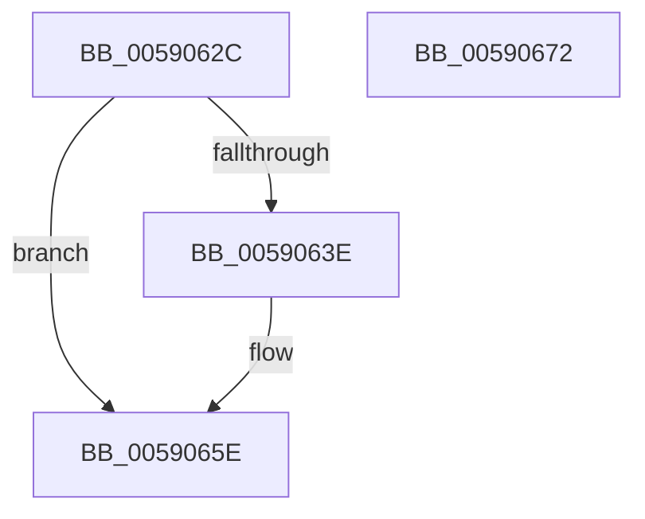

# FinalizeBootLogo

- RVA: `0x0059062C`–`0x00590673` (길이 `71` bytes)
- VA: `0x000000014059062C`
- 실행 섹션: `.text`
- PDB 이름 있음: `예`; PDB Function 태그: `아니요`
- unwind 정보 RVA: `0x0005D2F4`
- 디코드: `17`개 명령, `71/71` bytes 표시
- 미해석 바이트: `0` (있으면 어셈블리에 `.byte`로 보존)

> 이 문서는 커널 이미지의 기계어와 PDB 기호를 분석해 생성했습니다. 4번과 5번은 함수 원형과 자료형을 바이너리 사용 방식에서 추정한 C 해석이며 원본 소스 복구 결과는 아닙니다.

## 1. Dependencies

- 직접 호출 지점: **4**; 고유 호출 대상: **4**
- 직접 호출자로 확인된 함수: **1**
- RIP 상대 이미지 참조: **2**

### Outgoing calls
- `0x00590630` → [InbvAcquireLock](InbvAcquireLock_function_0059012C.md) (function, `0x0059012C`)
- `0x00590635` → [InbvGetDisplayState](InbvGetDisplayState_function_0059030C.md) (function, `0x0059030C`)
- `0x00590652` → `BOOTVID.dll!VidSolidColorFill` (import, 간접 대상; import `BOOTVID.dll!VidSolidColorFill`)
- `0x00590668` → [InbvReleaseLock](InbvReleaseLock_function_005903BC.md) (function, `0x005903BC`)

### Direct callers
- [StartFirstUserProcess](../../init/C7/StartFirstUserProcess_function_00C70848.md) at `0x00C70A40`

### Static image references
- `0x00590652` → RVA `0x00151048` (`BOOTVID.dll!VidSolidColorFill (IAT)`; read)
- `0x0059065E` → RVA `0x00E65E60` (`.data`; write)

## 2. Other-region calls and transfers

- 다른 실행 섹션으로 향하는 call: **0**
- 별도 외부 분기/꼬리 이동을 확인하지 못했습니다.

## 3. Assembly (complete function range)

```asm
0059062C  48 83 EC 38                     sub rsp, 0x38
00590630  E8 F7 FA FF FF                  call 0x14059012c
00590635  E8 D2 FC FF FF                  call 0x14059030c
0059063A  85 C0                           test eax, eax
0059063C  75 20                           jne 0x14059065e
0059063E  21 44 24 20                     and dword ptr [rsp + 0x20], eax
00590642  33 D2                           xor edx, edx
00590644  33 C9                           xor ecx, ecx
00590646  41 B9 DF 01 00 00               mov r9d, 0x1df
0059064C  41 B8 7F 02 00 00               mov r8d, 0x27f
00590652  48 FF 15 EF 09 BC FF            call qword ptr [rip - 0x43f611]
00590659  0F 1F 44 00 00                  nop dword ptr [rax + rax]
0059065E  C7 05 F8 57 8D 00 03 00 00 00   mov dword ptr [rip + 0x8d57f8], 3
00590668  E8 4F FD FF FF                  call 0x1405903bc
0059066D  48 83 C4 38                     add rsp, 0x38
00590671  C3                              ret
00590672  CC                              int3
```

## 4. C-style interpretation (structured pseudocode)

```c
__int64 __fastcall FinalizeBootLogo(int a1, int a2)
{
    __int64 result;
    __int64 v_rsp;
    unsigned int v_stack_m18;

    v_rsp = (v_rsp) - (56);
    result = InbvAcquireLock(a1, a2, a3, a4);
    result = InbvGetDisplayState(a1, a2, a3, a4);
    if ((unsigned int)(result) == 0) {
        a2 = 0;
        a1 = 0;
        a4 = 479;
        a3 = 639;
        result = BOOTVID_dll_VidSolidColorFill(a1, a2, a3, a4);
    }
    *(unsigned int *)(v_rip + 9263096) = 3;
    result = InbvReleaseLock(a1, a2, a3, a4);
    v_rsp = (v_rsp) + (56);
    return result;
}
```

## 5. (Beta) C Style

```c
int64_t FinalizeBootLogo(int32_t Arg1, int32_t Arg2)
{
    int64_t result;
    int64_t local_rsp;
    uint32_t v_stack_m18;

    local_rsp = (local_rsp) - (56);
    result = InbvAcquireLock(Arg1, Arg2, a3, a4);
    result = InbvGetDisplayState(Arg1, Arg2, a3, a4);
    if ((uint32_t)(result) == 0) {
        Arg2 = 0;
        Arg1 = 0;
        a4 = 479;
        a3 = 639;
        result = kernel_indirect_call(Arg1, Arg2, a3, a4);
    }
    *(uint32_t *)(v_rip + 0x8D57F8) = 3;
    result = InbvReleaseLock(Arg1, Arg2, a3, a4);
    local_rsp = (local_rsp) + (56);
    return result;
}
```

## 6. Execution-region graph

[열기: 2D/3D 그래프와 함수 탐색 컨트롤 패널](../../../control-panel.html?section=text&rva=0x0059062C&view=graph)

- 2D 그래프는 위에서 아래로 흐르고, 3D 그래프는 빈 공간을 드래그해 회전합니다. Shift+드래그는 이동, 휠은 확대·축소, 함수 노드 선택은 대상 보고서 이동입니다.

### Static fallback


