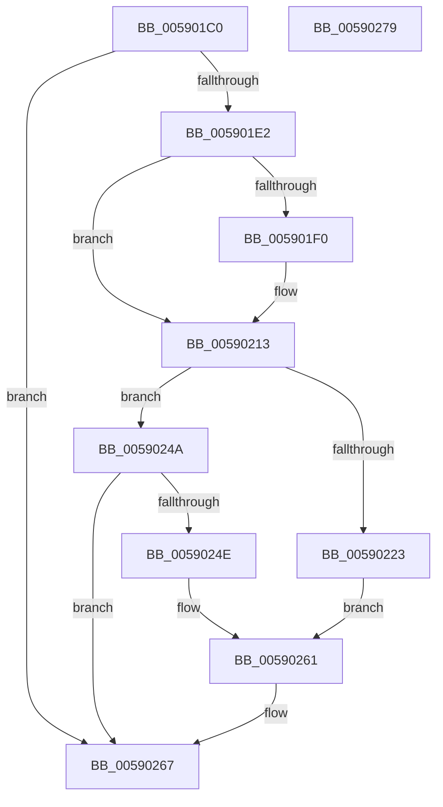

# InbvDetermineFunction

- RVA: `0x005901C0`–`0x0059027A` (길이 `186` bytes)
- VA: `0x00000001405901C0`
- 실행 섹션: `.text`
- PDB 이름 있음: `예`; PDB Function 태그: `아니요`
- unwind 정보 RVA: `0x00060BC4`
- 디코드: `45`개 명령, `186/186` bytes 표시
- 미해석 바이트: `0` (있으면 어셈블리에 `.byte`로 보존)

> 이 문서는 커널 이미지의 기계어와 PDB 기호를 분석해 생성했습니다. 4번과 5번은 함수 원형과 자료형을 바이너리 사용 방식에서 추정한 C 해석이며 원본 소스 복구 결과는 아닙니다.

## 1. Dependencies

- 직접 호출 지점: **2**; 고유 호출 대상: **2**
- 직접 호출자로 확인된 함수: **1**
- RIP 상대 이미지 참조: **6**

### Outgoing calls
- `0x005901F0` → [strupr](../4F/strupr_function_004FEEE0.md) (function, `0x004FEEE0`)
- `0x005901FF` → [strstr](../4F/strstr_function_004FF680.md) (function, `0x004FF680`)

### Direct callers
- [InbvDriverInitialize](../../init/C2/InbvDriverInitialize_function_00C2A420.md) at `0x00C2A441`

### Static image references
- `0x005901CF` → RVA `0x00E65E48` (`.data`; read)
- `0x005901F5` → RVA `0x006C9930` (` ?? ::FNODOBFM::`string'`; read)
- `0x00590225` → RVA `0x00E00D10` (`.data`; read)
- `0x0059022C` → RVA `0x00E00DD0` (`.data`; read)
- `0x00590237` → RVA `0x00E65E58` (`.data`; write)
- `0x00590261` → RVA `0x00E65E48` (`.data`; write)

## 2. Other-region calls and transfers

- 다른 실행 섹션으로 향하는 call: **0**
- 별도 외부 분기/꼬리 이동을 확인하지 못했습니다.

## 3. Assembly (complete function range)

```asm
005901C0  48 89 5C 24 08                  mov qword ptr [rsp + 8], rbx
005901C5  48 89 74 24 10                  mov qword ptr [rsp + 0x10], rsi
005901CA  57                              push rdi
005901CB  48 83 EC 20                     sub rsp, 0x20
005901CF  8B 15 73 5C 8D 00               mov edx, dword ptr [rip + 0x8d5c73]
005901D5  33 F6                           xor esi, esi
005901D7  48 8B F9                        mov rdi, rcx
005901DA  85 D2                           test edx, edx
005901DC  0F 85 85 00 00 00               jne 0x140590267
005901E2  48 8B 89 D8 00 00 00            mov rcx, qword ptr [rcx + 0xd8]
005901E9  B3 01                           mov bl, 1
005901EB  48 85 C9                        test rcx, rcx
005901EE  74 23                           je 0x140590213
005901F0  E8 EB EC F6 FF                  call 0x1404feee0
005901F5  48 8D 15 34 97 13 00            lea rdx, [rip + 0x139734]
005901FC  48 8B C8                        mov rcx, rax
005901FF  E8 7C F4 F6 FF                  call 0x1404ff680
00590204  8B 15 3E 5C 8D 00               mov edx, dword ptr [rip + 0x8d5c3e]
0059020A  48 85 C0                        test rax, rax
0059020D  0F B6 DB                        movzx ebx, bl
00590210  0F 45 DE                        cmovne ebx, esi
00590213  48 8B 87 F0 00 00 00            mov rax, qword ptr [rdi + 0xf0]
0059021A  48 39 B0 20 01 00 00            cmp qword ptr [rax + 0x120], rsi
00590221  74 27                           je 0x14059024a
00590223  84 DB                           test bl, bl
00590225  48 8D 0D E4 0A 87 00            lea rcx, [rip + 0x870ae4]
0059022C  48 8D 05 9D 0B 87 00            lea rax, [rip + 0x870b9d]
00590233  48 0F 44 C1                     cmove rax, rcx
00590237  48 89 05 1A 5C 8D 00            mov qword ptr [rip + 0x8d5c1a], rax
0059023E  0F B6 C3                        movzx eax, bl
00590241  8D 14 45 01 00 00 00            lea edx, [rax*2 + 1]
00590248  EB 17                           jmp 0x140590261
0059024A  84 DB                           test bl, bl
0059024C  74 19                           je 0x140590267
0059024E  48 8D 05 7B 0B 87 00            lea rax, [rip + 0x870b7b]
00590255  BA 02 00 00 00                  mov edx, 2
0059025A  48 89 05 F7 5B 8D 00            mov qword ptr [rip + 0x8d5bf7], rax
00590261  89 15 E1 5B 8D 00               mov dword ptr [rip + 0x8d5be1], edx
00590267  48 8B 5C 24 30                  mov rbx, qword ptr [rsp + 0x30]
0059026C  8B C2                           mov eax, edx
0059026E  48 8B 74 24 38                  mov rsi, qword ptr [rsp + 0x38]
00590273  48 83 C4 20                     add rsp, 0x20
00590277  5F                              pop rdi
00590278  C3                              ret
00590279  CC                              int3
```

## 4. C-style interpretation (structured pseudocode)

```c
__int64 __fastcall InbvDetermineFunction(__int64 a1)
{
    __int64 result;
    __int64 v_rbx;
    __int64 v_rsi;
    __int64 v_rsp;
    unsigned __int64 v_stack_p10;
    unsigned __int64 v_stack_p8;

    v_stack_p8 = v_rbx;
    v_stack_p10 = v_rsi;
    v_rsp = (v_rsp) - (32);
    v_rsi = 0;
    if ((unsigned int)((unsigned int)(*(unsigned int *)(v_rip + 9264243))) != 0) goto loc_00590267;
    v_rbx = 1;
    if (*(unsigned __int64 *)(a1 + 216) != 0) {
        result = strupr(*(unsigned __int64 *)(a1 + 216), (unsigned int)(*(unsigned int *)(v_rip + 9264243)), a3, a4);
        a2 = v_rip + 1283892;
        a1 = result;
        result = strstr(a1, a2, a3, a4);
        a2 = *(unsigned int *)(v_rip + 9264190);
        v_rbx = 1;
        if (result != 0) { v_rbx = 0; }
    }
    if ((*(unsigned __int64 *)(*(unsigned __int64 *)(a1 + 240) + 288)) == 0) goto loc_0059024A;
    result = v_rip + 8850333;
    if ((unsigned __int8)(v_rbx) == 0) { result = v_rip + 8850148; }
    *(unsigned __int64 *)(v_rip + 9264154) = result;
    goto loc_00590261;
loc_0059024A:
    if ((unsigned __int8)(v_rbx) == 0) goto loc_00590267;
    *(unsigned __int64 *)(v_rip + 9264119) = v_rip + 8850299;
loc_00590261:
    *(unsigned int *)(v_rip + 9264097) = 2;
loc_00590267:
    v_rsp = (v_rsp) + (32);
    return 2;
}
```

## 5. (Beta) C Style

```c
int64_t InbvDetermineFunction(void *Arg1)
{
    uint8_t *arg1 = (uint8_t *)Arg1;

    int64_t result;
    int64_t local_rbx;
    int64_t local_rsi;
    int64_t local_rsp;
    uint64_t v_stack_p10;
    uint64_t v_stack_p8;

    v_stack_p8 = local_rbx;
    v_stack_p10 = local_rsi;
    local_rsp = (local_rsp) - (32);
    local_rsi = 0;
    if ((uint32_t)((uint32_t)(*(uint32_t *)(v_rip + 0x8D5C73))) != 0) goto loc_00590267;
    local_rbx = 1;
    if (*(uint64_t *)(arg1 + 0xD8) != 0) {
        result = strupr(*(uint64_t *)(arg1 + 0xD8), (uint32_t)(*(uint32_t *)(v_rip + 0x8D5C73)), a3, a4);
        a2 = v_rip + 1283892;
        Arg1 = result;
        result = strstr(Arg1, a2, a3, a4);
        a2 = *(uint32_t *)(v_rip + 0x8D5C3E);
        local_rbx = 1;
        if (result != 0) { local_rbx = 0; }
    }
    if ((*(uint64_t *)(*(uint64_t *)(arg1 + 0xF0) + 0x120)) == 0) goto loc_0059024A;
    result = v_rip + 8850333;
    if ((uint8_t)(local_rbx) == 0) { result = v_rip + 8850148; }
    *(uint64_t *)(v_rip + 0x8D5C1A) = result;
    goto loc_00590261;
loc_0059024A:
    if ((uint8_t)(local_rbx) == 0) goto loc_00590267;
    *(uint64_t *)(v_rip + 0x8D5BF7) = v_rip + 8850299;
loc_00590261:
    *(uint32_t *)(v_rip + 0x8D5BE1) = 2;
loc_00590267:
    local_rsp = (local_rsp) + (32);
    return 2;
}
```

### 관측된 메모리 오프셋

구조체 형식이 확인되지 않은 접근은 인자 기준의 오프셋으로만 기록했습니다.

| 기준 인자 | 오프셋 표현 | 폭 (bit) | 접근 |
|---|---:|---:|---|
| `Arg1` | `+ 0xD8` | `64` | `R` |
| `Arg1` | `+ 0xF0` | `64` | `R` |

## 6. Execution-region graph

[열기: 2D/3D 그래프와 함수 탐색 컨트롤 패널](../../../control-panel.html?section=text&rva=0x005901C0&view=graph)

- 2D 그래프는 위에서 아래로 흐르고, 3D 그래프는 빈 공간을 드래그해 회전합니다. Shift+드래그는 이동, 휠은 확대·축소, 함수 노드 선택은 대상 보고서 이동입니다.

### Static fallback


