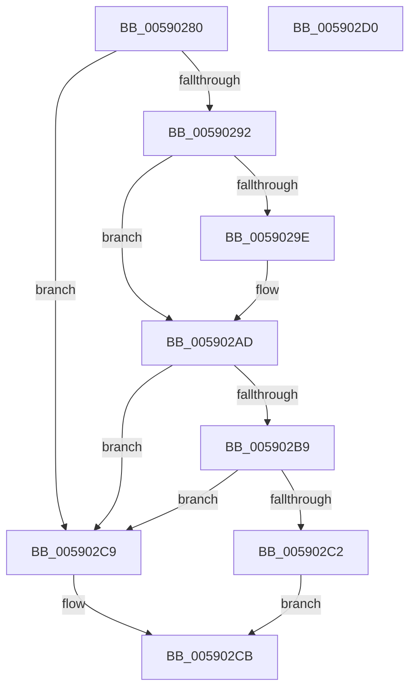

# InbvDisplayString

- RVA: `0x00590280`–`0x005902D1` (길이 `81` bytes)
- VA: `0x0000000140590280`
- 실행 섹션: `.text`
- PDB 이름 있음: `예`; PDB Function 태그: `아니요`
- unwind 정보 RVA: `0x00085914`
- 디코드: `22`개 명령, `81/81` bytes 표시
- 미해석 바이트: `0` (있으면 어셈블리에 `.byte`로 보존)

> 이 문서는 커널 이미지의 기계어와 PDB 기호를 분석해 생성했습니다. 4번과 5번은 함수 원형과 자료형을 바이너리 사용 방식에서 추정한 C 해석이며 원본 소스 복구 결과는 아닙니다.

## 1. Dependencies

- 직접 호출 지점: **2**; 고유 호출 대상: **1**
- 직접 호출자로 확인된 함수: **1**
- RIP 상대 이미지 참조: **3**

### Outgoing calls
- `0x005902A3` → [guard_dispatch_icall](../6B/guard_dispatch_icall_function_006BAAD0.md) (function, `0x006BAAD0`)
- `0x005902C2` → [guard_dispatch_icall](../6B/guard_dispatch_icall_function_006BAAD0.md) (function, `0x006BAAD0`)

### Direct callers
- [Phase1InitializationDiscard](../../init/C1/Phase1InitializationDiscard_function_00C1C728.md) at `0x00C1CCF0`
- [Phase1InitializationDiscard](../../init/C1/Phase1InitializationDiscard_function_00C1C728.md) at `0x00C1D1A8`
- [Phase1InitializationDiscard](../../init/C1/Phase1InitializationDiscard_function_00C1C728.md) at `0x00C1D937`
- [Phase1InitializationDiscard](../../init/C1/Phase1InitializationDiscard_function_00C1C728.md) at `0x00C1D984`

### Static image references
- `0x00590289` → RVA `0x00E65E4C` (`.data`; read)
- `0x00590292` → RVA `0x00E65E50` (`.data`; read)
- `0x005902AD` → RVA `0x00E65E58` (`.data`; read)

## 2. Other-region calls and transfers

- 다른 실행 섹션으로 향하는 call: **0**
- 별도 외부 분기/꼬리 이동을 확인하지 못했습니다.

## 3. Assembly (complete function range)

```asm
00590280  48 89 4C 24 08                  mov qword ptr [rsp + 8], rcx
00590285  48 83 EC 28                     sub rsp, 0x28
00590289  80 3D BC 5B 8D 00 00            cmp byte ptr [rip + 0x8d5bbc], 0
00590290  74 37                           je 0x1405902c9
00590292  48 8B 05 B7 5B 8D 00            mov rax, qword ptr [rip + 0x8d5bb7]
00590299  48 85 C0                        test rax, rax
0059029C  74 0F                           je 0x1405902ad
0059029E  48 8D 4C 24 30                  lea rcx, [rsp + 0x30]
005902A3  E8 28 A8 12 00                  call 0x1406baad0
005902A8  48 8B 4C 24 30                  mov rcx, qword ptr [rsp + 0x30]
005902AD  48 8B 05 A4 5B 8D 00            mov rax, qword ptr [rip + 0x8d5ba4]
005902B4  48 85 C0                        test rax, rax
005902B7  74 10                           je 0x1405902c9
005902B9  48 8B 40 28                     mov rax, qword ptr [rax + 0x28]
005902BD  48 85 C0                        test rax, rax
005902C0  74 07                           je 0x1405902c9
005902C2  E8 09 A8 12 00                  call 0x1406baad0
005902C7  EB 02                           jmp 0x1405902cb
005902C9  32 C0                           xor al, al
005902CB  48 83 C4 28                     add rsp, 0x28
005902CF  C3                              ret
005902D0  CC                              int3
```

## 4. C-style interpretation (structured pseudocode)

```c
__int64 __fastcall InbvDisplayString(__int64 a1)
{
    __int64 result;
    __int64 v_rsp;
    unsigned __int64 v_stack_p8;

    v_stack_p8 = a1;
    v_rsp = (v_rsp) - (40);
    if ((*(unsigned __int8 *)(v_rip + 9264060)) == 0) goto loc_005902C9;
    result = *(unsigned __int64 *)(v_rip + 9264055);
    if (*(unsigned __int64 *)(v_rip + 9264055) != 0) {
        a1 = v_stack_p8;
        result = guard_dispatch_icall(a1, a2, a3, a4);
        a1 = v_stack_p8;
    }
    if (*(unsigned __int64 *)(v_rip + 9264036) == 0) goto loc_005902C9;
    if (*(unsigned __int64 *)(*(unsigned __int64 *)(v_rip + 9264036) + 40) == 0) goto loc_005902C9;
    result = guard_dispatch_icall(a1, a2, a3, a4);
    goto loc_005902CB;
loc_005902C9:
    result = 0;
loc_005902CB:
    v_rsp = (v_rsp) + (40);
    return result;
}
```

## 5. (Beta) C Style

```c
int64_t InbvDisplayString(int64_t Arg1)
{
    int64_t result;
    int64_t local_rsp;
    uint64_t v_stack_p8;

    v_stack_p8 = Arg1;
    local_rsp = (local_rsp) - (40);
    if ((*(uint8_t *)(v_rip + 0x8D5BBC)) == 0) goto loc_005902C9;
    result = *(uint64_t *)(v_rip + 0x8D5BB7);
    if (*(uint64_t *)(v_rip + 0x8D5BB7) != 0) {
        Arg1 = v_stack_p8;
        result = guard_dispatch_icall(Arg1, a2, a3, a4);
        Arg1 = v_stack_p8;
    }
    if (*(uint64_t *)(v_rip + 0x8D5BA4) == 0) goto loc_005902C9;
    if (*(uint64_t *)(*(uint64_t *)(v_rip + 0x8D5BA4) + 0x28) == 0) goto loc_005902C9;
    result = guard_dispatch_icall(Arg1, a2, a3, a4);
    goto loc_005902CB;
loc_005902C9:
    result = 0;
loc_005902CB:
    local_rsp = (local_rsp) + (40);
    return result;
}
```

## 6. Execution-region graph

[열기: 2D/3D 그래프와 함수 탐색 컨트롤 패널](../../../control-panel.html?section=text&rva=0x00590280&view=graph)

- 2D 그래프는 위에서 아래로 흐르고, 3D 그래프는 빈 공간을 드래그해 회전합니다. Shift+드래그는 이동, 휠은 확대·축소, 함수 노드 선택은 대상 보고서 이동입니다.

### Static fallback


