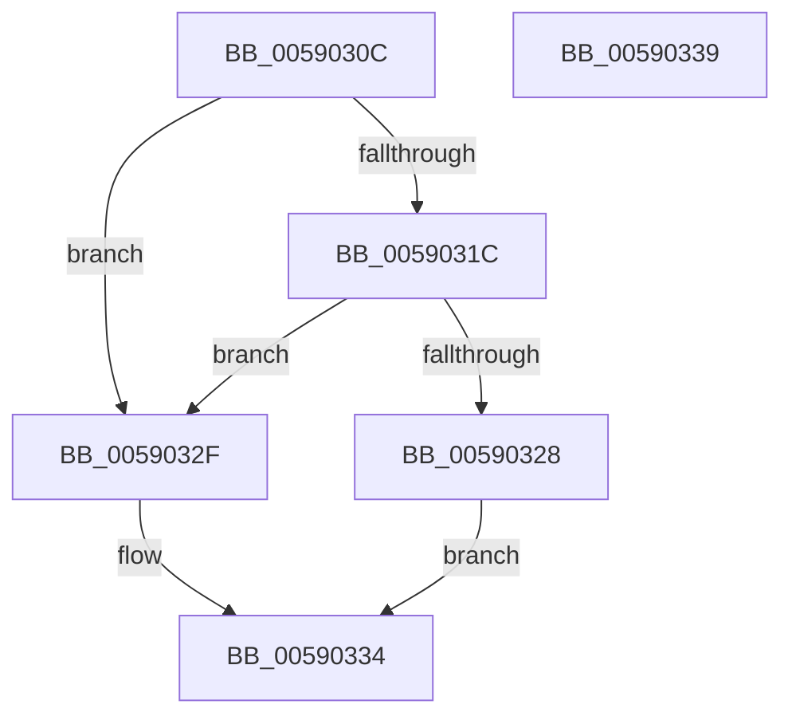

# InbvGetDisplayState

- RVA: `0x0059030C`–`0x0059033A` (길이 `46` bytes)
- VA: `0x000000014059030C`
- 실행 섹션: `.text`
- PDB 이름 있음: `예`; PDB Function 태그: `아니요`
- unwind 정보 RVA: `0x0005C788`
- 디코드: `13`개 명령, `46/46` bytes 표시
- 미해석 바이트: `0` (있으면 어셈블리에 `.byte`로 보존)

> 이 문서는 커널 이미지의 기계어와 PDB 기호를 분석해 생성했습니다. 4번과 5번은 함수 원형과 자료형을 바이너리 사용 방식에서 추정한 C 해석이며 원본 소스 복구 결과는 아닙니다.

## 1. Dependencies

- 직접 호출 지점: **1**; 고유 호출 대상: **1**
- 직접 호출자로 확인된 함수: **3**
- RIP 상대 이미지 참조: **1**

### Outgoing calls
- `0x00590328` → [guard_dispatch_icall](../6B/guard_dispatch_icall_function_006BAAD0.md) (function, `0x006BAAD0`)

### Direct callers
- [FinalizeBootLogo](FinalizeBootLogo_function_0059062C.md) at `0x00590635`
- [InbvRotateGuiBootDisplay](InbvRotateGuiBootDisplay_function_00590680.md) at `0x005906A0`
- [RotBarUpdate](RotBarUpdate_function_005907DC.md) at `0x00590A61`

### Static image references
- `0x00590310` → RVA `0x00E65E58` (`.data`; read)

## 2. Other-region calls and transfers

- 다른 실행 섹션으로 향하는 call: **0**
- 별도 외부 분기/꼬리 이동을 확인하지 못했습니다.

## 3. Assembly (complete function range)

```asm
0059030C  48 83 EC 28                     sub rsp, 0x28
00590310  48 8B 05 41 5B 8D 00            mov rax, qword ptr [rip + 0x8d5b41]
00590317  48 85 C0                        test rax, rax
0059031A  74 13                           je 0x14059032f
0059031C  48 8B 80 90 00 00 00            mov rax, qword ptr [rax + 0x90]
00590323  48 85 C0                        test rax, rax
00590326  74 07                           je 0x14059032f
00590328  E8 A3 A7 12 00                  call 0x1406baad0
0059032D  EB 05                           jmp 0x140590334
0059032F  B8 02 00 00 00                  mov eax, 2
00590334  48 83 C4 28                     add rsp, 0x28
00590338  C3                              ret
00590339  CC                              int3
```

## 4. C-style interpretation (structured pseudocode)

```c
__int64 __fastcall InbvGetDisplayState(void)
{
    __int64 result;
    __int64 v_rsp;

    v_rsp = (v_rsp) - (40);
    if (*(unsigned __int64 *)(v_rip + 9263937) == 0) goto loc_0059032F;
    if (*(unsigned __int64 *)(*(unsigned __int64 *)(v_rip + 9263937) + 144) == 0) goto loc_0059032F;
    result = guard_dispatch_icall(a1, a2, a3, a4);
    goto loc_00590334;
loc_0059032F:
loc_00590334:
    v_rsp = (v_rsp) + (40);
    return 2;
}
```

## 5. (Beta) C Style

```c
void InbvGetDisplayState(void)
{
    int64_t result;
    int64_t local_rsp;

    local_rsp = (local_rsp) - (40);
    if (*(uint64_t *)(v_rip + 0x8D5B41) == 0) goto loc_0059032F;
    if (*(uint64_t *)(*(uint64_t *)(v_rip + 0x8D5B41) + 0x90) == 0) goto loc_0059032F;
    result = guard_dispatch_icall(a1, a2, a3, a4);
    goto loc_00590334;
loc_0059032F:
loc_00590334:
    local_rsp = (local_rsp) + (40);
    return 2;
}
```

## 6. Execution-region graph

[열기: 2D/3D 그래프와 함수 탐색 컨트롤 패널](../../../control-panel.html?section=text&rva=0x0059030C&view=graph)

- 2D 그래프는 위에서 아래로 흐르고, 3D 그래프는 빈 공간을 드래그해 회전합니다. Shift+드래그는 이동, 휠은 확대·축소, 함수 노드 선택은 대상 보고서 이동입니다.

### Static fallback


