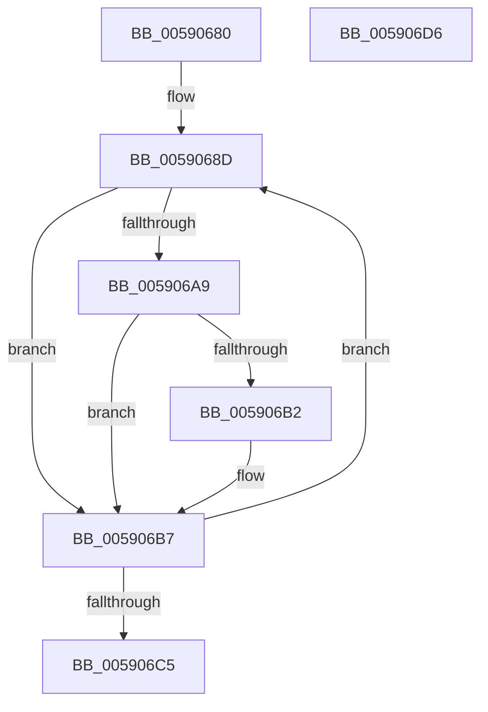

# InbvRotateGuiBootDisplay

- RVA: `0x00590680`–`0x005906D7` (길이 `87` bytes)
- VA: `0x0000000140590680`
- 실행 섹션: `.text`
- PDB 이름 있음: `예`; PDB Function 태그: `아니요`
- unwind 정보 RVA: `0x0005C788`
- 디코드: `23`개 명령, `87/87` bytes 표시
- 미해석 바이트: `0` (있으면 어셈블리에 `.byte`로 보존)

> 이 문서는 커널 이미지의 기계어와 PDB 기호를 분석해 생성했습니다. 4번과 5번은 함수 원형과 자료형을 바이너리 사용 방식에서 추정한 C 해석이며 원본 소스 복구 결과는 아닙니다.

## 1. Dependencies

- 직접 호출 지점: **8**; 고유 호출 대상: **8**
- 직접 호출자로 확인된 함수: **0**
- RIP 상대 이미지 참조: **1**

### Outgoing calls
- `0x00590696` → [KeDelayExecutionThread](../20/KeDelayExecutionThread_function_00209550.md) (function, `0x00209550`)
- `0x0059069B` → [InbvAcquireLock](InbvAcquireLock_function_0059012C.md) (function, `0x0059012C`)
- `0x005906A0` → [InbvGetDisplayState](InbvGetDisplayState_function_0059030C.md) (function, `0x0059030C`)
- `0x005906B2` → [RotBarUpdate](RotBarUpdate_function_005907DC.md) (function, `0x005907DC`)
- `0x005906B7` → [InbvReleaseLock](InbvReleaseLock_function_005903BC.md) (function, `0x005903BC`)
- `0x005906BC` → [InbvCheckDisplayOwnership](InbvCheckDisplayOwnership_function_00590190.md) (function, `0x00590190`)
- `0x005906C5` → [InbvReleaseResources](InbvReleaseResources_function_005903EC.md) (function, `0x005903EC`)
- `0x005906CC` → [PsTerminateSystemThread](../../page/9B/PsTerminateSystemThread_function_009BCE50.md) (function, `0x009BCE50`)

### Direct callers
- 이 함수 시작 RVA로 연결되는 직접 call은 확인되지 않았습니다. 간접 호출은 완전히 역산할 수 없습니다.

### Static image references
- `0x005906A9` → RVA `0x00E65E68` (`.data`; read)

## 2. Other-region calls and transfers

- 다른 실행 섹션으로 향하는 call: **1**
  - `0x005906CC` → [PsTerminateSystemThread](../../page/9B/PsTerminateSystemThread_function_009BCE50.md) (`.text` → `PAGE`)
- 별도 외부 분기/꼬리 이동을 확인하지 못했습니다.

## 3. Assembly (complete function range)

```asm
00590680  48 83 EC 28                     sub rsp, 0x28
00590684  48 C7 44 24 38 00 CB F3 FF      mov qword ptr [rsp + 0x38], 0xfffffffffff3cb00
0059068D  4C 8D 44 24 38                  lea r8, [rsp + 0x38]
00590692  33 D2                           xor edx, edx
00590694  33 C9                           xor ecx, ecx
00590696  E8 B5 8E C7 FF                  call 0x140209550
0059069B  E8 8C FA FF FF                  call 0x14059012c
005906A0  E8 67 FC FF FF                  call 0x14059030c
005906A5  85 C0                           test eax, eax
005906A7  75 0E                           jne 0x1405906b7
005906A9  83 3D B8 57 8D 00 01            cmp dword ptr [rip + 0x8d57b8], 1
005906B0  75 05                           jne 0x1405906b7
005906B2  E8 25 01 00 00                  call 0x1405907dc
005906B7  E8 00 FD FF FF                  call 0x1405903bc
005906BC  E8 CF FA FF FF                  call 0x140590190
005906C1  84 C0                           test al, al
005906C3  75 C8                           jne 0x14059068d
005906C5  E8 22 FD FF FF                  call 0x1405903ec
005906CA  33 C9                           xor ecx, ecx
005906CC  E8 7F C7 42 00                  call 0x1409bce50
005906D1  48 83 C4 28                     add rsp, 0x28
005906D5  C3                              ret
005906D6  CC                              int3
```

## 4. C-style interpretation (structured pseudocode)

```c
__int64 __fastcall InbvRotateGuiBootDisplay(int a1, int a2)
{
    __int64 result;
    __int64 v_rsp;
    unsigned __int64 v_stack_p10;

    v_rsp = (v_rsp) - (40);
    v_stack_p10 = 0xFFFFFFFFFFF3CB00ULL;
loc_0059068D:
    a2 = 0;
    a1 = 0;
    result = KeDelayExecutionThread(a1, a2, v_stack_p10, a4);
    result = InbvAcquireLock(a1, a2, v_stack_p10, a4);
    result = InbvGetDisplayState(a1, a2, v_stack_p10, a4);
    if ((unsigned int)(result) != 0) goto loc_005906B7;
    if ((*(unsigned int *)(v_rip + 9263032)) == 1) {
        result = RotBarUpdate(a1, a2, v_stack_p10, a4);
    }
    result = InbvReleaseLock(a1, a2, v_stack_p10, a4);
    result = InbvCheckDisplayOwnership(a1, a2, v_stack_p10, a4);
    if ((unsigned __int8)(result) != 0) goto loc_0059068D;
    result = InbvReleaseResources(a1, a2, v_stack_p10, a4);
    a1 = 0;
    result = PsTerminateSystemThread(a1, a2, v_stack_p10, a4);
    v_rsp = (v_rsp) + (40);
    return result;
}
```

## 5. (Beta) C Style

```c
int64_t InbvRotateGuiBootDisplay(int32_t Arg1, int32_t Arg2)
{
    int64_t result;
    int64_t local_rsp;
    uint64_t v_stack_p10;

    local_rsp = (local_rsp) - (40);
    v_stack_p10 = 0xFFFFFFFFFFF3CB00ULL;
loc_0059068D:
    Arg2 = 0;
    Arg1 = 0;
    result = KeDelayExecutionThread(Arg1, Arg2, v_stack_p10, a4);
    result = InbvAcquireLock(Arg1, Arg2, v_stack_p10, a4);
    result = InbvGetDisplayState(Arg1, Arg2, v_stack_p10, a4);
    if ((uint32_t)(result) != 0) goto loc_005906B7;
    if ((*(uint32_t *)(v_rip + 0x8D57B8)) == 1) {
        result = RotBarUpdate(Arg1, Arg2, v_stack_p10, a4);
    }
    result = InbvReleaseLock(Arg1, Arg2, v_stack_p10, a4);
    result = InbvCheckDisplayOwnership(Arg1, Arg2, v_stack_p10, a4);
    if ((uint8_t)(result) != 0) goto loc_0059068D;
    result = InbvReleaseResources(Arg1, Arg2, v_stack_p10, a4);
    Arg1 = 0;
    result = PsTerminateSystemThread(Arg1, Arg2, v_stack_p10, a4);
    local_rsp = (local_rsp) + (40);
    return result;
}
```

## 6. Execution-region graph

[열기: 2D/3D 그래프와 함수 탐색 컨트롤 패널](../../../control-panel.html?section=text&rva=0x00590680&view=graph)

- 2D 그래프는 위에서 아래로 흐르고, 3D 그래프는 빈 공간을 드래그해 회전합니다. Shift+드래그는 이동, 휠은 확대·축소, 함수 노드 선택은 대상 보고서 이동입니다.

### Static fallback


