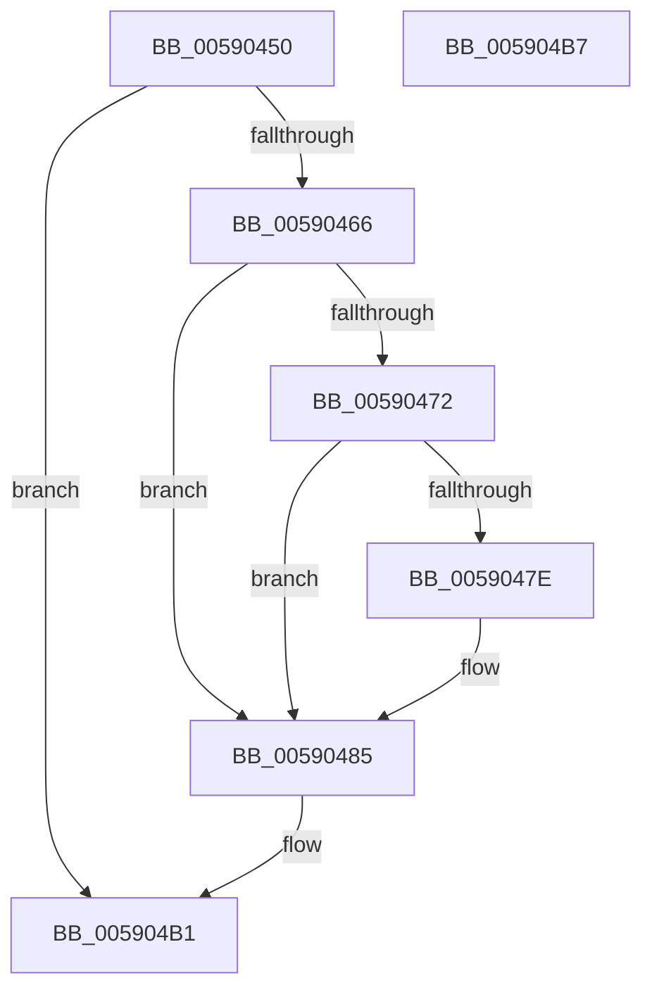

# InbvSetFunction

- RVA: `0x00590450`–`0x005904B8` (길이 `104` bytes)
- VA: `0x0000000140590450`
- 실행 섹션: `.text`
- PDB 이름 있음: `예`; PDB Function 태그: `아니요`
- unwind 정보 RVA: `0x0005CF00`
- 디코드: `29`개 명령, `104/104` bytes 표시
- 미해석 바이트: `0` (있으면 어셈블리에 `.byte`로 보존)

> 이 문서는 커널 이미지의 기계어와 PDB 기호를 분석해 생성했습니다. 4번과 5번은 함수 원형과 자료형을 바이너리 사용 방식에서 추정한 C 해석이며 원본 소스 복구 결과는 아닙니다.

## 1. Dependencies

- 직접 호출 지점: **1**; 고유 호출 대상: **1**
- 직접 호출자로 확인된 함수: **2**
- RIP 상대 이미지 참조: **6**

### Outgoing calls
- `0x00590480` → [guard_dispatch_icall](../6B/guard_dispatch_icall_function_006BAAD0.md) (function, `0x006BAAD0`)

### Direct callers
- [BgkNotifyDisplayOwnershipChange](BgkNotifyDisplayOwnershipChange_function_00590CC0.md) at `0x00590E2C`
- [InbvDriverInitialize](../../init/C2/InbvDriverInitialize_function_00C2A420.md) at `0x00C2A478`

### Static image references
- `0x00590456` → RVA `0x00E65E48` (`.data`; read)
- `0x00590466` → RVA `0x00E65E58` (`.data`; read)
- `0x0059048A` → RVA `0x00E00DD0` (`.data`; read)
- `0x00590491` → RVA `0x00E00D10` (`.data`; read)
- `0x005904A0` → RVA `0x00E65E48` (`.data`; write)
- `0x005904AA` → RVA `0x00E65E58` (`.data`; write)

## 2. Other-region calls and transfers

- 다른 실행 섹션으로 향하는 call: **0**
- 별도 외부 분기/꼬리 이동을 확인하지 못했습니다.

## 3. Assembly (complete function range)

```asm
00590450  40 53                           push rbx
00590452  48 83 EC 20                     sub rsp, 0x20
00590456  8B 05 EC 59 8D 00               mov eax, dword ptr [rip + 0x8d59ec]
0059045C  8B D9                           mov ebx, ecx
0059045E  8D 50 FD                        lea edx, [rax - 3]
00590461  83 FA 01                        cmp edx, 1
00590464  77 4B                           ja 0x1405904b1
00590466  48 8B 05 EB 59 8D 00            mov rax, qword ptr [rip + 0x8d59eb]
0059046D  48 85 C0                        test rax, rax
00590470  74 13                           je 0x140590485
00590472  48 8B 80 88 00 00 00            mov rax, qword ptr [rax + 0x88]
00590479  48 85 C0                        test rax, rax
0059047C  74 07                           je 0x140590485
0059047E  33 C9                           xor ecx, ecx
00590480  E8 4B A6 12 00                  call 0x1406baad0
00590485  8D 43 FC                        lea eax, [rbx - 4]
00590488  F7 D8                           neg eax
0059048A  48 8D 15 3F 09 87 00            lea rdx, [rip + 0x87093f]
00590491  48 8D 0D 78 08 87 00            lea rcx, [rip + 0x870878]
00590498  1B C0                           sbb eax, eax
0059049A  83 C0 04                        add eax, 4
0059049D  83 FB 04                        cmp ebx, 4
005904A0  89 05 A2 59 8D 00               mov dword ptr [rip + 0x8d59a2], eax
005904A6  48 0F 45 CA                     cmovne rcx, rdx
005904AA  48 89 0D A7 59 8D 00            mov qword ptr [rip + 0x8d59a7], rcx
005904B1  48 83 C4 20                     add rsp, 0x20
005904B5  5B                              pop rbx
005904B6  C3                              ret
005904B7  CC                              int3
```

## 4. C-style interpretation (structured pseudocode)

```c
__int64 __fastcall InbvSetFunction(int a1)
{
    __int64 result;
    __int64 v_rsp;

    v_rsp = (v_rsp) - (32);
    if (((unsigned int)((unsigned int)(*(unsigned int *)(v_rip + 9263596)) - 3)) > 1) goto loc_005904B1;
    if (*(unsigned __int64 *)(v_rip + 9263595) == 0) goto loc_00590485;
    result = *(unsigned __int64 *)(*(unsigned __int64 *)(v_rip + 9263595) + 136);
    if (*(unsigned __int64 *)(*(unsigned __int64 *)(v_rip + 9263595) + 136) != 0) {
        a1 = 0;
        result = guard_dispatch_icall(a1, (unsigned int)(*(unsigned int *)(v_rip + 9263596)) - 3, a3, a4);
    }
    result = (unsigned int)(-((unsigned int)(a1) - 4));
    result = (unsigned int)((result) + (4));
    *(unsigned int *)(v_rip + 9263522) = (unsigned int)(result);
    a1 = v_rip + 8849528;
    if (((unsigned int)((unsigned int)(a1))) != 4) { a1 = v_rip + 8849727; }
    *(unsigned __int64 *)(v_rip + 9263527) = a1;
loc_005904B1:
    v_rsp = (v_rsp) + (32);
    return result;
}
```

## 5. (Beta) C Style

```c
int64_t InbvSetFunction(void *Arg1)
{
    uint8_t *arg1 = (uint8_t *)Arg1;

    int64_t result;
    int64_t local_rsp;

    local_rsp = (local_rsp) - (32);
    if (((uint32_t)((uint32_t)(*(uint32_t *)(v_rip + 0x8D59EC)) - 3)) > 1) goto loc_005904B1;
    if (*(uint64_t *)(v_rip + 0x8D59EB) == 0) goto loc_00590485;
    result = *(uint64_t *)(*(uint64_t *)(v_rip + 0x8D59EB) + 0x88);
    if (*(uint64_t *)(*(uint64_t *)(v_rip + 0x8D59EB) + 0x88) != 0) {
        Arg1 = 0;
        result = guard_dispatch_icall(Arg1, (uint32_t)(*(uint32_t *)(v_rip + 0x8D59EC)) - 3, a3, a4);
    }
    result = (uint32_t)(-((uint32_t)(Arg1) - 4));
    result = (uint32_t)((result) + (4));
    *(uint32_t *)(v_rip + 0x8D59A2) = (uint32_t)(result);
    Arg1 = v_rip + 8849528;
    if (((uint32_t)((uint32_t)(Arg1))) != 4) { Arg1 = v_rip + 8849727; }
    *(void **)(v_rip + 0x8D59A7) = Arg1;
loc_005904B1:
    local_rsp = (local_rsp) + (32);
    return result;
}
```

### 관측된 메모리 오프셋

구조체 형식이 확인되지 않은 접근은 인자 기준의 오프셋으로만 기록했습니다.

| 기준 인자 | 오프셋 표현 | 폭 (bit) | 접근 |
|---|---:|---:|---|
| `Arg1` | `- 0x4` | `32` | `R` |

## 6. Execution-region graph

[열기: 2D/3D 그래프와 함수 탐색 컨트롤 패널](../../../control-panel.html?section=text&rva=0x00590450&view=graph)

- 2D 그래프는 위에서 아래로 흐르고, 3D 그래프는 빈 공간을 드래그해 회전합니다. Shift+드래그는 이동, 휠은 확대·축소, 함수 노드 선택은 대상 보고서 이동입니다.

### Static fallback


