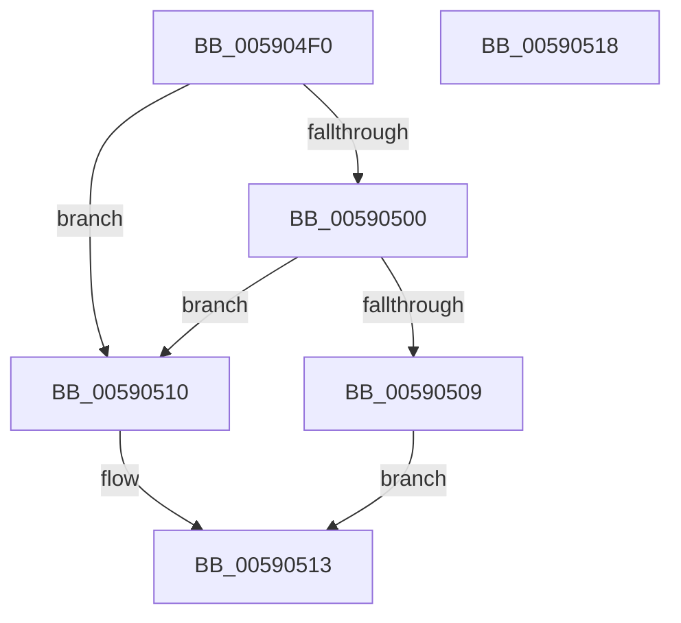

# InbvSetTextColor

- RVA: `0x005904F0`–`0x00590519` (길이 `41` bytes)
- VA: `0x00000001405904F0`
- 실행 섹션: `.text`
- PDB 이름 있음: `예`; PDB Function 태그: `아니요`
- unwind 정보 RVA: `0x0005C788`
- 디코드: `13`개 명령, `41/41` bytes 표시
- 미해석 바이트: `0` (있으면 어셈블리에 `.byte`로 보존)

> 이 문서는 커널 이미지의 기계어와 PDB 기호를 분석해 생성했습니다. 4번과 5번은 함수 원형과 자료형을 바이너리 사용 방식에서 추정한 C 해석이며 원본 소스 복구 결과는 아닙니다.

## 1. Dependencies

- 직접 호출 지점: **1**; 고유 호출 대상: **1**
- 직접 호출자로 확인된 함수: **1**
- RIP 상대 이미지 참조: **1**

### Outgoing calls
- `0x00590509` → [guard_dispatch_icall](../6B/guard_dispatch_icall_function_006BAAD0.md) (function, `0x006BAAD0`)

### Direct callers
- [DisplayBootBitmap](../53/DisplayBootBitmap_function_0053B87C.md) at `0x0053B8BC`

### Static image references
- `0x005904F4` → RVA `0x00E65E58` (`.data`; read)

## 2. Other-region calls and transfers

- 다른 실행 섹션으로 향하는 call: **0**
- 별도 외부 분기/꼬리 이동을 확인하지 못했습니다.

## 3. Assembly (complete function range)

```asm
005904F0  48 83 EC 28                     sub rsp, 0x28
005904F4  48 8B 05 5D 59 8D 00            mov rax, qword ptr [rip + 0x8d595d]
005904FB  48 85 C0                        test rax, rax
005904FE  74 10                           je 0x140590510
00590500  48 8B 40 50                     mov rax, qword ptr [rax + 0x50]
00590504  48 85 C0                        test rax, rax
00590507  74 07                           je 0x140590510
00590509  E8 C2 A5 12 00                  call 0x1406baad0
0059050E  EB 03                           jmp 0x140590513
00590510  83 C8 FF                        or eax, 0xffffffff
00590513  48 83 C4 28                     add rsp, 0x28
00590517  C3                              ret
00590518  CC                              int3
```

## 4. C-style interpretation (structured pseudocode)

```c
__int64 __fastcall InbvSetTextColor(void)
{
    __int64 result;
    __int64 v_rsp;

    v_rsp = (v_rsp) - (40);
    if (*(unsigned __int64 *)(v_rip + 9263453) == 0) goto loc_00590510;
    if (*(unsigned __int64 *)(*(unsigned __int64 *)(v_rip + 9263453) + 80) == 0) goto loc_00590510;
    result = guard_dispatch_icall(a1, a2, a3, a4);
    goto loc_00590513;
loc_00590510:
    result = (unsigned int)((result) | (0xFFFFFFFFULL));
loc_00590513:
    v_rsp = (v_rsp) + (40);
    return result;
}
```

## 5. (Beta) C Style

```c
void InbvSetTextColor(void)
{
    int64_t result;
    int64_t local_rsp;

    local_rsp = (local_rsp) - (40);
    if (*(uint64_t *)(v_rip + 0x8D595D) == 0) goto loc_00590510;
    if (*(uint64_t *)(*(uint64_t *)(v_rip + 0x8D595D) + 0x50) == 0) goto loc_00590510;
    result = guard_dispatch_icall(a1, a2, a3, a4);
    goto loc_00590513;
loc_00590510:
    result = (uint32_t)((result) | (0xFFFFFFFFULL));
loc_00590513:
    local_rsp = (local_rsp) + (40);
    return result;
}
```

## 6. Execution-region graph

[열기: 2D/3D 그래프와 함수 탐색 컨트롤 패널](../../../control-panel.html?section=text&rva=0x005904F0&view=graph)

- 2D 그래프는 위에서 아래로 흐르고, 3D 그래프는 빈 공간을 드래그해 회전합니다. Shift+드래그는 이동, 휠은 확대·축소, 함수 노드 선택은 대상 보고서 이동입니다.

### Static fallback


